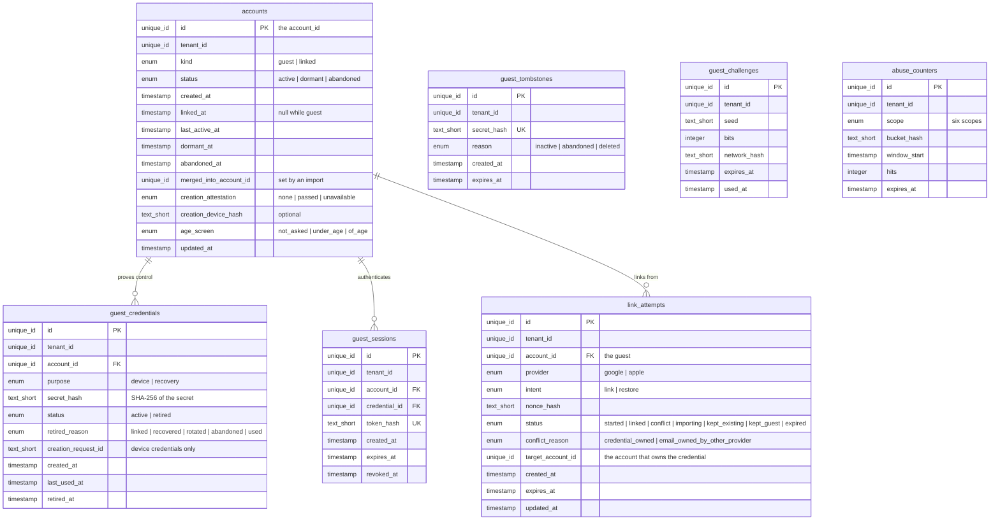
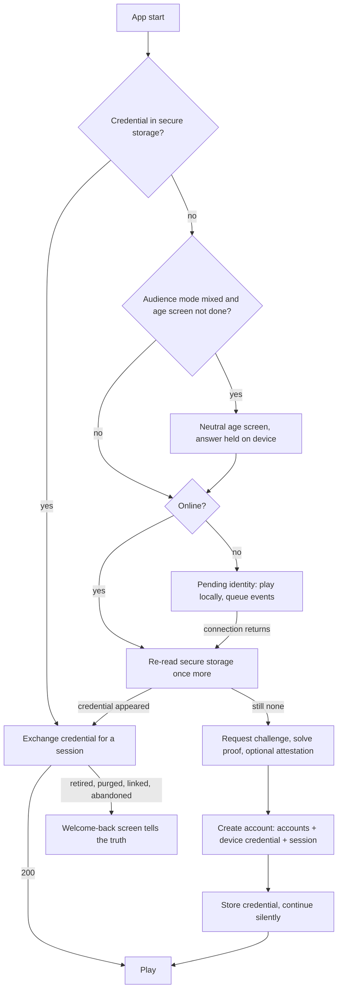
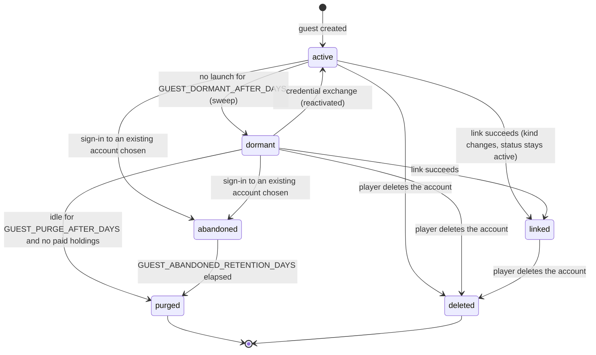
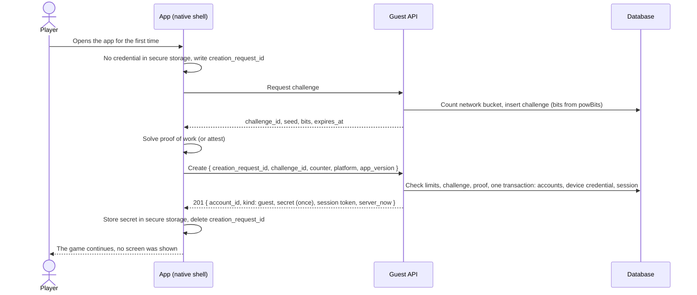
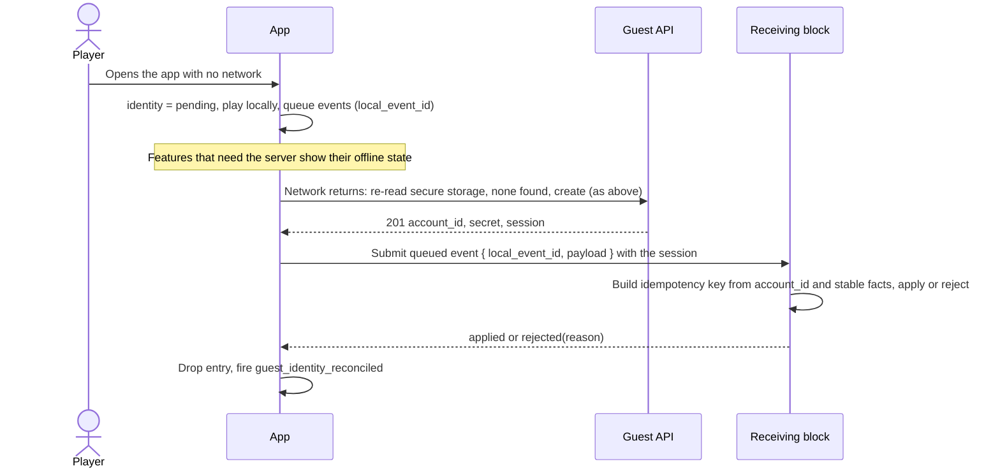
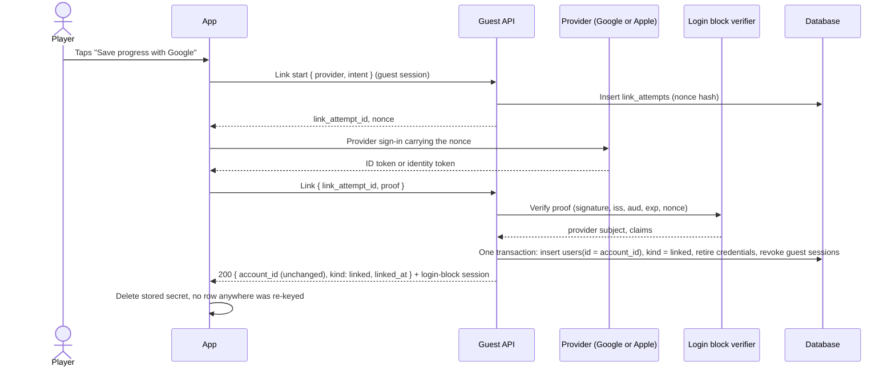
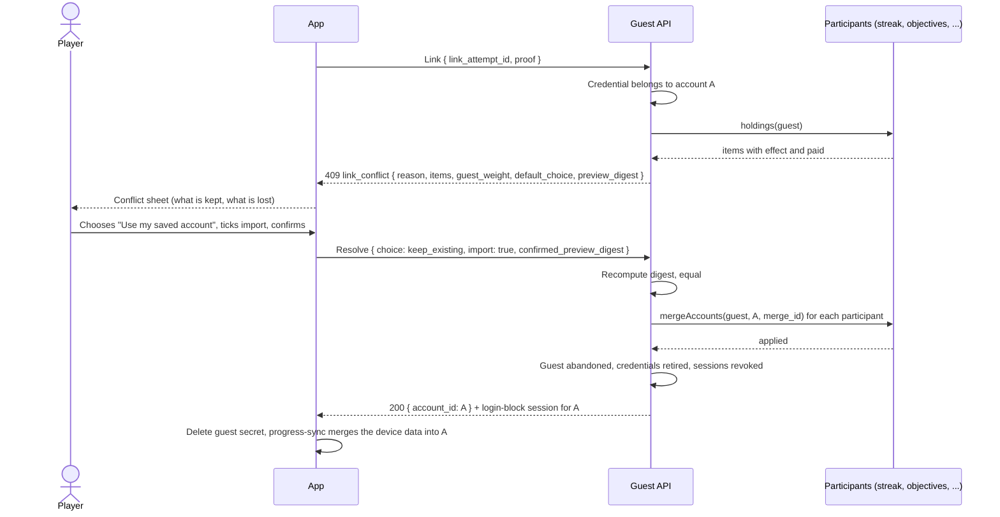
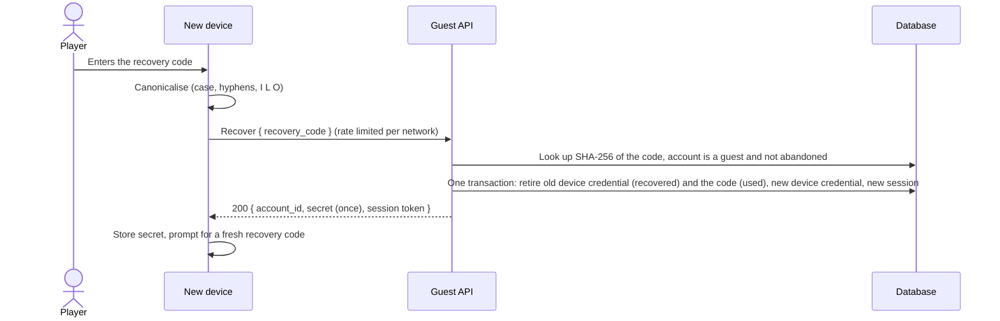

# Guest Account (silent anonymous account, linkable to Google or Apple)

## 1. Overview

### Problem Statement

A mobile game wants the player inside the first session with no sign-up, yet every server-authoritative block of the game (ledger, streak, energy, objectives, season pass, push preferences) keys its rows by one `account_id`. Something has to issue that id before the player has a Google or Apple identity. This block is that something: a **server-side anonymous account** created silently on first launch, identified on the device by a stored secret, that later gains a Google or Apple credential **on the same `account_id`** so nothing is re-keyed or migrated.

Three facts shape the design:

- **Apple and Google both allow, and Apple nudges toward, login-free play.** App Review Guideline 5.1.1(v): "If your app doesn't include significant account-based features, let people use it without a login" ([Apple guidelines](https://developer.apple.com/app-store/review/guidelines/), HIGH, read 2026-10-27). Guest-first is also the kit position (`kits/game-engagement/guides/11-feature-specs.md`, feature 25).
- **A guest identity held only in device storage is lost with the device.** The block says so in the product (frontend screens), gives the player three ways to avoid the loss (link before it, store a recovery code, platform backup where it exists), and tells a returning guest the truth when an account is gone.
- **Anonymous accounts attract farming.** A free account factory feeds bonus abuse (daily rewards, referral, event rewards), so creation carries rate limits, a cheap proof step and optional device attestation, with logs that hold no personal data.

What the block specifies: guest issuance, the device credential and its verification, device binding choices and their trade-offs, abuse controls, a lifecycle (active, dormant, purged), reinstall and device-loss behaviour with recovery options, **linking** to a Google or Apple credential on the same account (the preferred path) and the **conflict case** where that credential already belongs to another account, sign-out and switching on a shared device, deletion of guests and linked accounts, privacy and audience rules, the account contract other blocks rely on, and every screen.

What it does not specify: the Google and Apple sign-in flows (`auth.google-login`, `auth.sign-in-with-apple` verify the provider token and own the `users` row), the cloud snapshot merge (`data.progress-sync`), and balances and entitlements (`billing.virtual-currency`, `billing.subscriptions`, `billing.in-app-purchase`).

### User Stories

- **New player**: I open the game and play. No form, no sign-in, no permission prompt before my first win.
- **Player after a win**: I am offered, once and without blocking, a way to save my progress with Google or Apple. Saying "Not now" costs nothing.
- **Player who links**: I tap Google, confirm, and everything I had is still mine. Nothing is copied or moved.
- **Returning player on a new phone**: I tap "I already have an account", sign in, and land in my old account. The empty guest account the new phone created is dropped without a scary dialog.
- **Player who played for weeks as a guest and links a Google account that already has a game**: I am told, in plain words, what each choice keeps and what it removes, and nothing is removed until I confirm.
- **Player who bought something as a guest**: my purchase is still mine after linking; if a choice would leave it behind, the screen says so before I confirm.
- **Player who lost the phone**: with a recovery code or a linked account I get my account back; without either, the game says plainly that a guest account lives on the device.
- **Player who comes back after a long break**: the game tells me whether my guest account is still here, and if it is gone, says so.
- **Player on a shared device**: signing out of one account never shows or merges another person's progress.
- **Player who deletes the account**: a guest can delete too, from inside the app.
- **Game owner**: I see how many guests are created, how many link, and how many are lost, and I can cap abuse without storing personal data.
- **Developer**: every block asks one thing of me, `account_id`, and my block never has to know whether the player is a guest.

### When to use this block

- The game starts without sign-in and has any server-held per-player state (currency, streak, energy, objectives, season pass, purchases).
- Players should be able to save progress later with Google or Apple without losing what they did as a guest.
- User says: "guest account", "anonymous login", "play without signing in", "link account", "save progress", "guest to account", "device login".

### When NOT to use

- The game has no server-held per-player state. A local-only game needs `data.progress-sync` and nothing here.
- Sign-in is mandatory before play (an app with significant account-based features may require it; Apple 5.1.1(v) and the guest-first position of the kit are the reasons to avoid it for a casual game).
- The project already runs managed auth with anonymous sign-in and account linking (for example Firebase Authentication, whose anonymous accounts can be linked to a credential and can be cleaned up automatically after 30 days: [Firebase docs](https://firebase.google.com/docs/auth/web/anonymous-auth), HIGH). That service owns issuance, storage and linking; adopt only the account contract (section 6), the conflict rules (section 3.7), the recovery rules and `frontend.md`.
- Document NoSQL stores as the primary database: explicit non-goal of this block family (`docs/SPEC_GUIDELINES.md` section 4).

### Related blocks (referenced by id only)

| Block | Relation |
|---|---|
| `auth.google-login` | Credential a guest links to. Verifies the Google ID token and owns the `users` row; this block calls its verifier and creates the `users` row with `id = account_id`. |
| `auth.sign-in-with-apple` | Second credential. Same rules; Apple's relay email and one-time name delivery are its concern. |
| `data.progress-sync` | Owns the snapshot merge and the device owner marker. A guest never syncs a snapshot (INV-19); the snapshot and the marker start after a link, and the conflict import follows its merge rules (section 3.7). |
| `compliance.account-deletion` | Deletes linked accounts; this block adds the guest proof and the erasers (section 3.9). |
| `billing.virtual-currency`, `billing.subscriptions`, `billing.in-app-purchase` | Hold balances, entitlements and purchase records keyed by `account_id`; they register holdings and merge participants (section 3.7). |
| `engagement.daily-streak`, `engagement.energy-lives`, `engagement.season-pass`, `engagement.event-calendar`, `engagement.objectives` | Key their rows by `account_id`; each already names a guest-to-account merge step that this block calls (section 3.7). |
| `messaging.push-reengagement` | Reads `guest_dormant` to stop scheduling for a dormant guest. |
| `ugc.friends-leaderboard` | Keys `account_id` and `tenant_id`; its foreign key must point at `accounts.id` (section 2, "Identity precondition"). |

### Identity precondition

`account_id` is `accounts.id`. For a guest there is no provider identity, so the login blocks' `users` row does not exist yet. **At link time this block inserts the `users` row with `id = accounts.id`**, filled from the verified provider claims. The login blocks keep their model unchanged (`users.id` is an app-assigned `unique_id`: `auth.google-login` README section 2), and the guest's rows in every other block stay valid because the key never changes.

Consequences the adopter handles:

- A table that declares a foreign key from `account_id` to `users.id` (as `ugc.friends-leaderboard` does for `board_profiles`) points that key at `accounts.id`, or guests cannot hold rows there. *Extrapolated: reconcile when both blocks are installed.*
- `compliance.account-deletion` destroys the `users` row and then the `accounts` row (section 3.9).
- `data.progress-sync` stores `account_id` as `external_id`; the same value, as text.
- A project with its own users table maps `account_id` to that table's id and keeps the other columns of this block unchanged. It never creates a second user table for the same people.

---

## 2. Data Model

> Types below are **logical types** (canonical mapping in `docs/SPEC_GUIDELINES.md` section 5). Reference SQL for Postgres is in [Reference Migration](#reference-migration-postgres). Every table carries `tenant_id` (tenant convention of `ugc.friends-leaderboard`: `unique_id`, single-app deployments use one constant value). Every timestamp is a server instant.



### Table: `accounts`

The root every other block keys on. One row per account for its whole life.

| Column | Logical Type | Constraints | Notes |
|--------|------|-------------|-------|
| `id` | `unique_id` | PK | The `account_id`. Generated by the server from a CSPRNG, at least 128 bits, immutable, never accepted from a request, never reassigned after deletion. |
| `tenant_id` | `unique_id` | NOT NULL, indexed | Tenant isolation. Single-app deployments use one constant value. |
| `kind` | `enum` | NOT NULL, default `guest` | values: `guest|linked`. Changes only from `guest` to `linked`, once. |
| `status` | `enum` | NOT NULL, default `active` | values: `active|dormant|abandoned`. `linked` accounts are always `active`. |
| `created_at` | `timestamp` | NOT NULL, default = now | UTC instant |
| `linked_at` | `timestamp` | nullable | Set in the same transaction that sets `kind = linked`; null while `guest`. |
| `last_active_at` | `timestamp` | NOT NULL, default = now | Updated by a credential exchange (a launch), at most once per `GUEST_ACTIVITY_TOUCH_MINUTES`. The only activity signal of the lifecycle. |
| `dormant_at` | `timestamp` | nullable | Set by the sweep (section 3.5); cleared on reactivation. |
| `abandoned_at` | `timestamp` | nullable | Set when a conflict resolution left this guest behind (section 3.7). |
| `merged_into_account_id` | `unique_id` | nullable | The account an import carried this guest into. No foreign key: the target may be deleted first. |
| `creation_attestation` | `enum` | NOT NULL, default `none` | values: `none|passed|unavailable`. Whether the creation request carried a verified platform attestation. |
| `creation_device_hash` | `text_short` | nullable | Keyed hash of the device signal (section 3.3). Present only when attestation supplied one. Deleted with the row. |
| `age_screen` | `enum` | NOT NULL, default `not_asked` | values: `not_asked|under_age|of_age`. Outcome of the neutral age screen in `mixed` audience mode (section 3.10). Adopters derive their `is_minor` flag from `under_age`. |
| `updated_at` | `timestamp` | NOT NULL, default = now | UTC instant; updated on every row mutation |

**Indexes**: PK `id`; `(tenant_id, kind, status, last_active_at)` for the lifecycle sweep; `(tenant_id, creation_device_hash)` where not null for the device cap.
**Checks**: `kind = 'linked'` requires `linked_at IS NOT NULL` and `status = 'active'`; `kind = 'guest'` requires `linked_at IS NULL`.
**Account deletion**: every child table cascades from `accounts.id`; `compliance.account-deletion` deletes the `accounts` row last (section 3.9).

### Table: `guest_credentials`

A credential is a secret whose possession proves control of a guest account. Two purposes: `device` (generated by the server at creation, stored by the app in secure storage, never shown) and `recovery` (a code the player writes down, section 3.6). The secret itself is never stored.

| Column | Logical Type | Constraints | Notes |
|--------|------|-------------|-------|
| `id` | `unique_id` | PK | |
| `tenant_id` | `unique_id` | NOT NULL | |
| `account_id` | `unique_id` | NOT NULL, FK → `accounts.id` ON DELETE CASCADE | |
| `purpose` | `enum` | NOT NULL | values: `device|recovery` |
| `secret_hash` | `text_short` | NOT NULL | Lowercase hex of SHA-256 over the secret. Compare only the hash; the secret has at least 112 bits of entropy (section 3.2). |
| `status` | `enum` | NOT NULL, default `active` | values: `active|retired` |
| `retired_reason` | `enum` | nullable | values: `linked|recovered|rotated|abandoned|used`. Set with `status = retired` and `retired_at`. |
| `creation_request_id` | `text_short` | nullable | Device credentials only. The client-generated id that makes creation idempotent (section 3.1). |
| `created_at` | `timestamp` | NOT NULL, default = now | |
| `last_used_at` | `timestamp` | nullable | Updated with `accounts.last_active_at`. |
| `retired_at` | `timestamp` | nullable | |

**Indexes**: UNIQUE `(tenant_id, secret_hash)`; UNIQUE `(account_id, purpose)` where `status = active` (one active device credential and one active recovery credential per account); UNIQUE `(tenant_id, creation_request_id)` where not null.

### Table: `guest_sessions`

A short-lived opaque session issued by a successful credential exchange. After a link the login blocks' `sessions` table carries the account; guest sessions exist only while `kind = guest`.

| Column | Logical Type | Constraints | Notes |
|--------|------|-------------|-------|
| `id` | `unique_id` | PK | |
| `tenant_id` | `unique_id` | NOT NULL | |
| `account_id` | `unique_id` | NOT NULL, FK → `accounts.id` ON DELETE CASCADE | |
| `credential_id` | `unique_id` | NOT NULL, FK → `guest_credentials.id` ON DELETE CASCADE | The credential that opened this session. |
| `token_hash` | `text_short` | NOT NULL, UNIQUE | SHA-256 hex of a 256-bit random token; the token is never stored ([OWASP Session Management Cheat Sheet](https://cheatsheetseries.owasp.org/cheatsheets/Session_Management_Cheat_Sheet.html): session identifiers need at least 64 bits of entropy, and a one-way verifier is advised when read-only disclosure of the store is a threat, HIGH). |
| `created_at` | `timestamp` | NOT NULL, default = now | |
| `expires_at` | `timestamp` | NOT NULL | `created_at` plus `GUEST_SESSION_TTL_HOURS`. |
| `revoked_at` | `timestamp` | nullable | Set at link, recovery, abandonment, deletion. |

**Indexes**: `token_hash` (UNIQUE), `account_id`.

### Table: `link_attempts`

One row per attempt to attach a Google or Apple credential. It carries the single-use nonce, the conflict state, and the resumable import.

| Column | Logical Type | Constraints | Notes |
|--------|------|-------------|-------|
| `id` | `unique_id` | PK | The `link_attempt_id` the client holds. |
| `tenant_id` | `unique_id` | NOT NULL | |
| `account_id` | `unique_id` | NOT NULL, FK → `accounts.id` ON DELETE CASCADE | The guest that started the attempt. |
| `provider` | `enum` | NOT NULL | values: `google|apple` |
| `intent` | `enum` | NOT NULL | values: `link|restore`. `restore` is the "I already have an account" entry; the rules are identical, only the copy differs. |
| `nonce_hash` | `text_short` | NOT NULL | SHA-256 hex of the single-use nonce the provider proof must carry. |
| `status` | `enum` | NOT NULL, default `started` | values: `started|linked|conflict|importing|kept_existing|kept_guest|expired` |
| `conflict_reason` | `enum` | nullable | values: `credential_owned|email_owned_by_other_provider` |
| `target_account_id` | `unique_id` | nullable | Set with `status = conflict` when the credential belongs to another account. No foreign key. |
| `created_at` | `timestamp` | NOT NULL, default = now | |
| `expires_at` | `timestamp` | NOT NULL | `LINK_NONCE_TTL_SECONDS` after creation; extended to `LINK_CONFLICT_TTL_SECONDS` when a conflict is recorded. |
| `updated_at` | `timestamp` | NOT NULL, default = now | |

**Indexes**: `(account_id, created_at)` for the per-account start limit; `(target_account_id, updated_at)` where not null for the per-target import limit.

### Table: `guest_tombstones`

A tombstone lets the server tell a returning device why its credential does not work. It holds a hash of a random secret and nothing about a person: no `account_id`, no network, no device hash.

| Column | Logical Type | Constraints | Notes |
|--------|------|-------------|-------|
| `id` | `unique_id` | PK | |
| `tenant_id` | `unique_id` | NOT NULL | |
| `secret_hash` | `text_short` | NOT NULL | Hash of a device credential of a purged, abandoned or deleted account. |
| `reason` | `enum` | NOT NULL | values: `inactive|abandoned|deleted` |
| `created_at` | `timestamp` | NOT NULL, default = now | |
| `expires_at` | `timestamp` | NOT NULL | `created_at` plus `GUEST_TOMBSTONE_RETENTION_DAYS`. A swept row is gone for good. |

**Indexes**: UNIQUE `(tenant_id, secret_hash)`; `expires_at` for the sweep.

### Short-lived stores

Both tables below hold rows that expire within a day. A SQL table with an `expires_at` sweep works on all three stacks; no cache service is required.

#### `guest_challenges`

The proof-of-work challenge of section 3.3. Single use.

| Column | Logical Type | Constraints | Notes |
|--------|------|-------------|-------|
| `id` | `unique_id` | PK | The `challenge_id` the client returns. |
| `tenant_id` | `unique_id` | NOT NULL | |
| `seed` | `text_short` | NOT NULL | 32 random bytes, base64url. |
| `bits` | `integer` | NOT NULL | Required leading zero bits, computed when the challenge is issued. |
| `network_hash` | `text_short` | NOT NULL | Keyed hash of the requester's network bucket. A challenge is only valid for the bucket that asked for it. |
| `expires_at` | `timestamp` | NOT NULL | `GUEST_POW_CHALLENGE_TTL_SECONDS` after issue. |
| `used_at` | `timestamp` | nullable | Set when a creation consumes it. |

#### `abuse_counters`

Fixed-window counters for rate limits (section 3.3). A key is a keyed hash; no raw address or device id is stored.

| Column | Logical Type | Constraints | Notes |
|--------|------|-------------|-------|
| `id` | `unique_id` | PK | |
| `tenant_id` | `unique_id` | NOT NULL | |
| `scope` | `enum` | NOT NULL | values: `create_network_hour|create_network_day|create_device_day|create_global_minute|credential_fail_network_hour|recovery_network_hour` |
| `bucket_hash` | `text_short` | NOT NULL | HMAC-SHA256 of the bucket under a key that rotates every `ABUSE_KEY_ROTATION_HOURS`; the constant `all` for `create_global_minute`. |
| `window_start` | `timestamp` | NOT NULL | Start of the fixed window, aligned to the scope's length. |
| `hits` | `integer` | NOT NULL, default 0 | Incremented atomically (one statement), compared with the scope's limit. |
| `expires_at` | `timestamp` | NOT NULL | Window end plus `ABUSE_COUNTER_GRACE_MINUTES`. |

**Indexes**: UNIQUE `(tenant_id, scope, bucket_hash, window_start)`; `expires_at`.

### Client storage

| Entry | Where | Content | Notes |
|-------|-------|---------|-------|
| `guest.credential` | secure storage (Keychain on iOS, Keystore-backed or Block Store on Android) via a native plugin | the device secret | Never in web-view storage, logs or exports; a web view's storage is not secure storage. |
| `guest.creation_request_id` | device storage | random id | Written before the creation request is sent; deleted when the credential is stored. |
| `guest.account_hint` | device storage | `{ account_id, kind, linked_at }` | A display cache; the server's answer wins. |
| `guest.prompt_state` | device storage | dismissal count, last dismissal time | Drives the save-your-progress timing (`frontend.md`). |
| `guest.pending_events` | device storage | queue of events recorded before an account existed | Offline first launch (section 3.1). |
| `guest.signed_out` | device storage | boolean | Set by an explicit sign-out; routes the next launch to the welcome screen (section 3.8). |
| `guest.recovery_confirmed_at` | device storage | time the player confirmed storing a recovery code | Display only; the server holds no confirmation. |

### Reference Migration (Postgres)

#### `accounts` table

<!-- REFERENCE: dialect=postgres -->
<!-- ADAPT: MySQL - uuid becomes BINARY(16) with the id generated in app code, timestamptz becomes DATETIME(6), CHECK on MySQL 8.0.16+ only, partial index not supported so index the columns and filter in queries;
       SQLite - uuid becomes TEXT with uuid4 generated in app code, timestamptz becomes TEXT ISO 8601 with Z, partial index supported;
       text CHECK (col IN (...)) stays on SQLite and Postgres, becomes ENUM(...) on MySQL -->
```sql
CREATE TABLE IF NOT EXISTS accounts (
  id                     uuid PRIMARY KEY,
  tenant_id              uuid NOT NULL,
  kind                   text NOT NULL DEFAULT 'guest' CHECK (kind IN ('guest','linked')),
  status                 text NOT NULL DEFAULT 'active' CHECK (status IN ('active','dormant','abandoned')),
  created_at             timestamptz NOT NULL DEFAULT now(),
  linked_at              timestamptz,
  last_active_at         timestamptz NOT NULL DEFAULT now(),
  dormant_at             timestamptz,
  abandoned_at           timestamptz,
  merged_into_account_id uuid,
  creation_attestation   text NOT NULL DEFAULT 'none' CHECK (creation_attestation IN ('none','passed','unavailable')),
  creation_device_hash   text,
  age_screen             text NOT NULL DEFAULT 'not_asked' CHECK (age_screen IN ('not_asked','under_age','of_age')),
  updated_at             timestamptz NOT NULL DEFAULT now(),
  CHECK ((kind = 'linked' AND linked_at IS NOT NULL AND status = 'active')
      OR (kind = 'guest' AND linked_at IS NULL))
);
CREATE INDEX idx_accounts_sweep ON accounts(tenant_id, kind, status, last_active_at);
CREATE INDEX idx_accounts_device ON accounts(tenant_id, creation_device_hash)
  WHERE creation_device_hash IS NOT NULL;
```

#### `guest_credentials` and `guest_sessions` tables

<!-- REFERENCE: dialect=postgres -->
<!-- ADAPT: same dialect mapping as accounts; the two partial UNIQUE indexes (WHERE status = 'active', WHERE creation_request_id IS NOT NULL) need SQLite 3.8+ or Postgres; on MySQL enforce them in the creating transaction or with a generated column that is NULL when the row is retired;
       ON DELETE CASCADE needs PRAGMA foreign_keys = ON on every SQLite connection or the cascade silently does not run -->
```sql
CREATE TABLE IF NOT EXISTS guest_credentials (
  id                  uuid PRIMARY KEY,
  tenant_id           uuid NOT NULL,
  account_id          uuid NOT NULL REFERENCES accounts(id) ON DELETE CASCADE,
  purpose             text NOT NULL CHECK (purpose IN ('device','recovery')),
  secret_hash         text NOT NULL,
  status              text NOT NULL DEFAULT 'active' CHECK (status IN ('active','retired')),
  retired_reason      text CHECK (retired_reason IN ('linked','recovered','rotated','abandoned','used')),
  creation_request_id text,
  created_at          timestamptz NOT NULL DEFAULT now(),
  last_used_at        timestamptz,
  retired_at          timestamptz
);
CREATE UNIQUE INDEX uq_cred_hash ON guest_credentials(tenant_id, secret_hash);
CREATE UNIQUE INDEX uq_cred_active ON guest_credentials(account_id, purpose) WHERE status = 'active';
CREATE UNIQUE INDEX uq_cred_request ON guest_credentials(tenant_id, creation_request_id)
  WHERE creation_request_id IS NOT NULL;

CREATE TABLE IF NOT EXISTS guest_sessions (
  id            uuid PRIMARY KEY,
  tenant_id     uuid NOT NULL,
  account_id    uuid NOT NULL REFERENCES accounts(id) ON DELETE CASCADE,
  credential_id uuid NOT NULL REFERENCES guest_credentials(id) ON DELETE CASCADE,
  token_hash    text NOT NULL UNIQUE,
  created_at    timestamptz NOT NULL DEFAULT now(),
  expires_at    timestamptz NOT NULL,
  revoked_at    timestamptz
);
```

#### `link_attempts`, `guest_tombstones`, `guest_challenges`, `abuse_counters` tables

<!-- REFERENCE: dialect=postgres -->
<!-- ADAPT: same dialect mapping as accounts; integer columns map to BIGINT on MySQL and INTEGER on SQLite; the counter increment must be one atomic statement (INSERT ... ON CONFLICT DO UPDATE on Postgres and SQLite 3.24+, INSERT ... ON DUPLICATE KEY UPDATE on MySQL) -->
```sql
CREATE TABLE IF NOT EXISTS link_attempts (
  id                uuid PRIMARY KEY,
  tenant_id         uuid NOT NULL,
  account_id        uuid NOT NULL REFERENCES accounts(id) ON DELETE CASCADE,
  provider          text NOT NULL CHECK (provider IN ('google','apple')),
  intent            text NOT NULL CHECK (intent IN ('link','restore')),
  nonce_hash        text NOT NULL,
  status            text NOT NULL DEFAULT 'started' CHECK (status IN
                    ('started','linked','conflict','importing','kept_existing','kept_guest','expired')),
  conflict_reason   text CHECK (conflict_reason IN ('credential_owned','email_owned_by_other_provider')),
  target_account_id uuid,
  created_at        timestamptz NOT NULL DEFAULT now(),
  expires_at        timestamptz NOT NULL,
  updated_at        timestamptz NOT NULL DEFAULT now()
);
CREATE INDEX idx_link_account ON link_attempts(account_id, created_at);
CREATE INDEX idx_link_target ON link_attempts(target_account_id, updated_at)
  WHERE target_account_id IS NOT NULL;

CREATE TABLE IF NOT EXISTS guest_tombstones (
  id          uuid PRIMARY KEY,
  tenant_id   uuid NOT NULL,
  secret_hash text NOT NULL,
  reason      text NOT NULL CHECK (reason IN ('inactive','abandoned','deleted')),
  created_at  timestamptz NOT NULL DEFAULT now(),
  expires_at  timestamptz NOT NULL
);
CREATE UNIQUE INDEX uq_tomb_hash ON guest_tombstones(tenant_id, secret_hash);
CREATE INDEX idx_tomb_expiry ON guest_tombstones(expires_at);
```

<!-- REFERENCE: dialect=postgres -->
<!-- ADAPT: same dialect mapping as accounts; the six-value scope CHECK becomes ENUM(...) on MySQL; expiry sweeps for both tables run on expires_at -->
```sql
CREATE TABLE IF NOT EXISTS guest_challenges (
  id           uuid PRIMARY KEY,
  tenant_id    uuid NOT NULL,
  seed         text NOT NULL,
  bits         bigint NOT NULL,
  network_hash text NOT NULL,
  expires_at   timestamptz NOT NULL,
  used_at      timestamptz
);

CREATE TABLE IF NOT EXISTS abuse_counters (
  id           uuid PRIMARY KEY,
  tenant_id    uuid NOT NULL,
  scope        text NOT NULL CHECK (scope IN ('create_network_hour','create_network_day',
               'create_device_day','create_global_minute','credential_fail_network_hour',
               'recovery_network_hour')),
  bucket_hash  text NOT NULL,
  window_start timestamptz NOT NULL,
  hits         bigint NOT NULL DEFAULT 0,
  expires_at   timestamptz NOT NULL
);
CREATE UNIQUE INDEX uq_abuse_window ON abuse_counters(tenant_id, scope, bucket_hash, window_start);
CREATE INDEX idx_abuse_expiry ON abuse_counters(expires_at);
CREATE INDEX idx_chal_expiry ON guest_challenges(expires_at);
```

---

## 3. Data Flow



### 3.1 Issuance on first launch

Creation takes no screen and no prompt in `general` audience mode. The sequence, in the order the server checks it (cheap checks first, so an attacker cannot make the server do expensive work for free):

1. **Client** generates `creation_request_id` (at least 128 bits of randomness), writes it to device storage, then asks for a challenge.
2. **Server** issues a challenge: `challenge_id`, a random `seed`, and `bits` computed by the pure function `powBits` (section 3.3), stored with the requester's network hash.
3. **Client** solves the proof of work (skipped when it holds a platform attestation and `GUEST_POW_SKIP_WHEN_ATTESTED` is true) and, when attestation is on and supported, obtains an attestation bound to `SHA-256(challenge_id + ":" + creation_request_id)`.
4. **Client** calls create with `creation_request_id`, `challenge_id`, the proof counter, the optional attestation, `platform`, `app_version`, and (in `mixed` mode) the age-screen outcome.
5. **Server** checks, in this order: idempotent replay of `creation_request_id`; global and per-network limits; challenge exists, unused, unexpired, same network bucket; proof of work (one hash); attestation (the expensive step, last); per-device limits. Then, in one transaction, it inserts `accounts` (kind `guest`), the device credential (a fresh 256-bit secret, only its hash stored), and a session, and marks the challenge used.
6. **Server** answers with `account_id`, `kind`, the secret (this one time), the session token, `server_now`. **Client** writes the secret to secure storage, deletes `creation_request_id`, caches `guest.account_hint`.

**Idempotent creation.** If the response is lost, the client retries with the same `creation_request_id`. Within `GUEST_CREATE_REPLAY_WINDOW_MINUTES`, while the device credential has never been exchanged, the server returns the same `account_id` with a freshly generated secret that replaces the first (the first is retired with reason `rotated`). A request id whose credential has been exchanged, or whose window has passed, is refused with `409 request_consumed`; the client then runs the normal start (credential present, so exchange). No orphan account is created by a lost response.

**The `account_id` is stable and never reused.** It is a server-generated UUID version 4 (Apple's `appAccountToken` is a UUID: [Apple](https://developer.apple.com/documentation/appstoreserverapi/appaccounttoken), HIGH), written once, never accepted from a client, and never reassigned after deletion or purge. Random generation from a CSPRNG makes a repeat a collision, which the PK rejects.

#### Offline first launch

No network at first launch is normal (airplane mode, a flight, a slow store download followed by a cold start). The game plays; identity is pending.

| Rule | Behaviour |
|------|-----------|
| State | `identity = pending`. The client shows nothing blocking. Features that need the server show their own offline state (`frontend.md`); local-only play and local progress (`data.progress-sync`) continue. |
| No server effect | Nothing is shown as granted. A reward the server would pay is shown as "added when you are online". |
| Queue | Events recorded while pending are stored as `{ local_event_id, type, payload, client_ts }` in `guest.pending_events`, up to `OFFLINE_EVENT_QUEUE_MAX`. Beyond the cap new events are dropped and counted. No `account_id` appears in them because none exists. |
| Retry | Creation is retried with backoff `OFFLINE_CREATE_BACKOFF_SECONDS`, on every foreground and on every connectivity change. A `429` carries `retry_after_seconds`, which the client honours. |
| Re-read first | Before creating, the client reads secure storage again: a platform restore (section 3.6) may have delivered a credential since launch. A found credential is exchanged, never replaced. |
| Reconcile | When the account exists, the client submits the queue in order. The receiving block builds its idempotency key from `account_id` plus the stable parts of the event (for example `tutorial:{account_id}:{step_id}`, the kit's tutorial key) and accepts or rejects by its own rules; a rejected event is dropped and reported, never retried forever. `client_ts` orders the queue only; the device clock decides nothing (time contract). |
| Local data | Guest data has no owner marker and a guest never syncs a snapshot (INV-19), so `data.progress-sync` merges the device data into the account only after a link. The server-side state of a brand-new guest starts empty. |
| Report | After reconciliation the client fires `guest_identity_reconciled` with the queue length, the dropped count and the wait. |

### 3.2 Credential and session verification

- **Device credential**: 32 random bytes from the server CSPRNG, base64url, returned once. 256 bits clears the OWASP floor (identifiers of at least 64 bits; 128 bits or more from a CSPRNG for self-made IDs; 160 bits or more for a stored-hash verifier design) ([OWASP](https://cheatsheetseries.owasp.org/cheatsheets/Session_Management_Cheat_Sheet.html), HIGH).
- **Verification**: the client sends the secret over TLS; the server hashes it with SHA-256 and looks up `(tenant_id, secret_hash)`. Possession is the proof. There is no password and nothing for the player to remember, which is also why a copy of the secret is a copy of the account (section 3.6, platform backup).
- **Session**: a 256-bit random token, stored as a SHA-256 hash, valid `GUEST_SESSION_TTL_HOURS`. The client sends it in an `Authorization` bearer header; a native shell has no guaranteed cookie jar (the open question recorded in `auth.sign-in-with-apple` `frontend.md`, "Native Shell and the Session Cookie").
- **Resolution**: every request resolves to `{ account_id, tenant_id, kind, linked_at }`. A guest session resolves through `guest_sessions`; a linked account resolves through the login blocks' `sessions`. Downstream blocks see one shape (section 6).

Exchange outcomes. The client turns each into the welcome-back or sign-in screen of `frontend.md`:

| Lookup result | HTTP and code | Meaning for the player |
|---|---|---|
| active device credential, account `active` | `200` | Silent start. `last_active_at` is touched. |
| active device credential, account `dormant` | `200` with `reactivated: true`, `dormant_days` | Account is back to `active`; the welcome-back screen explains the idle rule. |
| retired, reason `linked` | `403 account_linked` | The account was linked on this or another device. Sign in with the provider to continue. |
| retired, reason `recovered` | `410 credential_retired` | Recovered on another device with the recovery code; this device is disconnected from the account. |
| retired, reason `rotated` | `410 credential_retired` | A newer secret replaced this one (a creation replay or a replaced recovery code). A client that holds it shows the access-replaced screen (`frontend.md` section 7). |
| retired, reason `abandoned` | `410 account_abandoned` | A sign-in to an existing account replaced this guest. |
| no row, tombstone found | `410 guest_purged` with `reason` | Removed after a long idle time (`inactive`), left behind (`abandoned`) or deleted by the player (`deleted`). |
| no row, no tombstone | `401 credential_invalid` | The server cannot say why. The screen says it could not find the account and gives no reason. |

Failed exchanges count against `credential_fail_network_hour`; past the limit the answer is `429 rate_limited`.

### 3.3 Abuse controls

Layers, cheapest for the server first. Every limit has a named default in section 7; every number there is a **kit default, not a measurement**: no source gives a threshold, and the adopter tunes them from their own creation logs.

| Layer | Control | Fails with |
|---|---|---|
| 1 | Global circuit breaker `create_global_minute`: at the cap the proof-of-work cost rises by `GUEST_POW_LOAD_STEP_BITS`; at twice the cap creation is shed. | `429 rate_limited` |
| 2 | Per-network caps `create_network_hour`, `create_network_day`. The network bucket is the full IPv4 address or the IPv6 /64 prefix. Carrier-grade NAT puts many players behind one address, so the defaults are generous and proof of work is the main throttle, not the cap. | `429 rate_limited` |
| 3 | **Cheap proof step**: a hashcash-style proof of work (below). Cost falls on the client; verification is one hash. | `422 pow_invalid`, `410 challenge_expired` |
| 4 | Platform attestation, per `GUEST_ATTESTATION_MODE` (section 3.4). | `403 attestation_failed`, `403 attestation_required` |
| 5 | Per-device caps `create_device_day` and `GUEST_MAX_LIVE_PER_DEVICE`, only where a device signal exists (attested requests). | `429 device_limit` |
| 6 | Downstream caps in other blocks that treat guests differently (for example the freeze cap of `engagement.daily-streak`). | their own |

**Proof of work** (Hashcash lineage: a sender spends computation, the receiver verifies cheaply; [Hashcash](https://en.wikipedia.org/wiki/Hashcash), MEDIUM as a secondary summary of Adam Back's 2002 paper). Internal contract of this block, so it is concrete:

- Input string: `seed + ":" + creation_request_id + ":" + counter`, with `counter` as a decimal integer without leading zeros, UTF-8.
- Hash: SHA-256. The proof is valid when the digest has at least `bits` leading zero bits.
- Binding: the request id is part of the input, so a solved puzzle serves one creation. The challenge is single use, expires after `GUEST_POW_CHALLENGE_TTL_SECONDS` and is tied to the requester's network hash.
- Difficulty is the pure function `powBits(networkHits, networkHourCap, globalHits, globalCap)`: `GUEST_POW_BASE_BITS`, plus `GUEST_POW_LOAD_STEP_BITS` when the network has used half its hourly cap, plus `GUEST_POW_LOAD_STEP_BITS` when the global minute counter has reached its cap, never above `GUEST_POW_MAX_BITS`. Vectors: `fixtures/abuse-vectors.json`.
- Trade-off: a proof costs battery on an old phone and cannot stop an attacker who owns many machines; it prices bulk creation, it does not identify anyone. The base cost is **not measured on devices**: the adopter times it on the slowest supported phone in the web-tech shell and sets the base so the solve stays unnoticeable.

**What is logged, without personal data.**

| Logged | Not logged |
|---|---|
| Per creation outcome, one line: hour bucket, outcome enum (`created`, `replayed`, `throttled_network`, `throttled_global`, `pow_invalid`, `attestation_failed`, `device_limit`), `attestation` enum, `pow_bits`, `platform`, `app_version` | Raw IP address, the network prefix, device identifiers, attestation key ids or tokens, the secret, `creation_request_id`, user agent strings |
| Counters keyed by a keyed hash (HMAC-SHA256) of the bucket, key rotated every `ABUSE_KEY_ROTATION_HOURS`, rows deleted at `expires_at` | Any join between a bucket hash and an `account_id` |
| `creation_device_hash` on the account, only when an attestation supplied a device signal, deleted with the account | A device signal for an unattested creation |

The raw network address exists in memory for the request. The web server's own access log is outside this block; the adopter sets its retention and treats it as personal data (section 3.10).

### 3.4 Device binding choices

Binding answers "is this request from the same device that was issued the credential, and is that device a genuine one?". The baseline needs no platform service; hardening is optional.

| Option | What the server learns | Survives reinstall | Cost and limits |
|---|---|---|---|
| **Stored secret in secure storage** (baseline) | Possession of the secret. No device property. | Depends on platform backup (section 3.6) | Needs a native secure-storage plugin in a web-tech shell. A copied secret is a copied account. |
| **Apple App Attest** | A hardware-backed key in the Secure Enclave certified by Apple as belonging to a valid instance of the app; attestation once per key, assertions per request. | **No.** "The keys that you generate remain valid through regular app updates, but don't survive app reinstallation, device migration, or restoration of a device from a backup" ([Apple](https://developer.apple.com/documentation/devicecheck/establishing-your-app-s-integrity), HIGH). | Needs `DCAppAttestService` (native plugin). Not every device supports it: "gracefully bypass the service" when the compatibility check fails. The key identifier must be persisted. Do not reuse a key among users. |
| **Google Play Integrity API (standard request)** | Verdicts, not an identity: `appRecognitionVerdict`, `deviceRecognitionVerdict`, `appLicensingVerdict`; optionally the device activity level, and device recall (three developer-defined bits per device that survive reinstall and reset). | Device recall: yes. The verdict pages read for this block list no device identifier among the verdicts. | Default quota "up to 10,000 total requests per day across all installs" ([Android docs](https://developer.android.com/google/play/integrity/overview), HIGH): a launch day can exceed it. Token decrypted on Google's servers by your backend. Device recall is "available in beta and subject to change" and needs an interest form ([Android docs](https://developer.android.com/google/play/integrity/device-recall), HIGH for what the page says). |
| Device-held signing key (the server stores a public key, the client signs a challenge) | A key that never leaves the device | No | Removes the bearer secret from the wire and the database. Needs native key storage a web view cannot reach; not specified further. *Design option, no source, LOW.* |

**What attestation does and does not do.** It raises the cost of faking a client (emulators, repackaged builds, scripts) and, on iOS, gives a per-install signal for a device cap. It does not prove one person owns one device, it does not stop a real device creating accounts after reinstalls, and the verdict is an input to the server's policy rather than a decision ("you can decide what combination of verdicts are acceptable", [Android docs](https://developer.android.com/google/play/integrity/verdicts), HIGH). A user without the platform service (older device, no Play services, simulator) has no attestation, which is why the default mode is `off` and the recommended production mode is `preferred`.

| `GUEST_ATTESTATION_MODE` | Creation without attestation | Creation with a failed attestation |
|---|---|---|
| `off` (default) | allowed; proof of work and network limits apply | not requested |
| `preferred` | allowed, recorded as `unavailable`, counted against the stricter unattested network limit `GUEST_CREATE_PER_NETWORK_PER_HOUR_UNATTESTED` | refused `403 attestation_failed` |
| `required` | refused `403 attestation_required` | refused `403 attestation_failed` |

`required` makes a platform-service outage or an exhausted quota into "new players cannot start". Use it only for a game with a real-money economy and a fallback plan.

**Attestation verification (external contracts, concrete).**

- *iOS attestation*: verify exactly the steps of Apple's "Validating apps that connect to your server" ([Apple](https://developer.apple.com/documentation/devicecheck/validating-apps-that-connect-to-your-server), HIGH): the `x5c` chain to Apple's App Attest root; `nonce` = SHA-256 of `authData` followed by `clientDataHash`, equal to the value in the credential certificate extension with OID `1.2.840.113635.100.8.2`; SHA-256 of the public key equals the key identifier; the RP ID hash equals the SHA-256 of the App ID; `counter` is `0`; `aaguid` is `appattest` followed by seven zero bytes in production or `appattestdevelop`; `credentialId` equals the key identifier. `clientDataHash` is the SHA-256 of the binding value of section 3.1 step 3. Keep development and production keys apart.
- *Android token*: the client makes a **standard** request with `requestHash` = SHA-256 of the binding value (the field allows 500 bytes and must not carry plain-text data). The backend calls `decodeIntegrityToken` on Google's server with a service account ([Android docs](https://developer.android.com/google/play/integrity/standard), HIGH), then checks `requestPackageName`, `requestHash`, a fresh `timestampMillis`, `appRecognitionVerdict = PLAY_RECOGNIZED` and `deviceRecognitionVerdict` containing `MEETS_DEVICE_INTEGRITY` ([verdicts](https://developer.android.com/google/play/integrity/verdicts), HIGH). Reusing a token returns cleared verdicts, which fail the check. The activity level (opt-in) above `GUEST_PLAY_INTEGRITY_MAX_ACTIVITY_LEVEL` answers `429 device_limit`.

### 3.5 Lifecycle: dormant, abandoned, purged



- **Activity** means a credential exchange (a launch). Server-side events such as a push sent do not count.
- **Dormant** is a notice state: nothing is deleted, the credential still works, the first launch reactivates the account. `guest_dormant` lets other blocks stop work for it (schedulers, push, event reminders). The sweep sets `dormant_at` and emits the event once.
- **Purge** deletes the account: the sweep calls each block's `deleteAccount(account_id)` (the eraser contract `engagement.daily-streak` already names, `engagement.daily-streak` README section 6), then deletes the `accounts` row (cascade), then writes a tombstone for each device credential with reason `inactive` or `abandoned`, then emits `guest_purged` (no `account_id`: the account is gone).
- **Paid holdings.** With `GUEST_PURGE_EXEMPT_PAID` true, a dormant guest whose participants report any holding with `paid = true` is never purged by idleness. The row stays dormant until the player returns, deletes, or links. The reason: deleting money the player spent is not a storage-limitation exercise this block can decide; the adopter's privacy page states the retention.
- **Defaults** (`GUEST_DORMANT_AFTER_DAYS` 90, `GUEST_PURGE_AFTER_DAYS` 365) are kit defaults. The only comparison point is Firebase Authentication's optional automatic clean-up of anonymous accounts older than 30 days ([Firebase docs](https://firebase.google.com/docs/auth/web/anonymous-auth), HIGH that the option exists); a game whose returning players come back after months needs longer. No source gives the return-time distribution of lapsed mobile players; that gap is named in `acceptance.md` for the adopter to fill from their own data.
- **Linked accounts** are not dormant here. Inactivity retention for a person who signed in is a privacy-policy decision of the adopter and outside this block.
- **A returning guest is told the truth**: reactivated (with how long it was idle), purged (with the reason when the tombstone knows it), or "not found" (no reason claimed).

### 3.6 Reinstall and device loss

**A guest identity held only in device storage is lost with the device.** Uninstalling the app (where the platform removes the secret), wiping the device, a factory reset, or a lost or broken phone leaves the account on the server and nobody able to reach it. The game says this in plain words (`frontend.md`, save-your-progress prompt) and offers the options below. What survives on its own differs by platform, and the platform facts are mostly documented as behaviours of a feature, not guarantees.

| Option | What it recovers | How | Caveats |
|---|---|---|---|
| **Link before loss** (preferred) | The same `account_id`, from any device | Sign in with Google or Apple (section 3.7) | The player must have done it before the loss. |
| **Recovery code** | The same `account_id` on a new device | Settings shows a 24-character code once (the request re-presents the device secret); the player stores it. Entering it on a new device creates a new device credential for the account, retires the lost device's credential (`recovered`), retires the code (`used`) and revokes sessions; the app then prompts for a fresh code. | The code is a password: whoever holds it holds the account. Shown once; only its hash is stored; one active code per account; attempts are rate limited. |
| **Platform backup** (`GUEST_CREDENTIAL_PLATFORM_BACKUP`, default `off`) | The device credential, restored with the platform's own backup | Android Block Store, iCloud Keychain item | See the caveats table below. |

**Recovery code format.** 24 characters from Crockford's Base32 alphabet `0123456789ABCDEFGHJKMNPQRSTVWXYZ` (the letters I, L, O, U are excluded; on input "`i` and `l` will be treated as `1` and `o` will be treated as `0`", case is ignored and hyphens are ignored: [Crockford](https://www.crockford.com/base32.html), HIGH), shown in six groups of four. Entropy is 24 x 5 = 120 bits, above the 112-bit line at which NIST SP 800-63B allows a plain approved one-way hash for a look-up secret; below it, a salted slow key derivation is required ([NIST SP 800-63B-3 section 5.1.2.2](https://pages.nist.gov/800-63-3/sp800-63b.html), HIGH for the quoted text; that revision is marked superseded by SP 800-63-4, which the page names). The server stores SHA-256 of the canonical 24-character string. NIST also caps consecutive failed attempts on one authenticator at 100; this block is stricter (`RECOVERY_ATTEMPTS_PER_NETWORK_PER_HOUR`). Vectors: `fixtures/abuse-vectors.json`, `recovery`.

**Platform backup caveats.**

| Platform feature | Documented behaviour | Consequence for the guest credential |
|---|---|---|
| iOS Keychain, default item | Items have been observed to survive app deletion. An Apple DTS engineer calls it "an implementation detail of the original iOS keychain" and says the documentation "has never specified" it; the behaviour could change ([Apple forums](https://developer.apple.com/forums/thread/36442), MEDIUM: a staff statement in a forum, not documentation). | Do not rely on it either way: the app works when the credential is present and when it is absent. A credential that survives uninstall is also a privacy fact (section 3.10). |
| iOS Keychain with `kSecAttrSynchronizable` | The item "synchronizes through iCloud" to other devices; "Updating or deleting items using the kSecAttrSynchronizable key affects all copies"; it cannot use an accessibility value ending in `ThisDeviceOnly` ([Apple](https://developer.apple.com/documentation/security/ksecattrsynchronizable), HIGH). | The guest follows the player to their other Apple devices and to a new one. Deleting the account must delete the item (all copies). |
| Android Auto Backup | Includes shared preferences and internal files by default, "up to 25 MB of backup data per app user", restored when the app is installed, including during device setup; the same page advises: "To back up user credentials and authentication tokens, don't store them in shared preferences or a file. Instead use Block Store APIs to store and manage credentials" ([Android docs](https://developer.android.com/identity/data/autobackup), HIGH). | Keep the secret out of Auto Backup targets. |
| Android Block Store | Up to 16 byte arrays of 4 KB; persisted across uninstall and reinstall "if the user enables Backup services"; "end-to-end encrypted when possible", which requires Android 9 or higher and a screen lock; device-to-device restore needs a target on Android 9 or higher; calling `storeBytes` with `shouldBackupToCloud` unset or false removes the cloud copy at the next sync ([Android docs](https://developer.android.com/identity/block-store), HIGH). | Optional. Without a screen lock the cloud copy is not end-to-end encrypted, so `on` is a trade of safety for continuity that the adopter makes. |
| Android Keystore keys across backup | Not confirmed: the Keystore page read for this block does not say whether keys are backed up. | Do not assume a Keystore-wrapped secret follows a restore. |

A credential restored by a platform onto a second device while the first still holds it means **two devices share one account**. The server sees one account and one credential; each device has its own sessions. A link or a recovery retires the credential for both.

**What this block does not recover.** Store purchases are restored by the store, not by this block. A lost guest's purchases stay on the lost `account_id`; whether a billing block lets the same store account re-attach them to a new account is its decision. Apple documents a "Set App Account Token" endpoint that updates the app account token of an existing transaction ([Apple](https://developer.apple.com/documentation/appstoreserverapi/appaccounttoken), HIGH); no claim is made for Google Play.

### 3.7 Linking a guest to Google or Apple

#### Same-account link (the preferred path)

The credential attaches to the **same `account_id`**. No row in any block is re-keyed, copied or merged.

1. The client calls **link start** with `provider` and `intent`, presenting the guest session **and the device secret again** (a stolen session token alone cannot start a link); the server creates a `link_attempts` row and returns `link_attempt_id` and a single-use `nonce` (valid `LINK_NONCE_TTL_SECONDS`). Limit: `LINK_STARTS_PER_ACCOUNT_PER_HOUR`.
2. The client runs the provider flow of the login block with that nonce as the provider nonce (the nonce rule, hashing included, is the login block's: Apple's flow hashes the raw nonce; see `auth.sign-in-with-apple`).
3. The client calls **link** with the guest session, `link_attempt_id` and the provider proof.
4. The server verifies the proof with the **login block's verifier** (`auth.google-login` ID-token checks; `auth.sign-in-with-apple` identity-token checks incl. `nonce`) and requires the nonce claim to match the attempt. The provider verification itself is not repeated here.
5. If the provider identity (`google_id` or `apple_id`) is not on any `users` row and the email rule of the login block does not trigger, then in **one transaction**: insert `users` with `id = account_id` and the verified claims; `accounts.kind = linked`, `linked_at = now`, guarded by `WHERE kind = 'guest'`; retire the device credential and the recovery credential (`linked`); revoke the guest sessions; mark the attempt `linked`.
6. The server creates a login-block session for the account, returns `{ account_id, kind: "linked", linked_at }` and the session, and emits `account_linked`.

Properties: the id the other blocks hold never changes; a second concurrent attempt for the same credential loses on the `users` uniqueness and becomes a conflict; the kind flips once. **After the link the guest credential is retired**: a linked account is protected by the provider, not by a bearer secret at rest on the device. The client deletes its stored secret on success. The account is now signed in, so `data.progress-sync` starts: its first sync merges the device data (no owner marker) into a new snapshot and sets the owner marker to the unchanged `account_id`; nothing on the device is replaced.

**Lost response.** If the link committed and the response was lost, the client's next credential exchange answers `403 account_linked`. The client shows "Your account is linked. Sign in with <provider> to continue", one tap, and the provider sign-in lands on the same `account_id`.

**Login CSRF.** An attacker who tricks a victim into completing the provider flow with the attacker's provider account would attach the victim's progress to the attacker's identity. The nonce is bound to the victim's guest session and attempt, the flow starts only from a button the player pressed, and the proof must arrive with that session; a proof minted for another attempt fails the nonce check.

#### Conflict: the credential already belongs to another account

Two reasons exist: `credential_owned` (a `users` row already holds this provider identity) and `email_owned_by_other_provider` (the login block's email rule fires: an existing user with the same email and a different provider; `auth.sign-in-with-apple` answers `409 account_exists_with_different_provider` for the same situation). The attempt becomes `conflict`, `target_account_id` is set for `credential_owned`, and the server answers `409 link_conflict`. The player has just proven control of the provider account, so revealing that it has an account leaks nothing.

**Holdings and merge participants.** Every block that holds server-side per-account state registers one participant with two operations:

| Operation | Contract |
|---|---|
| `holdings(account_id)` | Returns a list of `{ category, label_key, paid, effect }` for what the account holds; empty when it holds nothing. `category`: `progress`, `currency`, `items`, `purchases`. `paid`: true for anything bought with money. `effect` is the block's static merge rule for that holding when this account is the guest: `carried` (moves into the target by the block's rule), `kept_target` (the target's value wins, the guest's is discarded), `left_behind` (stays on the abandoned account and is lost). |
| `mergeAccounts(from_account_id, into_account_id, merge_id)` | One-way, idempotent by `merge_id`; a repeat returns the first result; a second merge of the same guest into another account fails `already_merged`. This is the "host linking step" `engagement.daily-streak` and `engagement.objectives` already describe. |

The ledger and entitlement blocks decide whether they list their holdings as `carried`. This block never moves a balance or an entitlement itself, and a participant that has not registered counts as holding nothing: the acceptance checklist makes registration a release gate.

**Weight.** `guestWeight(holdings)` is pure: `paid` when any holding has `paid = true`; otherwise `played` when any holding exists; otherwise `pristine`.

| Weight | What the player sees | Default | What "keep existing" removes | Confirmation |
|---|---|---|---|---|
| `pristine` | No sheet. The sign-in completes into the existing account with a short notice that the new guest account had no progress. | keep existing | nothing the player did | none (`LINK_CONFLICT_CONFIRM_PRISTINE` false) |
| `played` | Conflict sheet with both choices. | `LINK_CONFLICT_DEFAULT_PLAYED` = keep existing, import ticked | every holding with effect `left_behind` or `kept_target` that differs | a confirm step lists them; the button names the loss |
| `paid` | Conflict sheet, no preselected choice. | `LINK_CONFLICT_DEFAULT_PAID` = none | as above, including paid holdings | each paid holding with effect other than `carried` is acknowledged separately, then the confirm step |

**The two choices.**

- **Keep the existing account** (and import the guest's progress, a one-way import). The client signs in as the existing account. The server runs `mergeAccounts(guest, existing, merge_id)` for every participant, in registration order, only after the confirmation. The guest becomes `abandoned` (credentials retired, sessions revoked, `merged_into_account_id` set when the import ran) and is purged after `GUEST_ABANDONED_RETENTION_DAYS`. **Destroyed**: every guest holding with effect `left_behind`, and the guest's value wherever the target's wins. **Kept**: the existing account in full. **Not undoable in the app.** The player may also choose to keep the existing account without importing: then no participant runs and the guest's holdings are all lost.
- **Keep the guest account and refuse the link.** Nothing changes: the guest stays a guest, the provider credential stays with its owner, the attempt closes `kept_guest`. **Destroyed**: nothing. The cost is that the guest stays unprotected and the player cannot use that provider account here.

**Default and why.** The default is the existing account, because the player just proved control of it, it is the one they chose to sign in to, and an import carries the guest's non-monetary progress forward. It is the least-surprising answer for the most common case (a new phone that made a fresh guest). It is not the default for `paid`: money is on the line and a wrong default is the costliest mistake, so the player must choose.

**Explicit confirmation.** The confirm request carries `confirmed_preview_digest`: SHA-256 of the canonical list of holdings the player was shown. The server recomputes it; a mismatch answers `409 preview_changed` and the client shows the new list. A confirmation is therefore for exactly what was displayed.

**Bounded.** At most `LINK_IMPORTS_PER_TARGET_PER_DAY` guests can be imported into one existing account per day, so farmed guests cannot be funnelled into a main account; the next resolve answers `429 rate_limited` and the player may still choose to keep the guest.

**Resumable.** The import is a sequence of idempotent steps. A failure leaves the attempt `importing` and answers `503 import_incomplete`; the same request again resumes (participants already done return their first result). The guest is abandoned only after every participant has finished.

**`data.progress-sync` on the client.** A guest never syncs a snapshot (INV-19), so the device data has no owner marker for the whole guest life and the owner marker is set only by that block's first sync after a link. Signing in to the existing account therefore **merges** the device data into that account's snapshot under the merge rules of that block (`data.progress-sync` README INV-12, "guest data merges"; `account-switch.feature`, "Guest data (no owner) joins the first account that signs in"); nothing is replaced. Declining the import means the client first saves the device data aside with the previous-data backup of that block and resets the local record, so no owner-less data remains to merge, and then signs in. The guest's server-side state moves only through `mergeAccounts`, never through the snapshot. *Extrapolated: `data.progress-sync` offers a save-aside-and-reset outside its account-switch path; reconcile when both blocks are installed.*

**Email conflict.** For `email_owned_by_other_provider` there is no import: the player cannot act on an account they have not authenticated to. The sheet offers "Sign in with <the other provider>", which starts a new attempt that becomes a `credential_owned` conflict, or "Stay a guest".

#### Purchases and subscriptions follow the `account_id`

- **Same-account link**: entitlement and ledger rows are keyed by `account_id`, which does not change, so they follow with no code. Purchases made as a guest need nothing.
- **Why the store side agrees.** A store purchase belongs to the store account, not to the game account. The game maps `store_transaction_id` to `account_id` in the billing block's purchase record, and passes `account_id` to the store at purchase time: as `appAccountToken` on Apple ("the UUID that you generate to associate a customer's In-App Purchase with its resulting App Store transaction", returned in the transaction information) and as `obfuscatedAccountId` on Google Play (limited to 64 characters, must not contain personal data, "Google Play can use this value to detect irregular activity"; [Android docs](https://developer.android.com/reference/com/android/billingclient/api/BillingFlowParams.Builder), HIGH). Because the id never changes at a link, the tokens in past transactions stay correct. `account_id` is a random UUID, not personal data in the sense of that warning.
- **Conflict with paid holdings.** The purchase stays tied to the store account, and its entitlement stays with the guest account unless a billing participant lists it as `carried`. The sheet says so. A subscription keeps billing through the store until the player cancels it there; the sheet names the store's subscription settings as the place to manage it.

### 3.8 Sign-out and switching accounts

| Situation | Behaviour |
|---|---|
| Sign out of a **linked** account | The device's session is revoked and the cached account hint cleared. The account and other devices are untouched. The device stores `guest.signed_out = true`. |
| Next launch after an explicit sign-out | A welcome screen with "Sign in" and "Play as guest". A guest is created on that tap, never silently, so sign-outs do not multiply orphan accounts. |
| A **guest** wants to leave | A guest has no "sign out". Settings offers "Switch account". The sheet warns that the guest lives on this device, and offers link first, store a recovery code first, or switch anyway. Switching removes the device credential from the device (the server account stays until it is purged) and shows the welcome screen. There is no parked guest to switch back to. |
| A different person signs in on a device that holds someone's data | `data.progress-sync` INV-12: the device data is replaced after the old data is saved aside; the previous person's progress is not merged and not shown. |
| Signing in to an existing account from the welcome screen (no guest present) | The login block's normal sign-in. No link attempt and no conflict: there is no guest to weigh. |

### 3.9 Deletion

- **Rule.** Apple: "Apps submitted to the App Store that support account creation must also let people initiate deletion of their account within the app", the option must "delete the entire account record, along with associated personal data" (deactivation is insufficient), and: "People should have the option to delete automatically generated accounts (sometimes called "guest" accounts) and the data associated with those accounts" ([Apple](https://developer.apple.com/support/offering-account-deletion-in-your-app/), HIGH). Google Play's page applies to apps that "allow users to create an account from within the app" with an in-app path and a working web link; it does not name guest accounts ([Google Play](https://support.google.com/googleplay/android-developer/answer/13327111), HIGH for what it says). **Design choice (MEDIUM): guests are in scope on both stores.**
- **Dormant and abandoned are retention states, not deletion.** Deletion removes the rows.
- **Guest deletion.** The proof is the device credential presented again, together with the single-use deletion challenge of `compliance.account-deletion` (the guest counterpart of that block's provider proof; that block's endpoint accepts `google` and `apple` today, so a `guest` proof type is an addition to reconcile). The erasers of every block run, then the `accounts` row is deleted (cascade removes credentials, sessions, attempts), then a tombstone with reason `deleted` is written for each device credential hash.
- **Linked deletion.** `compliance.account-deletion` runs with the provider proof; its identity step deletes the `users` row and then the `accounts` row; Apple token revocation stays in `auth.sign-in-with-apple`.
- **Device cleanup.** After deletion the client removes the secure-storage entry, the Block Store entry (`shouldBackupToCloud` false deletes the cloud copy) and the synchronizable Keychain item (deletion affects all copies).
- **Web link for guests.** A guest has no provider credential, so the web deletion page accepts the recovery code as the proof. A guest with no code uses the in-app path. Whether Google accepts this for a guest is not settled by its page.
- **Data kept for law** (purchase records) follows the decision table of `compliance.account-deletion` and is disclosed there.

### 3.10 Privacy and audience

**Is a guest identifier personal data?** In the EU GDPR, "an identifiable natural person is one who can be identified, directly or indirectly, in particular by reference to an identifier such as a name, an identification number, location data, an online identifier" ([GDPR Art. 4(1)](https://gdpr-info.eu/art-4-gdpr/), HIGH for the text), and Recital 30 says natural persons "may be associated with online identifiers provided by their devices, applications, tools and protocols", with IP addresses and cookie identifiers as examples ([Recital 30](https://gdpr-info.eu/recitals/no-30/), HIGH for the quoted part). A random account id that recognises the same player over time is such an identifier (MEDIUM: application of the definition, not a ruling). In US children's privacy law, "a persistent identifier that can be used to recognize a user over time and across different websites or online services" is personal information ([16 CFR 312.2](https://www.law.cornell.edu/cfr/text/16/312.2), HIGH). Treat the `account_id`, the credential, the network address and the device hash as personal data wherever those regimes apply.

What that implies, each item mapped to a rule of the block:

| Implication | Rule |
|---|---|
| Collect little | No advertising identifier is read or used as identity: reading it brings Apple's tracking permission ("You must receive explicit permission from users via the App Tracking Transparency APIs to track their activity", [Apple 5.1.2(i)](https://developer.apple.com/app-store/review/guidelines/), HIGH), and Google's Families policy bars sending the advertising ID of children or users of unknown age ([Google Play Families](https://support.google.com/googleplay/android-developer/answer/9893335), HIGH). The account id is random and derived from nothing. |
| Keep it only as long as needed | Dormancy and purge (section 3.5); counters and challenges expire within a day; tombstones expire. GDPR storage limitation, Art. 5(1)(e): named from knowledge, not re-read for this block (MEDIUM). |
| Let the person erase it | Section 3.9. |
| Say what is collected | A privacy-policy link inside the app is a kit-level rule (`kits/game-engagement/guides/11-feature-specs.md`, item 18). Whether a notice at collection is also required before a silent creation is a legal question for the adopter; `GUEST_FIRST_RUN_NOTICE` (default off) shows a non-blocking notice where counsel requires it. |
| Uninstall is not erasure | A credential that survives uninstall (section 3.6) means deleting the app does not delete the account; the privacy page says deletion happens in Settings. |

**Audience modes** (`AUDIENCE_MODE`). This is not legal advice and not a children's-privacy programme; a game that targets children needs more than this block.

| Mode | Behaviour | Source |
|---|---|---|
| `general` (default) | Silent creation at first launch, no age screen. | |
| `mixed` | A neutral age screen runs before any identifier is requested, and its answer stays on the device until an account is created. A player at or above `AGE_THRESHOLD_YEARS` proceeds as in `general`. A player below it gets no server account (`AUDIENCE_UNDER_AGE_ACCOUNT` = `none`: local-only play, identity stays pending) unless the adopter sets `guest_internal_ops` after legal review; then the account is created with `age_screen = under_age`, no link prompt, no attestation, and the recovery code behind the app's parental gate. | FTC FAQ D.4: an age screen is allowed when it "does not collect personal information from any visitor prior to collecting age information" and "prevents the collection, use, or disclosure of personal information from visitors who identify themselves as under age 13"; D.7: neutral means no default to 13 or over and free entry of month and year of birth ([FTC](https://www.ftc.gov/business-guidance/resources/complying-coppa-frequently-asked-questions), HIGH). Exception for a persistent identifier collected alone and used "for the sole purpose of providing support for the internal operations" ([16 CFR 312.5(c)(7)](https://www.ecfr.gov/current/title-16/chapter-I/subchapter-C/part-312/section-312.5), HIGH for the quoted words; it also requires the notice of 312.4(d)(3)). |
| `kids` | Silent creation as an internal-operations identifier; no link prompt; attestation `off`; recovery code and deletion behind the parental gate; no advertising identifier. | Apple 1.3: Kids Category apps "must not include links out of the app, purchasing opportunities, or other distractions to kids unless reserved for a designated area behind a parental gate", and "may not send personally identifiable information or device information to third parties" ([Apple guidelines](https://developer.apple.com/app-store/review/guidelines/), HIGH). Whether sign-in counts as a "distraction" is not settled by the page: the parental gate on linking is a design choice (MEDIUM). |

The age threshold default is 16, the GDPR default for a child's consent to an information society service where consent is the legal basis; Member States may lower it, "provided that such lower age is not below 13 years" ([GDPR Art. 8(1)](https://gdpr-info.eu/art-8-gdpr/), HIGH). The US threshold is under 13 (16 CFR 312.2). Whether consent is your legal basis is the adopter's legal question; set `AGE_THRESHOLD_YEARS` to the value counsel gives.

---

## 4. Sequence Diagrams

### Happy path: silent creation on first launch



### Offline first launch, then reconcile



### Same-account link



### Conflict: keep the existing account and import



### Recovery on a new device



---

## 5. State Management

### Client state

| State | Storage | Survives Reload | Notes |
|-------|---------|-----------------|-------|
| `identity` | in memory | No | `none`, `pending`, `guest`, `linked`, `needs_sign_in` (credential retired or account linked). Derived at start from secure storage and the exchange answer. |
| Device secret | secure storage | Yes | Written once at creation or recovery; deleted at link, switch, deletion. |
| `guest.creation_request_id` | device storage | Yes | Exists only between sending creation and storing the secret. |
| `guest.account_hint` | device storage | Yes | `{ account_id, kind, linked_at }`; for display; never an authority. |
| `guest.signed_out` | device storage | Yes | Set by an explicit sign-out; routes the next launch to the welcome screen. |
| `guest.prompt_state` | device storage | Yes | Dismissal count and time of the save-your-progress prompt. |
| `guest.pending_events` | device storage | Yes | Offline queue, bounded by `OFFLINE_EVENT_QUEUE_MAX`. |
| `linkFlow` | in memory | No | `idle`, `starting`, `provider`, `verifying`, `conflict`, `confirming`, `importing`, `done`, `failed`. |
| Session token | memory (guest) or the login block's session transport | No / per login block | Re-obtained by credential exchange. |

```
start -> secure storage has secret?
           yes: exchange -> 200 identity = guest | linked-needs-sign-in handled below
                           -> 403 account_linked  identity = needs_sign_in (sign in with provider)
                           -> 410 credential_retired | account_abandoned | guest_purged  welcome-back screen, secret deleted
                           -> 401 credential_invalid  "not found" screen, secret deleted
           no : signed_out? yes: welcome screen (Sign in | Play as guest)
                            no : (mixed: age screen) -> online? yes: create -> identity = guest
                                                        no : identity = pending, retry
linkFlow: idle -> starting -> provider -> verifying -> done                      (same-account link)
                                          verifying -> conflict -> confirming -> importing -> done
                                          conflict -> idle                       (keep guest, refuse)
                                          any -> failed -> idle                  (error shown, nothing changed)
```

### Server state

| State | Where | Notes |
|---|---|---|
| Account `kind`, `status` | `accounts` | `guest` to `linked` once; `active` to `dormant` and back; `active` or `dormant` to `abandoned`. |
| Credential `status` | `guest_credentials` | `active` to `retired` once, with a reason. |
| Link attempt `status` | `link_attempts` | `started` to `linked`, or `started` to `conflict` to `importing` to `kept_existing`, or `conflict` to `kept_guest`, or to `expired`. |

Invalid transitions: `linked` back to `guest`; a retired credential becoming active; `abandoned` back to `active`; a second `merge_id` for the same guest; a link on an account that is not an active guest.

---

## 6. Integration Points

### Account contract (what other blocks may assume)

Exactly this, and nothing else:

| Field | Type | Guarantee |
|---|---|---|
| `account_id` | `unique_id` (UUID v4) | Stable for the life of the account, unique, never reused, never taken from a request body, identical before and after a link. Every block keys by it and by `tenant_id`. |
| `kind` | `enum` `guest` or `linked` | Changes once, from `guest` to `linked`. A block may use it for UX and abuse rules (caps for guests), never for ownership: a guest owns its rows exactly like a linked account. |
| `linked_at` | `timestamp` or null | Null while `guest`, the link instant after. |

The session middleware of the host resolves any verified request to `{ account_id, tenant_id, kind, linked_at }`. A block never reads `accounts` directly and never looks at provider identities.

**What a block must provide to this block:**

| Hook | Contract |
|---|---|
| `holdings(account_id)` | Section 3.7. Registered by every block with server-side per-account state, or the block declares `no_holdings`. |
| `mergeAccounts(from_account_id, into_account_id, merge_id)` | Section 3.7. Called only by the conflict import, never by a same-account link. |
| `deleteAccount(account_id)` | Eraser used by purge and by `compliance.account-deletion`. Safe to repeat. |

### Inbound

| Caller | How | Purpose |
|--------|-----|---------|
| App shell | Create, challenge, credential exchange, recovery | Silent issuance and start. |
| Settings, save-your-progress prompt, welcome screen | Link start, link, resolve, recovery-code create | Linking and recovery. |
| Host session middleware | Token resolution | Gives other blocks the account shape above. |
| Lifecycle job | Sweep (section 3.5) | Dormant, purge, expire. |
| `compliance.account-deletion` | Guest proof and erasers | Deletion of guests and linked accounts. |

### Outbound

| Target | How | Purpose |
|--------|-----|---------|
| Login-block verifiers | In-process call | Verify the Google ID token or Apple identity token; create the login-block session. |
| Participants | In-process calls | `holdings`, `mergeAccounts`, `deleteAccount`. |
| Apple App Attest chain; Google Play Integrity `decodeIntegrityToken` | HTTPS | Optional attestation (section 3.4). |
| Database | SQL | The seven tables. |

### Events

Server events carry the shared envelope of guide 12 (`event_name`, `account_id`, `session_id`, `server_ts`, `client_ts`, `app_version`, `platform`). Properties below are in addition.

| Event | Properties | When |
|---|---|---|
| `guest_created` | `attestation` (`none`, `passed`, `unavailable`), `pow_bits`, `audience_age`, `offline_start` (boolean, client-reported) | A guest account was created. |
| `account_linked` | `provider`, `intent`, `guest_age_days` | A credential was attached to the same account. |
| `link_conflict` | `provider`, `reason`, `guest_weight`, `default_choice` | The credential belongs to another account. No id of the other account is emitted. |
| `guest_dormant` | `inactive_days`, `paid_hold` (boolean) | The sweep marked a guest dormant. |
| `link_conflict_resolved` | `provider`, `choice` (`keep_existing`, `keep_guest`), `imported` (boolean), `guest_weight` | The player resolved a conflict. |
| `guest_reactivated` | `dormant_days` | A dormant guest launched again. |
| `guest_recovered` | `via` (`recovery_code`) | A recovery code was used. |
| `guest_purged` | `reason` (`inactive`, `abandoned`) | A guest was deleted by the sweep. **No `account_id`**: the account is gone. |
| `guest_create_throttled` | `scope` (the six counter scopes), `retry_after_seconds` | Creation was refused by a limit. **No `account_id`**: none exists. |

Client events (the envelope's `account_id` is empty while identity is pending):

| Event | Properties | When |
|---|---|---|
| `age_screen_result` | `result` (`under_age`, `of_age`) | The neutral age screen finished (`mixed` mode). |
| `guest_pending_identity` | `reason` (`offline`, `throttled`, `attestation_unavailable`, `under_age`) | The client entered pending identity. |
| `guest_identity_reconciled` | `queued_events`, `dropped_events`, `waited_seconds` | The offline queue was submitted. |
| `link_prompt_shown` | `trigger` (`first_win`, `before_purchase`, `settings`), `dismissals_so_far` | The save-your-progress prompt appeared. |
| `link_prompt_dismissed` | `trigger` | The player chose "Not now". |
| `account_link_started` | `provider`, `intent`, `entry` (`prompt`, `settings`, `welcome`) | The player tapped a provider button. |
| `sign_in_failed` | `provider`, `reason` (`cancelled`, `network`, `provider_error`, `nonce_expired`, `rate_limited`, `not_a_guest`) | A link or sign-in attempt ended without success. |
| `link_conflict_sheet_shown` | `guest_weight`, `default_choice` | The conflict sheet appeared. |
| `link_conflict_sheet_dismissed` | `guest_weight` | The sheet closed with no choice. |
| `recovery_code_shown` | none | A recovery code was displayed. |
| `recovery_code_confirmed` | none | The player confirmed they stored it. |
| `recovery_code_entered` | `result` (`ok`, `invalid`, `rate_limited`, `network`) | A code was submitted. |
| `welcome_back_shown` | `kind` (`reactivated`, `purged`, `credential_retired`, `account_linked`, `account_abandoned`, `unknown_credential`) | A welcome-back screen appeared. |
| `account_switch_started`, `account_switch_confirmed` | `from_kind` | The switch sheet opened and confirmed. |

`account_deleted` belongs to `compliance.account-deletion`. The guide's event `sync_conflict_resolved` is the merge event of `data.progress-sync`; this block's conflict event is `link_conflict_resolved`.

---

## 7. Configuration Surface

| Key | Type | Default | Description |
|-----|------|---------|-------------|
| `GUEST_ENABLED` | `boolean` | `true` | Off: the block issues nothing and the game requires sign-in. |
| `AUDIENCE_MODE` | `enum` | `general` | `general`, `mixed`, `kids` (section 3.10). |
| `AGE_THRESHOLD_YEARS` | `integer` | `16` | Age below which the `mixed` mode under-age path applies. Set to the value counsel gives (13 to 16). |
| `AUDIENCE_UNDER_AGE_ACCOUNT` | `enum` | `none` | `none` (local-only play) or `guest_internal_ops` (after legal review). |
| `GUEST_FIRST_RUN_NOTICE` | `boolean` | `false` | Show a non-blocking notice at first creation where counsel requires it. |
| `GUEST_CREATE_PER_NETWORK_PER_HOUR` | `integer` | `60` | Creations per network bucket per hour. Kit default. |
| `GUEST_CREATE_PER_NETWORK_PER_HOUR_UNATTESTED` | `integer` | `20` | Stricter hourly limit for unattested creations in `preferred` mode. Kit default. |
| `GUEST_CREATE_PER_NETWORK_PER_DAY` | `integer` | `200` | Creations per network bucket per day. Kit default. |
| `GUEST_CREATE_PER_DEVICE_PER_DAY` | `integer` | `3` | Creations per device hash per day (attested requests). Kit default. |
| `GUEST_MAX_LIVE_PER_DEVICE` | `integer` | `5` | Active or dormant guests sharing one device hash. Kit default. |
| `GUEST_CREATE_GLOBAL_PER_MINUTE` | `integer` | `600` | Global cap per minute; difficulty rises at the cap, creation is shed at twice the cap. Kit default. |
| `GUEST_POW_BASE_BITS` | `integer` | `14` | Base leading zero bits. Not measured on devices. |
| `GUEST_POW_LOAD_STEP_BITS` | `integer` | `4` | Added when the network passed half its hourly cap, and again at the global cap. |
| `GUEST_POW_MAX_BITS` | `integer` | `22` | Ceiling of difficulty. |
| `GUEST_POW_CHALLENGE_TTL_SECONDS` | `integer` | `120` | Challenge lifetime. |
| `GUEST_POW_SKIP_WHEN_ATTESTED` | `boolean` | `true` | An attested creation skips the proof. |
| `GUEST_ATTESTATION_MODE` | `enum` | `off` | `off`, `preferred`, `required` (section 3.4). |
| `GUEST_PLAY_INTEGRITY_MAX_ACTIVITY_LEVEL` | `enum` | `LEVEL_2` | Highest device activity level accepted on creation; needs the opt-in verdict. |
| `GUEST_CREATE_REPLAY_WINDOW_MINUTES` | `integer` | `15` | Window in which a creation retry with the same request id returns the same account. |
| `GUEST_SESSION_TTL_HOURS` | `integer` | `24` | Guest session lifetime. |
| `GUEST_ACTIVITY_TOUCH_MINUTES` | `integer` | `60` | Minimum gap between `last_active_at` writes. |
| `GUEST_CREDENTIAL_FAILS_PER_NETWORK_PER_HOUR` | `integer` | `20` | Failed credential exchanges per network bucket per hour. |
| `ABUSE_KEY_ROTATION_HOURS` | `integer` | `24` | Rotation of the key that hashes network buckets. |
| `ABUSE_COUNTER_GRACE_MINUTES` | `integer` | `60` | Time a counter row outlives its window. |
| `GUEST_DORMANT_AFTER_DAYS` | `integer` | `90` | Idle time before a guest is dormant. Kit default. |
| `GUEST_PURGE_AFTER_DAYS` | `integer` | `365` | Idle time before a dormant guest is purged. Kit default. |
| `GUEST_PURGE_EXEMPT_PAID` | `boolean` | `true` | A guest with paid holdings is never purged for idleness. |
| `GUEST_ABANDONED_RETENTION_DAYS` | `integer` | `30` | Time an abandoned guest is kept before purge. |
| `GUEST_TOMBSTONE_RETENTION_DAYS` | `integer` | `365` | Life of a tombstone. |
| `GUEST_SWEEP_EVERY_HOURS` | `integer` | `6` | Lifecycle sweep interval. |
| `GUEST_SWEEP_BATCH_SIZE` | `integer` | `500` | Accounts handled per sweep step. |
| `LINK_ATTEMPT_RETENTION_DAYS` | `integer` | `30` | Terminal link attempts are deleted after this. |
| `LINK_NONCE_TTL_SECONDS` | `integer` | `300` | Link nonce lifetime. |
| `LINK_CONFLICT_TTL_SECONDS` | `integer` | `600` | Time the player has to resolve a conflict. |
| `LINK_STARTS_PER_ACCOUNT_PER_HOUR` | `integer` | `10` | Link starts per guest per hour. |
| `LINK_CONFLICT_DEFAULT_PLAYED` | `enum` | `keep_existing` | Default for a `played` guest. |
| `LINK_CONFLICT_DEFAULT_PAID` | `enum` | `none` | Default for a `paid` guest; `none` means no preselection. |
| `LINK_IMPORTS_PER_TARGET_PER_DAY` | `integer` | `3` | Conflict imports accepted into one existing account per day. Kit default. |
| `LINK_CONFLICT_CONFIRM_PRISTINE` | `boolean` | `false` | Ask for confirmation even when the guest holds nothing. |
| `LINK_PROMPT_COOLDOWN_DAYS` | `integer` | `3` | Time before the prompt returns after "Not now". |
| `LINK_PROMPT_MAX_DISMISSALS` | `integer` | `3` | After this many dismissals the prompt appears only from Settings. |
| `RECOVERY_CODE_ENABLED` | `boolean` | `true` | Offer recovery codes. |
| `RECOVERY_CODE_CHARS` | `integer` | `24` | Code length, 5 bits per character. The minimum is 23 (115 bits); below it the 112-bit argument of section 3.6 fails. |
| `RECOVERY_ATTEMPTS_PER_NETWORK_PER_HOUR` | `integer` | `10` | Recovery attempts per network bucket per hour. |
| `GUEST_CREDENTIAL_PLATFORM_BACKUP` | `enum` | `off` | `off` or `on` (Block Store and iCloud Keychain). |
| `OFFLINE_EVENT_QUEUE_MAX` | `integer` | `200` | Offline queue cap. |
| `OFFLINE_CREATE_BACKOFF_SECONDS` | `integer list` | `[5, 30, 120, 600]` | Retry delays; the last repeats. |

---

## 8. Invariants

| ID | Invariant |
|----|-----------|
| INV-1 | **Silent issuance.** In `general` mode the first launch creates an account with no screen and no prompt; nothing blocks play while identity is pending. |
| INV-2 | **Stable, unique, never reused.** `account_id` is server-generated, immutable, never accepted from a client, never reassigned after deletion or purge, and identical before and after a link. |
| INV-3 | **Secrets are stored as hashes.** The device secret, the recovery code and every token are shown or returned once; only SHA-256 hashes are stored; lookups use the hash. |
| INV-4 | **Creation is idempotent.** A retry with the same request id inside the replay window returns the same account (new secret, first retired); no orphan account is created by a lost response. |
| INV-5 | **Cheap checks first.** Limits, challenge and proof of work run before attestation; an unattested flood costs the attacker, not the server. |
| INV-6 | **No personal data in abuse records.** No raw address, device identifier, token, secret or request id is logged; counters are keyed hashes that rotate and expire. |
| INV-7 | **Link keeps the id.** Linking sets `kind` once and inserts the provider identity under the same `account_id`; no row of any block is re-keyed, copied or merged. |
| INV-8 | **Provider proof is bound.** A link needs the guest session, the device secret re-presented at link start, and a provider proof whose nonce matches the attempt; the proof is verified by the login block; the attempt is single use. |
| INV-9 | **No silent merge.** Balances and entitlements are never merged by this block; a conflict import runs only after a confirmation tied to the shown holdings (digest), and only for participants that carry the holding. |
| INV-10 | **Every choice states its loss.** The conflict sheet lists what each choice keeps and removes before the player confirms; `keep_guest` removes nothing. |
| INV-11 | **Linked means provider-protected.** After a link the device credential and recovery code are retired; a linked account authenticates only through the login blocks. |
| INV-12 | **The truth on return.** Every exchange outcome maps to a distinct message; "not found" never claims a reason the server cannot know. |
| INV-13 | **One active credential per purpose.** An account has at most one active device credential and one active recovery code; recovery retires the lost device's credential. |
| INV-14 | **Dormant deletes nothing.** Only the purge deletes, never for a guest with paid holdings under `GUEST_PURGE_EXEMPT_PAID`, and always through every block's eraser. |
| INV-15 | **Guests can delete.** A guest can delete the account from inside the app, and deletion clears every device copy of the credential. |
| INV-16 | **Server clock only.** Expiry, windows, dormancy and retention use the server instant; the client clock orders nothing. |
| INV-17 | **Tenant isolation.** Every table and every lookup carries `tenant_id`; a credential from one tenant never resolves in another. |
| INV-18 | **Identity is never an advertising identifier.** No advertising ID, IDFA or AAID is read, sent or derived into any credential. |
| INV-19 | **A guest never syncs a progress snapshot.** While `kind = guest` nothing writes a `data.progress-sync` snapshot and nothing sets its owner marker. A guest's server-side state lives in the per-block tables keyed by `account_id` (ledger, streak, objectives and so on) and moves only through `mergeAccounts`; the snapshot and the owner marker start with the first sync after a link, when the account is signed in. Reason: a marker set while a guest would make signing in to an existing account replace the device data (`data.progress-sync` INV-12) instead of merging it, and would put the same progress in two places. |

---

## Origin and verification status

**Origin.** The block is specified from public platform documentation, published industry practice and the sibling blocks of this kit, which already assume a guest account, a stable `account_id`, a guest-to-account merge step and an erasure hook. **No shipped app verified it, and it has not been run on stacks A, B or C.** The 3-stack check in `acceptance.md` is a mental test.

**Documented fact** (each cited where used, labels in place):

- Apple 5.1.1(v), 4.8, 1.3, 5.1.4, 3.1.1, 5.1.2(i); Apple's guidance that guest accounts can be deleted; Google Play's deletion policy page (it does not name guest accounts).
- App Attest: key lifetime across reinstall, migration and restore, the attestation verification steps, unsupported devices; `appAccountToken` as a UUID returned in transaction info; the Set App Account Token endpoint.
- Play Integrity: standard request, `requestHash`, token decryption on Google's servers, replay protection, the verdict fields and values, the default 10,000 daily requests, the device activity levels, device recall as a beta feature; `setObfuscatedAccountId` rules.
- Android Block Store limits and conditions; Auto Backup contents, size and the advice on credentials; `kSecAttrSynchronizable`; the Apple DTS statement on Keychain persistence after deletion (a forum statement, MEDIUM).
- OWASP session identifier entropy; NIST look-up secret rules and the 100-attempt cap; Crockford Base32.
- GDPR Art. 4(1), Recital 30, Art. 8(1); the COPPA Rule definitions and the persistent-identifier exception; FTC FAQ D.4 and D.7; Google Play Families on advertising identifiers; Firebase's optional 30-day anonymous clean-up.

**Design choices** (no source decides them; every value is a named default in section 7): the server-issued 256-bit device secret with hash lookup; the proof-of-work format and its difficulty function; the limits and caps; the three attestation modes and their defaults; one active credential per purpose; the recovery code format (24 characters, 120 bits); the dormant and purge periods; tombstones and their retention; the `holdings` and `mergeAccounts` participant contract; guest weight and the conflict defaults; the digest confirmation; abandonment retention; retiring the device credential at link; the explicit-sign-out welcome screen; guests in scope of deletion on both stores; the audience modes and the age threshold default.

**Extrapolated, not verified**: that `users.id` can take an app-assigned id in the login blocks' implementations (their data models say it is an app-assigned `unique_id`); that `data.progress-sync` offers a save-aside-and-reset for a declined import outside its account-switch path; that `compliance.account-deletion` can accept a `guest` proof type and delete the `accounts` row last; that `ugc.friends-leaderboard` can point its foreign key at `accounts.id`; that `billing.virtual-currency` and `billing.subscriptions` register `holdings`; the device-cap behaviour on iOS (the key identifier resets on reinstall, so the cap bounds one install, not one phone); the IPv6 /64 network bucket; every statement about children's privacy beyond the quoted rules (legal review is the adopter's job).

**Not established**: whether Google Play requires guest accounts to offer deletion; whether Apple accepts a recovery-code web deletion for a guest; how Android Keystore keys behave across a backup restore; whether iOS Keychain items survive app deletion on current releases; the return-time distribution of lapsed mobile players (so the dormant and purge defaults are untested); the cost of the proof of work on the slowest supported phone.


