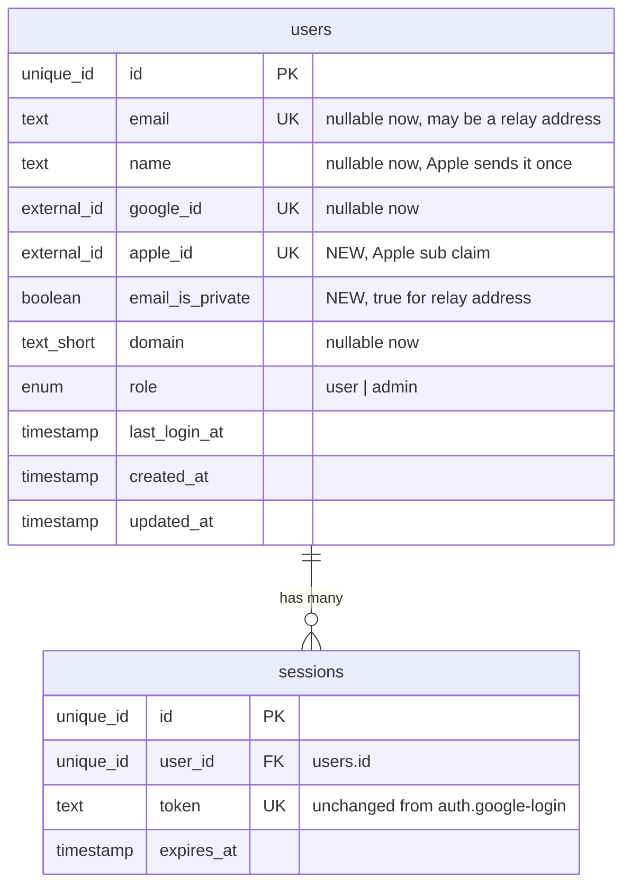
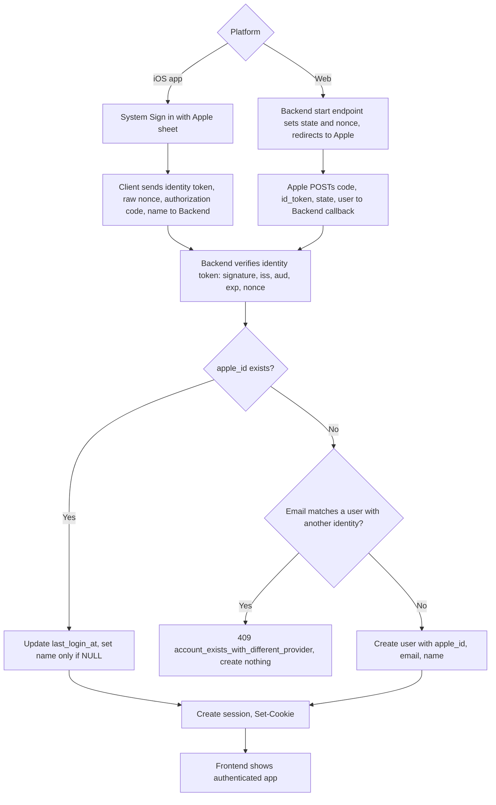
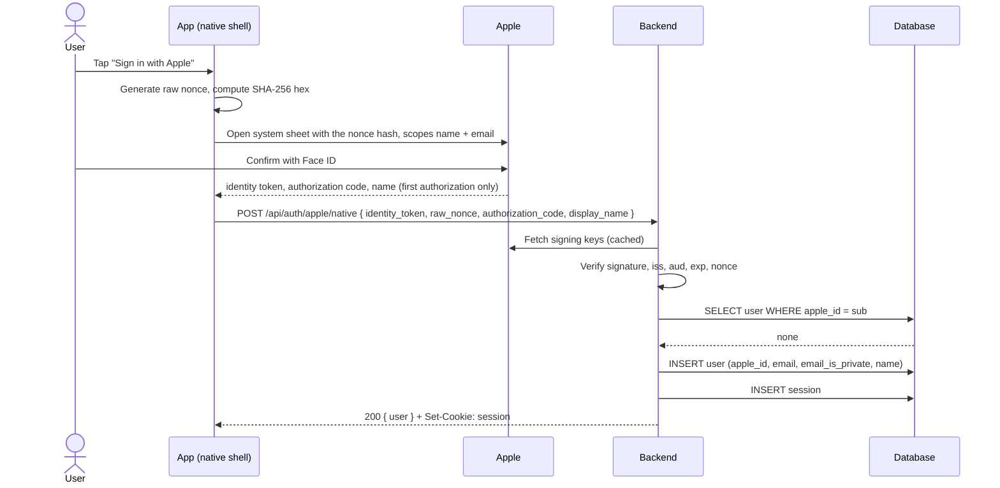
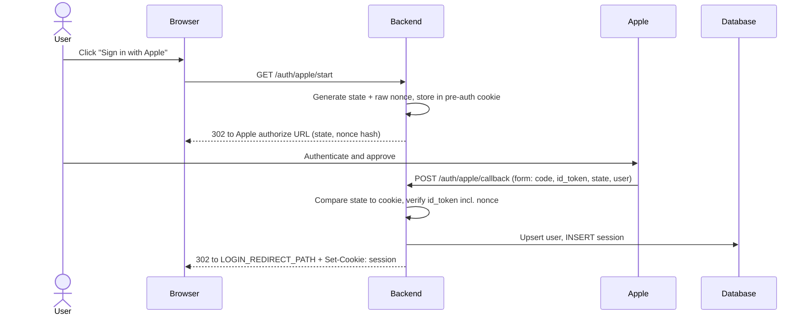
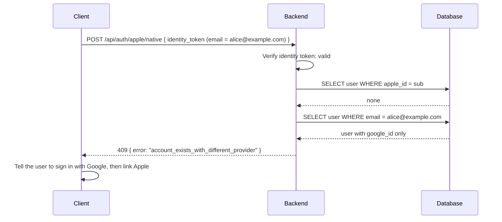
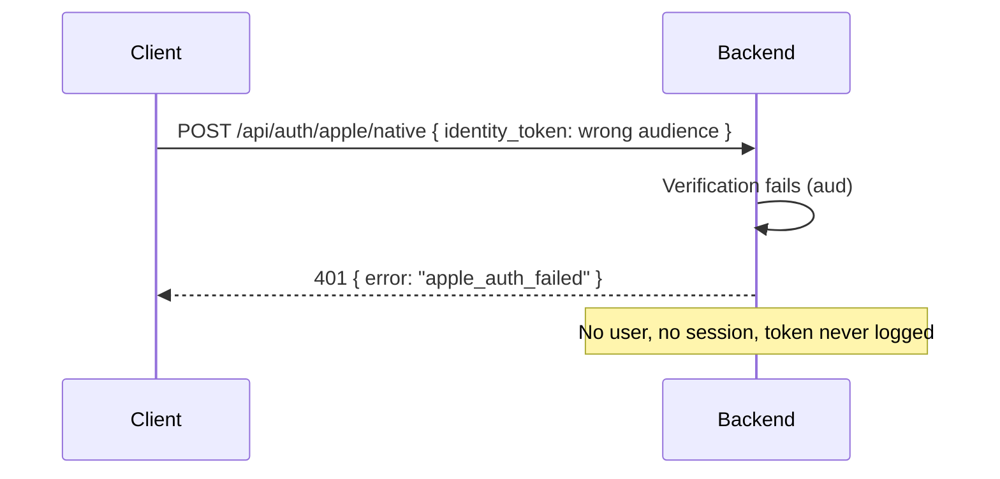

# Sign in with Apple

## 1. Overview

### Problem Statement

An app that sets up or authenticates the user's primary account through a third-party or social login (Google Sign-In, Facebook Login and similar) and ships on the iOS App Store must also offer an **equivalent** login service that (a) limits data collection to the user's name and email address, (b) lets the user keep their email address private, and (c) does not collect interactions with the app for advertising without consent (App Store Review Guideline 4.8; wording read from Apple's published guidelines on 2026-10-22, re-check before submitting). Sign in with Apple is the usual way to meet this, not the only one. It is not required when the app exclusively uses its own account system, requires an existing education or enterprise sign-in, uses a government or industry-backed e-ID, or is a client for one specific third-party service. The two providers differ in ways that break a copy of the Google flow:

- Apple delivers the user's **name only on the first authorization**, outside the identity token.
- The email can be an **Apple private relay address**, or can be missing.
- On iOS the sign-in runs in a **native system sheet** (a WebView cannot run a web popup), while on the web it is a browser redirect.
- Apple expects the app to **revoke its Apple authorization when the account is deleted**.

This block adds Apple as a second identity provider on the `users` / `sessions` model of `auth.google-login`. Sessions, cookies, logout and `/api/me` are reused unchanged.

### User Stories

- **iOS user**: I tap "Sign in with Apple", confirm with Face ID in the system sheet, and I am signed in. Closing the sheet shows no error.
- **Web user**: I click "Sign in with Apple", approve on Apple's page, and return to the app signed in.
- **User who hides their email**: I sign in with a private relay address; the app works and never requires my real email.
- **User with a Google account**: I try Apple with the same email and am told to sign in with Google first, then link Apple from my account. Nobody can take over my account by presenting my email.
- **User deleting their account**: my Apple authorization for the app is revoked as part of deletion (`compliance.account-deletion` calls this block's revoke capability).
- **Merchant admin**: I decide on which platforms Apple is offered (default: iOS and web).

### Khi nào dùng block này (When to use)

- The app offers Google login and ships an iOS build (native or Capacitor shell).
- User says: "Sign in with Apple", "Apple login", "App Store requires Apple sign-in", "đăng nhập Apple".

### Khi nào KHÔNG dùng (When not to use)

- The app has no third-party login on iOS and no iOS build: skip.
- The app only uses its own sign-in system, or another Guideline 4.8 exemption listed in the Problem Statement: Apple sign-in is not required; use another equivalent login service only if you add a third-party login.
- Username/password login: block `auth.email-password`.
- The auth backend is Firebase Authentication or another hosted identity service that already verifies Apple tokens: that service owns verification; use only the client parts (`frontend.md`) and the revoke contract (`backend.md` section "Revoke on delete").
- Document NoSQL stores (Firestore, MongoDB, DynamoDB): explicit non-goal of this library; fork the block and write the adaptation.

### Identity precondition

This block keys its rows on an authenticated user (`user_id`). `auth.google-login` is the reference implementation (a `users` row plus `sessions`), which is why it is listed as a prerequisite. The precondition is satisfied by **any existing authenticated-user model** in the project: managed auth (Firebase Authentication, Supabase, Auth0 and similar), another login block, or an existing users and sessions table. The origin app for this block used a managed provider and had no `users` or `sessions` tables of its own.

If the project already has login, do **not** implement `auth.google-login`. Map `user_id` here to the project's existing user id (same physical type) and keep every other column of this block unchanged. Never create a second login or a second user table for the same people.

For this block specifically: where `auth.google-login` is not in the project, do not alter a table the project does not own. Record the Apple identity (`provider = apple`, subject = Apple `sub`) as a linked identity on the existing user, and keep the account-linking and revocation rules in this block as written. *Extrapolated, not verified on a managed-auth stack.*

---

## 2. Data Model

> Types are **logical types** (canonical mapping in `docs/SPEC_GUIDELINES.md` section 5). `sessions` is reused from `auth.google-login` without change. Only `users` changes.



### Changes to `users` (from `auth.google-login`)

Two columns are added and four are relaxed. A user must have at least one provider identity.

| Column | Logical Type | Constraints | Notes |
|--------|------|-------------|-------|
| `apple_id` | `external_id` | nullable, UNIQUE | NEW. Apple identity token `sub` claim: opaque, stable per user per Apple developer team. Never parse it |
| `email_is_private` | `boolean` | NOT NULL, default `false` | NEW. `true` when Apple reported a private relay address (claim `is_private_email`) |
| `google_id` | `external_id` | **nullable** (was NOT NULL), UNIQUE when present | An Apple-only user has no Google identity |
| `email` | `text` | **nullable** (was NOT NULL), UNIQUE when present | Apple may withhold the email. Lowercase when present. A relay address is stored as given |
| `name` | `text` | **nullable** (was NOT NULL) | Set once from the first authorization; never overwritten with an empty value |
| `domain` | `text_short` | **nullable** (was NOT NULL) | `NULL` when `email` is `NULL` or `email_is_private` is `true` |

**Invariant**: `google_id IS NOT NULL OR apple_id IS NOT NULL` (database CHECK constraint).

**Indexes**: `apple_id` (UNIQUE, partial on non-null where the dialect supports it).

**Why columns and not a linked-identities table**: two providers need one nullable column each and a database-enforced invariant. A third provider is the signal to move to a `user_identities (user_id, provider, subject)` table; building it now would be speculative.

**Unchanged behavior for Google users**: Google always supplies email, name and domain, so `auth.google-login` flows keep their values. Display code must fall back (for example to a generic label) when `name` is `NULL`.

### Reference Migration (Postgres)

<!-- REFERENCE: dialect=postgres -->
<!-- ADAPT: apply as an ALTER on top of the auth.google-login migration, not a replacement.
       - `ALTER COLUMN ... DROP NOT NULL`: SQLite cannot alter nullability in place, rebuild the table (create new, copy, drop, rename); MySQL uses `MODIFY COLUMN ... NULL`
       - `CHECK (google_id IS NOT NULL OR apple_id IS NOT NULL)`: supported by Postgres, MySQL 8.0.16+, SQLite (ADD CONSTRAINT needs the table rebuild on SQLite)
       - UNIQUE on nullable columns: Postgres, MySQL and SQLite all allow many NULLs under UNIQUE; SQL Server does not (use a filtered unique index)
       - `boolean`: MySQL `TINYINT(1)`, SQLite `INTEGER` 0/1 -->
```sql
ALTER TABLE users ADD COLUMN IF NOT EXISTS apple_id text UNIQUE;
ALTER TABLE users ADD COLUMN IF NOT EXISTS email_is_private boolean NOT NULL DEFAULT false;
ALTER TABLE users ALTER COLUMN google_id DROP NOT NULL;
ALTER TABLE users ALTER COLUMN email DROP NOT NULL;
ALTER TABLE users ALTER COLUMN name DROP NOT NULL;
ALTER TABLE users ALTER COLUMN domain DROP NOT NULL;
ALTER TABLE users ADD CONSTRAINT users_has_identity
  CHECK (google_id IS NOT NULL OR apple_id IS NOT NULL);
```

---

## 3. Data Flow



---

## 4. Sequence Diagrams

### Happy Path: native iOS sign-in (new user)



### Happy Path: web sign-in (new user)



### Error: email already belongs to a Google account



### Error: forged or mis-targeted token



---

## 5. State Management

| State | Storage | Survives Reload | Notes |
|-------|---------|-----------------|-------|
| `currentUser` | In-memory (reactive) | No, re-fetched via `/api/me` | Same shape as `auth.google-login`; `name` and `email` may be `null` |
| `availableProviders` | Derived from platform + config | n/a | `google` everywhere; `apple` on the platforms listed in `APPLE_SIGN_IN_PLATFORMS` |
| `appleSignInStatus` | In-memory | No | `idle`, `opening`, `verifying`, `cancelled`, `failed`, `account_exists` |
| `pendingDisplayName` | In-memory only | No | The name Apple handed over; kept until the server confirms or the attempt is abandoned (see `frontend.md`) |
| Session token | `httpOnly` cookie | Yes | Unchanged from `auth.google-login` |
| Pre-auth cookie (web) | `httpOnly` cookie | Yes (5 min) | Holds `state` and raw nonce for the web redirect |

### State transitions

```
idle -> opening (sheet or redirect) -> verifying (request to Backend)
  verifying -> idle + currentUser set      (200)
  verifying -> account_exists               (409 account_exists_with_different_provider)
  verifying -> failed                       (401 / 5xx; pendingDisplayName kept for retry)
  opening   -> cancelled -> idle            (user closed the sheet: no message)
```

---

## 6. Integration Points

### Inbound

| Caller | How | Purpose |
|--------|-----|---------|
| Sign-in screen | `AppleSignInButton` | Start native sheet or web redirect |
| Account settings | Link Apple action | Attach Apple to a signed-in user |
| `compliance.account-deletion` | Revoke capability (see `backend.md`) | Revoke Apple authorization with a fresh authorization code |

### Outbound

| Target | How | Purpose |
|--------|-----|---------|
| Apple signing keys endpoint | HTTPS GET | Verify identity tokens |
| Apple token + revoke endpoints | HTTPS POST | Revoke on delete |
| Database | SQL | `users` / `sessions` |

### Events

Same names as `auth.google-login`, with `provider` added to the payload.

| Event | Payload | When |
|-------|---------|------|
| `user.created` | `{ userId, provider: "apple" }` | First Apple sign-in |
| `user.logged_in` | `{ userId, sessionId, provider: "apple" }` | Every Apple sign-in |
| `user.identity_linked` | `{ userId, provider: "apple" }` | Apple attached to an existing user |
| `user.apple_revoked` | `{ userId, ok }` | Revoke attempted on deletion |

### Neighbouring blocks (ids only)

- `auth.google-login`: owns `users`, `sessions`, session cookie, logout, `/api/me`.
- `compliance.account-deletion`: calls the revoke capability; owns the deletion itself.
- `messaging.transactional-email`: mail to a relay address needs the sending domain registered with Apple (see `security.md`, T3 notes).

---

## 7. Configuration Surface

| Key | Type | Default | Description |
|-----|------|---------|-------------|
| `APPLE_BUNDLE_ID` | env var | (required for native) | iOS bundle id; the expected `aud` of native identity tokens |
| `APPLE_SERVICES_ID` | env var | (required for web) | Apple Services ID; the expected `aud` of web identity tokens |
| `APPLE_TEAM_ID` | env var | (required for revoke) | Apple developer team id; the `iss` of the revoke client secret |
| `APPLE_KEY_ID` | env var | (required for revoke) | Id of the Sign in with Apple private key; the `kid` of the client secret |
| `APPLE_PRIVATE_KEY` | secret | (required for revoke) | The `.p8` private key content, never committed |
| `APPLE_SIGN_IN_PLATFORMS` | enum list | `["ios"]` | Platforms that show the Apple button. Values: `ios`, `web`, `android`. `ios` is the only platform proven in production; add `web` only after exercising the web flow (extrapolated, never run) |
| `SESSION_DURATION_DAYS` | number | `30` | Reused from `auth.google-login` |
| `LOGIN_REDIRECT_PATH` | string | `"/dashboard"` | Reused from `auth.google-login` |
| `APP_URL` | env var | (required) | Reused; web return URL is `{APP_URL}/auth/apple/callback` |

`ALLOWED_DOMAINS` (from `auth.google-login`) does not apply to Apple sign-ins: a relay address has no meaningful domain. An app that needs domain restriction must not offer Apple.

### Apple Developer Setup

Claude Code outputs these in `SETUP.md` (manual steps, nothing here can be automated from the repo):

1. Decide the Apple team and the iOS bundle id **before the first signed build**. The bundle id is the native `aud`; registering it under the wrong team cannot be undone cheaply.
2. In the Apple developer account, register the App ID with the **Sign in with Apple** capability. In the iOS project, the entitlement `com.apple.developer.applesignin` must be present.
3. Web only: create a **Services ID**, attach the app's domain and the return URL `{APP_URL}/auth/apple/callback`, and verify the domain with Apple.
4. Revoke only: create a **Sign in with Apple key**, download the `.p8` once, store it as `APPLE_PRIVATE_KEY`, and record `APPLE_KEY_ID` and `APPLE_TEAM_ID`.
5. Optional: if the app mails relay addresses, register the sending domain and address in Apple's private email relay configuration.

---

## Origin and verification status

**Origin.** The behavior in this block comes from the origin app (Vue + Capacitor + Firebase Authentication): iOS offers Google and Apple, Android and web offer Google only; native sheets run with `skipNativeAuth` so the app owns the single session; the name is captured on first authorization; account deletion re-authenticates with Apple and revokes the Apple tokens. That app used Firebase Auth, so Firebase performed all server-side token verification and session handling.

**Translated, not run.** The SQL-family model (`users.apple_id`, relaxed columns, server-side verification, linking rules, revoke through Apple's REST endpoints) is a translation of that behavior. It has **not** been implemented or run on stacks A, B or C.

**Proven in production (the origin app, Firebase-backed)**: per-platform provider list; native sheet returning tokens while the app creates its own session; name delivered only on first sign-in and stored by the app; cancel mapped to a silent state; a Capacitor plugin object must not be resolved from a promise directly; re-authenticate with Apple before account deletion; best-effort revoke of Apple tokens with a fresh authorization code before deleting the account; bundle id must be fixed before the first signed build.

**Extrapolated, not verified**: everything server-side in `backend.md` (signing-key fetch, `iss`/`aud`/`nonce` checks, form_post callback, client-secret signing, token and revoke endpoints), the web flow (the origin app does not offer Apple on the web), email-collision and linking rules, relay-address handling, the `apple_id` column design, and all fixtures. The session cookie transport from a native shell to the API (frontend.md, "Native Shell and the Session Cookie") is an open design question, not a verified behavior. Apple protocol details are written from Apple's public documentation as the author knows it and are marked "confirm against current Apple documentation" where relevant.
