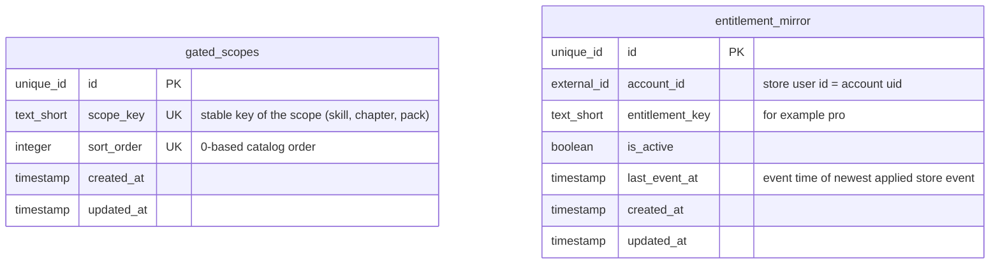
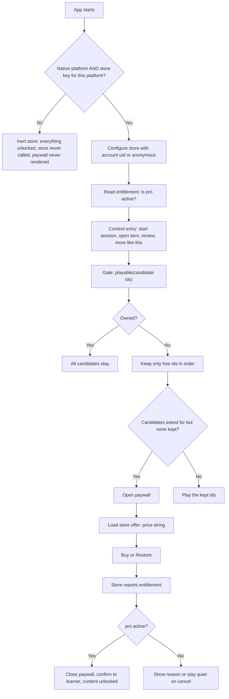
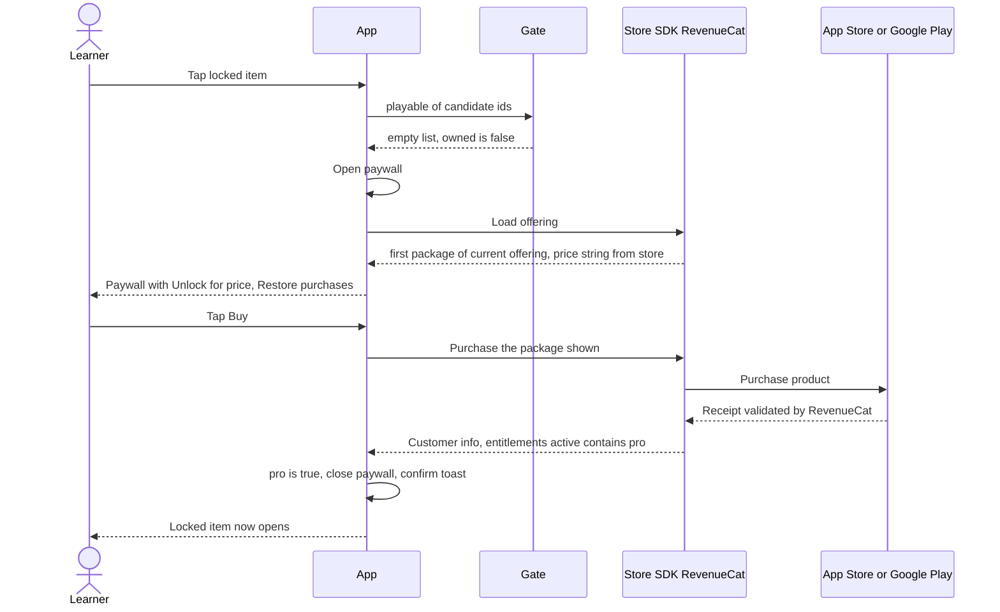
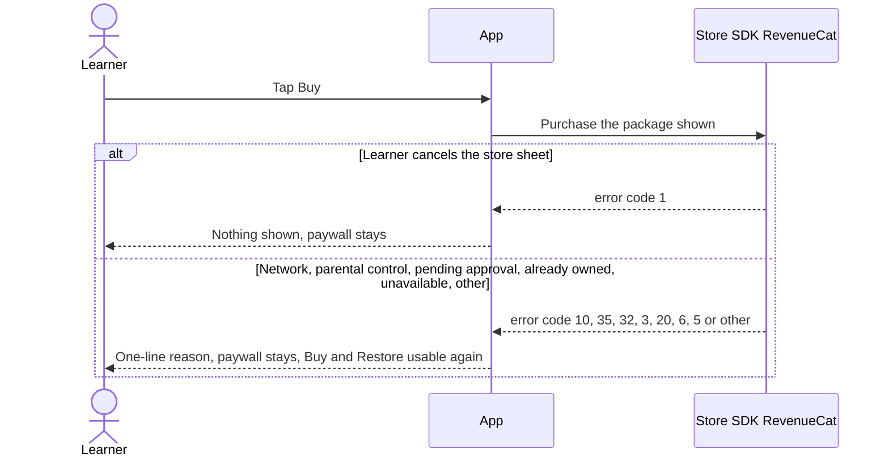
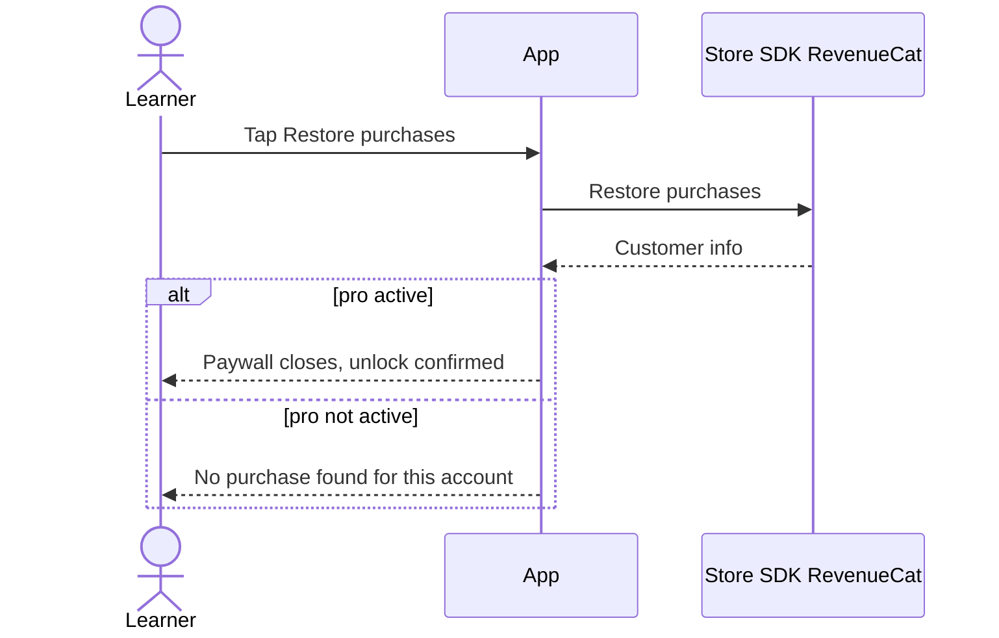
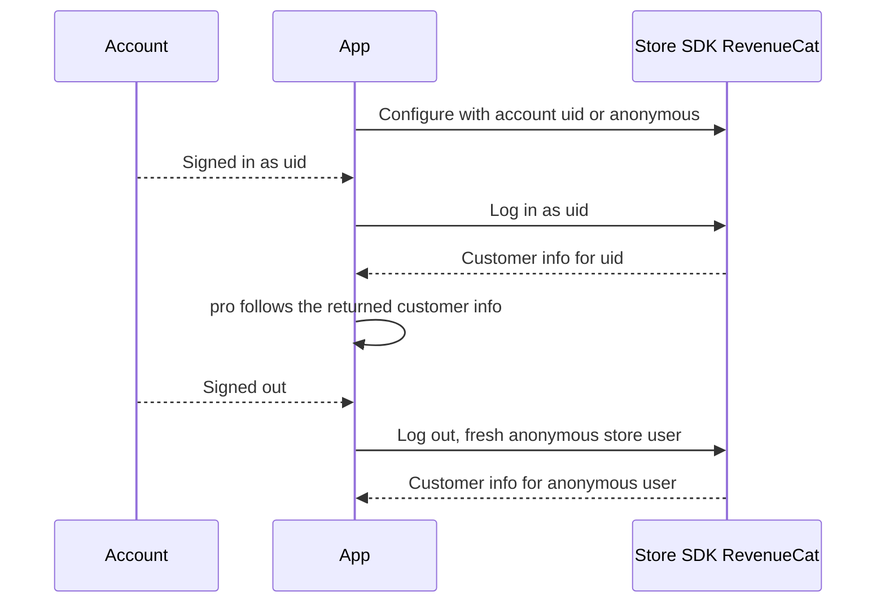

# In-App Purchase: One-Time Unlock

## 1. Overview

### Problem Statement

A mobile app (a web app wrapped in a native shell, shipped to the App Store and Google Play) wants to sell one thing: a permanent "unlock all" for its content. Digital content unlocked inside the app has to be sold through the store's own billing (Apple In-App Purchase, Google Play Billing); a separate web checkout cannot replace it. RevenueCat sits on top of both stores so the app asks one question, "is the `pro` entitlement active?", and never talks to StoreKit or Play Billing directly.

This block specifies the whole loop: a **free slice** a learner can use at full quality, a **single gate** every content entry passes through, a **paywall** that sells one product at the store's own price, **restore**, the **store-user identity** (the account id), **inert-by-default** behavior for every build that has no store, and the **store-side setup and reviewer access** that a first release needs.

The entitlement is read from the RevenueCat SDK on the device. The core block has no server component (see section 2 and the optional extension in `backend.md`).

### Invariants

Every implementation keeps these. Each has a scenario in the `.feature` files.

1. **One choke point.** Every entry that selects content to play passes its candidate ids through one gate function. A new entry cannot forget the check because there is nowhere else to check.
2. **Inert by default.** Purchases are active only on a native platform whose build carries that platform's store key. Web, dev, tests, and a native build without a key have everything unlocked and never call the store.
3. **Gate by coverage, not difficulty.** The free slice is "the first N scopes of the catalog" (for example the first 15 of 60 skills), with every difficulty and full explanations. Difficulty never gates.
4. **The paywall never opens at launch.** It opens when the learner reaches locked content (or taps a buy entry), never on app start.
5. **The price comes from the store.** The paywall shows the store's localized price string. No price constant exists in the app.
6. **Restore is always visible** on the paywall.
7. **The store user is the account.** The store's app user id is the account uid when signed in, anonymous otherwise; sign-in and sign-out switch the store user.
8. **Web has no purchase path.** Where the web build is also published, it never offers or sells the unlock.

### User Stories

- **Learner**: I can use a meaningful free part of the app (every difficulty, full explanations) before I pay.
- **Learner**: when I reach locked content, I see what unlocking adds, how much of the content is free, and the price in my currency, exactly as the store will charge it.
- **Learner**: I pay once, the unlock is permanent, and it works on every device where I sign in with the same account.
- **Learner**: after a reinstall or on a new phone, I tap "Restore purchases" and get my unlock back; if nothing is found, the app tells me so.
- **Learner**: if I cancel the store sheet, the app stays quiet; if the purchase fails, the app tells me why in one sentence.
- **Developer**: I add a new way to start a session and it is gated by calling the same function; I cannot create an ungated path by accident.
- **Developer**: I run the web build, dev server, and tests with no store keys and nothing breaks.
- **Store reviewer**: I can reach the paid content (promo code on Google Play, in-app purchase plus paywall screenshot on the App Store).

### When to use this block

- The app sells one permanent unlock (non-consumable) for content or features.
- The app ships to iOS and/or Android through a native shell, and billing must go through the stores.
- A client-side gate is acceptable: the gated content is bundled in the app, so the gate protects the experience, not a secret (see `security.md` T1).
- User says: "paywall", "in-app purchase", "IAP", "unlock all", "RevenueCat", "one-time purchase", "restore purchases".

### When NOT to use

- Subscriptions with renewal, trial, or grace-period handling. This block does not cover them (not part of the source implementation).
- Consumables or credit packs.
- Web checkout for the same unlock. The block's invariant 8 is that the web has no purchase path; a web checkout is a separate decision.
- Shopify app billing: use `billing.shopify-charges`.
- Content that must never reach a non-paying device (licensed video, paid API results). Deliver that content from a server that checks entitlement; start from the OPTIONAL EXTENSION in `backend.md`, which is not production-verified.

### Related blocks (referenced by id only)

| Block | Relation |
|---|---|
| `auth.sign-in-with-apple` | Optional. Supplies the account whose uid becomes the store user id. The block also works with anonymous store users. |
| `compliance.account-deletion` | Optional. A store-submitted app with accounts needs an in-app deletion path; independent of this block. |
| `data.progress-sync` | Optional. Syncs learner progress; entitlement is not synced by it (the store is the source of truth). |
| `ugc.friends-leaderboard` | Independent. |
| kit `app-factory` | The `app-factory` kit (`kits/app-factory/`, entered through the `implement-kit` skill) holds the end-to-end release order and store submission runbook; this block covers only the billing slice of it. |

---

## 2. Data Model

> Types below are **logical types** (canonical mapping in `docs/SPEC_GUIDELINES.md` section 5). Dialect-specific SQL is in [Reference Migration](#reference-migration-postgres) at the end of this section.

The core block stores **no purchase data on a server**. The source implementation keeps three kinds of data:

| Data | Where it lives | Status |
|---|---|---|
| Entitlement state (`pro` yes/no) | In memory on the device, read from the RevenueCat SDK at start-up and on every SDK update (section 5). Not persisted by the app. | Core, production |
| Gated-scope catalog (ordered list of scopes and which are free) | A bundled, ordered data file plus a constant for the free count. | Core, production |
| Entitlement mirror (server copy of who owns what) | A SQL table fed by a store webhook. | **OPTIONAL EXTENSION, not production-verified** |

The two tables below are the SQL-family translation of the second and third rows. Use `gated_scopes` only when the catalog lives in your database; if the catalog is a bundled file, keep the file. Skip `entitlement_mirror` unless you need server-side checks.



`gated_scopes` and `entitlement_mirror` have no relation to each other. Items (questions, lessons) reference scopes by `scope_key`; that link is app-owned (see ADAPT in `backend.md`, "free-slice-rule").

### Table: `gated_scopes` (catalog translation, not production-run)

| Column | Logical Type | Constraints | Notes |
|---|---|---|---|
| `id` | `unique_id` | PK | distributed-safe ID, immutable |
| `scope_key` | `text_short` | NOT NULL, UNIQUE | stable key an item uses to name its scope |
| `sort_order` | `integer` | NOT NULL, UNIQUE | 0-based order; a scope is free when `sort_order < FREE_SCOPE_COUNT` |
| `created_at` | `timestamp` | NOT NULL, default = now | UTC instant |
| `updated_at` | `timestamp` | NOT NULL, default = now | UTC instant; updated on every row mutation |

**Indexes**: `scope_key` (UNIQUE), `sort_order` (UNIQUE).
**Tenant isolation**: none. The catalog is global app content, not per-account data.

### Table: `entitlement_mirror` (OPTIONAL EXTENSION, not production-verified)

| Column | Logical Type | Constraints | Notes |
|---|---|---|---|
| `id` | `unique_id` | PK | |
| `account_id` | `external_id` | NOT NULL | the id sent to the store as app user id (the account uid); use `unique_id` with FK when accounts are issued by your own table |
| `entitlement_key` | `text_short` | NOT NULL | the RevenueCat entitlement identifier, `pro` |
| `is_active` | `boolean` | NOT NULL | true while the entitlement is active |
| `last_event_at` | `timestamp` | NOT NULL | UTC instant of the newest store event applied; an event older than this value is ignored |
| `created_at` | `timestamp` | NOT NULL, default = now | UTC instant |
| `updated_at` | `timestamp` | NOT NULL, default = now | UTC instant; updated on every row mutation |

**Indexes**: (`account_id`, `entitlement_key`) UNIQUE.
**Tenant isolation**: `account_id` is the isolation column; every read filters by the caller's account.

### Reference Migration (Postgres)

#### `gated_scopes` table

<!-- REFERENCE: dialect=postgres -->
<!-- ADAPT: `uuid ... gen_random_uuid()` -> MySQL `BINARY(16)` with UUID_TO_BIN(UUID()), SQLite `TEXT` with a uuid4 generated in the app; `timestamptz` -> MySQL `DATETIME(6)`, SQLite `TEXT` ISO 8601 with `Z`; `varchar(255)` -> SQLite `TEXT`; `bigint` -> SQLite `INTEGER`. Skip this table when the catalog is a bundled file. -->
```sql
CREATE TABLE IF NOT EXISTS gated_scopes (
  id         uuid PRIMARY KEY DEFAULT gen_random_uuid(),
  scope_key  varchar(255) NOT NULL UNIQUE,
  sort_order bigint NOT NULL UNIQUE,
  created_at timestamptz NOT NULL DEFAULT now(),
  updated_at timestamptz NOT NULL DEFAULT now()
);
```

#### `entitlement_mirror` table (OPTIONAL EXTENSION)

<!-- REFERENCE: dialect=postgres -->
<!-- ADAPT: same type mapping as `gated_scopes`; `boolean` -> MySQL `TINYINT(1)`, SQLite `INTEGER 0/1`; the composite UNIQUE works unchanged on all three dialects. Create only when the extension in backend.md is built. -->
```sql
CREATE TABLE IF NOT EXISTS entitlement_mirror (
  id              uuid PRIMARY KEY DEFAULT gen_random_uuid(),
  account_id      text NOT NULL,
  entitlement_key varchar(255) NOT NULL,
  is_active       boolean NOT NULL,
  last_event_at   timestamptz NOT NULL,
  created_at      timestamptz NOT NULL DEFAULT now(),
  updated_at      timestamptz NOT NULL DEFAULT now(),
  UNIQUE (account_id, entitlement_key)
);
```

---

## 3. Data Flow



Data movement: the only data that crosses the device boundary is the store user id and the purchase itself, both handled by the RevenueCat SDK. The app receives back one fact (`pro` active or not) and one display string (the price).

---

## 4. Sequence Diagrams

### Happy path: locked content to purchase



### Error: cancelled, failed, pending



### Restore



### Store user follows the account



---

## 5. State Management

| State | Storage | Survives Reload | Notes |
|---|---|---|---|
| `storeActive` | Derived once at build/boot (platform + key) | n/a | False means inert store |
| `pro` | In-memory | No: re-read from the store SDK at start | Initial value false until the first read resolves |
| `unlocked` | Derived | n/a | `not storeActive or pro` |
| `paywallOpen` | In-memory | No | Closes automatically when `pro` becomes true |
| `offer` | In-memory | No | `{ priceString }` or null |
| `offerState` | In-memory | No | `idle`, `loading`, `ready`, `none` (store has no product), `failed` (store unreachable) |
| `busy` | In-memory | No | `buy`, `restore`, or null; blocks a second tap |
| `problem` | In-memory | No | One of the problem names in `backend.md` (error taxonomy), or null |
| `nothingToRestore` | In-memory | No | Restore ran and found no purchase |

### State transitions

```
Boot, store inactive -> unlocked (no store call, ever)
Boot, store active   -> pro=false (locked) -> configure -> read entitlement -> pro=true|false

Gate call, not owned, candidates asked, none kept -> paywallOpen=true -> offerState=loading -> ready|none|failed
Buy tap   -> busy=buy -> pro=true (paywall closes) | cancelled (quiet) | problem=<name>
Restore   -> busy=restore -> pro=true (paywall closes) | nothingToRestore=true | problem=<name>
Store pushes an update -> pro follows it (purchase approved later: unlock; refund: lock again)
Account sign-in / sign-out -> store user switches -> pro follows the new user's entitlement
```

---

## 6. Integration Points

### Inbound

| Caller | How | Purpose |
|---|---|---|
| Every content entry (start, open one item, review misses, more-like-this, setup form) | gate function `playable(ids)` | Filter candidates; open paywall when nothing is playable |
| Settings or any "Unlock" button | open paywall | Optional explicit buy entry; the paywall is the same sheet |
| Resume of a stored session | not gated | The session was gated when it started |

### Outbound

| Target | How | Purpose |
|---|---|---|
| RevenueCat SDK (Capacitor plugin) | in-process calls | configure, log in/out, offerings, purchase, restore, update listener |
| App Store / Google Play | via RevenueCat | The purchase itself |
| Account provider | read uid | Store user id |

### Events

The source implementation emits no domain events. The UI confirms an unlock with a one-time toast. Add analytics events at buy/restore success only when a product need exists.

### Shared data

The catalog (ordered scopes) is shared with the content/learning engine; the gate depends on it and on nothing else in the engine.

---

## 7. Configuration Surface

| Key | Type | Default | Description |
|---|---|---|---|
| `FREE_SCOPE_COUNT` | integer | no default; source project: `15` (of 60 scopes) | How many scopes at the start of the catalog are free. `0` frees nothing; a value at or above the scope count frees everything |
| `FREE_RULE` | enum | `every` | `every`: an item is free when all its scopes are free (source project, 36 of 300 items). `any`: free when at least one scope is free (not shipped; the source project computed 124 of 300). Choose per product; the source owner never made this decision |
| `ENTITLEMENT_ID` | text_short | `pro` | RevenueCat entitlement identifier; code and dashboard must match exactly |
| `PRODUCT_ID` | text_short | (required) | One non-consumable product, **same identifier on both stores** |
| `STORE_KEY_IOS` | build-time public key | unset = inert | RevenueCat public SDK key for iOS. Public keys are designed to ship in the app. Build tools that expose env vars to the client need their own prefix (source: `VITE_`) |
| `STORE_KEY_ANDROID` | build-time public key | unset = inert | RevenueCat public SDK key for Android |
| `BASE_PRICE` | store console setting | source project: USD 14.99 | Set in each store, not in the app. Source owner chose it from three options; the agent called it a guess, not data |

### Store-side setup (ordered)

External parties dictate the names below, so they are concrete. Statuses: **observed** = done in the source project; **stated** = reported by the source project's agent without citing a store document.

1. **RevenueCat**: create a project and one app per platform inside it. Create product `PRODUCT_ID` as type Non-consumable, entitlement `pro` with that product attached, and an offering named `default` whose package is the Lifetime package (identifier `$rc_lifetime`, dictated by RevenueCat) holding the Android and iOS products. Verify with RevenueCat's public API, using the public key, that the current offering is `default` and `$rc_lifetime` maps to the product (observed). Do this **before the first store upload** so version 1 already carries the key.
2. **Google Play**: create the in-app product with `PRODUCT_ID`, a purchase option, a base price in USD, all regions, and activate it (observed). Create a Google Cloud service account for RevenueCat, invite it to Play Console limited to this one app with three permissions (view app information, view financial data, manage orders and subscriptions), upload its JSON key to RevenueCat, then check credentials; validation took under 35 minutes in the source project (observed).
3. **App Store Connect**: create the non-consumable IAP with the same `PRODUCT_ID`, price, availability, and a localization (observed). Create an In-App Purchase key in Users and Access > Integrations; upload the `.p8` file, key id, and issuer id to RevenueCat; status reads "Valid credentials" (observed). The Paid Apps Agreement, bank account, and tax forms had to be Active before the paid IAP could be tested and submitted (observed; the rule itself is stated, not cited).
4. **Keys into the build**: put the public SDK keys (`goog_...`, `appl_...` prefixes, observed) in a git-ignored local env file read by the native build. The Play service-account JSON, the `.p8` file, the key id, and the issuer id are secrets; keep them out of the repo and out of the build (`security.md` T3, T4).
5. **Reviewer access**: Google Play: when app access is restricted, put promo codes for the product in the "Sign in details" form (observed; promo-code terms had to be accepted first, and a code's start date is the day after creation). App Store: submit the IAP together with the first app version and attach a screenshot of the paywall (observed; "submit together" is stated, not cited). The iOS sandbox product loads only after the IAP metadata is complete, which can make the screenshot a chicken-and-egg problem: build one simulator app with the RevenueCat Test Store key, take the screenshot, rebuild with the real key, and check that the shipped bundle contains no Test Store key (observed).
6. **Build and ship** a keyed native build. The `app-factory` kit (`kits/app-factory/`, entered through the `implement-kit` skill) covers signing, listing, privacy declarations, and submission.

---

## 8. Origin and verification status

The behavior comes from the origin app (Vue + Capacitor + Firebase), which shipped to Google Play and was resubmitted to the App Store. Sources: `app/src/lib/entitlement.ts`, `app/src/lib/purchases.ts`, `app/src/composables/usePurchases.ts`, the "Purchases" section of `app/src/CONTRACT.md`, and the project's payments playbook.

What is **proven**: the logic in sections 3 to 6 passes the source project's unit and component tests, which drive a **fake store** (`test/entitlement.test.ts`, `test/purchases.test.ts`). The store-side objects (product, entitlement `pro`, offering `default`, package `$rc_lifetime`) exist on both stores and the offering was verified through RevenueCat's API.

What is **not** proven: no real purchase on either store was observed in the source project's records (Play app had zero installs at the last check; App Store review was still pending). Restore against a real purchase, real refund updates, and an owner starting the app offline are untested.

Data model status: `gated_scopes` and `entitlement_mirror` are SQL-family translations written for this block, **not run on stacks A/B/C**. In the source project the catalog is a bundled JSON file and there is no server entitlement store (the Firebase backend holds no entitlement data). `entitlement_mirror` and its webhook feed are an OPTIONAL EXTENSION that the source project proposed and never built.
