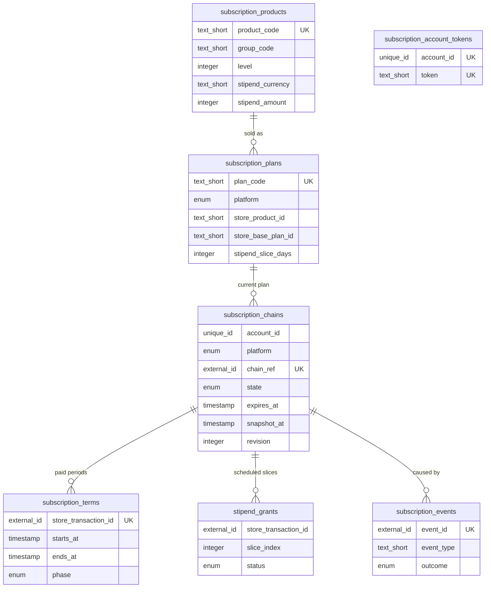
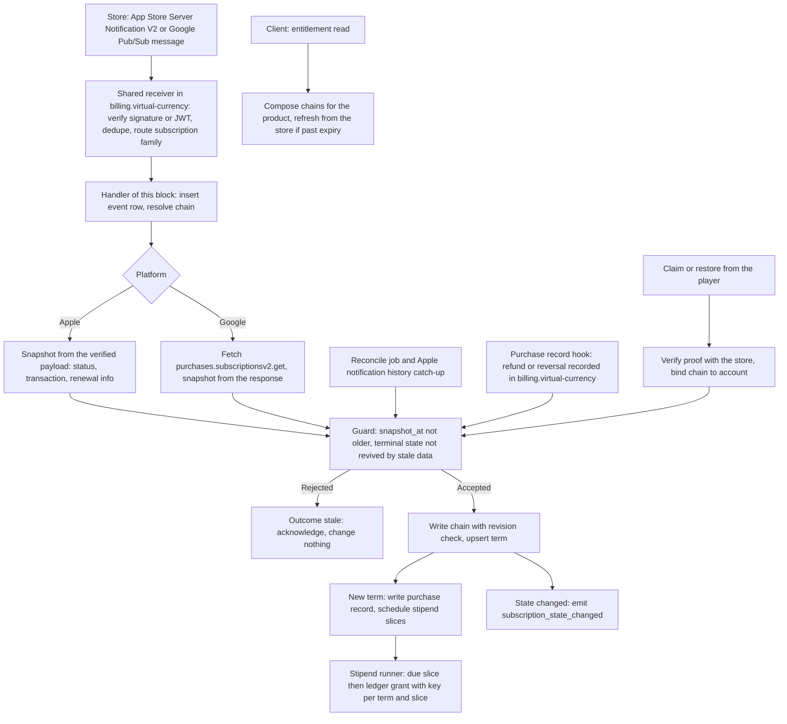
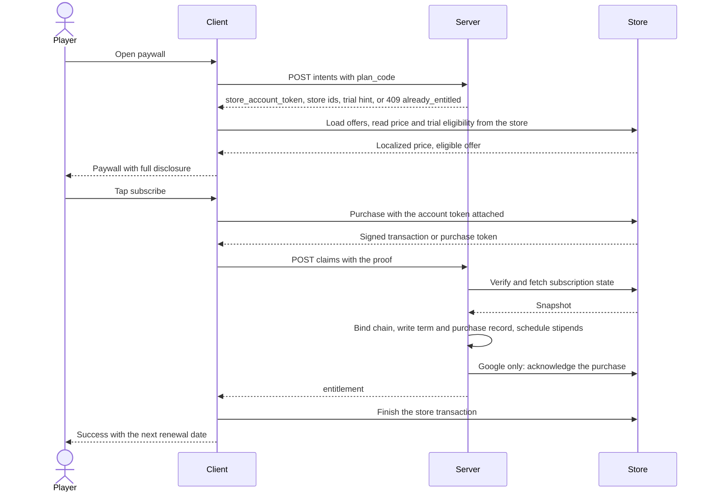
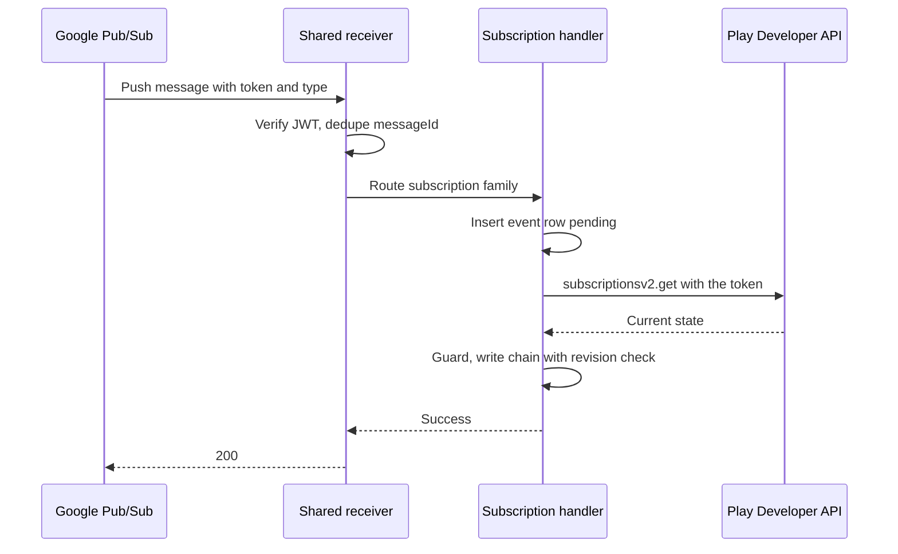
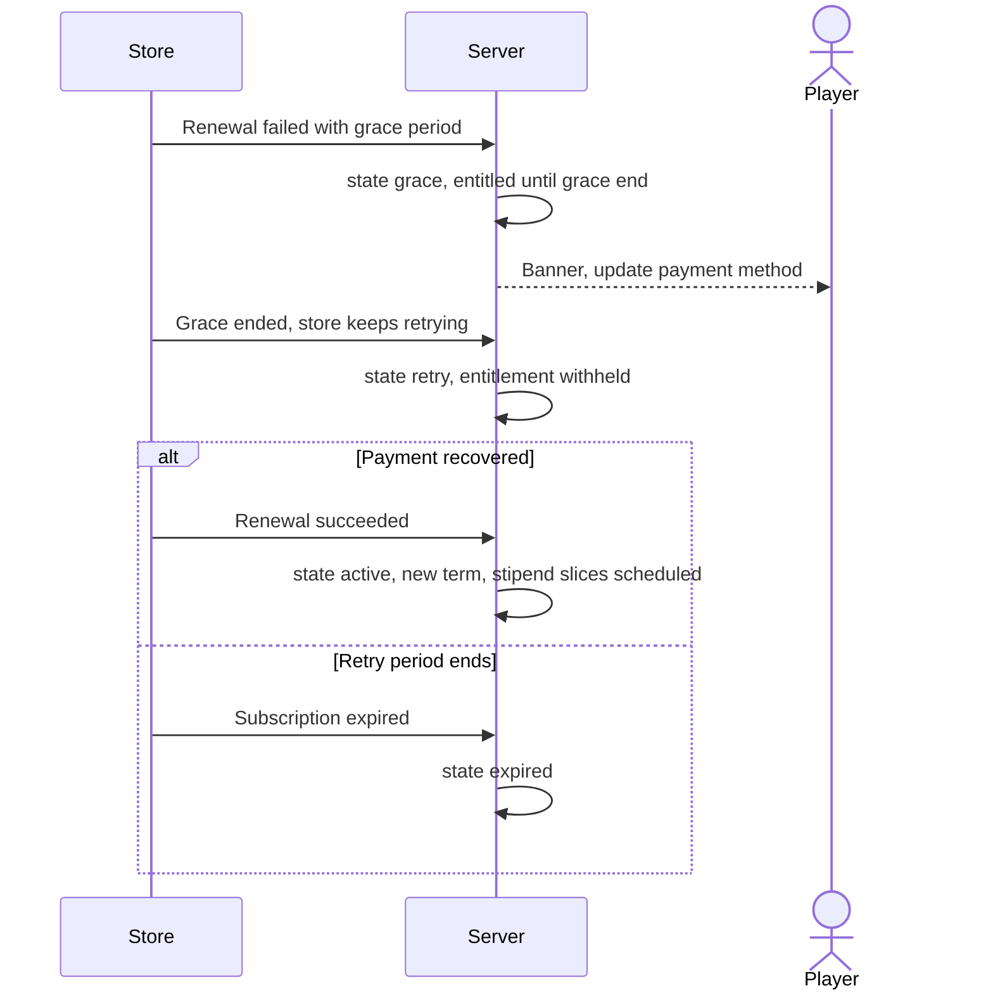
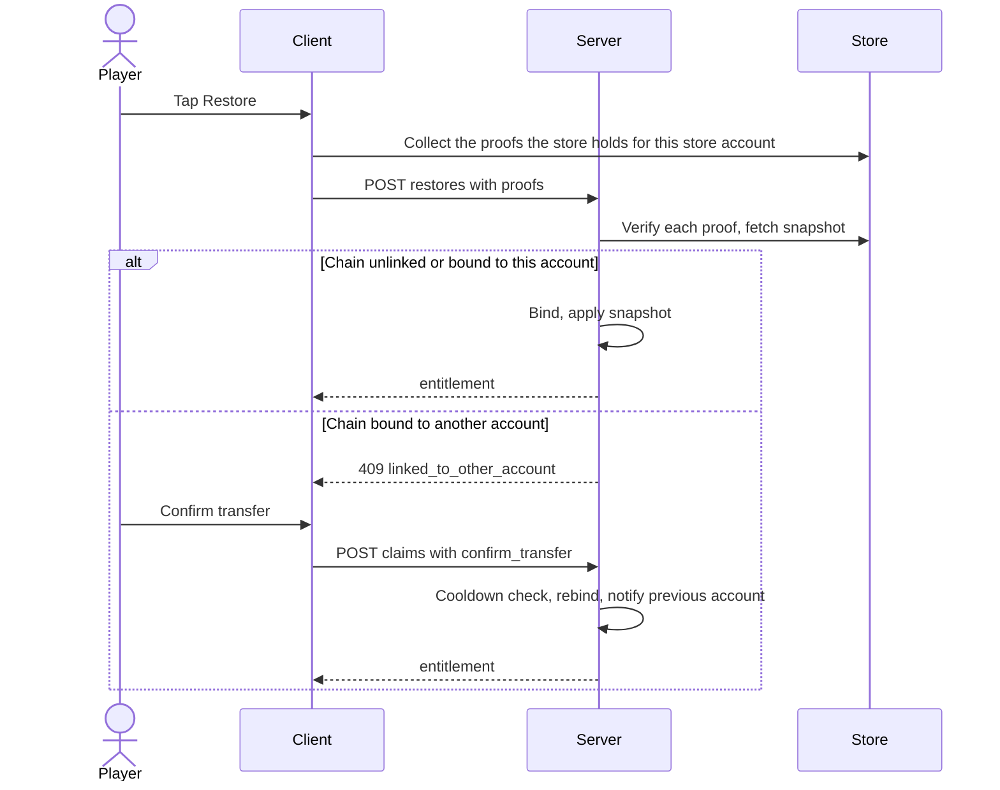
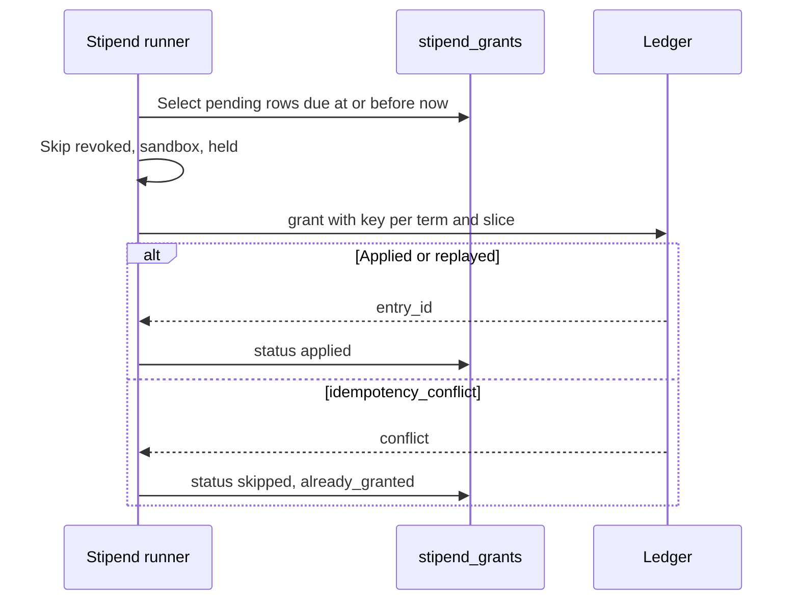
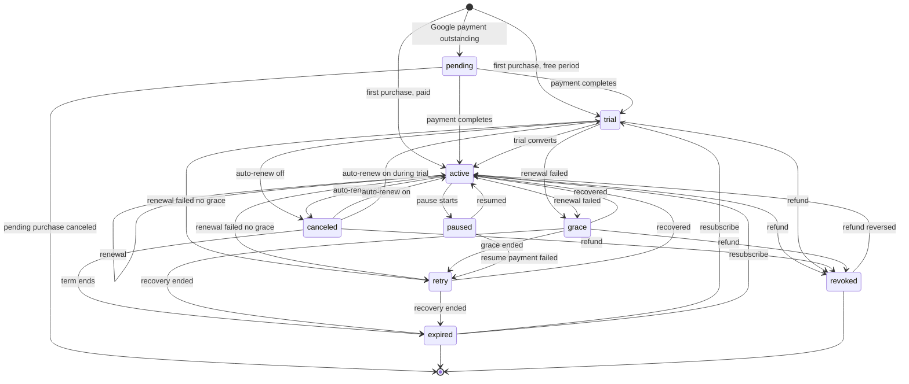

# Subscriptions: Store Subscriptions with a Server-Side Entitlement

Source keys such as `[SA1]` and `[SG3]` point to the Sources table in the last section; each row carries its confidence label (HIGH, MEDIUM, LOW).

## 1. Overview

### Problem Statement

A mobile game (a web app in a native shell, shipped to the App Store and Google Play) sells recurring access, for example a VIP membership with perks and a periodic currency stipend. Digital features unlocked in the app must be sold through the store's own billing: Apple requires in-app purchase for "subscriptions, in-game currencies, game levels" [SA15], and Google requires Google Play's billing system for subscription services, naming game among the examples [SG13]. The stores own the money and the lifecycle: free trial, renewal, grace period, billing retry, account hold, pause, refund. The app owns only access.

The failure this block prevents is a client that decides access from local state. A store can end access at any moment (refund, failed renewal, price-increase refusal) and tells the app only through notifications that arrive late, twice, or out of order. This block makes the server the single place that answers "does this account have this subscription right now", computed from verified store state, and gives every other block one call to ask.

The block specifies: the subscription state machine; the entitlement contract; how store messages and polling feed it; how a purchase is claimed, restored and linked to an app account; trial, offer, plan-change, family-sharing and price-increase handling; periodic stipends with exactly-once grants; refund handling; and the screens and disclosures a store-compliant paywall needs. No vendor SDK is mandated. A purchase-aggregation service can stand in for the store feeds if it is mapped into the normalized snapshot of `backend.md` section 2 (optional, not specified here).

### User Stories

- **Player**: before I pay, I see the plan name, the period, the full renewal price, what I get, and how to cancel, in my own currency, exactly as the store will charge it.
- **Player**: right after I subscribe, my perks are on and I see when the subscription renews or ends.
- **Player**: if my card fails, I keep my perks while the store retries, and the game tells me how to fix the payment before they stop.
- **Player**: when I cancel in the store, I keep what I paid for until the end of the period, and the game says the date.
- **Player**: on a new phone or after a reinstall I tap "Restore" and get my subscription back on my account; if it belongs to another account of mine, the game says so and never moves it silently.
- **Player**: the periodic currency from my subscription arrives without me tapping anything.
- **Player**: if the store refunds me, access ends and the game tells me why.
- **Player**: before a free trial turns into a paid subscription, I get one reminder with the date and the price, and a way to cancel; I see the same facts in the game even when notifications are off.
- **Operator**: I can read the state of any subscription and the history of store messages that produced it.
- **Developer**: I call `entitlement(account_id, product_code)` and never read store state.

### When to use this block

- The game sells auto-renewing subscriptions (VIP, monthly card, ad-free pass, season access) on the App Store, Google Play, or both.
- Access must be decided by the server: perks that reach other players, server-side content, currency stipends, anti-abuse.
- The game already uses (or will use) `billing.virtual-currency` for the purchase record, the ledger and the shared store receivers.
- User says: "subscription", "VIP", "monthly card", "free trial", "grace period", "billing retry", "restore subscription", "entitlement".

### When NOT to use

- One-time unlocks and non-renewing purchases: `billing.in-app-purchase` (client-side gate through the store SDK) or `billing.virtual-currency` for non-consumables.
- Consumable currency packs and the ledger itself: `billing.virtual-currency`.
- A premium season track sold as a one-time purchase: `engagement.season-pass`. A game that wants VIP to include that track writes its own rule on top of both blocks and asks `entitlement`.
- Shopify app billing: `billing.shopify-charges`.
- Web checkout for the same subscription. Store billing and web billing are separate decisions with separate records; the guide `06-design-ethics-and-compliance.md` and the platform rules govern the link-out question.
- Apple's Advanced Commerce API products and installment or prepaid Google plans: out of scope; their notification types are acknowledged and ignored (section 3).

### Related blocks (referenced by id only)

| Block | Relation |
|---|---|
| `billing.virtual-currency` | **Prerequisite.** Owns the purchase record (`store_purchases`, written once per `store_transaction_id`), the ledger (`grant`, `spend`), the two shared store receivers, and the Google service-account client. This block registers a notification handler there and writes one purchase record per subscription term. |
| `billing.in-app-purchase` | Sibling for one-time unlocks. Independent; a game can run both. |
| `engagement.season-pass` | Independent. A game rule that grants the premium track to subscribers asks `entitlement`, never store state. |
| `data.progress-sync` | Guest-to-account merge calls this block's `account_merged` handler (section 6). Entitlement is never synced by the client. |
| `auth.google-login`, `auth.sign-in-with-apple` | Supply the signed-in account. The store account and the app account are different identities (section 3, linking). |
| `compliance.account-deletion` | Detaches the account's chains; the deletion screen shows the manage-subscription link because store billing continues. |
| `messaging.push-reengagement` | Optional consumer of the hand-off event `subscription_trial_ending` (section 6) and of `subscription_state_changed` for billing-problem and win-back messages. |
| kit `game-engagement` | Guide `03-economy-and-offers.md` lists subscriptions as a gap; guide `06-design-ethics-and-compliance.md` sets the disclosure floor this block implements. |

---

## 2. Data Model

> Types below are **logical types** (`docs/SPEC_GUIDELINES.md` section 5). Dialect-specific SQL is in [Reference Migration](#reference-migration-postgres). Every table carries `tenant_id` (single-app deployments use one constant value), following `ugc.friends-leaderboard`.



A **chain** is one continuous store subscription: Apple `originalTransactionId`, Google purchase token [SA8, SG4]. A **term** is one paid or free period inside a chain: Apple `transactionId`, Google `orderId`, which changes on every renewal [SG1 voided-purchase `orderId`]. A **snapshot** is the normalized view of one chain at one instant, built from a verified store payload or API response (`backend.md` section 2).

### Table: `subscription_products`

The entitlement catalog: what a player can hold. Products in one `group_code` are ranked by `level`; a higher level also satisfies the lower levels of its group (INV-9).

| Column | Logical Type | Constraints | Notes |
|---|---|---|---|
| `id` | `unique_id` | PK | |
| `tenant_id` | `unique_id` | NOT NULL | |
| `product_code` | `text_short` | NOT NULL, UNIQUE per tenant | The `product_code` of the entitlement contract, for example `vip` |
| `group_code` | `text_short` | NOT NULL | Products that replace each other. Mirrors the Apple subscription group; Google plan changes happen between products of one group by app rule |
| `level` | `integer` | NOT NULL, >= 1 | Higher means more access. Mirrors the Apple level ranking [SA16] |
| `stipend_currency` | `text_short` | nullable | Currency or item code granted through the ledger |
| `stipend_amount` | `integer` | nullable, > 0 | Amount per stipend slice. Null together with `stipend_currency` means no stipend |
| `created_at`, `updated_at` | `timestamp` | NOT NULL | UTC instants |

### Table: `subscription_plans`

The purchasable variants of a product, per store.

| Column | Logical Type | Constraints | Notes |
|---|---|---|---|
| `id` | `unique_id` | PK | |
| `tenant_id` | `unique_id` | NOT NULL | |
| `plan_code` | `text_short` | NOT NULL, UNIQUE per tenant | For example `vip-monthly-apple` |
| `product_code` | `text_short` | NOT NULL, FK to `subscription_products` | |
| `platform` | `enum` | NOT NULL | values: `apple`, `google` |
| `store_product_id` | `text_short` | NOT NULL | Apple product identifier; Google subscription product id |
| `store_base_plan_id` | `text_short` | nullable | Google base plan id; null on Apple |
| `period` | `text_short` | NOT NULL | ISO 8601 duration as the store reports it, for example `P1M`. Apple durations: 1 week, 1 month, 2 months, 3 months, 6 months, 1 year [SA24]; Apple requires at least seven days [SA15] |
| `stipend_slice_days` | `integer` | nullable, > 0 | Null: one stipend per paid term. A number splits each paid term into slices of that many days (section 3) |
| `is_active` | `boolean` | NOT NULL, default true | false hides the plan from the paywall; purchases of it that arrive from the store are still processed |
| `created_at`, `updated_at` | `timestamp` | NOT NULL | |

**UNIQUE**: (`tenant_id`, `platform`, `store_product_id`, `store_base_plan_id` with null read as empty).

### Table: `subscription_account_tokens`

One opaque value per account, sent to the store at purchase so the store echoes it back: Apple `appAccountToken` (a UUID the app creates at purchase) [SA8]; Google `obfuscatedAccountId`, at most 64 characters, never PII [SG16].

| Column | Logical Type | Constraints | Notes |
|---|---|---|---|
| `id` | `unique_id` | PK | |
| `tenant_id` | `unique_id` | NOT NULL | |
| `account_id` | `unique_id` | NOT NULL | FK to the host accounts table |
| `token` | `text_short` | NOT NULL, a random UUID in text form (36 characters) | Random, never derived from the account id or an email |
| `created_at` | `timestamp` | NOT NULL | |

**UNIQUE**: (`tenant_id`, `account_id`), (`tenant_id`, `token`).

### Table: `subscription_chains`

| Column | Logical Type | Constraints | Notes |
|---|---|---|---|
| `id` | `unique_id` | PK | |
| `tenant_id` | `unique_id` | NOT NULL | |
| `account_id` | `unique_id` | nullable | Null while unlinked (a store message arrived before any account claimed the chain) and after account deletion |
| `platform` | `enum` | NOT NULL | values: `apple`, `google` |
| `chain_ref` | `external_id` | NOT NULL | Apple `originalTransactionId`; Google purchase token. **A credential**: never logged, never returned by any endpoint |
| `plan_code` | `text_short` | NOT NULL | The plan of the current term |
| `state` | `enum` | NOT NULL | values: `pending`, `trial`, `active`, `canceled`, `grace`, `retry`, `paused`, `expired`, `revoked` (section 5) |
| `phase` | `enum` | NOT NULL | values: `trial`, `intro`, `regular`. `trial`: a free period; `intro`: a paid introductory period; `regular`: everything else |
| `will_renew` | `boolean` | NOT NULL | The store's auto-renew flag read from the snapshot |
| `renewal_price_milliunits` | `integer` | nullable | Price of the next renewal as the store reports it: Apple renewal info `renewalPrice`, in milliunits [SA7]; Google `recurringPrice` converted to milliunits (it excludes discounts and taxes [SG4]). Informational, for reminders and banners; the paywall shows the store's own price string |
| `renewal_currency` | `text_short` | nullable | ISO 4217 code of the renewal price (Apple renewal info `currency` [SA7]) |
| `expires_at` | `timestamp` | nullable | Instant entitlement ends or ended (section 5, "expires_at by state"); null while `pending` |
| `auto_resume_at` | `timestamp` | nullable | Google pause: when the store resumes the subscription |
| `pending_plan_code` | `text_short` | nullable | A downgrade or crossgrade scheduled for the next renewal |
| `price_change_state` | `enum` | NOT NULL, default `none` | values: `none`, `pending_consent`, `accepted` |
| `ownership` | `enum` | NOT NULL | values: `purchased`, `family_shared` |
| `environment` | `enum` | NOT NULL | values: `production`, `sandbox` |
| `end_reason` | `text_short` | nullable | Set in `expired` and `revoked`; values in `backend.md` section 2 |
| `revoked_at` | `timestamp` | nullable | |
| `linked_chain_id` | `unique_id` | nullable, FK to this table | The chain this one replaced (Google `linkedPurchaseToken`) |
| `bound_at` | `timestamp` | nullable | Instant of the last (re)binding to an account; the transfer cooldown starts here |
| `snapshot_at` | `timestamp` | NOT NULL | Time of the newest applied snapshot: Apple `signedDate`; Google fetch start. Never decreases (INV-3) |
| `revision` | `integer` | NOT NULL, default 0 | Compare-and-swap counter |
| `first_purchase_at` | `timestamp` | nullable | |
| `created_at`, `updated_at` | `timestamp` | NOT NULL | |

**UNIQUE**: (`tenant_id`, `platform`, `chain_ref`). **Indexes**: (`tenant_id`, `account_id`); (`tenant_id`, `state`, `snapshot_at`) for the reconcile job.

### Table: `subscription_terms`

| Column | Logical Type | Constraints | Notes |
|---|---|---|---|
| `id` | `unique_id` | PK | |
| `tenant_id` | `unique_id` | NOT NULL | |
| `chain_id` | `unique_id` | NOT NULL, FK to `subscription_chains` | |
| `platform` | `enum` | NOT NULL | values: `apple`, `google` |
| `store_transaction_id` | `external_id` | NOT NULL | Apple `transactionId`; Google `orderId` |
| `plan_code` | `text_short` | NOT NULL | |
| `starts_at` | `timestamp` | NOT NULL | Apple `purchaseDate`; Google: previous term end when contiguous, else the event time (`backend.md` section 2) |
| `ends_at` | `timestamp` | NOT NULL | Apple `expiresDate`; Google line-item `expiryTime` |
| `phase` | `enum` | NOT NULL | values: `trial`, `intro`, `regular` |
| `offer_kind` | `enum` | NOT NULL, default `none` | values: `none`, `introductory`, `promotional`, `offer_code`, `win_back` (Apple `offerType` 1 to 4 [SA9]; Google offers map to `introductory` or `promotional`) |
| `offer_id` | `text_short` | nullable | Apple `offerIdentifier`; Google offer id |
| `ownership` | `enum` | NOT NULL | values: `purchased`, `family_shared` |
| `price_milliunits` | `integer` | nullable | Informational only. Apple states `price` and `currency` are not for revenue reconciliation [SA8] |
| `currency_code` | `text_short` | nullable | ISO 4217 |
| `revoked_at` | `timestamp` | nullable | Refund or revocation of this term |
| `purchase_id` | `unique_id` | nullable | Id of the purchase record in `billing.virtual-currency` (`store_purchases`, `product_kind = subscription_term`) |
| `reminder_seq` | `integer` | NOT NULL, default 0 | Occurrence counter of the trial-ending reminder of this term; part of the hand-off `subject_key` |
| `reminder_ends_at` | `timestamp` | nullable | The term end the currently armed reminder refers to; null when no reminder is armed |
| `created_at` | `timestamp` | NOT NULL | |

**UNIQUE**: (`tenant_id`, `platform`, `store_transaction_id`). **Index**: (`chain_id`, `ends_at` desc).

### Table: `subscription_events`

The handler's own idempotency and audit log. Payloads are not stored: the receivers verified them, and the facts live in chains and terms.

| Column | Logical Type | Constraints | Notes |
|---|---|---|---|
| `id` | `unique_id` | PK | |
| `tenant_id` | `unique_id` | NOT NULL | |
| `platform` | `enum` | NOT NULL | values: `apple`, `google` |
| `event_id` | `external_id` | NOT NULL | Apple `notificationUUID` [SA3]; Google Pub/Sub `messageId` [SG1] |
| `event_type` | `text_short` | NOT NULL | Apple `notificationType`; Google subscription notification name (`SUBSCRIPTION_RENEWED`) |
| `event_subtype` | `text_short` | nullable | Apple `subtype` |
| `event_at` | `timestamp` | NOT NULL | Apple `signedDate`; Google `eventTimeMillis` |
| `chain_id` | `unique_id` | nullable, FK | Null until the chain is resolved |
| `outcome` | `enum` | NOT NULL | values: `pending`, `applied`, `applied_no_change`, `stale`, `unlinked`, `ignored`, `failed`. A duplicate delivery is a handler return value, not a stored outcome |
| `attempts` | `integer` | NOT NULL, default 1 | |
| `last_error` | `text_short` | nullable | Error code only, no payload text |
| `received_at` | `timestamp` | NOT NULL | |
| `processed_at` | `timestamp` | nullable | |

**UNIQUE**: (`tenant_id`, `platform`, `event_id`).

### Table: `stipend_grants`

One row per slice of every paid term, written when the term is first seen.

| Column | Logical Type | Constraints | Notes |
|---|---|---|---|
| `id` | `unique_id` | PK | |
| `tenant_id` | `unique_id` | NOT NULL | |
| `platform` | `enum` | NOT NULL | values: `apple`, `google` |
| `store_transaction_id` | `external_id` | NOT NULL | The term the slice belongs to |
| `slice_index` | `integer` | NOT NULL, >= 0 | |
| `chain_id` | `unique_id` | NOT NULL, FK | |
| `account_id` | `unique_id` | nullable | Set when the grant is applied |
| `currency` | `text_short` | NOT NULL | Snapshot of the product setting at schedule time |
| `amount` | `integer` | NOT NULL, > 0 | Snapshot of the product setting at schedule time |
| `due_at` | `timestamp` | NOT NULL | Start of the slice |
| `status` | `enum` | NOT NULL | values: `pending`, `applied`, `skipped` |
| `skip_reason` | `text_short` | nullable | `trial`, `family_shared`, `revoked`, `sandbox`, `held`, `already_granted` |
| `ledger_entry_id` | `external_id` | nullable | `entry_id` returned by the ledger |
| `reversal_entry_id` | `external_id` | nullable | Set when an optional reversal ran |
| `applied_at` | `timestamp` | nullable | |
| `created_at`, `updated_at` | `timestamp` | NOT NULL | |

**UNIQUE**: (`tenant_id`, `platform`, `store_transaction_id`, `slice_index`). **Index**: (`tenant_id`, `status`, `due_at`).

### Reference Migration (Postgres)

#### `subscription_products`

<!-- REFERENCE: dialect=postgres -->
<!-- ADAPT: `uuid ... gen_random_uuid()` -> MySQL `BINARY(16)` with UUID_TO_BIN(UUID()), SQLite `TEXT` with a uuid4 generated in the app; `timestamptz` -> MySQL `DATETIME(6)`, SQLite `TEXT` ISO 8601 with `Z`; `bigint` -> SQLite `INTEGER`; `boolean` -> MySQL `TINYINT(1)`, SQLite `INTEGER 0/1`; `CHECK ... IN (...)` -> MySQL `ENUM(...)` is also fine -->
```sql
CREATE TABLE IF NOT EXISTS subscription_products (
  id               uuid PRIMARY KEY DEFAULT gen_random_uuid(),
  tenant_id        text NOT NULL,
  product_code     text NOT NULL,
  group_code       text NOT NULL,
  level            bigint NOT NULL CHECK (level >= 1),
  stipend_currency text,
  stipend_amount   bigint CHECK (stipend_amount > 0),
  created_at       timestamptz NOT NULL DEFAULT now(),
  updated_at       timestamptz NOT NULL DEFAULT now(),
  UNIQUE (tenant_id, product_code),
  CHECK ((stipend_currency IS NULL) = (stipend_amount IS NULL))
);
```

#### `subscription_plans`

<!-- REFERENCE: dialect=postgres -->
<!-- ADAPT: same type mapping as `subscription_products`; the expression index with COALESCE works on Postgres, SQLite 3.9+ and MySQL 8.0.13+ (functional key part); it makes a null base plan compare as empty so Apple rows stay unique -->
```sql
CREATE TABLE IF NOT EXISTS subscription_plans (
  id                 uuid PRIMARY KEY DEFAULT gen_random_uuid(),
  tenant_id          text NOT NULL,
  plan_code          text NOT NULL,
  product_code       text NOT NULL,
  platform           text NOT NULL CHECK (platform IN ('apple','google')),
  store_product_id   text NOT NULL,
  store_base_plan_id text,
  period             text NOT NULL,
  stipend_slice_days bigint CHECK (stipend_slice_days > 0),
  is_active          boolean NOT NULL DEFAULT true,
  created_at         timestamptz NOT NULL DEFAULT now(),
  updated_at         timestamptz NOT NULL DEFAULT now(),
  UNIQUE (tenant_id, plan_code),
  FOREIGN KEY (tenant_id, product_code) REFERENCES subscription_products (tenant_id, product_code)
);
CREATE UNIQUE INDEX IF NOT EXISTS idx_sub_plans_sku
  ON subscription_plans (tenant_id, platform, store_product_id, COALESCE(store_base_plan_id, ''));
```

#### `subscription_account_tokens`

<!-- REFERENCE: dialect=postgres -->
<!-- ADAPT: same type mapping as above; add a FOREIGN KEY from account_id to your accounts table with ON DELETE CASCADE (the token row is deleted with the account) -->
```sql
CREATE TABLE IF NOT EXISTS subscription_account_tokens (
  id         uuid PRIMARY KEY DEFAULT gen_random_uuid(),
  tenant_id  text NOT NULL,
  account_id uuid NOT NULL,
  token      text NOT NULL,
  created_at timestamptz NOT NULL DEFAULT now(),
  UNIQUE (tenant_id, account_id),
  UNIQUE (tenant_id, token)
);
```

#### `subscription_chains`

<!-- REFERENCE: dialect=postgres -->
<!-- ADAPT: same type mapping as above; add a FOREIGN KEY from account_id to your accounts table with ON DELETE SET NULL (a chain outlives the account because store billing continues); the `revision` compare-and-swap is an UPDATE ... WHERE revision = $n on every dialect -->
```sql
CREATE TABLE IF NOT EXISTS subscription_chains (
  id                 uuid PRIMARY KEY DEFAULT gen_random_uuid(),
  tenant_id          text NOT NULL,
  account_id         uuid,
  platform           text NOT NULL CHECK (platform IN ('apple','google')),
  chain_ref          text NOT NULL,
  plan_code          text NOT NULL,
  state              text NOT NULL CHECK (state IN ('pending','trial','active','canceled','grace','retry','paused','expired','revoked')),
  phase              text NOT NULL CHECK (phase IN ('trial','intro','regular')),
  will_renew         boolean NOT NULL,
  renewal_price_milliunits bigint,
  renewal_currency   text,
  expires_at         timestamptz,
  auto_resume_at     timestamptz,
  pending_plan_code  text,
  price_change_state text NOT NULL DEFAULT 'none' CHECK (price_change_state IN ('none','pending_consent','accepted')),
  ownership          text NOT NULL CHECK (ownership IN ('purchased','family_shared')),
  environment        text NOT NULL CHECK (environment IN ('production','sandbox')),
  end_reason         text,
  revoked_at         timestamptz,
  linked_chain_id    uuid REFERENCES subscription_chains (id),
  bound_at           timestamptz,
  snapshot_at        timestamptz NOT NULL,
  revision           bigint NOT NULL DEFAULT 0,
  first_purchase_at  timestamptz,
  created_at         timestamptz NOT NULL DEFAULT now(),
  updated_at         timestamptz NOT NULL DEFAULT now(),
  UNIQUE (tenant_id, platform, chain_ref)
);
```

<!-- REFERENCE: dialect=postgres -->
<!-- ADAPT: identical on MySQL and SQLite; the second index serves the reconcile job -->
```sql
CREATE INDEX IF NOT EXISTS idx_sub_chains_account ON subscription_chains (tenant_id, account_id);
CREATE INDEX IF NOT EXISTS idx_sub_chains_reconcile ON subscription_chains (tenant_id, state, snapshot_at);
```

#### `subscription_terms` and `subscription_events`

<!-- REFERENCE: dialect=postgres -->
<!-- ADAPT: same type mapping as above; purchase_id references the purchase record of billing.virtual-currency, add a FOREIGN KEY to its table if both live in one database -->
```sql
CREATE TABLE IF NOT EXISTS subscription_terms (
  id                   uuid PRIMARY KEY DEFAULT gen_random_uuid(),
  tenant_id            text NOT NULL,
  chain_id             uuid NOT NULL REFERENCES subscription_chains (id),
  platform             text NOT NULL CHECK (platform IN ('apple','google')),
  store_transaction_id text NOT NULL,
  plan_code            text NOT NULL,
  starts_at            timestamptz NOT NULL,
  ends_at              timestamptz NOT NULL,
  phase                text NOT NULL CHECK (phase IN ('trial','intro','regular')),
  offer_kind           text NOT NULL DEFAULT 'none' CHECK (offer_kind IN ('none','introductory','promotional','offer_code','win_back')),
  offer_id             text,
  ownership            text NOT NULL CHECK (ownership IN ('purchased','family_shared')),
  price_milliunits     bigint,
  currency_code        text,
  revoked_at           timestamptz,
  purchase_id          uuid,
  reminder_seq         bigint NOT NULL DEFAULT 0,
  reminder_ends_at     timestamptz,
  created_at           timestamptz NOT NULL DEFAULT now(),
  UNIQUE (tenant_id, platform, store_transaction_id)
);
CREATE INDEX IF NOT EXISTS idx_sub_terms_chain ON subscription_terms (chain_id, ends_at DESC);
```

<!-- REFERENCE: dialect=postgres -->
<!-- ADAPT: same type mapping as above -->
```sql
CREATE TABLE IF NOT EXISTS subscription_events (
  id            uuid PRIMARY KEY DEFAULT gen_random_uuid(),
  tenant_id     text NOT NULL,
  platform      text NOT NULL CHECK (platform IN ('apple','google')),
  event_id      text NOT NULL,
  event_type    text NOT NULL,
  event_subtype text,
  event_at      timestamptz NOT NULL,
  chain_id      uuid REFERENCES subscription_chains (id),
  outcome       text NOT NULL CHECK (outcome IN ('pending','applied','applied_no_change','stale','unlinked','ignored','failed')),
  attempts      bigint NOT NULL DEFAULT 1,
  last_error    text,
  received_at   timestamptz NOT NULL DEFAULT now(),
  processed_at  timestamptz,
  UNIQUE (tenant_id, platform, event_id)
);
```

#### `stipend_grants`

<!-- REFERENCE: dialect=postgres -->
<!-- ADAPT: same type mapping as above; account_id is set when the grant is applied, add a FOREIGN KEY to your accounts table with ON DELETE SET NULL -->
```sql
CREATE TABLE IF NOT EXISTS stipend_grants (
  id                   uuid PRIMARY KEY DEFAULT gen_random_uuid(),
  tenant_id            text NOT NULL,
  platform             text NOT NULL CHECK (platform IN ('apple','google')),
  store_transaction_id text NOT NULL,
  slice_index          bigint NOT NULL CHECK (slice_index >= 0),
  chain_id             uuid NOT NULL REFERENCES subscription_chains (id),
  account_id           uuid,
  currency             text NOT NULL,
  amount               bigint NOT NULL CHECK (amount > 0),
  due_at               timestamptz NOT NULL,
  status               text NOT NULL CHECK (status IN ('pending','applied','skipped')),
  skip_reason          text,
  ledger_entry_id      text,
  reversal_entry_id    text,
  applied_at           timestamptz,
  created_at           timestamptz NOT NULL DEFAULT now(),
  updated_at           timestamptz NOT NULL DEFAULT now(),
  UNIQUE (tenant_id, platform, store_transaction_id, slice_index)
);
CREATE INDEX IF NOT EXISTS idx_stipend_due ON stipend_grants (tenant_id, status, due_at);
```

---

## 3. Data Flow



### Intake

`billing.virtual-currency` owns the two receivers because App Store Connect takes one server URL per environment. The receivers verify the message (Apple JWS signature chain, bundle id and environment; Google Pub/Sub push JWT), dedupe it (Apple `notificationUUID`, Google `messageId`), and route every subscription-family message to the handler this block registers with `register_notification_handler(platform, family, handler)` (family `subscription`, once for `apple` and once for `google`). Apple types the receivers keep for themselves are `ONE_TIME_CHARGE`, `REFUND`, `REFUND_REVERSED`, `REFUND_DECLINED`, `CONSUMPTION_REQUEST` and `TEST`; refunds of a subscription term reach this block through the purchase record and `on_purchase_state_changed`. A handler failure returns a non-2xx and the store redelivers. The verification contract the receivers meet is restated in `security.md` so this block can be read alone; the owner block is the source of truth.

The handler succeeds only after one of two things is durable: the snapshot applied, or the event row recorded as `pending` for the retry job. It never acknowledges a message it has not stored.

### Snapshot, not replay

State is a pure function of the newest verified snapshot (`backend.md` section 2). A notification type tells the handler a chain changed and which signals to expect; it is not applied as a transition. Consequences: a duplicate is a no-op, an out-of-order message cannot move state backwards, and an unknown type is handled as "refresh". The transition table in section 5 is the expected mapping, used as a test oracle; when a snapshot disagrees with the type that triggered it, the snapshot wins and the mismatch is logged.

- **Apple**: the notification carries a signed transaction and signed renewal info plus `data.status`, the subscription status "as of the `signedDate`" [SA4]. That is a complete snapshot ordered by `signedDate`.
- **Google**: the notification carries only a purchase token and a type. Google states that notifications "tell you only that the purchase state changed" and that the Developer API must be called to get the complete status [SG2]. Every Google message triggers a `purchases.subscriptionsv2.get` fetch, which Google calls "the source of truth" [SG3]. The snapshot's time is the instant the fetch started; of two concurrent fetches the later one wins.

### Entitlement read

`entitlement(account_id, product_code)` is computed at read time from the account's chains, not from a stored flag (section 5, "Composition"). When a stored entitled state has passed `expires_at`, the read refreshes that chain from the store once (bounded, rate-limited); if the store is unreachable it keeps access for at most `ENTITLEMENT_LAG_ALLOWANCE_SECONDS`.

### Stipend schedule

A **slice** is one stipend period inside a paid term. Slice `k` starts at `starts_at + k * stipend_slice_days` days of 86400 seconds; the slice count is `max(1, floor(term_length / stipend_slice_days))`; a plan with no `stipend_slice_days` has exactly one slice that starts with the term. When a paid term is first seen, one `stipend_grants` row per slice is written (`pending`, or `skipped` with a reason). The runner grants every `pending` row whose `due_at <= now` through the ledger with the idempotency key `subscriptions.stipend:{platform}:{store_transaction_id}:{slice_index}`. The key carries no account id, so moving a chain to another account cannot mint a second grant for the same slice. Slices come only from paid terms: a renewal that fails creates no term and therefore no slice. Apple allows a subscription to include consumable credits, gems and in-game currencies [SA15 3.1.2(a)]. `fixtures/stipend-schedule.json` is the oracle.

### Trial-ending reminder

A free trial that will renew into a paid term gets one reminder before the first charge. The server emits the hand-off event `subscription_trial_ending` (section 6) `TRIAL_REMINDER_LEAD_SECONDS` before the trial ends, capped at half the trial length; it carries the renewal date and the price after the trial. The event resolves when the player cancels, when the trial stops being the newest term (it converted), or when the term's end moves; changed facts arm a new occurrence. Push delivery is best-effort: the player can switch it off, quiet hours can defer it, caps can suppress it, and providers do not guarantee delivery. The same facts therefore always show in the app, as a banner and in the Settings row, driven by the entitlement detail and never by push state (`frontend.md` section 3). The reminder informs; it carries no offer, discount, urgency or upsell (INV-19). `backend.md` section 10 holds the pure plan and `fixtures/state-matrix.json` `trial_reminders` the oracle.

### Polling fallback

Notifications can be lost: Apple retries a failed delivery five times, at 1, 12, 24, 48 and 72 hours after the previous attempt, in production only; the sandbox sends once [SA5]. Three polling paths close the gap:

| Path | Store API | Used for |
|---|---|---|
| Per-chain refresh | Apple Get All Subscription Statuses, `GET /inApps/v1/subscriptions/{anyTransactionId}` [SA10]; Google `purchases.subscriptionsv2.get` [SG5] | Read-through at expiry, the reconcile job, a claim, a restore |
| Notification catch-up | Apple Get Notification History, `POST /inApps/v1/notifications/history`, 20 records per page, kept 180 days in production and 30 in sandbox [SA12] | After an outage: replay what the server missed through the same handler |
| Revocation sweep | Apple Get Refund History, `GET /inApps/v2/refund/lookup/{anyTransactionId}` [SA12]; Google `purchases.voidedpurchases.list` with `type=1` (in-app products and subscriptions), `startTime` not older than 30 days [SG8] | Refunds and chargebacks whose message was lost |

Apple transaction history, `GET /inApps/v2/history/{anyTransactionId}`, returns up to 20 transactions per page with a `revision` token [SA11]; the block uses it to rebuild terms after a chain is created late.

---

## 4. Sequence Diagrams

### Purchase and claim



### Store message, Google



### Billing failure to recovery or expiry



### Restore and transfer



### Stipend grant



---

## 5. State Management

### Server states

| State | Entitled | Meaning |
|---|---|---|
| `none` | no | No chain for the product (the absence of a row, returned by the contract) |
| `pending` | no | Purchase created, payment outstanding (Google) |
| `trial` | yes | A free period, auto-renew on |
| `active` | yes | A paid period (including a paid introductory price), auto-renew on |
| `canceled` | yes, until `expires_at` | Auto-renew is off; the paid or free period still runs |
| `grace` | yes, until `expires_at` | Renewal failed, the store retries and grants access meanwhile |
| `retry` | no | Renewal failed, no grace left (Apple billing retry, Google account hold), the store keeps retrying |
| `paused` | no | Google pause in effect; resumes at `auto_resume_at` |
| `expired` | no | Ended. Terminal |
| `revoked` | no | Refunded, charged back, or Family Sharing ended. Terminal |

An entitled state grants access only while `now < expires_at` (section 3, "Entitlement read").

**`expires_at` by state.** `trial`, `active`, `canceled`, `retry`, `expired`: the end of the newest term (Apple `expiresDate`; Google line-item `expiryTime`). `grace`: Apple `gracePeriodExpiresDate`; Google line-item `expiryTime`, which Google "dynamically extends" until the grace period ends [SG3]. `revoked`: the revocation instant. `paused`: the expiry of the last term. `pending`: null.

### Transitions

The right two columns are the signals the stores send; the snapshot decides the state (section 3).

| # | From | To | Cause | Apple signal [SA1, SA2] | Google signal [SG1, SG3] |
|---|---|---|---|---|---|
| 1 | none | trial | First purchase with a free period | `SUBSCRIBED` / `INITIAL_BUY`, transaction offer is a free trial | 4 `SUBSCRIPTION_PURCHASED`, offer phase `freeTrial` |
| 2 | none | active | First paid purchase | `SUBSCRIBED` / `INITIAL_BUY` | 4 |
| 3 | none | pending | Payment outstanding | none: the notification list has no pending type | fetch shows `SUBSCRIPTION_STATE_PENDING` |
| 4 | pending | trial, active | Payment completes | | 4 |
| 5 | pending | none | Pending purchase canceled | | 20 `SUBSCRIPTION_PENDING_PURCHASE_CANCELED` |
| 6 | trial | active | Trial converts | `DID_RENEW` (no subtype) | 2 `SUBSCRIPTION_RENEWED` |
| 7 | active | active | Renewal, new term | `DID_RENEW` | 2 |
| 8 | trial, active | canceled | Auto-renew turned off | `DID_CHANGE_RENEWAL_STATUS` / `AUTO_RENEW_DISABLED` | 3 `SUBSCRIPTION_CANCELED` |
| 9 | canceled | trial, active | Auto-renew back on before expiry | `DID_CHANGE_RENEWAL_STATUS` / `AUTO_RENEW_ENABLED` | 7 `SUBSCRIPTION_RESTARTED` |
| 10 | canceled | expired | Term ends | `EXPIRED` / `VOLUNTARY` | 13 `SUBSCRIPTION_EXPIRED` |
| 11 | trial, active | grace | Renewal failed, grace configured | `DID_FAIL_TO_RENEW` / `GRACE_PERIOD` | 6 `SUBSCRIPTION_IN_GRACE_PERIOD` |
| 12 | trial, active | retry | Renewal failed, no grace | `DID_FAIL_TO_RENEW` (no subtype) | 5 `SUBSCRIPTION_ON_HOLD` |
| 13 | grace | retry | Grace ended | `GRACE_PERIOD_EXPIRED` | 5 |
| 14 | grace, retry, paused | active | Payment recovered or pause resumed | `DID_RENEW` / `BILLING_RECOVERY` | 1 `SUBSCRIPTION_RECOVERED` (stated for hold and pause; a grace recovery may arrive as 2) |
| 15 | grace, retry | expired | Recovery window ended | `EXPIRED` / `BILLING_RETRY` | 3 when the hold ends unrecovered, with a past `expiryTime` [SG3]; 13 when sent |
| 16 | active | paused | Google pause takes effect | none | 10 `SUBSCRIPTION_PAUSED` (11 only schedules it) |
| 17 | paused | retry | Resume payment failed | none | 5 |
| 18 | any non-terminal | revoked | Refund, chargeback, Family Sharing ended | `REVOKE`; `REFUND` (reaches this block through the purchase record hook) | 12 `SUBSCRIPTION_REVOKED`; voided purchase notification, product type subscription |
| 19 | revoked | state of the snapshot | Refund reversed | `REFUND_REVERSED` (through the purchase record hook) | none documented |
| 20 | expired | trial, active | Resubscribe: a new term | `SUBSCRIBED` / `RESUBSCRIBE` | 4 with a new purchase token (a new chain linked by `linkedPurchaseToken`) |
| 21 | any | expired | Price increase not accepted | `EXPIRED` / `PRICE_INCREASE` | 3 (automatic cancellation); expired on the renewal date [SG11] |
| 22 | any | expired | Product not for sale at renewal | `EXPIRED` / `PRODUCT_NOT_FOR_SALE` | |
| 23 | active | active, new plan | Upgrade, or crossgrade of the same duration | `DID_CHANGE_RENEWAL_PREF` / `UPGRADE` | 4 with a new token, `linkedPurchaseToken` set |
| 24 | active | active, `pending_plan_code` set | Downgrade, or crossgrade of a different duration, at next renewal | `DID_CHANGE_RENEWAL_PREF` / `DOWNGRADE`; empty subtype clears it | fetch shows a deferred item replacement |

A Google grace period set to 0 days still keeps the subscription `ACTIVE` for about 24 hours before the hold starts (Google's silent grace period [SG3]). Google does not state the notification type of a plan change; the snapshot decides.

Google types 8 (`SUBSCRIPTION_PRICE_CHANGE_CONFIRMED`, flagged obsolete by Google), 9 (`SUBSCRIPTION_DEFERRED`), 17, 18, 19 and 22 do not change the state by themselves; they trigger a refresh like every other type. The list of Google types in [SG1] has no values 14, 15, 16 and 21; an unlisted type triggers a refresh too.



**Terminal states**: `expired` and `revoked`. A terminal chain accepts only (a) a snapshot that carries a transaction it has not seen (resubscribe, row 20), or (b) on Apple, a snapshot that clears the revocation after `REFUND_REVERSED` (row 19). On Google a revocation mark is sticky: the store reports a revoked subscription as `SUBSCRIPTION_STATE_EXPIRED`, so an expired fetch cannot clear it [SG3].

**Invalid transitions** (rejected as `stale`, state unchanged): any snapshot older than `snapshot_at`; `expired` to `canceled`, `grace`, `retry` or `paused`; `revoked` to anything except rows 19 and 20; a plan-change snapshot on a chain that is not entitled.

### Composition: one account, many chains

An account can hold several chains: an upgrade replaces one with another, a player may subscribe on both stores, a lapsed chain stays as history. `entitlement(account_id, product_code)` applies, in order:

1. Consider the chains of the account whose product is in the same `group_code` with `level` at least the level of the asked product (INV-9).
2. If any is entitled and unexpired, choose the one with the latest `expires_at`: `active = true`, with that chain's `state`, `expires_at` and `will_renew`.
3. Otherwise choose by the priority `retry`, `paused`, `pending`, `revoked`, `expired` (ties by latest `expires_at`), `active = false`.
4. With no chain, return `{active: false, state: none, expires_at: null, will_renew: false}`.

`fixtures/state-matrix.json` carries the mapping rows, the read-time rules and the composition cases.

### Client state

| State | Storage | Survives reload | Notes |
|---|---|---|---|
| `entitlements`, `detail`, `server_now`, `fetched_at` | In memory, optionally cached | Cache only as a display hint | Re-fetched on app foreground, after a claim or restore, and when `expires_at` passes |
| `offers` | In memory | No | Read from the store on each paywall open; never cached across sessions |
| `purchase` | In memory | No | `idle`, `starting`, `store_sheet`, `claiming`, `pending`, `done`, `failed` with a problem code |
| `restore` | In memory | No | `idle`, `running`, `found`, `none`, `linked_elsewhere`, `failed` |
| `banner` | Derived | n/a | Selected from `state`, `price_change_state`, `ownership` (`frontend.md` section 3) |

---

## 6. Integration Points

### Inbound

| Caller | How | Purpose |
|---|---|---|
| Any block or server code | `entitlement(account_id, product_code)` in process | The contract: `{active, state, expires_at, will_renew}` |
| Client | HTTP endpoints of `backend.md` section 1 | Catalog, intents, claims, restores, status, refresh |
| `billing.virtual-currency` receivers | `register_notification_handler(platform, "subscription", handler)` for `apple` and `google` | Verified store messages of the subscription family |
| `billing.virtual-currency` purchase record | `on_purchase_state_changed(store_transaction_id)` | The refund and reversal channel for Apple: a record state change wakes the owning chain (`backend.md` section 6) |
| `data.progress-sync` or the host account service | `account_merged(from_account_id, to_account_id)` | Re-points chains and the account token of the merged guest account (`backend.md` section 4) |
| `compliance.account-deletion` | `account_deleted(account_id)` | Detaches chains, deletes the token row |

### Outbound

| Target | How | Purpose |
|---|---|---|
| `billing.virtual-currency` | `record_verified_purchase(input)`, `verify_apple_transaction(signed_transaction)`, `grant`, `spend` | One purchase record per term; Apple proof verification; stipends and optional reversal |
| Apple App Store Server API | HTTPS with a signed JWT | Snapshots, history, notification history, refund history |
| Google Play Developer API | HTTPS with the service account | `subscriptionsv2.get`, `subscriptions.acknowledge`, `voidedpurchases.list` |
| Store pages | Deep links opened by the client | Manage subscription, update payment method (`frontend.md` section 4) |

### Events

Server domain event, fired after commit:

| Event | Properties |
|---|---|
| `subscription_state_changed` | `account_id`, `product_code`, `platform`, `from_state`, `to_state`, `reason` (store event type or `reconcile`), `expires_at` |

Hand-off event emitted on the shared event bus (the contract of `messaging.push-reengagement`, section 6 "Hand-off event contract (consumed)"; this block never calls the push block and never waits for it):

| Event | Category | Lane | Armed when | Resolved when | Route |
|---|---|---|---|---|---|
| `subscription_trial_ending` | A service (non-promotional) category. The reference catalog of `messaging.push-reengagement` (section 7 "Categories") has none for billing; the adopter adds one | remote: the server knows the trial state and the player can cancel in the store while the app is closed | An eligible free trial exists, `fire_at` is set, and at least `TRIAL_REMINDER_MIN_NOTICE_SECONDS` remain | The player cancels, the trial converts, the term ends otherwise, or its end moves | The Settings subscription row (route id `subscription`, registered by the adopter) |

| Field | Value |
|---|---|
| `subject_key` | `trial:{term_id}:{reminder_seq}`, stable for one occurrence; `term_id` is this block's term row id, not a store id |
| `state` | `armed`; `resolved` cancels the pending notification with the same `subject_key` |
| `fire_at` | `ends_at` of the trial term minus `min(TRIAL_REMINDER_LEAD_SECONDS, half the trial length)`, never earlier than the emission time |
| `expires_at` | `ends_at` of the trial term: the reminder is pointless once the first charge has happened |
| `params` | `plan_code`, `product_code`, `platform`, `period` (ISO 8601), `renews_at` (the first charge date, equal to the trial `ends_at`), and when known `price_milliunits` and `currency_code` |

Analytics events (snake_case, on top of the shared envelope `event_name`, `account_id`, `session_id`, `server_ts`, `client_ts`, `app_version`, `platform`):

| Event | Fired by | Properties |
|---|---|---|
| `subscription_paywall_viewed` | client | `source`, `plan_codes`, `trial_shown`, `entitlement_state` |
| `subscription_plan_selected` | client | `plan_code` |
| `subscription_purchase_started` | client | `plan_code`, `offer_kind` |
| `subscription_purchase_pending` | client | `plan_code` |
| `subscription_purchase_succeeded` | server | `plan_code`, `offer_kind`, `phase`, `platform` |
| `subscription_purchase_failed` | client | `plan_code`, `problem` |
| `subscription_purchase_cancelled` | client | `plan_code` |
| `subscription_restore_started` | client | none |
| `subscription_restore_completed` | server | `result` (`found`, `none`, `linked_elsewhere`, `transferred`, `error`) |
| `subscription_banner_viewed` | client | `banner` (`retry`, `grace`, `paused`, `pending`, `revoked`, `canceled`, `expired`, `family`, `price_change`, `trial_ending`), `product_code` |
| `subscription_banner_action` | client | `banner`, `action` (`manage`, `update_payment`, `resubscribe`, `confirm_price`, `dismiss`) |
| `subscription_manage_opened` | client | `platform`, `via` (`native_sheet`, `deep_link`) |
| `subscription_stipend_granted` | server | `product_code`, `currency`, `amount`, `slice_index` |
| `subscription_stipend_skipped` | server | `product_code`, `skip_reason` |
| `subscription_refund_processed` | server | `product_code`, `platform`, `revocation_reason` |
| `subscription_winback_shown` | client | `offer_kind`, `lapse_days` |
| `subscription_winback_redeemed` | server | `offer_kind`, `plan_code` |
| `subscription_transfer_completed` | server | `platform` |
| `subscription_trial_reminder_emitted` | server | `product_code`, `platform`, `lead_seconds`, `subject_key` |
| `subscription_trial_reminder_resolved` | server | `product_code`, `reason` (`canceled`, `converted`, `ended`, `changed`), `subject_key` |

### Shared data

`billing.virtual-currency` holds the purchase record and the ledger; this block reads neither table directly. Catalog rows for subscription products also exist there (`store_products`, `product_kind = subscription_term`, `fulfilment = external`). The `currency_flows` registry needs a faucet row for `subscriptions.stipend` and a sink row for `subscriptions.stipend-reversal` per stipend currency; otherwise the ledger rejects with `unknown_reason`.

---

## 7. Configuration Surface

| Key | Type | Default | Description |
|---|---|---|---|
| `ACCEPTED_ENVIRONMENTS` | enum | `production+sandbox` | values: `production`, `production+sandbox`. App Review runs in the sandbox [SA23, LOW], so a first release needs sandbox accepted; set `production` after approval where no review is pending. Sandbox chains are stored with `environment = sandbox` |
| `SANDBOX_STIPENDS` | boolean | `false` | Grant stipends for sandbox chains (set true on staging) |
| `APPLE_BUNDLE_ID`, `GOOGLE_PACKAGE_NAME` | text_short | required | Checked against every message and snapshot; a mismatch is ignored and alerted |
| `ENTITLEMENT_LAG_ALLOWANCE_SECONDS` | integer | `3600` | Access kept past `expires_at` while a refresh cannot reach the store. Design choice |
| `READ_REFRESH_TIMEOUT_MS` | integer | `2000` | Budget of the read-through refresh |
| `REFRESH_MIN_INTERVAL_SECONDS` | integer | `60` | Per chain, read-through and client refresh requests inside this window reuse the stored snapshot |
| `RECONCILE_TROUBLE_INTERVAL_SECONDS` | integer | `21600` | Re-verify `grace`, `retry`, `paused`, `pending` chains this often |
| `RECONCILE_MAX_AGE_SECONDS` | integer | `2592000` | Re-verify any chain whose snapshot is older than this (lost-message net) |
| `CATCHUP_LOOKBACK_DAYS` | integer | `7` | Apple notification-history window replayed after an outage; the store keeps 180 days [SA12] |
| `GOOGLE_ACK_ALERT_AFTER_HOURS` | integer | `12` | Alert when a Google purchase is still unacknowledged this long after its start; Google refunds after three days [SG9] |
| `STIPEND_RUNNER_INTERVAL_SECONDS` | integer | `300` | How often due slices are granted (also granted on entitlement read) |
| `STIPEND_DURING_TRIAL` | boolean | `false` | Stipends in a free period. Design choice |
| `STIPEND_FOR_FAMILY_SHARED` | boolean | `false` | Stipends for family-shared access. Design choice |
| `STIPEND_REVERSAL` | enum | `none` | values: `none`, `spend_clamped`. `spend_clamped` debits `min(amount, balance)` on refund (`backend.md` section 5) |
| `STIPEND_HOLD_AFTER_REVOKES` | integer | `0` | Hold new slices for an account after this many revoked terms; 0 disables. Design choice |
| `TRANSFER_COOLDOWN_DAYS` | integer | `30` | Minimum time between rebinding a chain to a different account. Design choice |
| `CLAIM_RATE_LIMIT_PER_HOUR` | integer | `10` | Claims plus restores per account per hour |
| `TRIAL_REMINDER_LEAD_SECONDS` | integer | `172800` | How long before a free trial ends the reminder fires (two days), capped at half the trial length. Trade-off: a longer lead leaves more time to decide but sits further from the charge and is easier to forget; a shorter lead is closer to the charge, but quiet hours, caps or delivery delay can push it past the last moment a cancellation still stops the first charge, which each store defines. Two days stays clear of the 24-hour renewal window Apple has long documented, which was not confirmed on a current page (LOW). Design choice; no benchmark was found |
| `TRIAL_REMINDER_MIN_NOTICE_SECONDS` | integer | `21600` | No reminder is armed when less than this remains before the trial ends (a late claim); the banner still shows. Design choice |
| `WINBACK_ENABLED` | boolean | `false` | Show win-back offers (optional feature, `backend.md` section 7) |
| `WINBACK_MIN_LAPSE_DAYS` | integer | `14` | Do not offer to a player who lapsed more recently. Design choice |

### Store-side setup (ordered)

1. **Catalog**: decide `product_code`, `group_code`, `level` and the stipend; list every plan per store. Apple periods are 1 week, 1 month, 2 months, 3 months, 6 months or 1 year, at least seven days [SA15, SA24].
2. **App Store Connect**: create one subscription group, one subscription per plan with its level (ranking decides upgrade, downgrade and crossgrade [SA16]), the introductory offer if any (one per subscription group per customer [SA16]), Billing Grace Period (the enablement page lists 3, 16 or 28 days, capped at 6 for weekly plans; another Apple page says 6 or 16; read the console, MEDIUM [SA18, SA24]), Family Sharing only if wanted (it cannot be undone [SA16]). Set the App Store Server Notifications V2 URL to the receiver of `billing.virtual-currency`; create the App Store Server API key.
3. **Google Play Console**: create each subscription with base plans (auto-renewing), offers and their eligibility (new customer acquisition, upgrade, developer determined [SG14]), grace period and account hold (hold defaults to 60 days minus the grace period; the two together must total at least 30 days [SG14]), pause if wanted (not for annual plans or free trials [SG14]), resubscribe (on by default [SG10]).
4. **Real-time developer notifications**: Pub/Sub topic, publish right for the Google Play notifications service account named on the setup page, Console > Monetize > Monetization setup > enable, choose "Get notifications for subscriptions and all voided purchases" or the wider option, press Send Test Message [SG2]. The receiver of `billing.virtual-currency` is the push endpoint.
5. **Server catalog**: insert `subscription_products` and `subscription_plans`; insert a `store_products` row per Apple product id and Google subscription id (`product_kind = subscription_term`, `fulfilment = external`, `owner_block = billing.subscriptions`); register the `currency_flows` rows.
6. **Reviewer access**: Apple review purchases use the sandbox (section 7 `ACCEPTED_ENVIRONMENTS`); Google license testers produce test purchases, reported as `testPurchase` [SG4].
7. **Legal links**: the Terms of Use and Privacy Policy links must be reachable inside the app, and Apple also requires them in the App Store metadata [SA16, SA17].

---

## 8. Invariants

| # | Invariant |
|---|---|
| INV-1 | **The server decides access.** `entitlement` is computed from verified store state. The client displays it and never asserts it. |
| INV-2 | **State is derived from the newest verified snapshot.** Notification types wake the handler; they are not replayed as transitions. |
| INV-3 | **Time never runs backwards.** `snapshot_at` never decreases; a write is a compare-and-swap on `revision`; of two concurrent Google fetches the later start wins. |
| INV-4 | **Duplicates change nothing.** An event is unique per (`platform`, `event_id`); a term per (`platform`, `store_transaction_id`); a stipend slice per (`platform`, `store_transaction_id`, `slice_index`). |
| INV-5 | **Grace entitles; retry, hold, pause and expiry do not.** Apple makes the grace period part of the offer ("including any Billing Grace Period You authorize" [SA17]); Google says the user keeps access in grace and loses it in hold [SG3]. |
| INV-6 | **Cancel keeps access until `expires_at`.** `canceled` is entitled; removing access earlier violates Google's policy [SG3] and breaks what the player paid for. |
| INV-7 | **Terminal states resist stale data.** `expired` and `revoked` leave only through a new transaction or an Apple refund reversal. |
| INV-8 | **A chain belongs to one app account.** The first claim binds it; a different account needs store proof, explicit confirmation and the transfer cooldown; the previous account is told. |
| INV-9 | **Level dominance.** An entitled chain satisfies every product of its group at its level or lower. |
| INV-10 | **Stipends are exactly once per slice and only for paid terms.** The ledger key carries platform, term and slice, never the account. |
| INV-11 | **One purchase record per term.** Terms are recorded through `billing.virtual-currency` once per `store_transaction_id`; receipts are never verified a second way here. |
| INV-12 | **Google purchases are acknowledged by the server after the grant is stored, within three days** [SG9]; a plan change or resubscribe needs the existing subscription acknowledged first [SG3]. |
| INV-13 | **The price comes from the store.** No price constant, no server-computed price; the amount billed is the most prominent price on the paywall [SA16]. A reminder may carry the renewal price the store reported; the on-device store string wins when both exist. |
| INV-14 | **Disclosure precedes purchase.** The paywall shows plan name, period, full renewal price, what is included, trial length and the price after it, how to cancel, restore, and the Terms and Privacy links before the store sheet opens (`frontend.md` section 1). |
| INV-15 | **Nothing extra is asked of a subscriber.** Perks and stipends arrive without check-ins, social posts or other tasks [SA15]. |
| INV-16 | **Sandbox is flagged.** Sandbox and test chains carry `environment = sandbox` and receive no stipends unless `SANDBOX_STIPENDS`. |
| INV-17 | **Credentials stay server-side.** `chain_ref`, store keys and the service account are never logged or returned. |
| INV-18 | **A subscriber is never double-billed through this app.** An account with an entitled chain in the group cannot start another purchase in it, on either store (Apple 3.1.2(b) [SA15]). |
| INV-19 | **The trial reminder informs and never sells.** One reminder per renewing free trial carries the renewal date, the price after the trial and a way to manage or cancel; it contains no offer, discount, urgency, loss framing or upsell; it resolves when it stops applying; the same facts show in the app whether or not push is on. |

---

## Origin and verification status

This block has no origin app. It is specified from public Apple and Google documentation read on 2026-10-27 and published industry practice. No shipped app has verified it, and it has **not been run on stacks A, B or C**; the 3-stack check in `acceptance.md` is a mental test. The sibling block `billing.in-app-purchase` is a one-time unlock that reads entitlement from a client SDK; nothing in this block is derived from it except the data-model conventions.

**Documented fact** (carries a source key and the source's confidence): notification and subtype names; snapshot fields and status codes; Apple retry schedule; the grace, hold, pause and acknowledgement rules; the Google RTDN envelope and types; API paths; the deep links; the disclosure requirements; the guideline texts.

**Design choice** (this block's decision, not a store rule): the state names and the mapping to them; snapshot-not-replay; `snapshot_at` ordering and the compare-and-swap; chain and term tables; account-token binding and the transfer rule and cooldown; level dominance; composition priority; the read-through refresh and the lag allowance; stipend slices and the key format; the sandbox defaults; every numeric default in section 7; the trial reminder (lead time, half-length cap, minimum notice, occurrence counter, resolve rules).

**Extrapolation** (reasoned, not stated by a source; MEDIUM or LOW):
- Auto-delivery of stipends follows from Apple 3.1.2(a), which says subscribers should get what they paid for "without performing additional tasks, such as ... checking in to the app a certain number of times" [SA15]. Whether a daily claim button would be judged a task is the reviewer's call (MEDIUM).
- Apple keeps one `originalTransactionId` across a resubscribe of the same product, and a plan change inside a group keeps or changes it: not confirmed. The block keys chains by `originalTransactionId` and resolves a second chain for the same account and group through composition, so either behaviour works (LOW).
- Google does not report a per-order start time; the block derives `starts_at` of a renewal (LOW).
- Google family sharing for third-party subscriptions: no developer setting was found in the Play documentation read; the block treats `family_shared` ownership as Apple-only (LOW).
- Apple App Review uses the sandbox: from an archived technical note and forum threads [SA23] (LOW).
- `appAccountToken` on a family-shared transaction may be absent or belong to the purchaser; family members bind through claim or restore only (LOW).
- The enumerated strings `FREE_TRIAL`, `PAY_AS_YOU_GO`, `PAY_UP_FRONT` for Apple `offerDiscountType` and the `Production` and `Sandbox` spelling of `environment` come from Apple's published type names, not from a page read in full (MEDIUM).
- The latest moment a cancellation still stops the first charge after a free trial is store-defined. Apple's long-standing 24-hour renewal window was not confirmed on a current page (LOW); the two-day default reminder lead stays clear of it.
- The renewal price the server forwards can differ from the amount charged by taxes: Google states `recurringPrice` excludes discounts and taxes [SG4]; Apple's `renewalPrice` does not say. Copy points the player to the store's own subscription screen for the exact charge (MEDIUM).
- JWS verification details (algorithm, `x5c` chain, root certificates) belong to `billing.virtual-currency` and the Apple App Store Server Library; this block does not restate them beyond what [SA14] states.

**Not covered**: Google installment and prepaid plans, Apple Advanced Commerce API, subscription offer code redemption UI, Subscribe with Google, parental consent withdrawal (`RESCIND_CONSENT`), local consumer-protection law on automatic renewal, tax. Google's KR price step-up consent states are only partly read (`priceStepUpConsentDetails` fields named, state values not read).

### Sources

All pages were read on 2026-10-27. HIGH: an official page states the fact directly. MEDIUM: official page partly read or conflicting with another official page. LOW: archived page, forum or search summary.

| Key | Page | Used for | Confidence |
|---|---|---|---|
| SA1 | [notificationType](https://developer.apple.com/documentation/appstoreservernotifications/notificationtype) | The 23 notification types and their semantics | HIGH |
| SA2 | [subtype](https://developer.apple.com/documentation/appstoreservernotifications/subtype) | Subtype values | HIGH |
| SA3 | [responseBodyV2DecodedPayload](https://developer.apple.com/documentation/appstoreservernotifications/responsebodyv2decodedpayload) | `notificationUUID`, `signedDate`, `version` "2.0" | HIGH |
| SA4 | [data](https://developer.apple.com/documentation/appstoreservernotifications/data) | `status`, `signedTransactionInfo`, `signedRenewalInfo`, `environment`, `bundleId` | HIGH |
| SA5 | [Responding to notifications](https://developer.apple.com/documentation/appstoreservernotifications/responding-to-app-store-server-notifications) | 200 to 206 success, 50x and 40x retry, five retries at 1, 12, 24, 48, 72 hours, sandbox once | HIGH |
| SA6 | [Receiving notifications](https://developer.apple.com/documentation/appstoreservernotifications/receiving-app-store-server-notifications) | `signedPayload` is a JWS (RFC 7515) | HIGH |
| SA7 | [JWSRenewalInfoDecodedPayload](https://developer.apple.com/documentation/appstoreservernotifications/jwsrenewalinfodecodedpayload) | `autoRenewStatus`, `gracePeriodExpiresDate`, `isInBillingRetryPeriod`, `priceIncreaseStatus`, `renewalPrice`, `eligibleWinBackOfferIds` | HIGH |
| SA8 | [JWSTransactionDecodedPayload](https://developer.apple.com/documentation/appstoreserverapi/jwstransactiondecodedpayload) | Transaction fields, `appAccountToken`, revocation fields, the revenue caveat | HIGH |
| SA9 | Value pages: [status](https://developer.apple.com/documentation/appstoreserverapi/status), [offerType](https://developer.apple.com/documentation/appstoreserverapi/offertype), [expirationIntent](https://developer.apple.com/documentation/appstoreserverapi/expirationintent), [priceIncreaseStatus](https://developer.apple.com/documentation/appstoreserverapi/priceincreasestatus), [autoRenewStatus](https://developer.apple.com/documentation/appstoreserverapi/autorenewstatus), [revocationReason](https://developer.apple.com/documentation/appstoreserverapi/revocationreason), [inAppOwnershipType](https://developer.apple.com/documentation/appstoreserverapi/inappownershiptype) | Status 1 to 5, offer types 1 to 4, expiration intents 1 to 5, price-increase 0 and 1, auto-renew 0 and 1, revocation reasons 0 and 1, ownership values | HIGH |
| SA10 | [Get All Subscription Statuses](https://developer.apple.com/documentation/appstoreserverapi/get-all-subscription-statuses) | Path, `status` filter, error codes | HIGH |
| SA11 | [Get Transaction History](https://developer.apple.com/documentation/appstoreserverapi/get-transaction-history) | Path, 20 per page, `revision` | HIGH |
| SA12 | [Get Notification History](https://developer.apple.com/documentation/appstoreserverapi/get-notification-history), [Get Refund History](https://developer.apple.com/documentation/appstoreserverapi/get-refund-history) | Paths, pagination, 180 and 30 day retention | HIGH |
| SA13 | [Extend a Subscription Renewal Date](https://developer.apple.com/documentation/appstoreserverapi/extend-a-subscription-renewal-date) | Support tool path `PUT /inApps/v1/subscriptions/extend/{originalTransactionId}` | HIGH |
| SA14 | [App Store Server Library](https://developer.apple.com/documentation/appstoreserverapi/simplifying-your-implementation-by-using-the-app-store-server-library) and its [Node README](https://github.com/apple/app-store-server-library-node) | Four languages (Swift, Java, Python, Node); verification helpers; roots from Apple's PKI page | HIGH (languages), MEDIUM (README) |
| SA15 | [App Review Guidelines](https://developer.apple.com/app-store/review/guidelines/) | 3.1.1, 3.1.2(a), (b), (c) | HIGH |
| SA16 | [Auto-renewable Subscriptions](https://developer.apple.com/app-store/subscriptions/) | Sign-up screen requirements, intro offers, offer types, levels, Family Sharing, price increases | HIGH |
| SA17 | [Developer Program License Agreement](https://developer.apple.com/support/terms/apple-developer-program-license-agreement/) | Schedule 2 section 3.8 (a) to (c) | HIGH |
| SA18 | [Enable billing grace period](https://developer.apple.com/help/app-store-connect/manage-subscriptions/enable-billing-grace-period-for-auto-renewable-subscriptions/) | 3, 16, 28 days; weekly cap | MEDIUM (read through a search summary; conflicts with SA24) |
| SA19 | [Handling Subscriptions Billing](https://developer.apple.com/documentation/storekit/handling-subscriptions-billing) | Retry up to 60 days; `https://apps.apple.com/account/subscriptions` and `https://apps.apple.com/account/billing` | MEDIUM (page sits in the original-API section) |
| SA20 | [showManageSubscriptions(in:)](https://developer.apple.com/documentation/storekit/appstore/showmanagesubscriptions(in:)) | In-app sheet, iOS 15 and later, not on Mac | HIGH |
| SA21 | [isEligibleForIntroOffer](https://developer.apple.com/documentation/storekit/product/subscriptioninfo/iseligibleforintrooffer) | Eligibility is evaluated across the subscription group | HIGH |
| SA22 | [Price increase thresholds](https://developer.apple.com/help/app-store-connect/reference/auto-renewable-subscription-price-increase-thresholds) | Consent required above fixed thresholds per storefront | HIGH |
| SA23 | [TN2413 In-App Purchase FAQ](https://developer.apple.com/library/archive/technotes/tn2413/_index.html) | App Review reviews in the sandbox | LOW |
| SA24 | [Offer auto-renewable subscriptions](https://developer.apple.com/help/app-store-connect/manage-subscriptions/offer-auto-renewable-subscriptions) | Durations; ranking | HIGH |
| SG1 | [RTDN reference](https://developer.android.com/google/play/billing/rtdn-reference) | Envelope, notification types, voided purchase fields | HIGH |
| SG2 | [RTDN setup](https://developer.android.com/google/play/billing/getting-ready) | Topic, publisher role, Console steps, "call the API after RTDN" | HIGH |
| SG3 | [Subscription lifecycle](https://developer.android.com/google/play/billing/lifecycle/subscriptions) | States, grace, hold, pause, cancel, revoke, resubscribe, restore, `linkedPurchaseToken`, token validity | HIGH |
| SG4 | [purchases.subscriptionsv2](https://developers.google.com/android-publisher/api-ref/rest/v3/purchases.subscriptionsv2) | `SubscriptionPurchaseV2` fields, states, offer phases, price change state | HIGH |
| SG5 | [subscriptionsv2.get](https://developers.google.com/android-publisher/api-ref/rest/v3/purchases.subscriptionsv2/get) | Path and scope | HIGH |
| SG6 | [subscriptionsv2.revoke](https://developers.google.com/android-publisher/api-ref/rest/v3/purchases.subscriptionsv2/revoke) | Revoke API for support tooling | HIGH |
| SG7 | [subscriptions.acknowledge](https://developers.google.com/android-publisher/api-ref/rest/v3/purchases.subscriptions/acknowledge) | Path; `subscriptionId` optional since May 21, 2025 | HIGH |
| SG8 | [voidedpurchases.list](https://developers.google.com/android-publisher/api-ref/rest/v3/purchases.voidedpurchases/list) | Path, `type`, 30-day window | HIGH |
| SG9 | [Integrate Play Billing](https://developer.android.com/google/play/billing/integrate) | Acknowledge within three days, pending purchases, offers returned are eligible ones | HIGH |
| SG10 | [About subscriptions](https://developer.android.com/google/play/billing/subscriptions) | Deep link, resubscribe, replacement modes | HIGH |
| SG11 | [Change subscription prices](https://developer.android.com/google/play/billing/price-changes) | Opt-in and opt-out, 37-day advance period, seven-day window | HIGH |
| SG12 | [Subscriptions policy](https://support.google.com/googleplay/android-developer/answer/9900533) | Disclosure, trials, cancellation, violations | HIGH |
| SG13 | [Payments policy](https://support.google.com/googleplay/android-developer/answer/9858738) | Use Play billing; in-app pricing must match the Play interface | HIGH |
| SG14 | [Understanding subscriptions](https://support.google.com/googleplay/android-developer/answer/12154973) | Offer eligibility, grace and hold, pause limits, 250 and 50 offer limits | HIGH |
| SG15 | [Create and manage subscriptions](https://support.google.com/googleplay/android-developer/answer/140504) | Grace and hold defaults, pause takes effect after the period | HIGH |
| SG16 | [BillingFlowParams.Builder](https://developer.android.com/reference/com/android/billingclient/api/BillingFlowParams.Builder) | Obfuscated ids: 64 characters, no PII | HIGH |
| SG17 | [Policy announcement, October 30, 2025](https://support.google.com/googleplay/android-developer/answer/16550159) | Subscriptions policy clarified, enforcement unchanged | HIGH |
| SG18 | Pub/Sub: [push](https://docs.cloud.google.com/pubsub/docs/push), [authenticate push](https://docs.cloud.google.com/pubsub/docs/authenticate-push-subscriptions), [ordering](https://docs.cloud.google.com/pubsub/docs/ordering) | Ack codes, OIDC JWT claims, at-least-once and no default ordering | HIGH |
| SK1 | Kit `game-engagement` guides `03-economy-and-offers.md` and `06-design-ethics-and-compliance.md` | Subscriptions are a stated gap; disclosure floor | HIGH (repo) |
| SK2 | Kit guide `15-manipulation-and-the-line.md`, catalog row 16 and control B3 | A reminder precedes trial conversion; push copy names a benefit without guilt or loss framing (N1) | HIGH (repo) |
| SP1 | `blocks/messaging/push-reengagement/README.md`, hand-off event contract and categories | Event shape, lanes, categories | HIGH (repo) |
