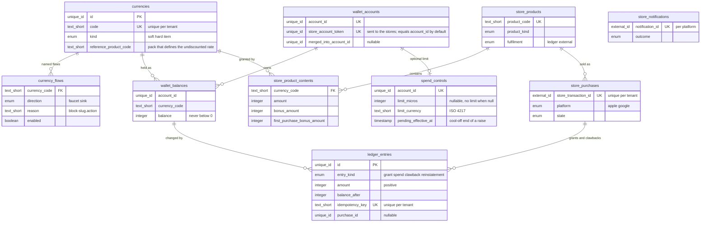
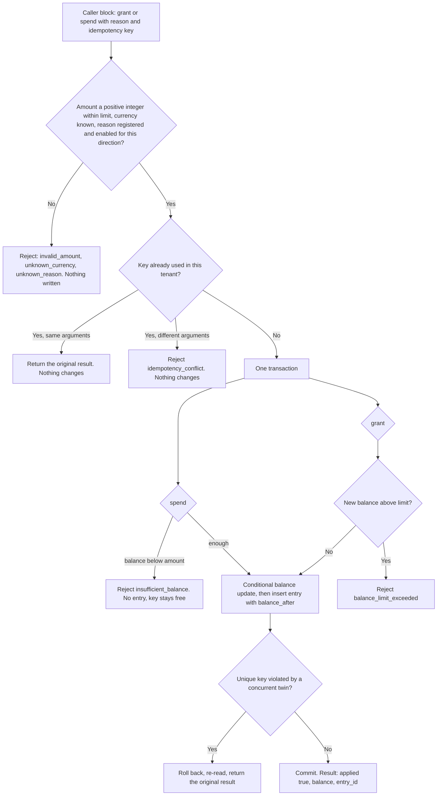
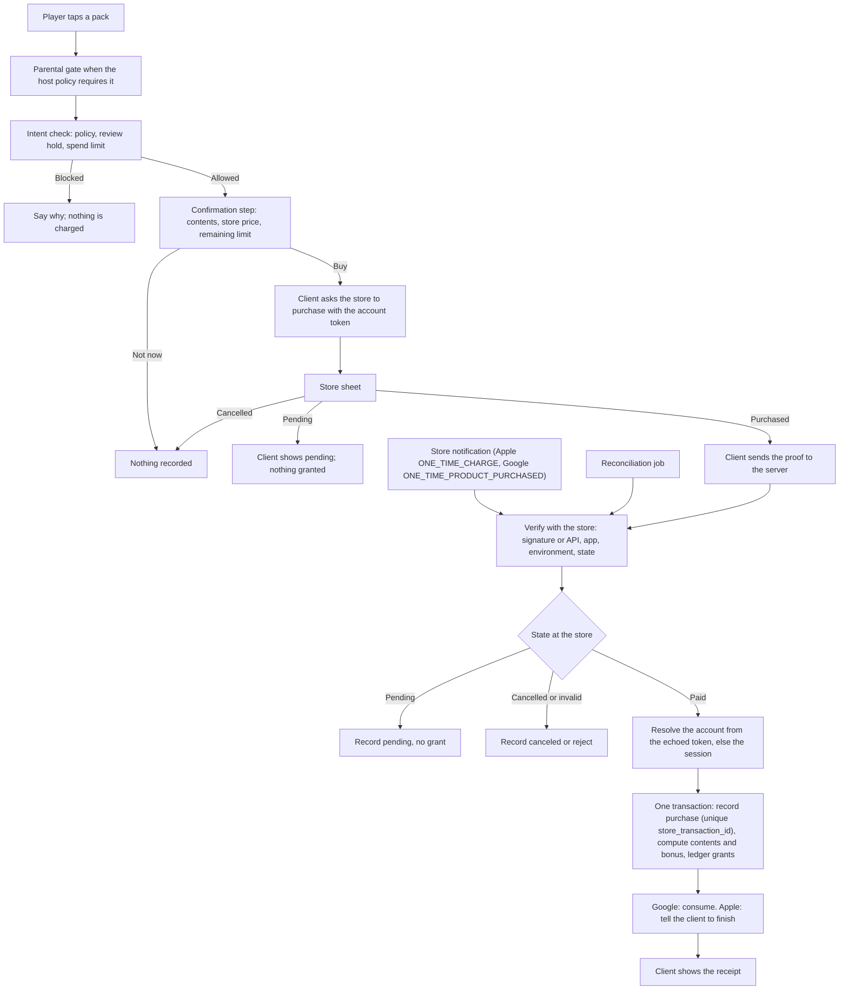
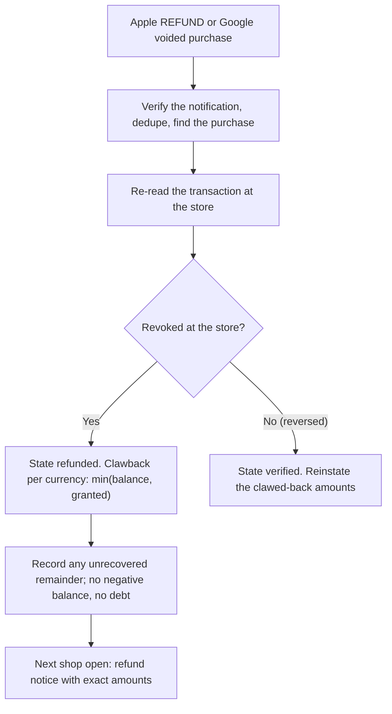
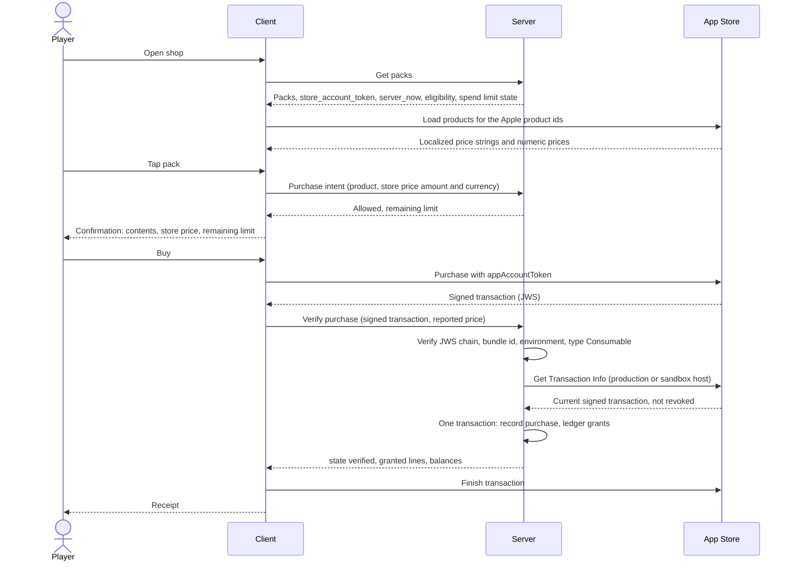
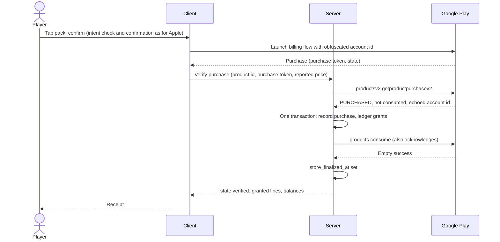
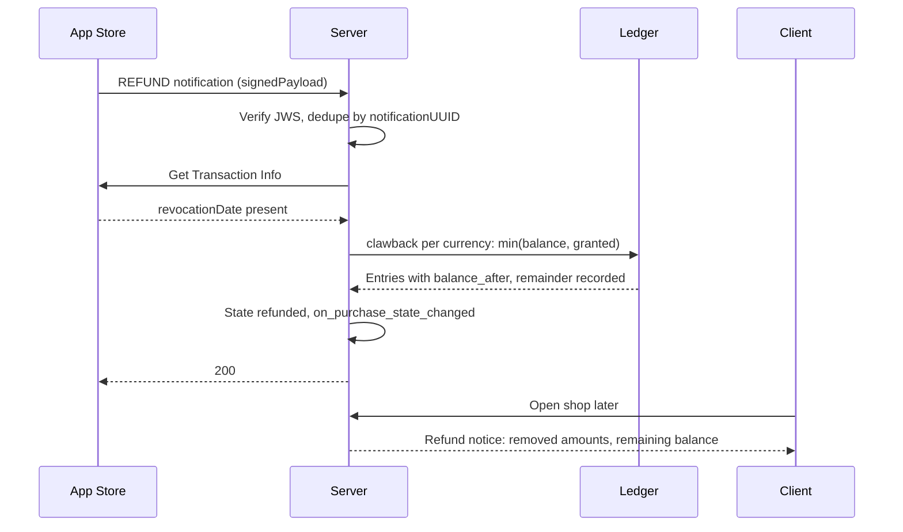

# Virtual Currency: Wallet Ledger and Consumable Currency Packs

## 1. Overview

### Problem Statement

A mobile game (a web app in a native wrapper, shipped to the App Store and Google Play) has currencies and countable items: a soft currency earned by playing, a hard currency mostly bought with money, boosters and similar items. Other features give and take them: a daily reward grants coins, a season pass sells a tier skip for gems, an energy refill costs gems. Players also buy the hard currency in packs. Apple requires in-app currencies to be sold through in-app purchase and says purchased currencies may not expire ([App Review Guidelines 3.1.1](https://developer.apple.com/app-store/review/guidelines/), HIGH). Google Play Billing has the same consumable model.

Three problems make this block necessary:

1. **The balance is money-adjacent state.** Every change has to be applied exactly once, never take a balance below zero, and be explainable later. A balance column that features update directly cannot be audited, and a retried request double-grants.
2. **Stores deliver at least once, out of order, and take purchases back.** A purchase can arrive twice, arrive while the app is closed, stay pending for days, or be refunded after the player spent the currency. The store settles who paid; the block settles what the player owns.

3. **Money must stay legible and controllable.** A player who buys or spends a premium currency has to be able to learn what it costs in real money, and a player who wants to cap their own spending needs a limit that cannot be lifted on impulse. Kit guide 14 (Decision rule 4) recommends showing the real-money value of what is bought and spent, and guide 06 (Decision rule 1) says to show prices in real money wherever currency is sold.

This block specifies one **wallet ledger** (the only way any block changes a balance), a **currency registry** that names every faucet and sink so a team can audit the economy, a **consumable pack catalog** with a first-purchase bonus and a one-time starter offer, **server-side verification** of App Store and Google Play purchases, handling of **pending and interrupted** purchases, **refund and revoke** handling with an explicit clawback policy, a **reconciliation job**, **account erasure** and **restore** behavior, **spending controls** (a purchase confirmation step and an optional per-account spend limit with a cool-off on raising it), and the shop, balance and purchase screens (`frontend.md`).

The block owns two contracts that sibling blocks rely on. The **ledger contract** (section 6) is `grant` and `spend` with an idempotency key. The **purchase contract** is that a verified store purchase is recorded once per `store_transaction_id`; `billing.subscriptions` and `engagement.season-pass` reuse that record and never verify receipts a second way.

### User Stories

- **Player**: I see my balances at all times, and when I lack gems for something I am taken to the shop with the missing amount stated.
- **Player**: the shop shows each pack with the price my store charges, in my currency, exactly as the store sheet will show it.
- **Player**: before the store sheet opens I see what I get and what it costs in real money, and I can say "not now".
- **Player**: I can set a spending limit for myself. Lowering it works at once; raising or removing it takes a day, so a bad moment cannot undo it.
- **Player**: wherever something costs gems, I can learn roughly what those gems cost in real money, and my purchase history shows what each purchase charged.
- **Player**: I pay once and the gems arrive once, even if my connection drops, the app is killed, or I tap twice.
- **Player**: if my payment needs approval (a parent, a cash payment), the app says so, lets me keep playing, and adds the gems when the store confirms.
- **Player**: if the store refunds a purchase, the app tells me what was removed and why. My balance never goes below zero.
- **Player**: a new phone shows my balance when I sign in to the same account. A guest profile warns me before I buy.
- **Game designer**: every currency lists where it enters and leaves, and a report shows net flow per reason.
- **Developer of another block**: I call `grant` and `spend` with a key built from stable facts; a retry cannot double-apply.
- **Operator**: I see pending purchases, refunds, unconsumed Google purchases and any ledger drift in one report.

### When to use this block

- The game has at least one virtual currency or countable item that features give and take, and sells consumable packs.
- The backend is SQL-family and the client is a web-tech shell with a native store plugin.
- User says: "gems", "coins", "currency pack", "top-up", "virtual currency", "wallet", "consumable IAP", "refund clawback", "idempotent reward grant".

### When NOT to use

- One permanent unlock and no currencies: use `billing.in-app-purchase`.
- Subscriptions and their entitlements: `billing.subscriptions` (it reuses this block's purchase record and receivers).
- A currency that exists only on the device with no purchase path. A client-only balance cannot be trusted; this block requires a server.
- Packs that sell randomized rewards (loot boxes, gacha). Odds disclosure, pity rules and minor protections need their own design (see `kits/game-engagement/guides/06-design-ethics-and-compliance.md`, "Harm and enforcement" and guide 15). This block's packs grant fixed contents only; a random product owned by another block is a `fulfilment = external` row with `random_reward` and an `odds_url`, and the shop shows the odds link beside it.
- Cash-out, withdrawal, or player-to-player transfer of currency. The ledger has no transfer operation between players.
- Spends that must change two currencies atomically. The contract spends one currency per call.
- Web checkout for the same packs. The shop here sells through the stores only.
- Currency expiry. Apple states purchased currencies may not expire; this block has no expiry mechanism.
- Document NoSQL as the primary store: non-goal (`docs/SPEC_GUIDELINES.md` section 4).

### Related blocks (referenced by id only)

| Block | Relation |
|---|---|
| `billing.in-app-purchase` | Sibling. Covers one non-consumable unlock through RevenueCat. This block verifies consumable packs on its own server. If one app embeds both, exactly one library finishes each store transaction (see Integration Points, "One finisher per transaction"). |
| `billing.subscriptions` | Reuses the purchase record and the two store receivers; owns `entitlement(account_id, product_code)`. Its stipends are `grant` calls. |
| `engagement.daily-streak`, `engagement.season-pass`, `engagement.event-calendar`, `engagement.objectives`, `engagement.timed-queues`, `messaging.push-reengagement` | Callers of `grant` and `spend`. Each registers its reasons in `currency_flows` (section 6, "Flows registered by the calling blocks"). `engagement.season-pass` and `engagement.timed-queues` read the purchase record for their store products. |
| `engagement.energy-lives` | Spends currency for paid refills and refunds undeliverable ones through the ledger; holds energy itself and credits it through `grantEnergy` (section 6, "Energy and the ledger"). |
| `engagement.items` | Holds owned objects on top of the ledger's item counts; registers its own reasons when they are final. |
| `auth.guest-account` | Calls this block's `holdings`, `mergeAccounts` and `deleteAccount`; passes the account id as the store account token (section 3, "Guest wallet merge"). |
| `compliance.account-deletion` | Erasure registry. This block registers an eraser for every table that holds account data (section 6). |
| `data.progress-sync` | Syncs progress, not balances. Balances live on the server only. Guest-to-account merge of wallets follows the account switch rules of that block (section 3, "Guest wallet merge"). |
| `auth.google-login`, `auth.sign-in-with-apple` | Supply the account. The wallet never stores an email or a provider id. |

---

## 2. Data Model

> Types below are **logical types** (canonical mapping in `docs/SPEC_GUIDELINES.md` section 5). Dialect-specific SQL is in [Reference Migration](#reference-migration-postgres) at the end of this section.

Every table carries `tenant_id` (tenant isolation, as in `blocks/ugc/friends-leaderboard/README.md`). Single-app deployments use one constant value. `account_id` is the project's account id (a guest or a signed-in account) with the same logical type as the project's account table; no foreign key to a users table, so guest accounts and merges work.



### Table: `currencies` (registry)

| Column | Logical Type | Constraints | Notes |
|---|---|---|---|
| `id` | `unique_id` | PK | |
| `tenant_id` | `unique_id` | NOT NULL | Tenant isolation |
| `code` | `text_short` | NOT NULL, UNIQUE per tenant | The `currency` argument of `grant` and `spend`. Lowercase `[a-z][a-z0-9_]*`: `coins`, `gems`, `booster_shield`. Item counts use the same table |
| `kind` | `enum` | NOT NULL | values: `soft`, `hard`, `item`. Informational for reports; the ledger treats all three alike |
| `display_name_key` | `text_short` | NOT NULL | Localization key; the server never sends display text |
| `sort_order` | `integer` | NOT NULL, default 0 | HUD order |
| `reference_product_code` | `text_short` | nullable, FK (`tenant_id`, `product_code`) → `store_products` | For a purchasable currency: the pack whose base `amount` and store price define the undiscounted rate used for the approximate real-money value (section 6, "Real-money value"). Usually the smallest pack. Null when the currency cannot be bought |
| `created_at` | `timestamp` | NOT NULL, default = now | UTC instant |
| `updated_at` | `timestamp` | NOT NULL, default = now | UTC instant; updated on every row mutation |

### Table: `currency_flows` (faucets and sinks)

One row per place a currency enters (faucet) or leaves (sink). Every ledger entry names a `reason`; the registry is the list of reasons a team agreed to. This is the audit surface for the guide rule "every currency has named faucets and sinks" (`kits/game-engagement/guides/03-economy-and-offers.md`, Decision rule 3).

| Column | Logical Type | Constraints | Notes |
|---|---|---|---|
| `id` | `unique_id` | PK | |
| `tenant_id` | `unique_id` | NOT NULL | |
| `currency_code` | `text_short` | NOT NULL, FK (`tenant_id`, `code`) → `currencies` | |
| `direction` | `enum` | NOT NULL | values: `faucet`, `sink`. A `grant` and a `reinstatement` need a faucet row; a `spend` and a `clawback` need a sink row |
| `reason` | `text_short` | NOT NULL | `<block-slug>.<action>`, for example `daily-streak.claim`, `energy-lives.refill`, `virtual-currency.pack-purchase` |
| `source_block` | `text_short` | NOT NULL | Owning block id, for example `engagement.daily-streak` |
| `description` | `text` | NOT NULL | One sentence a designer can read: what the player did to cause the flow |
| `enabled` | `boolean` | NOT NULL, default true | false rejects new entries with this reason (`unknown_reason`) without touching history. An emergency stop for a runaway faucet |
| `created_at` | `timestamp` | NOT NULL, default = now | |
| `updated_at` | `timestamp` | NOT NULL, default = now | |

**Indexes**: UNIQUE (`tenant_id`, `currency_code`, `direction`, `reason`).

### Table: `wallet_accounts`

| Column | Logical Type | Constraints | Notes |
|---|---|---|---|
| `id` | `unique_id` | PK | |
| `tenant_id` | `unique_id` | NOT NULL | |
| `account_id` | `unique_id` | NOT NULL, UNIQUE per tenant | Created on first use |
| `store_account_token` | `unique_id` | NOT NULL, UNIQUE per tenant | The value sent to Apple as `appAccountToken` (a UUID) and to Google as the obfuscated account id (64 characters at most, no personally identifiable information); the stores echo it back on the transaction. With `STORE_ACCOUNT_TOKEN_SOURCE = account_id` (default) it equals `account_id`, which `auth.guest-account` defines as a random UUID that is not personal data; with `wallet_token` it is a random UUID generated here. Never an email, a provider id or a value derived from personal data ([Apple, appAccountToken](https://developer.apple.com/documentation/storekit/product/purchaseoption/appaccounttoken(_:)), [Google, BillingFlowParams](https://developer.android.com/reference/com/android/billingclient/api/BillingFlowParams.Builder), HIGH) |
| `merged_into_account_id` | `unique_id` | nullable | Set when a guest wallet was merged into another account. Every operation on this account resolves to the target |
| `consumption_consent` | `boolean` | NOT NULL, default false | The player agreed that refund-request consumption data may be sent to Apple (section 3, "Refund") |
| `consumption_consent_at` | `timestamp` | nullable | |
| `refund_notice_seen_at` | `timestamp` | nullable | Refund notices are refunded purchases with `refunded_at` later than this instant |
| `created_at` | `timestamp` | NOT NULL, default = now | |
| `updated_at` | `timestamp` | NOT NULL, default = now | |

### Table: `spend_controls` (optional per-account limit)

One row per account that ever set a limit. No row, or `limit_micros` null, means no limit. Amounts are in micro-units of the limit's currency (one millionth), the unit Google reports prices in; Apple's payload price is in milliunits and is multiplied by 1000.

| Column | Logical Type | Constraints | Notes |
|---|---|---|---|
| `id` | `unique_id` | PK | |
| `tenant_id` | `unique_id` | NOT NULL | |
| `account_id` | `unique_id` | NOT NULL, UNIQUE per tenant | |
| `limit_micros` | `integer` | nullable, CHECK `> 0` | The limit in force. Null: no limit |
| `limit_currency` | `text_short` | nullable | ISO 4217 code the limit is written in; set together with `limit_micros` |
| `pending_limit_micros` | `integer` | nullable, CHECK `> 0` | A raise or currency change waiting out the cool-off |
| `pending_limit_currency` | `text_short` | nullable | |
| `pending_remove` | `boolean` | NOT NULL, default false | A removal waiting out the cool-off |
| `pending_effective_at` | `timestamp` | nullable | Server instant when the pending change takes effect: request time plus `SPEND_LIMIT_COOL_OFF_SECONDS` |
| `created_at` | `timestamp` | NOT NULL, default = now | |
| `updated_at` | `timestamp` | NOT NULL, default = now | |

The limit in force at time `t` is the pending change when `pending_effective_at <= t`, else the stored limit. A read at or after that instant applies the change (idempotent). The rules are in `backend.md`, "Spending controls".

### Table: `wallet_balances`

| Column | Logical Type | Constraints | Notes |
|---|---|---|---|
| `id` | `unique_id` | PK | |
| `tenant_id` | `unique_id` | NOT NULL | |
| `account_id` | `unique_id` | NOT NULL | |
| `currency_code` | `text_short` | NOT NULL, FK (`tenant_id`, `code`) → `currencies` | |
| `balance` | `integer` | NOT NULL, default 0, CHECK `balance >= 0` | Equals the `balance_after` of the newest ledger entry for the pair. Items are counts in the same column |
| `created_at` | `timestamp` | NOT NULL, default = now | |
| `updated_at` | `timestamp` | NOT NULL, default = now | |

**Indexes**: UNIQUE (`tenant_id`, `account_id`, `currency_code`); (`tenant_id`, `currency_code`, `account_id`) for `holders`.

### Table: `ledger_entries` (append-only)

| Column | Logical Type | Constraints | Notes |
|---|---|---|---|
| `id` | `unique_id` | PK | The `entry_id` of the result |
| `tenant_id` | `unique_id` | NOT NULL | |
| `account_id` | `unique_id` | NOT NULL | |
| `currency_code` | `text_short` | NOT NULL | |
| `entry_kind` | `enum` | NOT NULL | values: `grant`, `spend`, `clawback`, `reinstatement`. Credits: `grant`, `reinstatement`. Debits: `spend`, `clawback`. Only `grant` and `spend` are callable by other blocks |
| `amount` | `integer` | NOT NULL, CHECK `amount > 0` | Always positive; the kind gives the sign |
| `balance_after` | `integer` | NOT NULL, CHECK `balance_after >= 0` | The balance right after this entry; the `balance` of the result |
| `reason` | `text_short` | NOT NULL | `<block-slug>.<action>`; registered in `currency_flows` |
| `source_ref` | `text_short` | nullable | Caller's reference for humans and audits (for example `streak-day-5`). Not unique, not interpreted |
| `idempotency_key` | `text_short` | NOT NULL, UNIQUE per tenant | At most `LEDGER_IDEMPOTENCY_KEY_MAX_LENGTH` characters; built by the caller from stable facts |
| `purchase_id` | `unique_id` | nullable, FK → `store_purchases.id` | Set on pack grants, clawbacks and reinstatements |
| `created_at` | `timestamp` | NOT NULL, default = now | UTC instant, server clock |

**Indexes**: UNIQUE (`tenant_id`, `idempotency_key`); (`tenant_id`, `account_id`, `created_at` DESC) for history; (`purchase_id`).
**Append-only**: no code path updates a row. Rows are deleted only by account erasure (section 6).

### Table: `store_products` (pack catalog and purchase registry)

A row exists for every store product the server accepts. Packs have `fulfilment = ledger`. Products owned by another block (a season premium unlock, a subscription term) have `fulfilment = external`: this block verifies and records them; the owner acts on the record.

| Column | Logical Type | Constraints | Notes |
|---|---|---|---|
| `id` | `unique_id` | PK | |
| `tenant_id` | `unique_id` | NOT NULL | |
| `product_code` | `text_short` | NOT NULL, UNIQUE per tenant | Our code, for example `gems_medium`. Used in events and the shop |
| `product_kind` | `enum` | NOT NULL | values: `consumable`, `non_consumable`, `subscription_term`. Drives the store checks (Apple `type`) and the Google finish call (consume or acknowledge) |
| `fulfilment` | `enum` | NOT NULL | values: `ledger`, `external`. `ledger` requires `product_kind = consumable` and at least one `store_product_contents` row |
| `owner_block` | `text_short` | NOT NULL | Block id that sells it, for example `billing.virtual-currency` |
| `offer_kind` | `enum` | NOT NULL, default `standard` | values: `standard`, `starter` |
| `apple_product_id` | `external_id` | nullable, UNIQUE per tenant | App Store Connect product identifier |
| `google_product_id` | `external_id` | nullable, UNIQUE per tenant | Play Console product identifier |
| `max_purchases_per_account` | `integer` | nullable | Starter offers: 1. Null means unlimited. Controls shop visibility; a paid purchase beyond it is still delivered (section 3) |
| `window_seconds` | `integer` | nullable | Starter offers only: how long after account creation the offer is shown. Null means no time limit |
| `random_reward` | `boolean` | NOT NULL, default false | true when the product sells a randomized reward (a key, a chest, a pull). Only `fulfilment = external` products may set it; this block's packs have fixed contents |
| `odds_url` | `text_short` | nullable | Where the odds of a random reward are published. Required when `random_reward` is true; the shop and the confirmation step show it beside the product (Apple 3.1.1: odds must be disclosed before purchase, [Apple](https://developer.apple.com/app-store/review/guidelines/), HIGH) |
| `sort_order` | `integer` | NOT NULL, default 0 | |
| `active` | `boolean` | NOT NULL, default true | false hides the pack in the shop. Purchases of an inactive product that arrive from the store are still verified and delivered |
| `created_at` | `timestamp` | NOT NULL, default = now | |
| `updated_at` | `timestamp` | NOT NULL, default = now | |

There is no price column. The price is the store's localized string, read on the device (INV-16).

### Table: `store_product_contents`

| Column | Logical Type | Constraints | Notes |
|---|---|---|---|
| `id` | `unique_id` | PK | |
| `tenant_id` | `unique_id` | NOT NULL | |
| `product_code` | `text_short` | NOT NULL, FK (`tenant_id`, `product_code`) → `store_products` | |
| `currency_code` | `text_short` | NOT NULL, FK (`tenant_id`, `code`) → `currencies` | A currency or an item code |
| `amount` | `integer` | NOT NULL, CHECK `amount > 0` | Base units |
| `bonus_amount` | `integer` | NOT NULL, default 0, CHECK `>= 0` | Extra units always included, shown as a separate number in the shop |
| `first_purchase_bonus_amount` | `integer` | NOT NULL, default 0, CHECK `>= 0` | Extra units added when the purchase is the account's first of its scope (`FIRST_PURCHASE_BONUS_SCOPE`) |
| `created_at` | `timestamp` | NOT NULL, default = now | |
| `updated_at` | `timestamp` | NOT NULL, default = now | |

**Indexes**: UNIQUE (`tenant_id`, `product_code`, `currency_code`).

### Table: `store_purchases` (the purchase contract record)

One row per transaction the store itself vouches for. A forged or unverifiable proof creates no row.

| Column | Logical Type | Constraints | Notes |
|---|---|---|---|
| `id` | `unique_id` | PK | |
| `tenant_id` | `unique_id` | NOT NULL | |
| `account_id` | `unique_id` | nullable | Null while `state = unclaimed` and after erasure |
| `account_binding` | `enum` | nullable | values: `token`, `session`. How the account was determined: the store echoed our account token, or the submitting session |
| `platform` | `enum` | NOT NULL | values: `apple`, `google` |
| `store_transaction_id` | `external_id` | NOT NULL, UNIQUE per tenant | Apple `transactionId`; Google `purchaseToken` for one-time products (globally unique; Google says not to key on `orderId` because promo-code purchases have none: [Google, security](https://developer.android.com/google/play/billing/security), HIGH). Other blocks state the identifier they use for their own product kinds (a Google subscription term uses its `orderId`) |
| `store_order_id` | `external_id` | nullable | Google `orderId` when present |
| `store_product_id` | `external_id` | NOT NULL | Apple `productId` or Google product id as the store reported it |
| `product_code` | `text_short` | nullable | Null when the store product is not in the catalog (`state = rejected`) |
| `product_kind` | `enum` | nullable | Copied from the catalog row |
| `environment` | `enum` | NOT NULL | values: `production`, `sandbox`. Google license-tester purchases are recorded as `sandbox` |
| `quantity` | `integer` | NOT NULL, default 1 | |
| `state` | `enum` | NOT NULL | values: `pending`, `unclaimed`, `verified`, `canceled`, `refunded`, `rejected` (section 5) |
| `reject_reason` | `text_short` | nullable | values: `unknown_product`, `line_items_unsupported`, `type_mismatch`, `quantity_unsupported`, `environment_not_accepted`, `account_unknown` |
| `purchased_at` | `timestamp` | NOT NULL | The store's purchase instant (Apple `purchaseDate`, Google purchase time) |
| `verified_at` | `timestamp` | nullable | Server time when the state first became `verified` |
| `refunded_at` | `timestamp` | nullable | The store's revocation or void instant; null when not refunded |
| `refund_reason` | `text_short` | nullable | `apple:0`, `apple:1` (Apple `revocationReason`), or `google:<voidedReason name>` |
| `price_micros` | `integer` | nullable | What the store charged, in micro-units of `price_currency`. Apple: the payload `price` (milliunits) times 1000. Google: reported by the client from the store's product details. Used only for the spend limit and the purchase history; never for revenue (Apple: "Don't use the `price` or `currency` values for any revenue reconciliation", [Apple, JWSTransactionDecodedPayload](https://developer.apple.com/documentation/appstoreserverapi/jwstransactiondecodedpayload), HIGH) |
| `price_currency` | `text_short` | nullable | ISO 4217 code of `price_micros` |
| `price_source` | `enum` | NOT NULL, default `none` | values: `apple_payload`, `client_report`, `none` |
| `store_finalized_at` | `timestamp` | nullable | Google: the consume or acknowledge call succeeded. Apple: unused (the client finishes the transaction) |
| `first_purchase_bonus_applied` | `boolean` | NOT NULL, default false | |
| `created_at` | `timestamp` | NOT NULL, default = now | |
| `updated_at` | `timestamp` | NOT NULL, default = now | |

### Table: `store_notifications` (dedupe inbox)

| Column | Logical Type | Constraints | Notes |
|---|---|---|---|
| `id` | `unique_id` | PK | |
| `tenant_id` | `unique_id` | NOT NULL | |
| `platform` | `enum` | NOT NULL | values: `apple`, `google` |
| `notification_id` | `external_id` | NOT NULL | Apple `notificationUUID`; Google Pub/Sub `messageId` |
| `notification_type` | `text_short` | NOT NULL | The store's type name; no payload and no account data is stored |
| `store_transaction_id` | `external_id` | nullable | |
| `outcome` | `enum` | NOT NULL, default `received` | values: `received`, `processed`, `ignored`, `failed` |
| `received_at` | `timestamp` | NOT NULL, default = now | |
| `processed_at` | `timestamp` | nullable | |

**Indexes**: UNIQUE (`tenant_id`, `platform`, `notification_id`).

### Reference Migration (Postgres)

#### `currencies` and `currency_flows`

<!-- REFERENCE: dialect=postgres -->
<!-- ADAPT: `uuid ... gen_random_uuid()` -> MySQL `BINARY(16)` with UUID_TO_BIN(UUID()), SQLite `TEXT` with a uuid4 generated in the app; `timestamptz` -> MySQL `DATETIME(6)`, SQLite `TEXT` ISO 8601 with `Z`; `varchar(255)` -> SQLite `TEXT`; `boolean` -> MySQL `TINYINT(1)`, SQLite `INTEGER 0/1`; enum `CHECK (col IN (...))` -> MySQL `ENUM(...)`; composite FKs work unchanged on all three dialects (enable `PRAGMA foreign_keys=ON` on SQLite); the FK from `currencies.reference_product_code` to `store_products` is added after that table exists -->
```sql
CREATE TABLE IF NOT EXISTS currencies (
  id uuid PRIMARY KEY DEFAULT gen_random_uuid(),
  tenant_id uuid NOT NULL,
  code varchar(255) NOT NULL,
  kind text NOT NULL CHECK (kind IN ('soft','hard','item')),
  display_name_key varchar(255) NOT NULL,
  sort_order bigint NOT NULL DEFAULT 0,
  reference_product_code varchar(255),
  created_at timestamptz NOT NULL DEFAULT now(),
  updated_at timestamptz NOT NULL DEFAULT now(),
  UNIQUE (tenant_id, code)
);
CREATE TABLE IF NOT EXISTS currency_flows (
  id uuid PRIMARY KEY DEFAULT gen_random_uuid(),
  tenant_id uuid NOT NULL,
  currency_code varchar(255) NOT NULL,
  direction text NOT NULL CHECK (direction IN ('faucet','sink')),
  reason varchar(255) NOT NULL,
  source_block varchar(255) NOT NULL,
  description text NOT NULL,
  enabled boolean NOT NULL DEFAULT true,
  created_at timestamptz NOT NULL DEFAULT now(),
  updated_at timestamptz NOT NULL DEFAULT now(),
  UNIQUE (tenant_id, currency_code, direction, reason),
  FOREIGN KEY (tenant_id, currency_code) REFERENCES currencies (tenant_id, code)
);
```

#### `wallet_accounts` and `wallet_balances`

<!-- REFERENCE: dialect=postgres -->
<!-- ADAPT: same type mapping as above; the `CHECK (balance >= 0)` is the last line of defense and must stay on every dialect (SQLite and MySQL 8.0.16+ enforce CHECK); `account_id` takes the project's account id type -->
```sql
CREATE TABLE IF NOT EXISTS wallet_accounts (
  id uuid PRIMARY KEY DEFAULT gen_random_uuid(),
  tenant_id uuid NOT NULL,
  account_id uuid NOT NULL,
  store_account_token uuid NOT NULL,
  merged_into_account_id uuid,
  consumption_consent boolean NOT NULL DEFAULT false,
  consumption_consent_at timestamptz,
  refund_notice_seen_at timestamptz,
  created_at timestamptz NOT NULL DEFAULT now(),
  updated_at timestamptz NOT NULL DEFAULT now(),
  UNIQUE (tenant_id, account_id),
  UNIQUE (tenant_id, store_account_token)
);
CREATE TABLE IF NOT EXISTS wallet_balances (
  id uuid PRIMARY KEY DEFAULT gen_random_uuid(),
  tenant_id uuid NOT NULL,
  account_id uuid NOT NULL,
  currency_code varchar(255) NOT NULL,
  balance bigint NOT NULL DEFAULT 0 CHECK (balance >= 0),
  created_at timestamptz NOT NULL DEFAULT now(),
  updated_at timestamptz NOT NULL DEFAULT now(),
  UNIQUE (tenant_id, account_id, currency_code),
  FOREIGN KEY (tenant_id, currency_code) REFERENCES currencies (tenant_id, code)
);
CREATE INDEX IF NOT EXISTS idx_balances_holders ON wallet_balances (tenant_id, currency_code, account_id);
```

#### `spend_controls`

<!-- REFERENCE: dialect=postgres -->
<!-- ADAPT: same type mapping as above; `bigint` micro-units fit SQLite `INTEGER` (64-bit); keep the CHECK constraints on every dialect -->
```sql
CREATE TABLE IF NOT EXISTS spend_controls (
  id uuid PRIMARY KEY DEFAULT gen_random_uuid(),
  tenant_id uuid NOT NULL,
  account_id uuid NOT NULL,
  limit_micros bigint CHECK (limit_micros > 0),
  limit_currency varchar(255),
  pending_limit_micros bigint CHECK (pending_limit_micros > 0),
  pending_limit_currency varchar(255),
  pending_remove boolean NOT NULL DEFAULT false,
  pending_effective_at timestamptz,
  created_at timestamptz NOT NULL DEFAULT now(),
  updated_at timestamptz NOT NULL DEFAULT now(),
  UNIQUE (tenant_id, account_id)
);
```

#### `ledger_entries` and its append-only guard

<!-- REFERENCE: dialect=postgres -->
<!-- ADAPT: same type mapping as above; `purchase_id` FK is added after `store_purchases` exists -->
```sql
CREATE TABLE IF NOT EXISTS ledger_entries (
  id uuid PRIMARY KEY DEFAULT gen_random_uuid(),
  tenant_id uuid NOT NULL,
  account_id uuid NOT NULL,
  currency_code varchar(255) NOT NULL,
  entry_kind text NOT NULL CHECK (entry_kind IN ('grant','spend','clawback','reinstatement')),
  amount bigint NOT NULL CHECK (amount > 0),
  balance_after bigint NOT NULL CHECK (balance_after >= 0),
  reason varchar(255) NOT NULL,
  source_ref varchar(255),
  idempotency_key varchar(255) NOT NULL,
  purchase_id uuid,
  created_at timestamptz NOT NULL DEFAULT now(),
  UNIQUE (tenant_id, idempotency_key)
);
CREATE INDEX IF NOT EXISTS idx_ledger_history ON ledger_entries (tenant_id, account_id, created_at DESC);
CREATE INDEX IF NOT EXISTS idx_ledger_purchase ON ledger_entries (purchase_id);
```

<!-- REFERENCE: dialect=postgres -->
<!-- ADAPT: the trigger is Postgres PL/pgSQL; SQLite -> two `CREATE TRIGGER ... BEFORE UPDATE/DELETE ... SELECT RAISE(ABORT, ...)` triggers (SQLite cannot read a session flag, so run erasure through a maintenance connection that drops the delete trigger first); MySQL -> `SIGNAL SQLSTATE '45000'` triggers -->
```sql
CREATE FUNCTION ledger_guard() RETURNS trigger AS $$
BEGIN
  IF TG_OP = 'DELETE' AND current_setting('app.erasure', true) = 'on' THEN RETURN OLD; END IF;
  RAISE EXCEPTION 'ledger_entries is append-only';
END $$ LANGUAGE plpgsql;
CREATE TRIGGER ledger_no_change BEFORE UPDATE OR DELETE ON ledger_entries
  FOR EACH ROW EXECUTE FUNCTION ledger_guard();
```

#### `store_products` and `store_product_contents`

<!-- REFERENCE: dialect=postgres -->
<!-- ADAPT: same type mapping as above; the UNIQUE constraints on nullable `apple_product_id` and `google_product_id` allow several NULLs on Postgres, SQLite and MySQL; then add `ALTER TABLE currencies ADD FOREIGN KEY (tenant_id, reference_product_code) REFERENCES store_products (tenant_id, product_code)` -->
```sql
CREATE TABLE IF NOT EXISTS store_products (
  id uuid PRIMARY KEY DEFAULT gen_random_uuid(),
  tenant_id uuid NOT NULL,
  product_code varchar(255) NOT NULL,
  product_kind text NOT NULL CHECK (product_kind IN ('consumable','non_consumable','subscription_term')),
  fulfilment text NOT NULL CHECK (fulfilment IN ('ledger','external')),
  owner_block varchar(255) NOT NULL,
  offer_kind text NOT NULL DEFAULT 'standard' CHECK (offer_kind IN ('standard','starter')),
  apple_product_id text,
  google_product_id text,
  max_purchases_per_account bigint,
  window_seconds bigint,
  random_reward boolean NOT NULL DEFAULT false,
  odds_url varchar(255),
  sort_order bigint NOT NULL DEFAULT 0,
  active boolean NOT NULL DEFAULT true,
  created_at timestamptz NOT NULL DEFAULT now(),
  updated_at timestamptz NOT NULL DEFAULT now(),
  UNIQUE (tenant_id, product_code),
  UNIQUE (tenant_id, apple_product_id),
  UNIQUE (tenant_id, google_product_id),
  CHECK (fulfilment = 'external' OR product_kind = 'consumable'),
  CHECK (NOT random_reward OR (fulfilment = 'external' AND odds_url IS NOT NULL))
);
```

<!-- REFERENCE: dialect=postgres -->
<!-- ADAPT: same type mapping as above; composite FKs work unchanged on all three dialects -->
```sql
CREATE TABLE IF NOT EXISTS store_product_contents (
  id uuid PRIMARY KEY DEFAULT gen_random_uuid(),
  tenant_id uuid NOT NULL,
  product_code varchar(255) NOT NULL,
  currency_code varchar(255) NOT NULL,
  amount bigint NOT NULL CHECK (amount > 0),
  bonus_amount bigint NOT NULL DEFAULT 0 CHECK (bonus_amount >= 0),
  first_purchase_bonus_amount bigint NOT NULL DEFAULT 0 CHECK (first_purchase_bonus_amount >= 0),
  created_at timestamptz NOT NULL DEFAULT now(),
  updated_at timestamptz NOT NULL DEFAULT now(),
  UNIQUE (tenant_id, product_code, currency_code),
  FOREIGN KEY (tenant_id, product_code) REFERENCES store_products (tenant_id, product_code),
  FOREIGN KEY (tenant_id, currency_code) REFERENCES currencies (tenant_id, code)
);
```

#### `store_purchases` and `store_notifications`

<!-- REFERENCE: dialect=postgres -->
<!-- ADAPT: same type mapping as above; `store_transaction_id` is `text` here because Google does not state a maximum purchase-token length on the pages read, and MySQL's logical `external_id` (`VARCHAR(255)`) needs a hashed key column if a real token is longer: check tokens from a sandbox purchase; then add the `ledger_entries.purchase_id` FK -->
```sql
CREATE TABLE IF NOT EXISTS store_purchases (
  id uuid PRIMARY KEY DEFAULT gen_random_uuid(),
  tenant_id uuid NOT NULL,
  account_id uuid,
  account_binding text CHECK (account_binding IN ('token','session')),
  platform text NOT NULL CHECK (platform IN ('apple','google')),
  store_transaction_id text NOT NULL,
  store_order_id text,
  store_product_id text NOT NULL,
  product_code varchar(255),
  product_kind text,
  environment text NOT NULL CHECK (environment IN ('production','sandbox')),
  quantity bigint NOT NULL DEFAULT 1,
  state text NOT NULL CHECK (state IN ('pending','unclaimed','verified','canceled','refunded','rejected')),
  reject_reason varchar(255),
  purchased_at timestamptz NOT NULL,
  verified_at timestamptz,
  refunded_at timestamptz,
  refund_reason varchar(255),
  price_micros bigint,
  price_currency varchar(255),
  price_source text NOT NULL DEFAULT 'none' CHECK (price_source IN ('apple_payload','client_report','none')),
  store_finalized_at timestamptz,
  first_purchase_bonus_applied boolean NOT NULL DEFAULT false,
  created_at timestamptz NOT NULL DEFAULT now(),
  updated_at timestamptz NOT NULL DEFAULT now(),
  UNIQUE (tenant_id, store_transaction_id)
);
```

<!-- REFERENCE: dialect=postgres -->
<!-- ADAPT: same type mapping as above; the notification id is `text` for the same token-length reason as `store_transaction_id` -->
```sql
CREATE TABLE IF NOT EXISTS store_notifications (
  id uuid PRIMARY KEY DEFAULT gen_random_uuid(),
  tenant_id uuid NOT NULL,
  platform text NOT NULL CHECK (platform IN ('apple','google')),
  notification_id text NOT NULL,
  notification_type varchar(255) NOT NULL,
  store_transaction_id text,
  outcome text NOT NULL DEFAULT 'received' CHECK (outcome IN ('received','processed','ignored','failed')),
  received_at timestamptz NOT NULL DEFAULT now(),
  processed_at timestamptz,
  UNIQUE (tenant_id, platform, notification_id)
);
```

---

## 3. Data Flow

### Ledger write



### Pack purchase delivery

Three paths deliver the same purchase and converge on one idempotent recording step.



### Refund



### Guest wallet merge

`auth.guest-account` registers every block that holds per-account state as a participant with `holdings(account_id)`, `mergeAccounts(from_account_id, into_account_id, merge_id)` and `deleteAccount(account_id)` (`blocks/auth/guest-account/README.md`, "Holdings and merge participants"). This block registers all three.

- **`holdings(account_id)`** returns `{ category, label_key, paid, effect }` for each currency or item code the account holds with a balance above zero: `category` is `currency` for `soft` and `hard` currencies and `items` for item codes, `label_key` is the currency's `display_name_key`, `paid` is true when a `verified` purchase of this account granted that code (the balance may be mixed with earned units, so `paid` is a conservative flag), `effect` is `carried`. Purchases are not listed here: the blocks that own entitlements (`engagement.season-pass`, `billing.subscriptions`) list theirs. The list is sorted by `category`, then `label_key`, so the preview digest of the caller is stable.
- **`mergeAccounts(from, into, merge_id)`** is one-way and idempotent by `merge_id`: per currency with a positive balance, one `spend` on `from` (reason `virtual-currency.wallet-merge-out`, key `wallet-merge-out:{merge_id}:{currency}`) and one `grant` on `into` (reason `virtual-currency.wallet-merge-in`, key `wallet-merge-in:{merge_id}:{currency}`), then `merged_into_account_id` is set on the guest row. A repeat with the same `merge_id` returns the first result and finishes any missing leg; merging the same guest into another account fails `already_merged`; merging an account into itself is rejected.
- **After the merge** every operation on the guest id (a purchase submitted by an old session, a refund of a guest purchase) resolves to the target, and `purchase_record(...).account_id` returns the surviving account. A purchase made as a guest keeps its row; refunds resolve through the merge pointer.
- **`deleteAccount(account_id)`** is the eraser of section 6, safe to repeat.
- The store account token is the `account_id` by default (`STORE_ACCOUNT_TOKEN_SOURCE`), so past transactions still carry a token that resolves through the merge pointer.

---

## 4. Sequence Diagrams

### Happy path: Apple consumable pack



### Happy path: Google consumable pack



### Google pending purchase completes

```mermaid
sequenceDiagram
    actor P as Player
    participant C as Client
    participant S as Server
    participant G as Google Play

    C->>S: Verify purchase (token)
    S->>G: productsv2.getproductpurchasev2
    G-->>S: PENDING
    S-->>C: state pending (no grant, no acknowledge)
    C-->>P: Waiting for payment approval; keep playing
    Note over G: Payment completes later
    G->>S: Pub/Sub push ONE_TIME_PRODUCT_PURCHASED (token)
    S->>G: productsv2.getproductpurchasev2
    G-->>S: PURCHASED
    S->>S: Record verified, ledger grants
    S->>G: products.consume
    C->>S: Wallet refresh on resume
    S-->>C: New balance and the purchase receipt
```

### Refund after the player spent part of the pack



---

## 5. State Management

### Purchase state (server, `store_purchases.state`)

| State | Meaning | Ledger effect |
|---|---|---|
| `pending` | The store reports the payment is not complete (Google `PENDING`) | None. Nothing is consumed or acknowledged |
| `unclaimed` | Verified and paid, but no account is known: the store did not echo our token and no session submitted it (for example an Apple offer-code redemption seen first through a notification) | None until a session submits the proof |
| `verified` | Paid and recorded. For `fulfilment = ledger` the grants were written in the same transaction | Grants exist |
| `canceled` | A pending purchase was canceled or expired at the store | None |
| `refunded` | The store refunded or voided it | Clawback entries exist |
| `rejected` | The store vouches for the transaction but the server refuses to deliver it (`reject_reason`) | None |

Transitions:

```
(new) -> pending | unclaimed | verified | rejected
pending -> verified | canceled
unclaimed -> verified (a session submits the proof)
verified -> refunded (REFUND, voided purchase)
refunded -> verified (Apple REFUND_REVERSED)
canceled, rejected -> terminal
```

Every other transition is ignored and logged. State is always set from a fresh read of the store (section 3, Refund), never from the order in which notifications arrive.

### Server state

| State | Storage | Notes |
|---|---|---|
| Balances | `wallet_balances` | Derived from the ledger; the ledger wins on any mismatch (`reconciliation.feature`) |
| Purchase state | `store_purchases` | |
| Notification dedupe | `store_notifications` | |
| Reconciliation cursors | The job's own run record (`last_run_at` per task) | Not part of the data model; any durable key-value store |

### Client state

| State | Storage | Survives reload | Notes |
|---|---|---|---|
| `balances` | In memory, refreshed from the server | No | Never authoritative; every spend is decided by the server |
| `packs`, `purchase_policy`, `server_offset` | In memory | No | `server_offset` = `server_now` minus device time, used for countdowns |
| `flow` | In memory | No | `idle`, `gate`, `intent`, `confirming`, `store_sheet`, `verifying`, `granted`, `pending`, `cancelled`, `failed`, `rejected`, `blocked` |
| `spend_limit` | In memory, from the server | No | `{limit_micros, limit_currency, spent_micros, remaining_micros, pending_change}`; display only, the server decides |
| Unfinished store transactions | The store's own queue (Apple unfinished transactions, Google unconsumed purchases) | Yes, kept by the store | The recovery source after a crash |

---

## 6. Integration Points

### Inbound: the ledger contract (owned here)

Callers are server-side modules of other blocks; the client never calls these.

| Call | Arguments | Result |
|---|---|---|
| `grant` | `account_id`, `currency`, `amount`, `reason`, `source_ref`, `idempotency_key` | `{applied, balance, entry_id}` |
| `spend` | same | same; rejects with `insufficient_balance` |
| `balance` | `account_id`, `currency` (optional) | balances |
| `holders` | `currency`, `after_account_id` (optional), `limit` | `{ holders: [{ account_id, balance }], next_after_account_id }`: accounts of the tenant whose balance of `currency` is above zero, ordered by `account_id` ascending, after the given cursor (exclusive), at most `limit` rows (1 to `HOLDERS_MAX_LIMIT`); `next_after_account_id` is null on the last page. Read-only and in-process, for sweeps such as the expiry of an item stack in `engagement.items`. A merged-away account has no balance, so it is not listed |

Rules (all tested in `ledger.feature`):

- `amount` is a positive integer. `reason` is `<block-slug>.<action>`, for example `daily-streak.claim`, `season-pass.tier-reward`, `objectives.reward`, `energy-lives.refill`, `event-calendar.reward`, `virtual-currency.pack-purchase`, `subscriptions.stipend`. Items other than currencies use the same calls with `currency` set to an item code.
- A replay with an `idempotency_key` already applied, with the same `account_id`, `currency`, `amount`, `reason` and kind, returns the original `{applied, balance, entry_id}` (`balance` is the `balance_after` of the original entry) and changes nothing. The same key with any different argument returns the error `idempotency_conflict` and changes nothing.
- A rejected `spend` (`insufficient_balance`) writes no entry and does not consume its key; a later call with the same key is a new attempt.
- `grant` and `spend` never take or leave a balance outside `0 .. LEDGER_MAX_BALANCE`. Errors: `invalid_amount`, `unknown_currency`, `unknown_reason`, `insufficient_balance`, `balance_limit_exceeded`, `idempotency_conflict`.
- Keys are built by the caller from stable facts, at most `LEDGER_IDEMPOTENCY_KEY_MAX_LENGTH` characters, for example `daily-streak:{account_id}:{day_key}` or `season-pass:{account_id}:{season_id}:{track}:{tier}`.
- Each calling block ships its `currency_flows` rows (currency, direction, reason, description) with its own migration. A `grant` needs a `faucet` row, a `spend` a `sink` row. This block registers only its own `virtual-currency.*` rows; every other block registers its own (`engagement.items` registers its rows for the item codes it manages), so a block added later adds rows without a change here.
- **Keys are kept for the life of the entry.** An idempotency key is the unique column of its ledger row, so it lives as long as the row: there is no expiry and no purge except account erasure. Callers whose retries can arrive late (a claim grace plus a retry window, as in `engagement.event-calendar`, `blocks/engagement/event-calendar/security.md` T-2) can rely on a replay returning the original result for the whole life of the account. Any archival of old entries must keep keys at least as long as the longest claim grace plus retry window of every caller.

### Flows registered by the calling blocks

Each row below comes from the sibling block's own README at the time of writing and is registered by that block's migration, one row per currency it uses. `fixtures/catalog.json` holds a sample set. A reason that is not in a sibling's README is not listed.

| Block | Faucet reasons | Sink reasons |
|---|---|---|
| `engagement.daily-streak` | `daily-streak.claim`, `daily-streak.repair-refund` | `daily-streak.freeze-purchase`, `daily-streak.repair-purchase` |
| `engagement.season-pass` | `season-pass.tier-reward`, `season-pass.refund-restore` | `season-pass.tier-skip`, `season-pass.xp-boost`, `season-pass.refund-clawback` |
| `engagement.energy-lives` | `energy-lives.refill-refund` | `energy-lives.refill` |
| `engagement.objectives` | `objectives.reward` | none |
| `engagement.event-calendar` | `event-calendar.reward` | none |
| `engagement.timed-queues` | `timed-queues.collect`, `timed-queues.cancel-refund` | `timed-queues.start`, `timed-queues.speed-up`, `timed-queues.slot-unlock` |
| `messaging.push-reengagement` | `push-reengagement.comeback-reward` | none |
| `billing.subscriptions` | `subscriptions.stipend` | `subscriptions.stipend-reversal` |
| `billing.virtual-currency` | `virtual-currency.pack-purchase`, `virtual-currency.pack-refund-reversed`, `virtual-currency.wallet-merge-in`, `virtual-currency.support-grant` | `virtual-currency.pack-refund`, `virtual-currency.wallet-merge-out`, `virtual-currency.support-debit` |
| `engagement.items` | `items.upgrade-refund`, `items.consume-refund`, `items.duplicate`, `items.convert`, `items.expire` | `items.upgrade`, `items.consume`, `items.discard`, `items.expire`, `items.convert` |

### Energy and the ledger

`engagement.energy-lives` does not hold energy in the ledger, because the value of energy depends on time. It exposes `grantEnergy(account_id, meter_code, amount, reason, source_ref, idempotency_key)`, which returns `{applied, balance, entry_id}` plus `applied_amount` and `unapplied_amount` (`blocks/engagement/energy-lives/README.md`, "Cross-block contracts"). That is consistent with this contract: `grantEnergy` mirrors the shape of `grant` with the meter code in the `currency` position and has its own idempotency, so no ledger row and no `currency` named `energy` exist, and the ledger neither stores nor routes energy. Its two reasons `energy-lives.ad-refill` and `energy-lives.gift` are meter grants and need no `currency_flows` row; the ledger touches energy only through the paid refill (`energy-lives.refill`, a `spend` of a currency) and its undeliverable-refill refund (`energy-lives.refill-refund`, a `grant`). A game that chooses to keep energy as a ledger item instead registers faucet rows for those reasons and must not also keep it in `engagement.energy-lives`.

### Inbound: the purchase contract (owned here)

| Call | Purpose |
|---|---|
| `verify_apple_transaction(signed_transaction)` | Verifies an Apple signed transaction of any product type (chain, bundle id, environment, current state at the store) and returns the verified facts. |
| `record_verified_purchase(input)` | In-process, idempotent by `store_transaction_id`. Records a verified purchase for a catalog product and returns the record. Used by this block's verify endpoint and by blocks that sell their own product kinds. Not exposed over HTTP. |
| `purchase_record(store_transaction_id)` | Returns `{store_transaction_id, platform, account_id, product_code, product_kind, state, purchased_at, refunded_at}`. Callers treat only `verified` as paid. |
| `holdings(account_id)`, `mergeAccounts(from_account_id, into_account_id, merge_id)`, `deleteAccount(account_id)` | The participant contract of `auth.guest-account` (section 3, "Guest wallet merge"; section 6, "Erasure registration"). |
| `on_purchase_state_changed(store_transaction_id)` | Fired in-process after the commit of every state change. A latency hint: the record is the truth, so a consumer reads the record and keeps its own periodic re-read. |
| `register_notification_handler(platform, family, handler)` | `platform` is `apple` or `google`; `family` is the string `subscription`. The two store receivers are shared (App Store Connect takes one server URL per environment). Messages of a family this block does not own (Apple subscription types, Google `subscriptionNotification`) go to the registered handler after the same verification and dedupe. A handler failure returns a non-2xx so the store redelivers. |
| `purchase_policy(account_id)` | Provided by the host app: `{purchases_enabled, parental_gate_required, countdown_offers_allowed}`. With no policy registered the answer is `purchases_enabled = false`, reason `age`, so real-money spending is off for any profile the host has not verified as an adult (kit guide 15 recommends this default; `PURCHASES_DEFAULT_WITHOUT_POLICY` = `off`). Gates the shop only; a purchase that arrives from the store is always verified and delivered (INV-12). This block adds the reason `review` when the refund-review threshold is met. |
| `set_spend_limit(account_id, limit, apply)` | In-process, for host policy (section 6, "Spending controls"). Players use `PUT /api/spend-limit`. |

### Inbound: client endpoints

`GET /api/wallet`, `GET /api/wallet/history`, `GET /api/shop/packs` (also `?codes=` for direct purchases), `POST /api/purchases/intent`, `POST /api/purchases/verify`, `GET /api/purchases/recent`, `GET /api/spend-limit`, `PUT /api/spend-limit`, `DELETE /api/spend-limit/pending`, `PUT /api/wallet/consumption-consent` (details in `backend.md`).

### Spending controls

Two controls sit in front of the store sheet. Both gate the shop, not the store: a purchase made outside the shop (a store product page, an offer-code redemption) is verified, delivered and counted (INV-12), and the shop then reflects it. For a child's device the stores' own controls are stronger: Apple's `pending` purchase result and Google's `PENDING` state exist for purchases that need approval (sections 3 and 4).

| Control | Rule |
|---|---|
| Purchase confirmation | Before the store sheet opens, the client shows the pack contents (base, bonus, first-purchase bonus), the store's price string and, when a limit exists, the amount left under it. "Buy" and "Not now" are equally visible. `PURCHASE_CONFIRMATION` = `always` (default) or `off`. The store's own sheet stays the final step |
| Spend limit | Optional, per account, in the player's store currency, counted over a rolling `SPEND_LIMIT_PERIOD_SECONDS` from the `price_micros` of the account's `pending`, `unclaimed` and `verified` purchases (a refund frees room). `POST /api/purchases/intent` rejects a purchase that would cross it and returns `next_room_at`, the earliest instant at which that purchase would fit (`backend.md` section 12) |
| Cool-off | Setting a first limit and lowering a limit apply at once. Raising a limit, changing its currency and removing it are recorded as pending and apply after `SPEND_LIMIT_COOL_OFF_SECONDS` of server time; the player can cancel a pending change at any time |
| Gate | Changing a limit passes the host's parental gate when `purchase_policy` says `parental_gate_required` |
| Host-set limit | The host may set a limit with `set_spend_limit(account_id, limit, apply)` (`apply` = `immediate` only for tightening or first-time setting by the host, for example a default for a minor's account) |

### Guide 15 controls

| Control (kit guide 15) | Where it is in this block |
|---|---|
| Spend limit with a cool-off; purchase confirmation with the real-money total | "Spending controls" above |
| Purchased currency never expires | INV-14; there is no expiry column, job or rule (Apple 3.1.1) |
| One premium currency and no chained exchanges | At most `MAX_PURCHASABLE_CURRENCIES` (default 1) currencies are granted by any pack, checked at startup; the ledger has no conversion operation between currencies (INV-27) |
| A pack or direct purchase for each exact price | The insufficient-balance sheet marks the packs that cover the shortfall and can list a direct purchase of the item for money: a `store_products` row sold through the same intent, confirmation and verification path (`GET /api/shop/packs?codes=`, `frontend.md` screen 8). The reconciliation job reports the balance left after each pack purchase so a team can see remainders (`backend.md` section 13) |
| An odds link beside any random item | `store_products.random_reward` and `odds_url`; the shop card and the confirmation step show the link |
| Real-money spend off by default for a profile not verified as an adult | `purchase_policy` defaults to `purchases_enabled = false` when the host registers none (section 6, "Inbound: the purchase contract") |
| A refund path for spend a guardian did not authorize | The spending screen's "Unauthorized purchase?" help points to the store's refund request and to support; an operator can refund a Google purchase with `orders.refund` (`backend.md` section 10); the resulting refund is flagged `operator:unauthorized` and does not count toward the refund-review hold |

### Real-money value

The player can always learn what a purchase costs in real money:

1. Every pack card, the starter offer and the confirmation step show the store's price string (INV-16).
2. The receipt and the purchase history show the amount charged (`price_micros` in `price_currency`, formatted for the locale); when the amount is unknown the line says to see the store receipt.
3. Wherever the game prices something in a purchasable currency (the insufficient-balance sheet, a host's item price, a season-pass skip, an energy refill: every screen of every block, through one shared `ApproxMoney` component), the client shows an indicative real-money equivalent beside the currency price, labeled "about" with an "indicative" explanation. The device computes it at the undiscounted reference rate from the pack catalog: `indicative = ceil_to_minor_unit(amount * P / B)`, where `P` is the store's numeric price of the pack named by the currency's `reference_product_code` and `B` is that pack's base `amount` in `store_product_contents` (no bonus, no first-purchase bonus, no discount, no other pack). Guide 10 (Real-money value) requires the indicative figure beside any price in a purchasable currency; INV-16 stays true because this figure is display only. This is the only computed money figure in the block (INV-24). It follows kit guide 14, Decision rule 4, whose basis is the EU consumer-protection network's principle that the real-money price of content bought with virtual currency be shown clearly and computed at what the consumer would pay in full (guide 14 labels this HIGH for the text, a non-binding document). The block did not read that document itself.
4. When the reference price is unavailable (store unreachable) the approximate value is hidden and a "pack prices" link opens the shop. A "pack prices" entry is reachable from every balance display of a purchasable currency.

### Outbound

| Target | How | Purpose |
|---|---|---|
| App Store Server API | HTTPS, JWT signed ES256 | Get Transaction Info, Get Notification History, Send Consumption Information |
| App Store Server Notifications V2 | Inbound HTTPS POST from Apple | Purchases, refunds, refund reversals, consumption requests |
| Google Play Developer API | HTTPS, service account, scope `androidpublisher` | `productsv2.getproductpurchasev2`, `products.consume`, `products.acknowledge`, `voidedpurchases.list`, `orders.refund` |
| Google Cloud Pub/Sub | Push subscription to this server | Real-time developer notifications |
| Host hook `purchase_policy` | In-process | Age and region gating |

### One finisher per transaction

Exactly one library finishes (Apple) or consumes and acknowledges (Google) each store transaction. In this block the server consumes Google purchases and the client finishes Apple transactions after the server's answer. RevenueCat finishes transactions by default, and its documentation says that setting `purchasesAreCompletedBy` to `MY_APP` makes the app complete them itself ([RevenueCat, finishing transactions](https://www.revenuecat.com/docs/migrating-to-revenuecat/sdk-or-not/finishing-transactions), HIGH). An app that embeds RevenueCat for `billing.in-app-purchase` and this block's store plugin must configure RevenueCat so it does not finish or consume the consumable packs (MEDIUM: the interplay of the two SDKs was not run; test it on both stores).

### Erasure registration

`compliance.account-deletion` requires every table that holds data about a user to cascade or to have an eraser (`blocks/compliance/account-deletion/README.md`, "Erasure inventory"; `backend.md`, Pattern 3 "Erasure registry"). This block registers:

| Table | Action on account deletion |
|---|---|
| `wallet_balances`, `wallet_accounts`, `spend_controls` | Hard delete |
| `ledger_entries` | Hard delete for the account (the only permitted delete) |
| `store_purchases` | Retained, de-linked: `account_id` set null; nothing else changes. The record is a payment-processing record the merchant may have to keep (GDPR Article 17(3)(b) names compliance with a legal obligation as an exception, [GDPR Art. 17](https://gdpr-info.eu/art-17-gdpr/), MEDIUM: secondary mirror of the regulation; whether it applies is the merchant's legal decision). Set `ERASURE_PURCHASE_RECORDS = delete` to remove the rows instead |
| `store_notifications` | Holds no account data; untouched |

The deletion confirmation must state that the remaining balance is deleted and is not refunded by the game (refund rights stay with the store). A later refund notification for a de-linked purchase is recorded and needs no clawback.

### Events (analytics)

Shared envelope from the kit guide `12-live-ops-and-instrumentation.md` (`event_name`, `account_id`, `session_id`, `server_ts`, `client_ts`, `app_version`, `platform`). The names `currency_grant`, `currency_spend`, `purchase_verified`, `purchase_refunded` and `offer_shown` and their core properties are the ones that guide defines; this block adds properties and the events marked "added".

Server events (written in the same transaction as the state change):

| Event | Properties | When |
|---|---|---|
| `currency_grant` | `currency`, `amount`, `balance_after`, `reason`, `source_ref`, `entry_id` | A `grant` or `reinstatement` is applied (`reason` shows which) |
| `currency_spend` | same as `currency_grant` | A `spend` or `clawback` is applied |
| `purchase_verified` | `product_code`, `offer_id`, `currency_code`, `price_micros`, plus added `price_currency`, `price_source`, `platform`, `environment`, `first_purchase_bonus_applied`, `latency_ms` | A purchase first becomes `verified`, once per `store_transaction_id`. `offer_id` equals `product_code`; `currency_code` is the pack's hard-currency line, else its first line |
| `purchase_refunded` | `product_code`, `refund_reason`, plus added `platform`, `clawed_total`, `shortfall_total` | A refund is applied |
| `purchase_reinstated` (added) | `product_code`, `platform`, `reinstated_total` | Apple REFUND_REVERSED applied |
| `ledger_rejected` (added) | `currency`, `reason`, `error` | A ledger call is rejected |
| `purchase_blocked` (added) | `product_code`, `reason` (`limit_reached`, `limit_currency_mismatch`, `policy`, `review`) | An intent check refuses a purchase |
| `spend_limit_changed` (added) | `change` (`set`, `lowered`, `raise_requested`, `remove_requested`, `cancelled`, `applied`), `limit_micros`, `limit_currency`, `effective_at` | A spend limit is set, requested, cancelled or takes effect |

Client events are listed in `frontend.md`. Revenue comes from the store's reports, not from these events: Apple states its payload price must not be used for revenue reconciliation ([Apple, JWSTransactionDecodedPayload](https://developer.apple.com/documentation/appstoreserverapi/jwstransactiondecodedpayload), HIGH), so `price_micros` serves limits and history.

### Shared data

| Item | Agreement |
|---|---|
| Reasons | Every block registers its reasons in `currency_flows`; the reason string in code and in the registry must match exactly |
| Currency codes | One list in `currencies`, used by every caller |
| Store account token | Created here; the client reads it from `GET /api/shop/packs` |

---

## 7. Configuration Surface

Defaults marked "design" are this block's choices; none comes from a source. Values dictated by a store are in the constants table below.

| Key | Type | Default | Description |
|---|---|---|---|
| `LEDGER_MAX_AMOUNT` | `integer` | `1000000000` | Largest amount of one `grant` or `spend` (design) |
| `LEDGER_MAX_BALANCE` | `integer` | `9007199254740991` | Largest balance. The JavaScript maximum safe integer, because the client is web-tech (design) |
| `LEDGER_IDEMPOTENCY_KEY_MAX_LENGTH` | `integer` | `200` | Longest accepted key (design; the column holds 255) |
| `LEDGER_REQUIRE_REGISTERED_FLOW` | `boolean` | `true` | Reject reasons without an enabled `currency_flows` row |
| `HOLDERS_MAX_LIMIT` | `integer` | `500` | Largest page of the `holders` read (design) |
| `APPLE_BUNDLE_ID` | `text_short` | (required) | Must equal the transaction's `bundleId` |
| `APPLE_APP_ID` | `integer` | (required for production) | Apple's numeric app id; the verification library requires it for the production environment |
| `APPLE_ISSUER_ID`, `APPLE_KEY_ID`, `APPLE_PRIVATE_KEY` | secret | (required) | App Store Connect API key used to sign API request JWTs |
| `APPLE_API_JWT_TTL_SECONDS` | `integer` | `1800` | Lifetime of a request JWT; Apple rejects more than 60 minutes (design under a HIGH cap) |
| `APPLE_ROOT_CERTIFICATES` | text_short list | (required) | Apple root certificates the JWS chain must end in |
| `APPLE_ONLINE_CERT_CHECKS` | `boolean` | `true` | Enable the verification library's online certificate status checks |
| `APPLE_ACCEPT_SANDBOX` | `boolean` | `true` | Accept `Sandbox` transactions on the production server, recorded as `environment = sandbox` |
| `GOOGLE_PACKAGE_NAME` | `text_short` | (required) | The app's package name; every Developer API path carries it |
| `GOOGLE_SERVICE_ACCOUNT_KEY` | secret | (required) | Service account with the `androidpublisher` scope |
| `GOOGLE_PUSH_AUDIENCE`, `GOOGLE_PUSH_SERVICE_ACCOUNT` | `text_short` | (required) | Expected `aud` and `email` claims of the Pub/Sub push token |
| `GOOGLE_ACCEPT_TEST_PURCHASES` | `boolean` | `true` | Accept license-tester purchases, recorded as `sandbox` |
| `MAX_PURCHASE_QUANTITY` | `integer` | `1` | A transaction with a larger quantity is rejected (`quantity_unsupported`) |
| `ACCOUNT_TOKEN_MISSING_POLICY` | `enum` | `bind_to_session` | values: `bind_to_session`, `reject`. What to do with a verified purchase whose echoed token is absent |
| `FIRST_PURCHASE_BONUS_SCOPE` | `enum` | `product` | values: `product`, `account`. Whether the bonus is once per product or once per account |
| `REFUND_REVIEW_THRESHOLD` | `integer` | `3` | Refunded purchases within the window that switch `purchase_policy` to `review` (design; Google suggests lighter action for first-time offenders, [Google, security](https://developer.android.com/google/play/billing/security), HIGH for the suggestion) |
| `REFUND_REVIEW_WINDOW_SECONDS` | `integer` | `15552000` | 180 days (design) |
| `CONSUME_RETRY_INTERVAL_SECONDS` | `integer` | `300` | Retry period for a failed Google consume |
| `CONSUME_ALERT_AFTER_SECONDS` | `integer` | `86400` | Alert when a verified Google purchase is still unconsumed. The hard limit is three days |
| `PENDING_RECHECK_INTERVAL_SECONDS` | `integer` | `3600` | How often reconciliation re-reads `pending` and `unclaimed` purchases |
| `RECONCILE_INTERVAL_SECONDS` | `integer` | `3600` | Reconciliation run period |
| `VOIDED_LOOKBACK_SECONDS` | `integer` | `604800` | Window of each Google voided-purchases read (design; the API allows at most 30 days) |
| `NOTIFICATION_HISTORY_LOOKBACK_SECONDS` | `integer` | `604800` | Window of each Apple Get Notification History read (design; Apple keeps 180 days in production) |
| `CONSUMPTION_REFUND_PREFERENCE` | `enum` | `omit` | values: `omit`, `decline_if_consumed`. `decline_if_consumed` sends the refund preference `DECLINE` when the whole purchase has been spent, otherwise no preference |
| `ERASURE_PURCHASE_RECORDS` | `enum` | `delink` | values: `delink`, `delete` |
| `PURCHASE_RECENT_LIMIT` | `integer` | `20` | Rows returned by `GET /api/purchases/recent` |
| `STORE_ACCOUNT_TOKEN_SOURCE` | `enum` | `account_id` | values: `account_id`, `wallet_token`. The value sent to the stores as `appAccountToken` and the obfuscated account id: the account id itself (a random UUID per `auth.guest-account`) or a random UUID kept in `wallet_accounts` |
| `PURCHASES_DEFAULT_WITHOUT_POLICY` | `enum` | `off` | values: `off`, `on`. The `purchase_policy` answer when the host registers none. `off` keeps real-money spending disabled for every profile until the host verifies adults (kit guide 15) |
| `MAX_PURCHASABLE_CURRENCIES` | `integer` | `1` | How many distinct currencies the packs of the catalog may grant at the same time, counting only `kind = hard` (kit guide 15: one premium currency). Startup fails above it |
| `VERIFY_RATE_LIMIT_PER_MINUTE` | `integer` | `30` | Calls of `POST /api/purchases/verify` per account per minute (design) |
| `PENDING_ALERT_AFTER_SECONDS` | `integer` | `604800` | Alert when a purchase has stayed `pending` this long; Google states no maximum (design) |
| `PURCHASE_CONFIRMATION` | `enum` | `always` | values: `always`, `off`. The confirmation step before the store sheet (design; kit guide 15, `kits/game-engagement/guides/15-manipulation-and-the-line.md`, lists a purchase confirmation with the real-money total among the shop controls) |
| `SPEND_LIMIT_PERIOD_SECONDS` | `integer` | `2592000` | Rolling window a spend limit counts over: 30 days (design) |
| `SPEND_LIMIT_COOL_OFF_SECONDS` | `integer` | `86400` | Delay before a raise, currency change or removal of a limit takes effect: 24 hours (design) |
| `SPEND_LIMIT_DEFAULT_MICROS` | `integer` | unset | Limit applied to new accounts when the host wants one (micro-units of the account's store currency, set at the first intent). Unset: no limit |

Client-side defaults: `VERIFY_RETRY_BACKOFF_SECONDS` = `[2, 5, 15, 60]` then every 60 seconds while the app is open (design); `RECOVERY_ON_RESUME` = `true`.

### Store constants (not tunable)

| Fact | Value | Source | Confidence |
|---|---|---|---|
| Google acknowledge window | Three days from `PURCHASED`; an unacknowledged purchase is refunded and revoked | [Google, integrate](https://developer.android.com/google/play/billing/integrate), [one-time lifecycle](https://developer.android.com/google/play/billing/lifecycle/one-time) | HIGH |
| Google pending window start | The three days start when `PENDING` becomes `PURCHASED` | [Google, integrate](https://developer.android.com/google/play/billing/integrate) | HIGH |
| Google maximum pending duration | Not stated ("required timeframe") | same | HIGH that it is unstated |
| Google voided-purchases lookback | `startTime` not older than 30 days | [voidedpurchases.list](https://developers.google.com/android-publisher/api-ref/rest/v3/purchases.voidedpurchases/list) | HIGH |
| Pub/Sub push acknowledgement codes | 102, 200, 201, 202, 204; any other status is a negative acknowledgement and Pub/Sub resends | [Pub/Sub push](https://docs.cloud.google.com/pubsub/docs/push) | HIGH |
| Apple V2 notification retries | Five retries at 1, 12, 24, 48 and 72 hours after the previous attempt, production only; the sandbox sends once | [Apple, responding to notifications](https://developer.apple.com/documentation/appstoreservernotifications/responding-to-app-store-server-notifications) | HIGH |
| Apple success statuses | 200 to 206; 50x and 40x trigger a retry | same | HIGH |
| Apple consumption response deadline | Within 12 hours of the `CONSUMPTION_REQUEST` | [Apple, Send Consumption Information](https://developer.apple.com/documentation/appstoreserverapi/send-consumption-information) | HIGH |
| Apple notification history | 180 days in production, 30 days in sandbox, 20 records per call | [Apple, Get Notification History](https://developer.apple.com/documentation/appstoreserverapi/get-notification-history) | HIGH |
| Apple API JWT | ES256, `aud` `appstoreconnect-v1`, claims `iss`, `iat`, `exp`, `bid`; `exp` at most 60 minutes after `iat` | [Apple, JWT for API requests](https://developer.apple.com/documentation/appstoreserverapi/generating-json-web-tokens-for-api-requests) | HIGH |
| Apple API hosts | `https://api.storekit.apple.com/` production, `https://api.storekit-sandbox.apple.com/` sandbox | [Apple, Get Transaction Info](https://developer.apple.com/documentation/appstoreserverapi/get-transaction-info) | HIGH |
| Apple server TLS | The notification endpoint must support TLS 1.2 or later | [Apple, Server Notifications V2](https://developer.apple.com/documentation/appstoreservernotifications/app-store-server-notifications-v2) | HIGH |
| Google Play Billing Library | New apps and updates must use version 8 or later (since 2026-08-31; extension requests until 2026-11-01) | [Google, getting ready](https://developer.android.com/google/play/billing/getting-ready) | HIGH, dated 2026-10-27 |

### Store-side setup (ordered)

Documented store steps; no step was run for this block.

1. **Apple**: create each pack in App Store Connect as a Consumable with a product id; create an App Store Connect API key (issuer id, key id, private key) for the server; enter the production and sandbox Server Notifications V2 URLs. The Paid Apps Agreement must be active before paid products can be tested (statement from the `billing.in-app-purchase` block, `README.md` section 7 step 3, MEDIUM, not re-checked here). Check each field against Apple's current console.
2. **Google**: create each pack as an in-app (one-time) product; create a service account with the Developer API scope and give it access in Play Console (the sibling block lists three permissions: view app information, view financial data, manage orders and subscriptions, `blocks/billing/in-app-purchase/README.md` step 2, MEDIUM; the permission needed for `orders.refund` and `products.consume` is not confirmed on the pages read).
3. **Real-time developer notifications**: create a Pub/Sub topic, grant the Google Play developer-notifications service account (named on the [Google page](https://developer.android.com/google/play/billing/getting-ready)) the Pub/Sub Publisher role on it, create a push subscription with authentication to the receiver, enter the topic in Play Console under Monetize > Monetization setup, and choose "Get all notifications for subscriptions and one-time products". One-time product events are not sent without that choice ([Google, RTDN setup](https://developer.android.com/google/play/billing/getting-ready), HIGH). Send the console's test message and expect `testNotification`.
4. **Catalog**: insert `currencies`, `currency_flows`, `store_products` and `store_product_contents` rows (`fixtures/catalog.json` is a model). The product ids at the stores are placeholders in the fixture (`acme_gems_small`).
5. **Test**: Apple sandbox purchases and Google license testers. Both arrive as `sandbox`. App Review and TestFlight builds are reported to transact in the sandbox against the production server (Apple Developer Forum answers relayed secondhand, LOW), which is why `APPLE_ACCEPT_SANDBOX` defaults to true.

---

## 8. Invariants

| # | Invariant |
|---|---|
| INV-1 | **The ledger is append-only.** No code path updates or deletes a `ledger_entries` row except whole-account erasure. |
| INV-2 | **A balance is never negative and always equals the ledger.** `balance = balance_after` of the newest entry for the pair; a `spend` is a conditional decrement that cannot cross zero; a database CHECK is the backstop. |
| INV-3 | **Only the contract writes balances.** No feature updates `wallet_balances` directly; the internal `clawback`, `reinstatement` and merge entries go through the same writer. The one exception is the operator call `rebuild_balance`, which recomputes a balance from its ledger (the ledger wins) and is audited. |
| INV-4 | **One applied entry per idempotency key per tenant, kept for the life of the entry.** A replay with equal arguments returns the original result; different arguments return `idempotency_conflict`. Keys have no expiry, so a late retry after any claim grace still finds its entry. |
| INV-5 | **A rejected spend leaves nothing behind.** No entry, no consumed key. |
| INV-6 | **Amounts are positive integers within limits.** No decimals, floats or strings; balances stay at or below `LEDGER_MAX_BALANCE`. |
| INV-7 | **Every reason is registered.** A write needs an enabled `currency_flows` row of the right direction. |
| INV-8 | **The client never names an amount.** Grants come from the server catalog by store product id. |
| INV-9 | **One record per `store_transaction_id`, and the grant is atomic with it.** Recording and ledger grants commit together or not at all. |
| INV-10 | **The server verifies every purchase.** Apple: JWS chain to a pinned Apple root, `bundleId`, `environment`, then current state from Get Transaction Info. Google: `productsv2` state for the app's package. A client claim alone grants nothing. |
| INV-11 | **Finishing follows delivery.** Google purchases are consumed or acknowledged only after the record commits, only by the server, and never when rejected. Apple transactions are finished by the client only after the server answered a terminal state. |
| INV-12 | **A paid purchase is delivered.** Policy (`purchase_policy`, inactive product, refund review) gates the shop; a purchase that arrives from the store is verified and delivered. |
| INV-13 | **Pending grants nothing.** Entitlement starts at `verified`; nothing is consumed or acknowledged while pending. |
| INV-14 | **Currency never expires.** No expiry column, job or rule exists. |
| INV-15 | **A refund removes at most what exists.** Clawback is `min(balance, granted)` per currency; the remainder is recorded and charged to no one. Apple REFUND_REVERSED reinstates the clawed amounts exactly once. |
| INV-16 | **What the ledger charges and settles never depends on a price.** A pack's price shown to the player is the store's string; the catalog holds amounts and no price; no constant, parsed or computed price of a pack exists in client or server. The server records the amount the store charged (`price_micros`) for limits and history only, never for revenue. The indicative real-money figure of INV-24 is display only and never reaches the ledger, a grant or a settlement. |
| INV-17 | **State comes from the store, not from arrival order.** Notifications are deduplicated and each one triggers a fresh read. |
| INV-18 | **First-purchase bonus is once per scope.** A refunded purchase keeps consuming it; evaluation happens when the purchase is verified. |
| INV-19 | **Reconciliation never edits history.** Drift between a balance and its ledger is repaired by recomputing the balance from the ledger; a wrong amount in the ledger is corrected with a new entry through the contract with a `virtual-currency.support-*` reason. |
| INV-20 | **Erasure registered.** Wallet rows and ledger rows are deleted with the account; purchase rows are de-linked by default. |
| INV-21 | **Consumables are not restored.** Recovery of a balance is signing in; recovery of an unfinished purchase is automatic and idempotent. |
| INV-22 | **The server clock decides every window.** Starter-offer `ends_at`, reconciliation windows and ledger timestamps use server time; the client shows countdowns from `server_now`. |
| INV-23 | **The store account token carries no personal data.** By default it is the account id, a random UUID (`auth.guest-account`); with `wallet_token` a random UUID. It is never an email, a provider id or a value derived from either. |
| INV-24 | **Real-money value is always learnable.** Every pack card, the starter offer and the confirmation step show the store's price string; the receipt and history show the amount charged; an amount of a purchasable currency priced anywhere in the game, including screens of other blocks, shows an indicative real-money equivalent beside it, labeled "about" and explained as indicative, computed on the device from the pack catalog and the store's price by the formula in section 6; a "pack prices" entry is reachable from every balance of a purchasable currency. That indicative figure is the only computed money figure. |
| INV-25 | **A confirmation step precedes the store sheet** while `PURCHASE_CONFIRMATION` is `always`, with an equally visible "Not now". |
| INV-26 | **A spend limit can be tightened at once and loosened only after the cool-off.** Raising, changing the currency of, or removing a limit takes effect `SPEND_LIMIT_COOL_OFF_SECONDS` after the request by the server clock; the player can cancel a pending change. The limit gates the shop and never blocks the delivery of a purchase already made (INV-12). |
| INV-27 | **One premium currency, no exchange.** Packs grant at most `MAX_PURCHASABLE_CURRENCIES` distinct hard currencies, and the ledger has no operation that converts one currency into another. |
| INV-28 | **Real-money spending is off until the host enables it.** With no `purchase_policy` registered, `purchases_enabled` is false. A purchase that arrives from the store is still delivered (INV-12). |
| INV-29 | **The account lifecycle contract is registered.** `holdings`, `mergeAccounts` (idempotent by `merge_id`, `already_merged` for a second target) and `deleteAccount` are registered with `auth.guest-account` and `compliance.account-deletion`; the store account token follows `STORE_ACCOUNT_TOKEN_SOURCE`. |
| INV-30 | **A random product shows its odds.** A product with `random_reward` has an `odds_url` and shows it on the card and the confirmation step. |

---

## Origin and verification status

This block is specified from public platform documentation (Apple App Store Server API and Server Notifications V2, StoreKit, Google Play Billing and Developer API, Cloud Pub/Sub, RevenueCat's documentation) and from published industry practice for game economies (`research_notes/Mobile game retention mechanics/monetization_and_economy.md`). No shipped app verified it. It has not been run on stacks A, B or C; the 3-stack check in `acceptance.md` is a mental test. Store endpoints, field names and deadlines were read from the official pages on 2026-10-27 and are cited where used.

**Documented fact (cited above, HIGH unless labelled):**
- Apple endpoint paths, hosts, notification types and the retry schedule; the JWT rules for API requests; the 12-hour consumption deadline; consumables are absent from `Transaction.currentEntitlements`; REFUND and REFUND_REVERSED apply to consumables; Family Sharing applies to non-consumables and subscriptions only.
- Google `productsv2`, `consume`, `acknowledge`, `voidedpurchases.list` and `orders.refund`; the three-day acknowledge window and its start at `PURCHASED`; one-time RTDN opt-in; `queryPurchasesAsync` returns only non-consumed one-time purchases; Pub/Sub push acknowledgement codes and signed token.
- Apple Guideline 3.1.1 (currency may not expire; restore for restorable purchases; odds disclosure) and 1.3 (purchases in the Kids Category behind a parental gate).
- Apple's payload carries `price` (the price times 1000) and `currency`, with the note not to use them for revenue reconciliation.

**Design choice (this block's, no source):** the ten-table model; the default of no real-money spending until the host enables it, the single-premium-currency check and the operator refund path (kit guide 15 recommends the controls, no source tests them); the confirmation step, the spend limit, its rolling period and its cool-off (the stores document no such control; Apple's and Google's pending states cover approval flows only); the client-side approximate real-money value at the reference-pack rate (the kit guide's recommendation, not a store rule); tenant-wide idempotency keys; the registry as an enforced allow-list; `unclaimed` and `pending` states; account resolution by echoed token; the clawback rule (`min(balance, granted)`, remainder recorded, no debt, no negative balance); reinstatement of clawed amounts only; the refund-review threshold and every default in section 7 marked "design"; first-purchase bonus scope and ordering; delivering a repeat starter purchase in full; purchase-record de-linking on erasure; consumption percentage as the share of purchased units spent.

**Extrapolation or unconfirmed (verify before relying):**
- The JWS algorithm Apple signs transactions with was not read from Apple's pages; the verification library infers it from the leaf key. Pin it after inspecting a sandbox transaction (MEDIUM).
- Whether `originalTransactionId` equals `transactionId` for a consumable was not confirmed; the lookup tries `transactionId` first.
- Google's maximum purchase-token length, the maximum time a pending one-time purchase may stay pending, and which Play Console permissions `orders.refund` and `products.consume` need were not found on the pages read.
- The Pub/Sub push request envelope (`message.data`, `message.messageId`) is Cloud Pub/Sub's own format; the RTDN page confirms the base64 `data` field and `messageId`, the rest was not re-read.
- Apple's behavior when no consumption data arrives, the non-delivered `deliveryStatus` values, and the full list of `ConsumptionRequest` fields were not read.
- That App Review transacts in the sandbox against production backends comes from secondhand forum summaries (LOW).
- Google's per-purchase price is not among the `productsv2` fields read; the block takes it from the client's store product details (Play Billing Library `ProductDetails`, field names not re-checked in this session, MEDIUM). A tampered client can misreport it, so the spend limit is a self-protection control and not an anti-fraud control.
- Whether a game-initiated refund request can be made to Apple from the app was not verified (no Apple refund endpoint was found on the pages read); the block points players to the store's own refund request and to support.
- Behavior of RevenueCat and this block's store plugin together (see "One finisher per transaction") was not run.
- GDPR treatment of retained purchase rows is a legal decision; the cited article is quoted from a secondary mirror.
