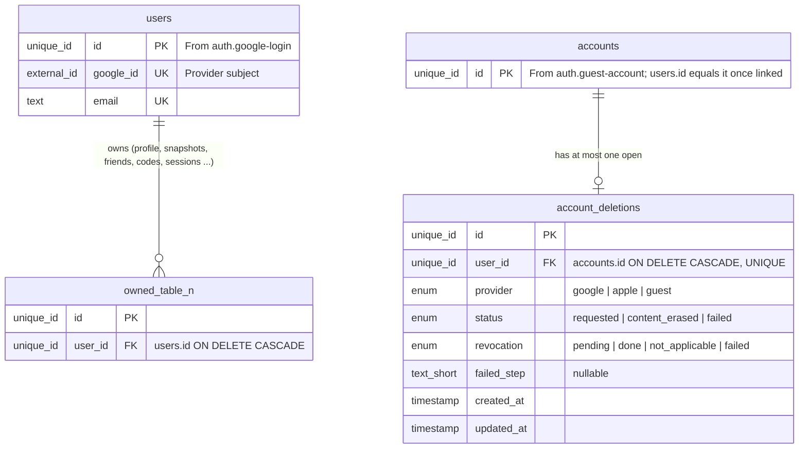
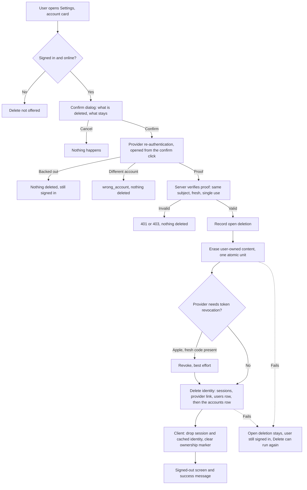
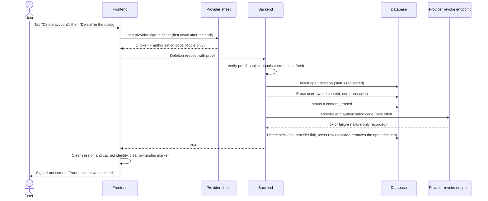
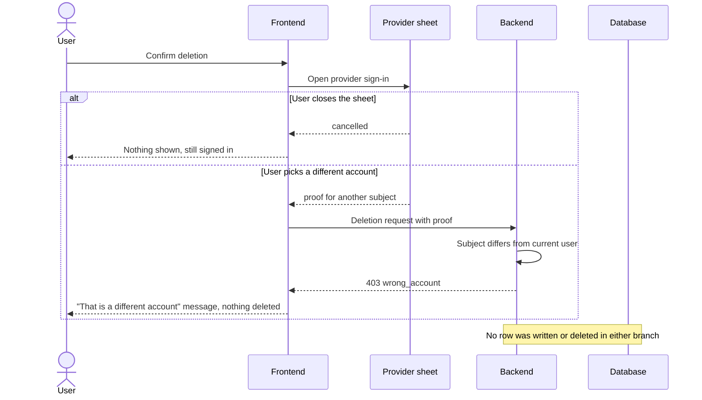
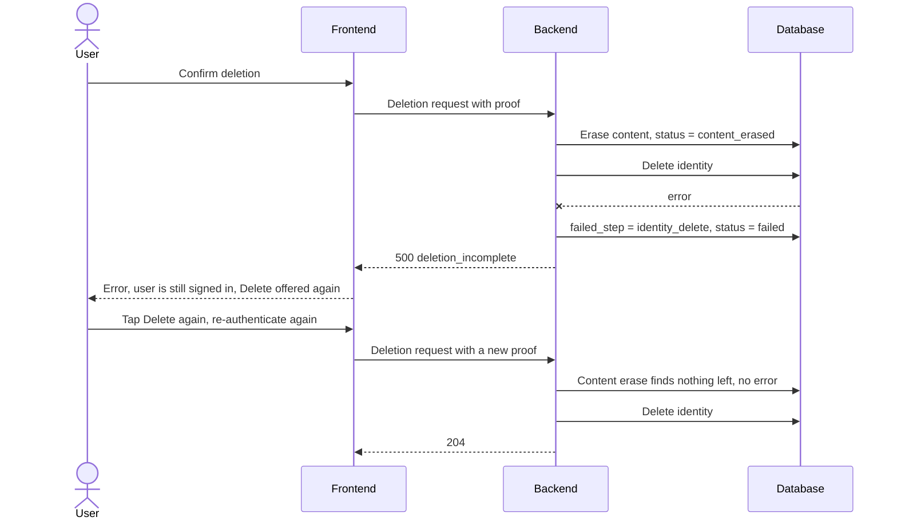

# In-App Account Deletion

## 1. Overview

### Problem Statement

An app that lets users create an account must let them delete that account from inside the app. A "write us an email" path is not enough to show a store reviewer. This block specifies the whole deletion: the user confirms intent, proves they are still the account owner, the app erases everything the user owns (including their public presence such as a leaderboard row), revokes provider tokens where the provider requires it, destroys the identity, and cleans up the device. It also specifies what happens when a step fails halfway, and the recording that proves the flow to a reviewer.

Two things make this harder than "DELETE FROM users":

1. **Re-authentication is part of the flow.** Deleting an identity usually requires a recent sign-in. Backing out of the re-authentication must delete nothing.
2. **Order and re-runnability matter.** Some steps need the identity to still exist (provider-token revocation needs a fresh credential; some data stores authorize writes with the live sign-in). The identity is therefore destroyed last, and every step is safe to run again.

### User Stories

- **End user**: I open Settings, tap "Delete account", read what will go and what will stay, confirm with my sign-in provider, and land signed out with a message saying it worked
- **End user**: I back out of the provider confirmation and nothing is deleted
- **End user**: The deletion lost its connection halfway; I tap Delete again and it finishes
- **Developer**: I can show App Review a screen recording of registration, login and deletion on a physical device
- **Developer**: I can point to one list of every place user data lives and show that each one is erased
- **Operator**: A forgotten table cannot silently survive deletion

### When to use this block

- The app has accounts (any sign-in) and ships to the Apple App Store or Google Play
- User says: "delete account", "account deletion", "App Review asked for deletion", "data deletion", "right to erasure", "xóa tài khoản"
- Before the first store submission of any app that has sign-in (the `app-factory` kit (`kits/app-factory/`, entered through the `implement-kit` skill), if present in your copy of this repo, places it in the release order)

### When NOT to use

- The app has no accounts and stores nothing server-side
- Shopify apps: the platform sends erasure webhooks instead, use `compliance.shopify-gdpr`
- Document NoSQL stores as the primary database: non-goal for this block family (the shipped origin is Firestore, see "Origin and verification status"; the SQL-family model here is a translation)

### Decision points left to the merchant

The origin app answers these one way; the merchant may answer differently. Each is a configuration key in section 7.

| Decision | Shipped default | Why it is the merchant's call |
|---|---|---|
| Wipe on-device content when the account is deleted | **No**: study data stays on the device, the dialog says so | Whether device data counts as "account data" depends on the product; the confirm dialog must state the choice either way |
| Delete the purchase-processor record (subscriber id) | **Not done** by the shipped flow; privacy page says purchase records are kept as the law requires | Retention duties for payment records are the merchant's legal question, not this spec's |
| A failed provider-token revocation blocks deletion | **No**: best effort, deletion continues | Blocking would trap the user in an undeletable account |
| Offer an email route as well | Yes, in addition to the in-app route | The email route is a supplement; the in-app route is the reviewed one |

### Identity precondition

This block keys its rows on an authenticated user (`user_id`). `auth.google-login` is the reference implementation (a `users` row plus `sessions`), which is why it is listed as a prerequisite. The precondition is satisfied by **any existing authenticated-user model** in the project: managed auth (Firebase Authentication, Supabase, Auth0 and similar), another login block, or an existing users and sessions table. The origin app for this block used a managed provider and had no `users` or `sessions` tables of its own.

If the project already has login, do **not** implement `auth.google-login`. Map `user_id` here to the project's existing user id (same physical type) and keep every other column of this block unchanged. Never create a second login or a second user table for the same people.

For this block specifically: the identity itself is erased **last**, through whatever system owns it (a `users` row and its sessions here; the auth provider's delete-user call on a managed stack). The ordered flow in this block does not change.

**Guests.** With `auth.guest-account`, the account id is `accounts.id` and a guest has no `users` row (it is inserted with the same id when the guest links). `account_deletions.user_id` is therefore a foreign key to `accounts.id`, so a guest can hold an open deletion. The identity step deletes the `users` row when one exists, then the `accounts` row, which cascades the guest's credentials, sessions and link attempts and every table that keys `account_id` to it. A guest proves ownership with the `guest` proof type (section 3).

---

## 2. Data Model

> Types below are **logical types** (canonical mapping in `docs/SPEC_GUIDELINES.md` section 5). Dialect-specific SQL lives in [Reference Migration](#reference-migration-postgres) at the end of this section.

This block owns one small table and one rule that applies to every other table in the app.

**The rule (erasure inventory):** every table that holds data about a user either (a) has a `user_id` foreign key to `users.id` with `ON DELETE CASCADE`, or (b) has an explicit entry in the erasure registry (see `backend.md` Pattern 3). A table that is neither is a defect; acceptance checks for it. With `auth.guest-account` the cascade root is `accounts.id` (tables key `account_id`): the identity step deletes the `accounts` row last, so its cascades fire after every eraser has run.



### Erasure inventory (what is deleted, what is kept)

The first six rows are what the origin app deletes. SQL-family translation is the right-hand column.

| Data | Origin location | SQL-family translation | Action |
|---|---|---|---|
| Public profile and leaderboard row (display name, friend code, board opt-in, XP, level, streak, counts) | document `users/{uid}` | profile / leaderboard rows keyed by `user_id` | **hard delete** (public presence disappears from every read path) |
| Private progress snapshot | `users/{uid}/private/study` | snapshot rows keyed by `user_id` | **hard delete** |
| The user's own friend list | `users/{uid}/private/friends` | friendship rows where the user is the owner | **hard delete** |
| Friend code registry entry | `friendCodes/{code}` | unique code column or registry row | **hard delete, only when the entry belongs to this user** |
| Sign-in identity | Firebase Authentication user | `users` row, `sessions` rows, provider link; then the `accounts` row when `auth.guest-account` is installed | **hard delete, last** (users, then accounts) |
| Apple tokens for the app | held by Apple | revoke with the fresh authorization code | **best effort**, never blocks |
| Guest credentials, recovery code and link attempts | none (the origin has no guests) | `auth.guest-account` tables, cascading from `accounts` | **hard delete** with the `accounts` row; the credential hashes survive only as tombstones with reason `deleted` and no account id |
| Other users' friend lists that mention this user | other users' `private/friends` arrays | friendship rows where the user is the friend | origin: left in place, readers drop ids whose account no longer exists. SQL: FK cascade removes them (extrapolated) |
| Purchase-processor subscriber record | RevenueCat, App Store, Play | external | **retained**, not touched by the shipped flow. *Decision for the merchant* |
| On-device content (answers, notes, saved words) | app local storage | local storage | **kept by default**, dialog says so. *Decision for the merchant* |
| Backups, logs, provider-side copies | Firebase and hosting infrastructure | merchant infrastructure | **not established**: the origin evidence does not say. *Decision for the merchant*; write the retention period into the privacy page |

### Table: `account_deletions`

> Extrapolated: The origin app has no such table. It exists because a SQL-family backend needs somewhere to record "deletion started, not finished", which the origin handles by letting the user simply press Delete again. See "Origin and verification status".

| Column | Logical Type | Constraints | Notes |
|--------|------|-------------|-------|
| `id` | `unique_id` | PK | distributed-safe ID |
| `user_id` | `unique_id` | NOT NULL, UNIQUE, FK → `accounts.id` **ON DELETE CASCADE** | The row disappears with the account: after completion nothing about the deleted person remains here. `accounts.id` is the account id of `auth.guest-account`; without that block it is the project's own account or user id (`users.id` of `auth.google-login`) |
| `provider` | `enum` | NOT NULL | values: `google|apple|guest` (the provider the user signed in with at request time; `guest` for an active guest account) |
| `status` | `enum` | NOT NULL, default `requested` | values: `requested|content_erased|failed` |
| `revocation` | `enum` | NOT NULL, default `pending` | values: `pending|done|not_applicable|failed` (`not_applicable` for providers with nothing to revoke) |
| `failed_step` | `text_short` | nullable | step that failed last. values: `content_erase|identity_delete|other`; no user content (revocation failure is recorded in `revocation`, not here) |
| `created_at` | `timestamp` | NOT NULL, default = now | UTC instant |
| `updated_at` | `timestamp` | NOT NULL, default = now | UTC instant; updated on every row mutation |

**Indexes**: `user_id` (UNIQUE) doubles as the "one open deletion per user" guard.

**Why no completed-deletion log**: keeping a row that names the deleted user defeats the purpose. Operators observe deletions through counters and logs that carry no user identifiers (see `security.md`).

### Reference Migration (Postgres)

<!-- REFERENCE: dialect=postgres -->
<!-- ADAPT: MySQL/SQLite per the Logical Types table in docs/SPEC_GUIDELINES.md section 5:
       - `uuid PRIMARY KEY DEFAULT gen_random_uuid()` -> MySQL `BINARY(16)` + UUID generated in app code; SQLite `TEXT PRIMARY KEY` + uuid4 in app code
       - `timestamptz` -> MySQL `DATETIME(6)`; SQLite `TEXT` ISO 8601 with `Z`
       - `CHECK (col IN (...))` -> MySQL `ENUM(...)`; SQLite keeps `TEXT CHECK`
       - `ON DELETE CASCADE` is portable; SQLite needs `PRAGMA foreign_keys = ON` per connection or the cascade silently does not run -->
```sql
CREATE TABLE IF NOT EXISTS account_deletions (
  id          uuid PRIMARY KEY DEFAULT gen_random_uuid(),
  user_id     uuid NOT NULL UNIQUE REFERENCES accounts(id) ON DELETE CASCADE,
  provider    text NOT NULL CHECK (provider IN ('google','apple','guest')),
  status      text NOT NULL DEFAULT 'requested'
              CHECK (status IN ('requested','content_erased','failed')),
  revocation  text NOT NULL DEFAULT 'pending'
              CHECK (revocation IN ('pending','done','not_applicable','failed')),
  failed_step text,
  created_at  timestamptz NOT NULL DEFAULT now(),
  updated_at  timestamptz NOT NULL DEFAULT now()
);
```

> `accounts.id` is `uuid` in `auth.guest-account`. Use the physical type of the table `user_id` points at (`users.id` is `text` in `auth.google-login`).

---

## 3. Data Flow



**Guest.** The proof in steps D and E is the guest's device credential presented together with the single-use challenge (`backend.md` Pattern 1b): no provider sheet opens, nothing is revoked (step H takes the No branch and `revocation` is `not_applicable`), and step J deletes only the `accounts` row because a guest has no `users` row. The proof types of the endpoint are `google`, `apple` and `guest`. The route for a guest without a device credential (a recovery code on the web deletion page) is specified in `auth.guest-account` section 3.9.

---

## 4. Sequence Diagrams

### Happy path: delete an Apple-signed-in account (native app)



### Error case: wrong account, and backing out



### Partial failure: content erased, identity delete failed



---

## 5. State Management

### Frontend state

| State | Storage | Survives Reload | Notes |
|---|---|---|---|
| `deletion.phase` (`idle | confirming | working | failed | done`) | memory | No | `working` blocks every other account call (sign in, sign out) so they run one at a time |
| `deletion.problem` | memory | No | Message key; cancelled re-authentication leaves it empty |
| cached account identity | local storage | Yes | Removed on success (origin: the account key is gone after deletion) |
| on-device content ownership marker | local storage | Yes | Cleared on success so a later sign-in merges the device data instead of replacing it |
| on-device content | local storage | Yes | Kept or wiped per `ACCOUNT_DELETION_WIPE_LOCAL_DATA` |

### Server state

| State | Storage | Notes |
|---|---|---|
| open deletion | `account_deletions` | exists only between request and completion, or after a failure |
| challenge nonce | merchant's short-lived store | single use, expires; see `backend.md` Pattern 1 |

### Status transitions

```
(no row) -> requested            proof verified
requested -> content_erased      all registered erasers ran
content_erased -> (user row and this row deleted)   identity deleted: completed
requested | content_erased -> failed   a step threw; failed_step names it
failed -> requested              user presses Delete again with a new proof
```

---

## 6. Integration Points

### Inbound

| Source | What | Notes |
|---|---|---|
| Settings screen | Delete account entry | Must be reachable by a signed-in user inside the app, without contacting support |
| `auth.google-login` | `users`, `sessions`, provider subject | Identity this block destroys |
| `auth.guest-account` | `accounts`, device credentials | The `accounts` row is destroyed after the `users` row; the device credential is the `guest` proof |

### Outbound

| Target | How | Purpose |
|---|---|---|
| Identity provider (Google, Apple) | provider sign-in, fresh credential | Re-authentication proof |
| Token-revoke endpoint | HTTPS POST | Apple token revocation (external contract in `backend.md`) |
| Database | SQL | Erase content, delete identity, track open deletion |

### Other blocks that own user data

Sibling blocks that store user-owned rows must register an eraser or use the cascade rule from section 2. By id: `billing.in-app-purchase` (purchase-processor subscriber link), `auth.sign-in-with-apple` (Apple provider link and revocation material), `data.progress-sync` (snapshots), `ugc.friends-leaderboard` (profile row, friend codes, friend lists), `auth.guest-account` (device credentials, recovery codes, sessions and link attempts, which cascade from `accounts`, and the tombstones for the credential hashes). These ids are the blocks planned alongside this one; check they exist in your copy of the repo before depending on them.

### Events

| Event | Payload | When |
|---|---|---|
| `account.deleted` | `{ provider, revocation }` | Identity deleted. **No user id, no email** (the person is gone) |
| `account.deletion_failed` | `{ failedStep }` | A step failed; no user identifiers |

### Shared data other documents must agree with

The privacy policy page must name the in-app path and what is deleted and kept. The store forms must agree with it (see "Verification artifact" below).

---

## 7. Configuration Surface

| Key | Type | Default | Description |
|-----|------|---------|-------------|
| `ACCOUNT_DELETION_REAUTH_MAX_AGE_SECONDS` | `integer` | `300` | Maximum age of the re-authentication proof. *Extrapolated default*: origin delegates freshness to the provider SDK |
| `ACCOUNT_DELETION_CHALLENGE_TTL_SECONDS` | `integer` | `300` | Lifetime of the single-use nonce the proof must carry. *Extrapolated* |
| `ACCOUNT_DELETION_STALE_AFTER_SECONDS` | `integer` | `300` | An open deletion not updated for this long may be retaken by a new request (covers a crashed worker). *Extrapolated* |
| `ACCOUNT_DELETION_WIPE_LOCAL_DATA` | `boolean` | `false` | Also wipe on-device content after success. Origin keeps it |
| `ACCOUNT_DELETION_REVOKE_FAILURE_BLOCKS` | `boolean` | `false` | Fail the deletion when revocation fails. Origin continues |
| `ACCOUNT_DELETION_EMAIL_CONTACT` | `string` | `null` | Address shown on the privacy page for the secondary email route |
| `APPLE_CLIENT_ID`, `APPLE_TEAM_ID`, `APPLE_KEY_ID`, `APPLE_PRIVATE_KEY` | `string` | required only for direct Apple revocation | Direct-Apple variant only; `APPLE_PRIVATE_KEY` is a secret (see `security.md`) |

---

## Verification artifact (what to hand a reviewer)

The origin app's first App Review round came back as "Information Needed". The message asked for a screen recording on a physical device, from launch, showing account registration or login and account deletion, plus written answers. What satisfied it: two recordings from a physical iPhone, one of them dedicated to Settings > Delete account with provider re-authentication and the signed-out result, and a written reply that states the in-app path ("after signing in, Settings, account card, Delete account removes the cloud data and the sign-in").

This block treats that recording as an acceptance item (`acceptance.md`, "Verification Artifact"): recorded on a physical device, launched from the Home Screen, throwaway account, nothing personal on screen. The reviewer's final verdict on the origin app is **not established** (see below), so the artifact is necessary evidence, not proof of acceptance.

---

## Origin and verification status

The behavior in this block comes from the origin app (Vue 3 + Capacitor + Firebase Authentication + Cloud Firestore). Its deletion lives in `app/src/lib/firebasePort.ts` (re-authenticate, batch delete, revoke, delete identity) with the contract in `app/src/CONTRACT.md` ("Delete account"). The flow ran on a physical iPhone and was recorded for App Review.

What is established and what is not:

- **Established by the origin code and tests**: confirm-before-anything, provider re-authentication first (popup on web, system sheet in the app), nothing deleted when the user backs out or picks a different account, content deleted in one batch, identity deleted last, Apple revocation best effort, deletion unavailable while the account cannot be reached, on-device data kept, and the dialog and privacy page saying so.
- **Documented but not tested in the origin**: that a re-run after a half-finished delete completes it. The contract states it and the code is shaped for it; no origin test exercises it. `partial-failure.feature` is where your stack proves it.
- **Not established**: whether Apple accepted the build. The app was resubmitted and the last read of the review state was "Waiting for Review"; no later reading exists. Treat "satisfies app-store review" as the design goal, not a proven result.
- **Extrapolated, not run**: the `guest` proof type and the `accounts` step of the identity deletion. The origin has no guest accounts; both exist for `auth.guest-account`, whose section 3.9 states the contract this block implements.
- **Translated, not run**: the SQL-family model (the `account_deletions` table, the cascade rule, the server-side endpoints, the challenge nonce, the direct-Apple revocation variant) is a translation of the Firestore behavior. It has **not been run on stacks A, B or C**. Expect the first implementation to refine the endpoint shapes.
- **Policy status.** Apple's published App Store Review Guideline 5.1.1(v) (read 2026-10-22) says an app that supports account creation must also offer account deletion within the app; the origin code labels its deletion with that number. This block does not quote Apple's or Google's policy wording, deadlines, or exemptions beyond that sentence. Read the current store policy before relying on this block for a submission.
