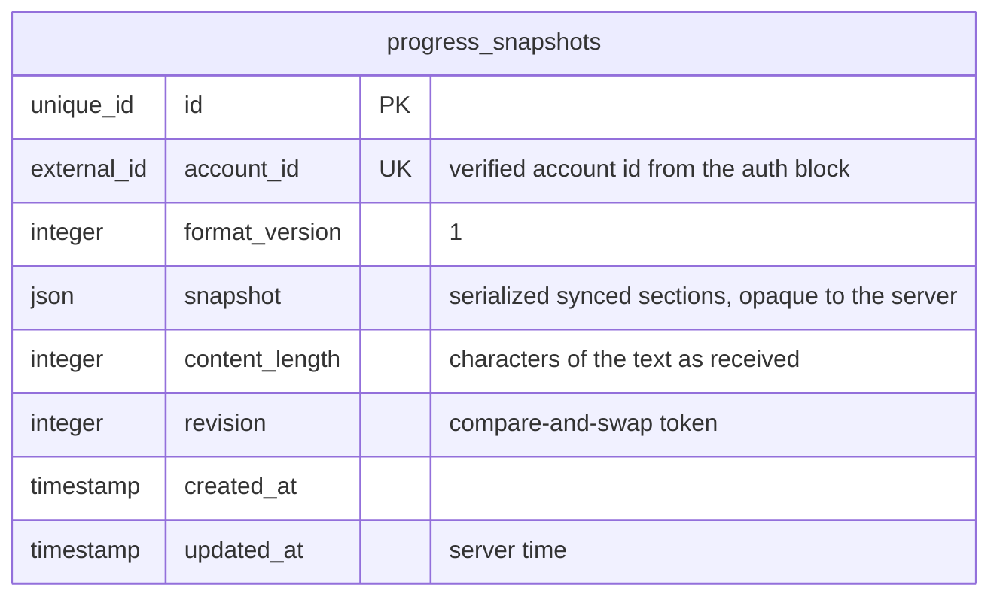
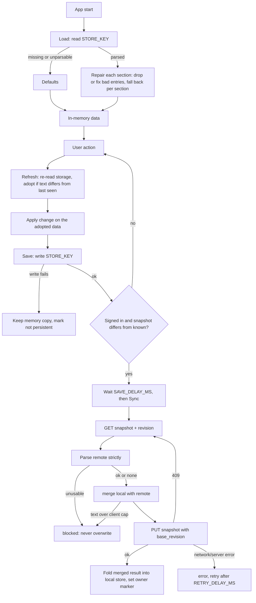
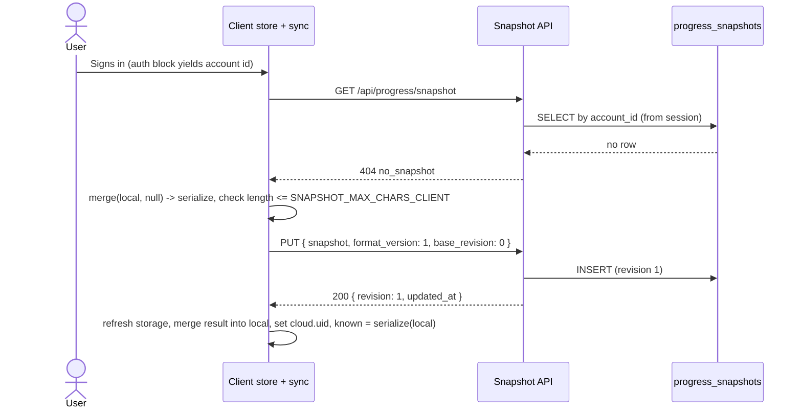
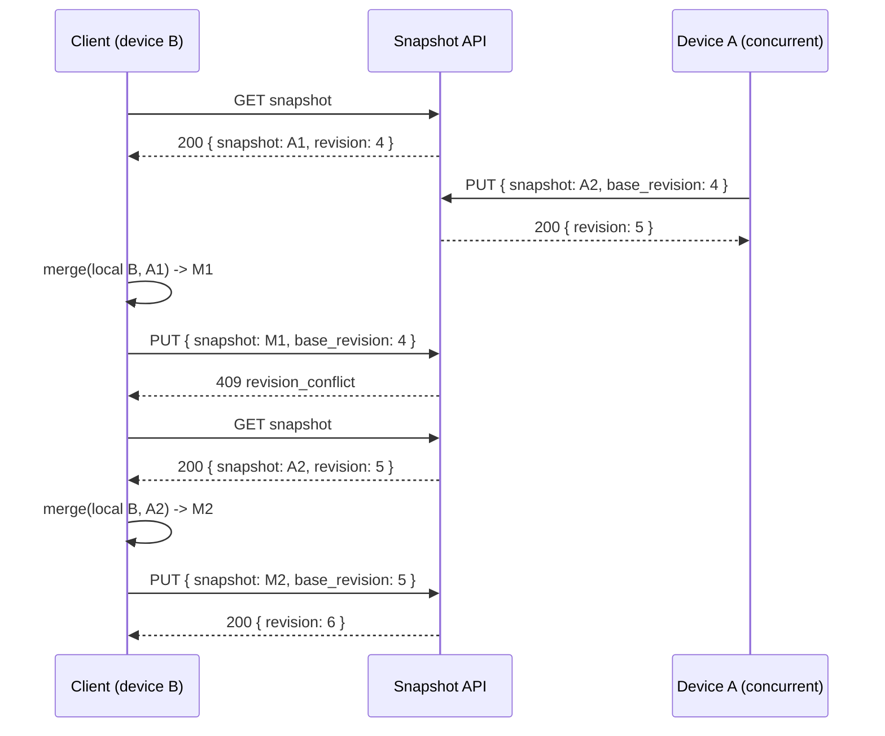
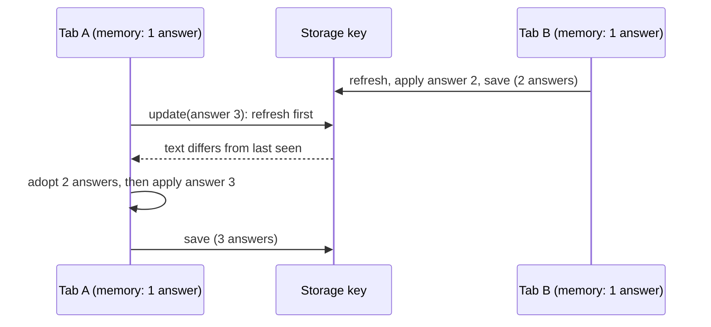
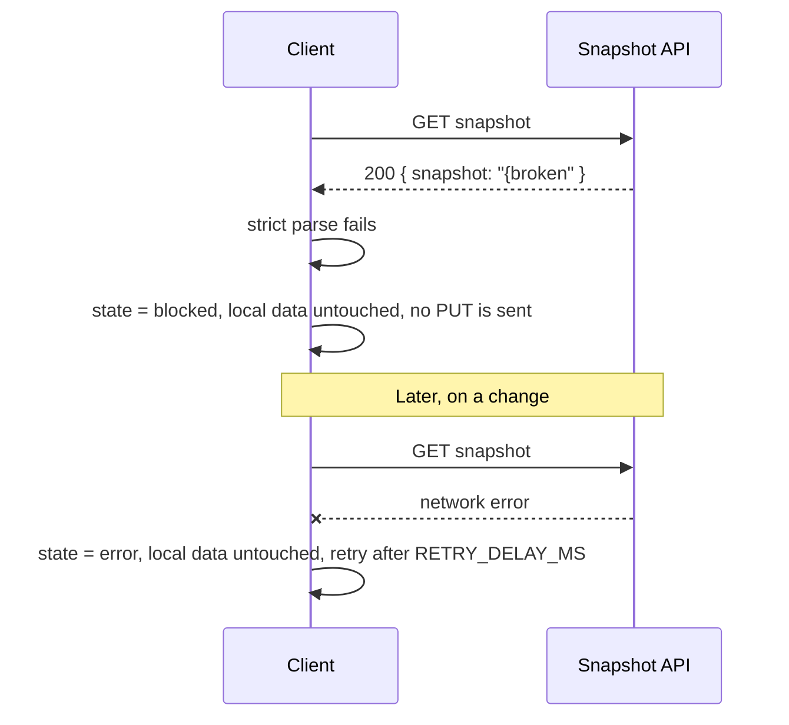
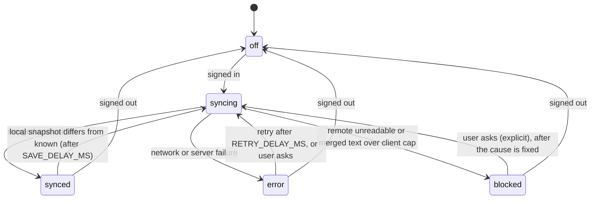

# Progress Sync (local-first user progress)

## 1. Overview

### Problem Statement

An app that records what a user has done (answers, bookmarks, saved items, settings, milestones) must keep working with no account and no network, must survive corrupted storage and hostile import files, and must not lose data when the same person uses two browser tabs or two devices. This block is the data layer for that: a **versioned local store** with strict validation, a **safe import/export**, and an optional **cloud snapshot** that merges two copies of the progress without a server-side conflict resolver.

Three failure families drive the design, each seen in a shipped app (see "Origin and verification status"):

- **Persisted-data robustness**: malformed import threw an exception, duplicate entries passed validation, oversized strings broke layout, history was wiped when it crossed a size limit.
- **Stale writes**: a second tab wrote an old in-memory copy over newer storage, wiping answers and undoing a Reset.
- **Silent divergence between devices**: a deletion on one device was undone by an older copy on another.

### User Stories

- **End user (no account)**: I use the app offline for weeks; closing the tab or the app never loses my progress.
- **End user (two tabs)**: I answer in tab A and tab B; both answers are kept, and Reset in one tab is not undone by the other.
- **End user (backup)**: I export my progress to a file and import it later; a damaged or hostile file is refused with a reason and my current data stays intact.
- **End user (two devices)**: I sign in on a second device; my history from both devices is joined, a bookmark I removed on one device stays removed on the other.
- **End user (shared device)**: I sign in with a different account on a device someone else used; I get my own progress, and the previous data is kept aside, not merged into my account.
- **Developer**: I declare which sections exist and which merge rule each uses; the block gives me validation, recovery, merge, and sync.

### When to use this block

- The user's progress is a small structured document (well under 1 MB serialized) that one person owns.
- The app must be usable without an account, and an account is an optional upgrade that adds backup and multi-device.
- User mentions: "offline", "local storage", "progress", "export/import", "sync across devices", "backup", "two tabs".

### When NOT to use

- Real-time collaboration on shared documents (concurrent editing of the same text) - needs a proper CRDT or OT system.
- Progress larger than the snapshot cap (default 900,000 characters) - split into per-collection documents or use a database-per-user design.
- Data that other users must read or that the server must query by field - this block keeps the snapshot opaque to the server (leaderboard numbers live in `ugc.friends-leaderboard`).
- Payments and entitlements - use `billing.in-app-purchase`.

---

## 2. Data Model

> Types below are **logical types** (canonical mapping in `docs/SPEC_GUIDELINES.md` section 5). Reference SQL for Postgres is in [Reference Migration](#reference-migration-postgres).

The block has two storage locations: a **client store** (one record under one key in the device's key-value storage) and, once a user signs in, a **server table** holding one snapshot per account. Only the server table is relational.



### Table: `progress_snapshots`

One row per account: the latest merged copy of that account's synced sections.

| Column | Logical Type | Constraints | Notes |
|--------|------|-------------|-------|
| `id` | `unique_id` | PK | distributed-safe ID, immutable |
| `account_id` | `external_id` | NOT NULL, UNIQUE | Tenant isolation. The account id issued by the auth block (e.g. an OAuth `sub`). Always taken from the verified session, never from the request body. |
| `format_version` | `integer` | NOT NULL, default 1 | Envelope version. Only `1` is accepted; any other value is rejected (`unsupported_format_version`). |
| `snapshot` | `json` | NOT NULL | The serialized snapshot (section 3). Must parse to a JSON object. Server does not interpret its sections. |
| `content_length` | `integer` | NOT NULL, CHECK `<= SNAPSHOT_MAX_CHARS_SERVER` | Length in characters of the snapshot text **as received**, measured before storing (a `json` column may reformat the text). |
| `revision` | `integer` | NOT NULL, default 1 | Starts at 1, +1 on every successful write. The client sends the revision it merged against; a mismatch is a conflict. |
| `created_at` | `timestamp` | NOT NULL, default = now | UTC instant |
| `updated_at` | `timestamp` | NOT NULL | UTC instant, assigned by the server on every write, never accepted from the client |

**Indexes**: the UNIQUE constraint on `account_id` is the only lookup path.

**Account deletion**: `account_id` is an external id, so there is no foreign key to cascade from. The account-deletion flow must delete this row explicitly (`compliance.account-deletion`).

### Local Store Record (client)

One record, one key. The key embeds the major schema version (`STORE_KEY`, e.g. `myapp-v1`): an incompatible redesign uses a new key instead of migrating in place.

| Section | Logical Type | Synced | Merge kind | Notes |
|---------|------|--------|-----------|-------|
| `history` | `json` | yes | `append_log` | `{ seq, entries[] }`; entry `{ seq, ref, value, ok, ms, at? }`; at most `MAX_HISTORY` entries |
| `marks` | `id_list` | yes | `mark_set` | list of `ref` ids the user flagged; no duplicates |
| `collection` | `json` | yes | `keyed_collection` | list of `{ key, meaning, savedAt?, sources[], example? }`; unique by `normalizeKey(key)` |
| `settings` | `json` | yes | `stamped_section` | `{ reviewInterval }` |
| `prefs` | `json` | yes | `stamped_section` | `{ lang, ... }` |
| `notes` | `json` | yes | `text_map` | map `ref -> text`, each value at most `MAX_TEXT` characters |
| `milestones` | `json` | yes | `monotone_section` | `{ v, level, badges[] }`, has its own version `v` |
| `edits` | `json` | yes | `edit_log` | stamps and tombstones that make deletions mergeable (section 3) |
| `cache` | `json` | **no** | - | per-device, rebuildable, never synced |
| `session` | `json` | **no** | - | unfinished in-progress activity on this device |
| `cloud` | `json` | **no** | - | `{ uid }`: the account that owns this device's progress data (owner marker) |
| *any other top-level key* | `json` | **no** | - | preserved untouched through load, export, import |

The section names above are the **reference schema**; adopters rename or replace sections but keep one merge kind per synced section. `normalizeKey` is: lower-case, typographic apostrophes folded to `'`, whitespace runs collapsed to one space, trimmed. **Every client must use the same function**, or tombstones written on one device do not match entries on another.

### Reference Migration (Postgres)

#### `progress_snapshots` table

<!-- REFERENCE: dialect=postgres -->
<!-- ADAPT: MySQL - `uuid`/`gen_random_uuid()` becomes `BINARY(16)` with UUID() at the app layer, `timestamptz` becomes `DATETIME(6)`, `jsonb` becomes `JSON` (MySQL normalizes JSON text, so measure content_length before insert as the spec says);
       SQLite - `uuid` becomes `TEXT` with uuid4 generated in the app, `timestamptz` becomes `TEXT` ISO 8601 with `Z`, `jsonb` becomes `TEXT` (JSON validity checked in the app, or with the json_valid() function in a CHECK);
       the `SNAPSHOT_MAX_CHARS_SERVER` literal 950000 is configuration, keep it in sync with the config surface -->
```sql
CREATE TABLE IF NOT EXISTS progress_snapshots (
  id              uuid PRIMARY KEY DEFAULT gen_random_uuid(),
  account_id      text NOT NULL UNIQUE,
  format_version  bigint NOT NULL DEFAULT 1 CHECK (format_version = 1),
  snapshot        jsonb NOT NULL CHECK (jsonb_typeof(snapshot) = 'object'),
  content_length  bigint NOT NULL CHECK (content_length <= 950000),
  revision        bigint NOT NULL DEFAULT 1,
  created_at      timestamptz NOT NULL DEFAULT now(),
  updated_at      timestamptz NOT NULL DEFAULT now()
);
```

---

## 3. Data Flow

### Snapshot and merge semantics (L1)

The **snapshot** is the serialized form of the synced sections only (the `Synced = yes` rows above), in a fixed section order, with map keys of `edits` sorted. Serialization is deterministic: the same logical content always yields the same text.

The **merge** is a pure function `merge(local, remote | null) -> synced sections`. It has no I/O and no clock. Properties:

- `remote = null` returns `local`'s synced sections unchanged.
- **Idempotent**: `merge(m, remote) = m` when `m = merge(local, remote)`.
- **Order-independent as a set**: swapping local and remote yields the same history, the same set of marks, the same set of collection keys. What may differ is list order, the order of `sources`, and which side wins a **tie** on a single-valued field (the local side wins, since it is the one in use).
- No clock is read; all times come from stamps stored in the data.

| Kind | Rule |
|------|------|
| `append_log` | Entry identity = `(ref, value, ms, at)` plus its occurrence number inside its **own** copy, so two identical entries in one copy are two entries, while the same entry present on both sides counts once. Union local then remote, first occurrence wins. Order: entries without `at` first (in the order found), then entries with `at` ascending. Keep the newest `MAX_HISTORY`. Renumber `seq` as 1..n; `history.seq = n`. |
| `mark_set` | Union of both lists, minus every `ref` whose merged mark in `edits.marks` is `on = false`. A `ref` with no mark is kept (data from before marks existed still joins). |
| `keyed_collection` | Entries from both sides, keyed by `normalizeKey(key)`. An entry whose `savedAt` (missing = 0) is **less than or equal to** the tombstone `edits.collection[normalizedKey]` is dropped. For two entries with one key: the larger `savedAt` wins (a tie keeps the local entry); `sources` becomes the union. |
| `stamped_section` | Whole section from the side with the larger stamp (`edits.settings`, `edits.prefs`; missing = 0). Tie or both unstamped: local. Merged stamp = the larger one, kept if either side had one. |
| `text_map` | Union of keys; on a key clash the local value wins. There is no deletion rule for this kind (see Known limits). |
| `monotone_section` | If either side is missing or either `v` differs from the version this client knows, return local (or remote when local is missing). Otherwise `level = max`, `badges` = union ordered by the registry order (`MILESTONE_IDS`). |
| `edit_log` (`edits`) | Each side is cleaned first (malformed entries ignored). `marks`: per `ref` the larger `at` wins; at equal `at` the entry with `on = true` wins. `collection`: per key the larger removal time. `settings`, `prefs`: the larger stamp. Result omitted when empty; map keys sorted. |

**Known limits (not covered by edits)**: a note deleted on one device is restored by the other (`text_map` has no tombstone); `milestones` with different versions on the two sides fall back to local; the log cap drops the oldest entries when more than `MAX_HISTORY` exist.

### Flow



---

## 4. Sequence Diagrams

### First sign-in on a device with guest progress (happy path)



### Second device with divergent progress and a revision conflict



### Two tabs write the same store



### Failure: cloud copy unusable, server unreachable



---

## 5. State Management

### Client state

| State | Storage | Survives Reload | Notes |
|-------|---------|-----------------|-------|
| Local Store Record | device key-value storage under `STORE_KEY` | Yes | The truth. Whenever its text differs from the last text this tab wrote or read, it is adopted before any change is applied. |
| `persistent` flag | memory | No | `false` when storage is unavailable or a write failed; the app keeps running on the in-memory copy. |
| `known` snapshot text | memory | No | The snapshot the cloud is known to hold; a change is worth saving only when the current serialized snapshot differs from it. |
| Owner marker `cloud.uid` | inside the Local Store Record | Yes | Which account the device's progress belongs to. Absent = guest data. |
| Previous-data backup | separate device storage key `PREVIOUS_KEY` | Yes | The full export of the local data that was replaced by another account's copy. One slot: a later replacement overwrites it. Never synced, never deleted automatically. |

### Cloud sync state machine



Invalid transitions: `blocked` never retries automatically (the cause is data, not the network); `off` never contacts the server; a change made while `syncing` schedules exactly one follow-up sync after the current one ends.

### Local persistence transitions

```
start -> storage usable?   yes: persistent = true, load
                           no : memory-only storage, persistent = false, load defaults
update(change) -> refresh -> apply -> save -> ok: seen = new text
                                            -> fail: persistent = false, memory keeps the change, seen unchanged
reset -> data = defaults, storage key removed (other tabs read "missing" as defaults)
import(text) -> validate strictly -> replace data -> save -> fail: restore previous data, error "quota"
```

---

## 6. Integration Points

### Inbound

| Caller | How | Purpose |
|--------|-----|---------|
| UI features | store `update(fn)` | Every feature writes through `update`, never by writing storage directly. A feature that owns new data adds its own top-level key; unknown keys survive. |
| Settings screen | `export`, `import`, `reset` | Backup, restore, erase. |
| Auth block (`auth.google-login`, `auth.sign-in-with-apple`) | account id + signed-in status | Starts and stops sync; supplies `account_id` server-side from the verified session. |

### Outbound

| Target | How | Purpose |
|--------|-----|---------|
| Snapshot API | HTTP: GET / PUT / DELETE `/api/progress/snapshot` | Read, write (compare-and-swap), erase the account's snapshot. |
| Database | SQL | `progress_snapshots` row per account. |
| Device storage | key-value | Local Store Record, previous-data backup. |

### Cross-block contracts

- `compliance.account-deletion`: must delete the `progress_snapshots` row for the account, and must leave the device's local data in place (local data belongs to the device, the owner marker is cleared).
- `ugc.friends-leaderboard`: derived numbers (totals, streaks) are computed from the merged data **after** each successful sync and stored by that block; this block never publishes history. Erasing the snapshot must also reset those derived numbers, in the same user action, or the next sync resurrects them.
- `billing.in-app-purchase`: entitlements are never part of the snapshot (they come from the store receipt); a restored snapshot cannot grant access.

### Events (client-side)

| Event | Payload | When |
|-------|---------|------|
| `store.adopted` | `{ reset: boolean }` | Another tab's write was adopted; `reset` is true when the adopted data has fewer history entries (the other tab erased). |
| `sync.state` | `{ state, lastSyncedAt }` | `off / syncing / synced / error / blocked` changes. |
| `import.result` | `{ ok, error? }` | An import finished. |

---

## 7. Configuration Surface

| Key | Type | Default | Description |
|-----|------|---------|-------------|
| `STORE_KEY` | `string` | `"<app>-v1"` | Device storage key; the suffix is the major schema version. |
| `PREVIOUS_KEY` | `string` | `"<app>-previous-v1"` | Device storage key for the replaced-data backup. |
| `MAX_IMPORT_CHARS` | `number` | `5242880` | Import text longer than this is rejected before parsing. |
| `MAX_HISTORY` | `number` | `20000` | Maximum history entries (import rejects more, load and merge keep the newest). |
| `MAX_TEXT` | `number` | `20000` | One note or one cache entry, in characters. |
| `MAX_KEY_CHARS` / `MAX_MEANING_CHARS` / `MAX_EXAMPLE_CHARS` | `number` | `120` / `400` / `600` | Collection field limits. |
| `MAX_ELAPSED_MS` | `number` | `86400000` | Largest plausible duration of one history entry (one day). |
| `MAX_AT` | `number` | `4102444800000` (2100-01-01 UTC) | Entry `at` must be below this. |
| `AT_SKEW_MS` | `number` | `86400000` | An entry's `at` may be at most this much earlier than the latest earlier `at`. |
| `SNAPSHOT_MAX_CHARS_CLIENT` | `number` | `900000` | The client never sends a larger snapshot. |
| `SNAPSHOT_MAX_CHARS_SERVER` | `number` | `950000` | The server rejects a larger snapshot. Must be `>=` the client value. |
| `SAVE_DELAY_MS` | `number` | `3000` | Quiet period after a change before a sync (a burst is one write). |
| `RETRY_DELAY_MS` | `number` | `30000` | Wait before retrying a failed sync. |
| `MAX_CONFLICT_RETRIES` | `number` | `5` | Read-merge-write attempts per sync when the server answers 409. |
| `MILESTONE_IDS` | `string[]` | adopter-defined | Canonical order of milestone ids. |

---

## 8. Invariants (L1, referenced by features and acceptance)

| ID | Invariant |
|----|-----------|
| INV-1 | **Versioned schema.** The store key embeds the major version; a section with its own version `v` newer than the client knows is kept untouched (the feature uses its defaults); unknown top-level keys survive load, export, import. |
| INV-2 | **Never throw on malformed data.** Load, external refresh, import, and cloud parse each return a defined result (defaults, ignore, typed error, `blocked`) for any input text. |
| INV-3 | **Repair on load, reject on import.** Stored data is repaired section by section and entry by entry; an imported file with any invalid part is refused whole, with an error path, and existing data stays. |
| INV-4 | **Merge before write.** Every write first re-reads storage and applies the change on top of what it found; storage is the truth. A key removed by another tab reads as defaults. |
| INV-5 | **A failed write loses nothing in memory.** The failing tab keeps its data, marks itself not persistent, and does not adopt older storage over newer memory. |
| INV-6 | **Every size is capped, with a defined action at the cap** (section 7): reject on import, repair on load, keep newest on merge, `blocked` for sync. |
| INV-7 | **No whole-history loss.** Crossing a cap keeps the newest entries; a bad entry is dropped or repaired alone; the whole section falls back to defaults only if repair still fails validation. |
| INV-8 | **Merge is a join.** Idempotent, no clock, order-independent as sets (section 3). |
| INV-9 | **Deletions are stamped.** A removal is a tombstone with a time; the later event wins; an item re-added after its removal stands. |
| INV-10 | **Single-valued sections follow the stamp.** Later stamp wins whole; unstamped loses to stamped; a tie keeps this device's value. |
| INV-11 | **Equality skips writes.** Serialization is deterministic; a sync is scheduled only when the current snapshot text differs from the one known to be in the cloud; a sync that changes nothing locally causes no further write. |
| INV-12 | **Sync only when signed in, owned by one account.** The owner marker is set after sync; a different account replaces (not merges) the device's data after the old data is saved aside first (if the backup cannot be written, the replacement does not happen); guest data merges; an import clears the owner. |
| INV-13 | **An unreadable or oversized cloud copy is never overwritten.** The state is `blocked`; local data is untouched. |
| INV-14 | **Offline is normal.** Local reads and writes never wait for the network; a failed sync leaves local data as is and retries; a failed remote erase aborts the local erase. |
| INV-15 | **Only whitelisted sections travel.** `cache`, `session`, owner marker, and unknown keys never enter a snapshot. |
| INV-16 | **Server owns identity, time, and size.** `account_id` comes from the verified session, `updated_at` from the server clock, size is checked against `SNAPSHOT_MAX_CHARS_SERVER`; the write is a compare-and-swap on `revision`. |

---

## Origin and verification status

Behavior in this block comes from the origin app (Vue web app and Capacitor mobile shell, Firebase backend): its local store module, its pure study-sync module (merge, parse, serialize), its cloud composable, and the independent-judge findings recorded while building it.

- **Observed in the shipped app**: local store versioning, per-section recovery, strict import, two-tab merge-before-write, size caps, the merge rules and edit stamps in section 3, snapshot-equality scheduling, owner marker and replace-not-merge, `blocked` on unreadable or oversized cloud copy, erase-before-local-erase. Covered by 114 unit tests in the source app for the store, the merge and the cloud composable; the two-tab, import and size findings were raised by independent judges before the fixes.
- **Translated, not run**: the app stores one JSON string per user in a Firestore document and relies on a database transaction for atomic read-merge-write. This block translates that into a SQL table with a `json` column, a size `CHECK`, and a `revision` compare-and-swap with a client retry loop. The table, the three endpoints, and the 409 retry flow have **not been run on stacks A, B, or C**; the 3-Stack check in `acceptance.md` is a mental test only.
- **Not in the source app**: any server-side validation beyond size and ownership; notification to the user when the history cap drops the oldest entries; tombstones for notes; the rule that a failed backup write cancels the replacement (the source app ignores a failed backup write); the revision field, the 409 retry loop, and `MAX_CONFLICT_RETRIES` (the document store retried transactions itself).
