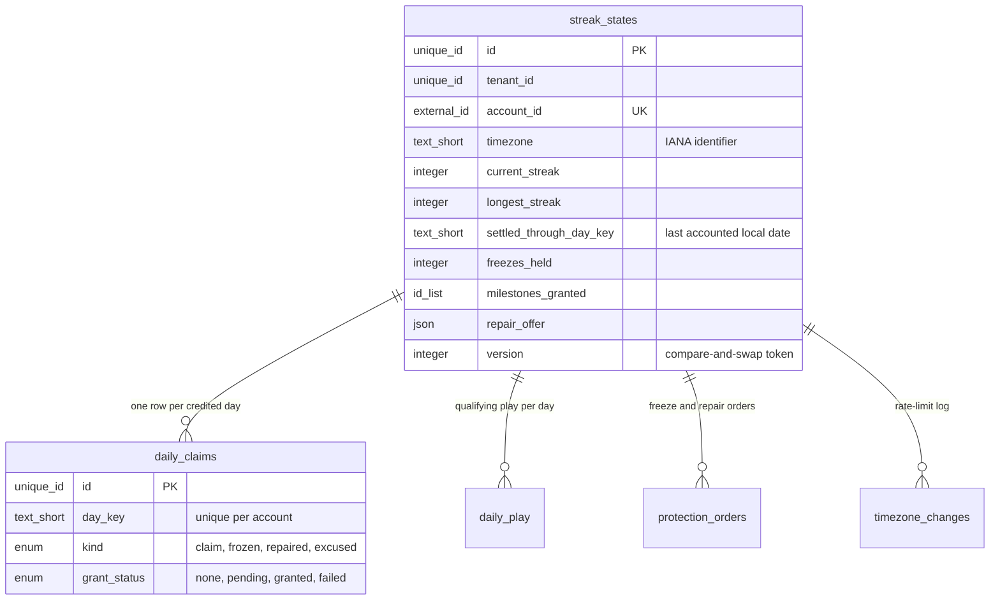
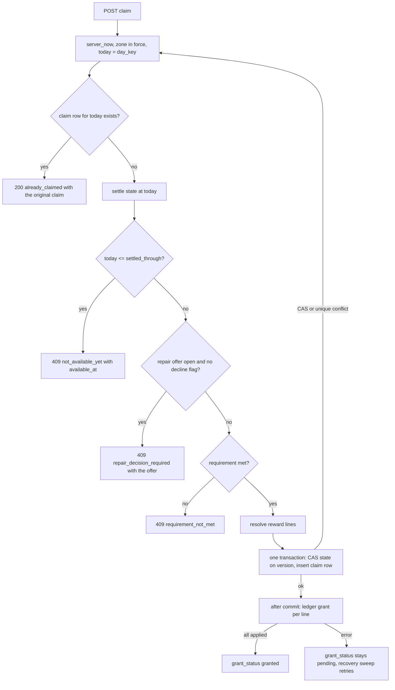
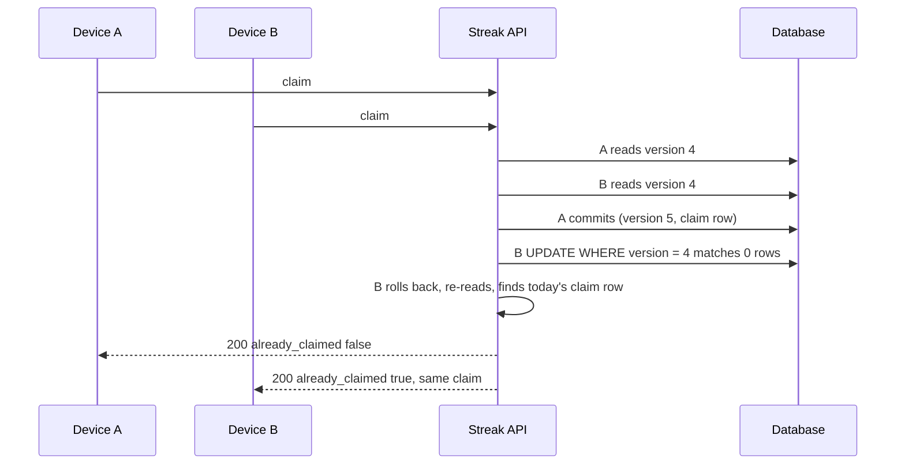
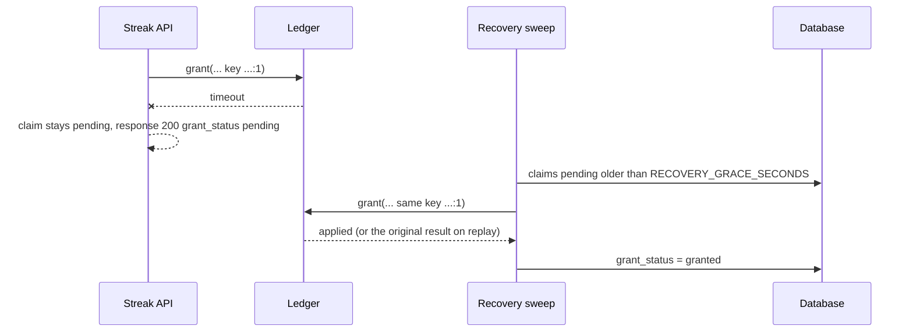
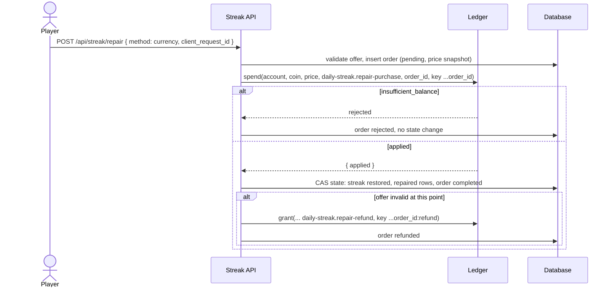
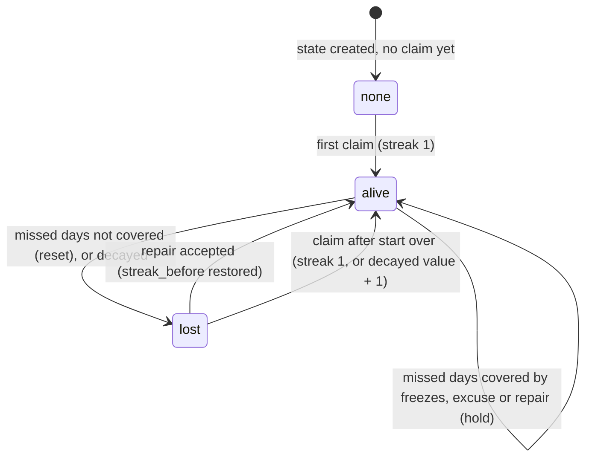

# Daily Streak (daily reward calendar and streak counter)

## 1. Overview

### Problem Statement

A mobile game needs at least one reason to come back tomorrow (kit guide `02-return-reasons.md`, tier "must-have for almost any game"). The oldest form is a **daily reward calendar** (a reward per day, escalating, with bonuses at milestones) paired with a **streak counter** (consecutive days). The mechanic is simple to describe and easy to get wrong in four places, which is why it is a block:

- **The day boundary.** "Today" is the player's local calendar date. A device clock the player can change, a flight across time zones, a 23-hour or 25-hour daylight-saving day, and a leap day all move that boundary. Only the server clock may decide it (time contract of the kit), so the block computes a `day_key` on the server from the account's IANA time zone and does all arithmetic on dates, never on elapsed hours.
- **Once per day, everywhere.** Two devices of one player, a retried request and a double tap must produce exactly one claim and exactly one reward. The claim row is unique per account and `day_key`; the reward goes through the ledger with an idempotency key built from the same facts.
- **What a missed day costs.** A streak that can be lost leans on loss avoidance, which guide `06-design-ethics-and-compliance.md` lists as contested evidence and a regulatory sore spot. The block gives three miss policies with named trade-offs, freeze and repair mechanics with caps and a window, and requires a non-punitive default.
- **Rewarding play, not opening the app.** Guide `02-return-reasons.md` (decision rule 2) records that top casual puzzle games moved from pure login rewards to a daily prize the player must win levels to claim. `claim_requirement` selects either behavior; the "daily jackpot" is `play_to_claim` with a higher `PLAY_TARGET` and a larger reward on the calendar's last day.

The block does not own balances (`billing.virtual-currency` does), notification delivery (`messaging.push-reengagement` does), seasonal passes, or missions.

### User Stories

- **Player**: I open the game, see today's reward and which day of the cycle I am on, and claim it once; a second tap or a second device shows "already claimed", not a second reward.
- **Player (two devices)**: I claim on my phone and open my tablet; the tablet shows today as claimed.
- **Player (traveler)**: I fly across the date line and change my time zone; I do not lose the day I am in, and I do not lose my streak.
- **Player (missed a day)**: I missed yesterday; a freeze I earned by playing keeps the streak, or I can restore it by playing, or I can start over for free. Nothing forces me to pay.
- **Player (guest to account)**: I sign in on a device where I played as a guest; my best streak survives.
- **Designer**: I define the cycle length, the reward per day, the milestone bonuses, the miss policy and the play requirement in configuration, without code changes.
- **Operator**: After an outage, players who could not claim are not punished.
- **Compliance owner**: I can show that no purchase is needed at the moment a streak is lost and that loss prompts are capped.

### When to use this block

- The game wants a daily return reason with a visible calendar and counter.
- The game has a ledger (`billing.virtual-currency`) or can adopt its `grant` / `spend` contract.
- User mentions: "daily reward", "login bonus", "daily check-in", "streak", "streak freeze", "streak repair", "daily jackpot".

### When NOT to use

- Rewards that are random, paid or odds-based: this block pays deterministic rewards from a calendar (odds disclosure and minors rules belong to a different design; guide `06-design-ethics-and-compliance.md`).
- Time-limited events, seasonal tracks and missions: `engagement.event-calendar`, `engagement.season-pass`, `engagement.objectives`.
- Rewards with real-money stakes or prizes: the play report can be client-reported (`PLAY_REPORT_SOURCE = client`); see `security.md` T-7.
- Games whose audience includes children and that cannot accept free-only freeze and repair: set both prices to `null` (section 7) or skip the streak counter entirely.

### Design ethics

A streak that can be lost is a loss-aversion hook. Guide `06-design-ethics-and-compliance.md` rates the mapping "streak to loss avoidance" as contested (the large 2020 study found loss aversion in all experience groups, a 2022 study found none for small amounts; guide 06, MEDIUM) and notes that China's December 2023 draft rules proposed to ban daily login rewards (draft withdrawn, [TechNode](https://technode.com/2023/12/22/draft-gaming-regulations-cause-sharp-fall-in-netease-and-tencent-share-prices/), MEDIUM). The EU consumer-protection network's principles on in-game virtual currencies tell companies to avoid "practices forcing consumers to purchase virtual currency" ([Forbrukertilsynet, 21 March 2025](https://www.forbrukertilsynet.no/eng-articles/national-consumer-authorities-and-commission-take-action-on-harmful-practices-in-the-gaming-industry), HIGH for the text; the principles are not stated to be binding). The block therefore ships these requirements as invariants, not as options:

1. **Earned protection.** Freezes are earned by claiming (calendar `freeze` lines); purchase is optional and off by default (INV-14).
2. **No forced purchase at the point of loss.** Starting over is always free and always offered with equal prominence; a free repair path (`REPAIR_PLAY_TARGET`) exists whenever a paid one does (INV-15).
3. **Capped loss prompts.** The proactive loss sheet is shown at most `LOSS_PROMPT_CAP` times per loss; the reminder hand-off fires at most once per day (INV-16, INV-17).
4. **True clocks.** Countdowns come from the server's `ends_at`; no fake urgency (INV-18).
5. **Prices in money terms.** A paid freeze or a paid repair is optional and, when it is priced in a purchasable currency, shows the indicative real-money equivalent beside the currency price through the shared `ApproxMoney` component of `billing.virtual-currency` (its INV-24; guide 15 check S1 in `kits/game-engagement/guides/15-manipulation-and-the-line.md`).
6. **A loss never removes anything bought.** Reset, decay and an expired offer change the counter only; no freeze, item or currency is removed, expired or clawed back by this block (INV-25; guide 15 check S3).
7. **Benefit-led reminders.** Reminder copy and the variables handed to the push block name today's reward, never a loss (INV-26; guide 15 check S2).

The three tests of guide 06 (decision rule 2) apply to the defaults: the player can see exactly how it works and what it costs, it pays for play when `play_to_claim` is set, and audiences that include children get free-only protection.

### Evidence behind the mechanic

- Duolingo separated the daily goal from the streak in an A/B test: +3.3% relative day-14 retention and +10.5% in the share of daily learners on a streak within 20 days; learners at a 7-day streak were 2.4 times more likely to return the next day, a correlation that does not show cause ([Duolingo, 2020](https://blog.duolingo.com/improving-the-streak), HIGH as reported; not a game, not controlled for selection).
- Duolingo lets learners equip "up to two" streak freezes, and reports that this change raised the relative number of daily active learners by +0.38% ([Duolingo, 2022](https://blog.duolingo.com/how-duolingo-streak-builds-habit), HIGH as reported; the post does not state the previous limit). `FREEZE_CAP` defaults to 2 for this reason (design choice informed by one example).
- Daily login appeared in 38 of the 40 top Korean mobile games in a 2025 preprint ([arXiv 2504.10714](https://arxiv.org/html/2504.10714), MEDIUM; single country, sample skewed to gacha RPG and strategy; see guide `02-return-reasons.md`).
- No source measures the retention effect of a streak freeze, a repair, or a reward calendar in a game. Default values below are design choices (labelled in section 7).

---

## 2. Data Model

> Types are **logical types** (`docs/SPEC_GUIDELINES.md` section 5). Reference SQL for Postgres follows in [Reference Migration](#reference-migration-postgres). Every table carries `tenant_id` (tenant convention of `ugc.friends-leaderboard`; single-app deployments use one constant value) and keys rows by `account_id` (account contract of the kit: a guest or a signed-in account).



### Table: `streak_states`

One row per account: the streak counter and everything needed to evaluate a day.

| Column | Logical Type | Constraints | Notes |
|--------|------|-------------|-------|
| `id` | `unique_id` | PK | |
| `tenant_id` | `unique_id` | NOT NULL | Tenant isolation |
| `account_id` | `external_id` | NOT NULL, UNIQUE per tenant | From the verified session, never from a request body. No foreign key: account deletion removes the row explicitly |
| `timezone` | `text_short` | NOT NULL | IANA identifier in force (for example `Europe/Berlin`); validated against the server's time-zone database; offsets and abbreviations are rejected |
| `pending_timezone` | `text_short` | nullable | Zone requested by the player, applied at `timezone_effective_at` |
| `timezone_effective_at` | `timestamp` | nullable | Instant the current local day in `timezone` ends; set together with `pending_timezone` |
| `current_streak` | `integer` | NOT NULL, default 0, `>= 0` | Consecutive credited days as of `settled_through_day_key` (credited = claimed, or held by a freeze, repair or excuse) |
| `longest_streak` | `integer` | NOT NULL, default 0, `>= current_streak` | Never decreases except by account deletion |
| `settled_through_day_key` | `text_short` | nullable | Local date `YYYY-MM-DD` up to which every day has been accounted for (credited, or lost by policy). Null until the first claim |
| `freezes_held` | `integer` | NOT NULL, default 0, `0..FREEZE_CAP` | Streak freeze inventory, consumed only by settlement |
| `milestones_granted` | `id_list` | NOT NULL, default empty | Milestone ids already paid; list of text ids; max ~1000 |
| `repair_offer` | `json` | nullable | `{ streak_before, gap_first_day_key, expires_day_key, prompts_shown }`; at most one open offer |
| `unseen_notice` | `json` | nullable | `{ type, ... }` for the last settlement outcome the player has not acknowledged (`freeze_used`, `streak_lost`, `streak_decayed`, `excused`) |
| `streak_deadline_at` | `timestamp` | nullable | Derived: the instant the local day `settled_through_day_key + 1` ends. Used only by the at-risk sweep and the countdown; never trusted for a claim decision |
| `at_risk_day_key` | `text_short` | nullable | Day key for which a `streak_at_risk` armed event was last emitted |
| `merged_into_account_id` | `external_id` | nullable | Set only on a merge tombstone: the account this guest row was merged into |
| `merge_id` | `text_short` | nullable | Set only on a merge tombstone: the `merge_id` of the merge that retired this row. UNIQUE per tenant |
| `version` | `integer` | NOT NULL, default 1 | Compare-and-swap token, `+1` on every write |
| `created_at` | `timestamp` | NOT NULL, default = now | UTC instant |
| `updated_at` | `timestamp` | NOT NULL | UTC instant, set by the server |

**Indexes**: UNIQUE `(tenant_id, account_id)`; UNIQUE `(tenant_id, merge_id)` (rows with a null `merge_id` do not collide); `(tenant_id, streak_deadline_at)` partial on `current_streak > 0` for the at-risk sweep.

### Table: `daily_claims`

One row per credited local day. The unique key is the race guard.

| Column | Logical Type | Constraints | Notes |
|--------|------|-------------|-------|
| `id` | `unique_id` | PK | Used as `source_ref` in ledger calls |
| `tenant_id` | `unique_id` | NOT NULL | |
| `account_id` | `external_id` | NOT NULL | |
| `day_key` | `text_short` | NOT NULL | Local date `YYYY-MM-DD` computed by the server |
| `kind` | `enum` | NOT NULL | values: `claim|frozen|repaired|excused`. Only `claim` pays a reward |
| `streak_after` | `integer` | NOT NULL | Streak value after this day was credited |
| `cycle_day` | `integer` | nullable | `1..cycle_length`; null unless `kind = claim` |
| `reward_lines` | `json` | nullable | Effective lines as stored at claim time: `[{ kind, code, amount, capped? }]`; the source of truth for retries |
| `milestone_ids` | `id_list` | nullable | Milestones paid by this claim |
| `config_version` | `text_short` | nullable | `calendar.version` in force at claim time |
| `grant_status` | `enum` | NOT NULL | values: `none|pending|granted|failed`. `none` when there is no ledger line |
| `claimed_at` | `timestamp` | NOT NULL | Server time of the write |
| `granted_at` | `timestamp` | nullable | Server time when every ledger line was applied |

**UNIQUE** `(tenant_id, account_id, day_key)`. **Index** `(tenant_id, grant_status, claimed_at)` partial on `grant_status = pending` for recovery.

### Table: `daily_play`

One row per qualifying play that was counted, used by `play_to_claim` and by repair-by-play. The play count of a day is the number of its rows.

| Column | Logical Type | Constraints | Notes |
|--------|------|-------------|-------|
| `id` | `unique_id` | PK | |
| `tenant_id` | `unique_id` | NOT NULL | |
| `account_id` | `external_id` | NOT NULL | |
| `day_key` | `text_short` | NOT NULL | Local date at the moment the play was counted |
| `play_key` | `text_short` | NOT NULL | The `attempt_id` of the proof (or the host's own play id when `PLAY_PROOF_SOURCE = event`). UNIQUE with `(tenant_id, account_id)`: one play counts once, ever |
| `action` | `text_short` | NOT NULL | One of `PLAY_ACTIONS` |
| `counted_at` | `timestamp` | NOT NULL | Server time |

**UNIQUE** `(tenant_id, account_id, play_key)`. **Index** `(tenant_id, account_id, day_key)`. Rows stop being added for a day once its count reaches the largest target in use (`PLAY_TARGET`, `REPAIR_PLAY_TARGET`); readers use `min(count, that cap)`.

### Table: `protection_orders`

Purchases and repairs, so a retried request is replayed and a half-finished purchase can be completed or refunded.

| Column | Logical Type | Constraints | Notes |
|--------|------|-------------|-------|
| `id` | `unique_id` | PK | Used as `source_ref` and inside the ledger idempotency key |
| `tenant_id` | `unique_id` | NOT NULL | |
| `account_id` | `external_id` | NOT NULL | |
| `kind` | `enum` | NOT NULL | values: `freeze|repair` |
| `method` | `enum` | NOT NULL | values: `currency|play` |
| `client_request_id` | `text_short` | NOT NULL | Client-generated opaque id; UNIQUE with `(tenant_id, account_id, kind)` |
| `status` | `enum` | NOT NULL | values: `pending|completed|rejected|refunded` |
| `price_currency` | `text_short` | nullable | Snapshot of the price at creation (null for `method = play`) |
| `price_amount` | `integer` | nullable | |
| `missed_day_keys` | `id_list` | nullable | Repair only: the local dates the order credits |
| `streak_restored` | `integer` | nullable | Repair only |
| `reject_reason` | `text_short` | nullable | For example `insufficient_balance` |
| `created_at` | `timestamp` | NOT NULL | |
| `completed_at` | `timestamp` | nullable | |

### Table: `timezone_changes`

| Column | Logical Type | Constraints | Notes |
|--------|------|-------------|-------|
| `id` | `unique_id` | PK | |
| `tenant_id` | `unique_id` | NOT NULL | |
| `account_id` | `external_id` | NOT NULL | |
| `from_timezone` | `text_short` | nullable | Null for the first set; the first set never counts toward the limit |
| `to_timezone` | `text_short` | NOT NULL | |
| `changed_at` | `timestamp` | NOT NULL | Server time of the accepted request |

**Index** `(tenant_id, account_id, changed_at)`.

**Account deletion**: all five tables hold `account_id` as an external id with no foreign key; `compliance.account-deletion` must delete the account's rows in each (section 6). The time-zone identifier is coarse location data and is deleted with the account.

### Derived values (L1, pure functions)

These four definitions are shared by the server, the tests and the fixtures. They take an instant and a zone; they read no clock.

- **`day_key(instant, zone)`**: the local calendar date at that instant in that IANA zone, formatted `YYYY-MM-DD`.
- **`day_index(day_key)`**: days since 1970-01-01 of that date in the proleptic Gregorian calendar. Date arithmetic is integer subtraction of `day_index` values, so month ends, year ends and leap days need no special case (`fixtures/timezone-vectors.json`: 2026-10-31 to 2026-11-01 is 1; 2028-02-28 to 2028-03-01 is 2).
- **`day_start(zone, day_key)`**: the earliest instant whose local date is `day_key`. This definition holds in a zone whose daylight-saving jump happens at midnight, where local 00:00 does not exist and the day starts at 01:00 (America/Havana on 2026-03-08 in the fixture; the tz maintainers list Cuba, the Azores, Lebanon, Egypt and Chile among zones with forward transitions at 00:00, [IANA tz mailing list, Oct 2025](https://lists.iana.org/hyperkitty/list/tz%40iana.org/message/UKBMAOAGUDPIWSFWK7OUS6DQXC666GGN/), HIGH for the quoted sentence).
- **`day_end(zone, day_key)`** = `day_start(zone, next day_key)`; this is the `ends_at` shown to clients. A day lasts 23 or 25 hours at ordinary daylight-saving changes, 23.5 or 24.5 hours in Lord Howe Island, whose shift is 30 minutes ([Wikipedia: Lord Howe Island](https://en.wikipedia.org/wiki/Lord_Howe_Island), HIGH for the offsets UTC+10:30 and UTC+11:00), and a date can be skipped altogether: Samoa went from 2011-12-29 to 2011-12-31 when it moved from UTC-10:00 to UTC+14:00 ([Wikipedia: Daylight saving time in Samoa](https://en.wikipedia.org/wiki/Daylight_saving_time_in_Samoa), HIGH; the fixture values were also computed from tz database 2026a).

### Reference Migration (Postgres)

#### `streak_states` table

<!-- REFERENCE: dialect=postgres -->
<!-- ADAPT: MySQL - uuid becomes BINARY(16) generated in the app, timestamptz becomes DATETIME(6), jsonb becomes JSON, text[] columns are not used here (id_list is JSON); SQLite - uuid becomes TEXT generated in the app, timestamptz becomes TEXT ISO 8601 with Z, jsonb becomes TEXT with json_valid() in a CHECK; the partial index is supported by SQLite and Postgres, MySQL needs a full index plus the predicate in the query -->
```sql
CREATE TABLE IF NOT EXISTS streak_states (
  id                      uuid PRIMARY KEY DEFAULT gen_random_uuid(),
  tenant_id               uuid NOT NULL,
  account_id              text NOT NULL,
  timezone                varchar(64) NOT NULL,
  pending_timezone        varchar(64),
  timezone_effective_at   timestamptz,
  current_streak          bigint NOT NULL DEFAULT 0 CHECK (current_streak >= 0),
  longest_streak          bigint NOT NULL DEFAULT 0 CHECK (longest_streak >= current_streak),
  settled_through_day_key varchar(10),
  freezes_held            bigint NOT NULL DEFAULT 0 CHECK (freezes_held >= 0),
  milestones_granted      jsonb NOT NULL DEFAULT '[]',
  repair_offer            jsonb,
  unseen_notice           jsonb,
  streak_deadline_at      timestamptz,
  at_risk_day_key         varchar(10),
  merged_into_account_id  text,
  merge_id                varchar(64),
  version                 bigint NOT NULL DEFAULT 1,
  created_at              timestamptz NOT NULL DEFAULT now(),
  updated_at              timestamptz NOT NULL DEFAULT now(),
  UNIQUE (tenant_id, account_id),
  UNIQUE (tenant_id, merge_id)
);
CREATE INDEX idx_ss_deadline ON streak_states (tenant_id, streak_deadline_at) WHERE current_streak > 0;
```

#### `daily_claims` and `daily_play` tables

<!-- REFERENCE: dialect=postgres -->
<!-- ADAPT: same type mapping as streak_states; the UNIQUE constraints are the race guard (and, on daily_play, the once-ever rule for a play) and must exist in every dialect; MySQL has no partial index, use a full index on (tenant_id, grant_status, claimed_at); enum CHECK lists become ENUM(...) in MySQL -->
```sql
CREATE TABLE IF NOT EXISTS daily_claims (
  id            uuid PRIMARY KEY DEFAULT gen_random_uuid(),
  tenant_id     uuid NOT NULL,
  account_id    text NOT NULL,
  day_key       varchar(10) NOT NULL,
  kind          text NOT NULL CHECK (kind IN ('claim','frozen','repaired','excused')),
  streak_after  bigint NOT NULL,
  cycle_day     bigint,
  reward_lines  jsonb,
  milestone_ids jsonb,
  config_version varchar(64),
  grant_status  text NOT NULL CHECK (grant_status IN ('none','pending','granted','failed')),
  claimed_at    timestamptz NOT NULL DEFAULT now(),
  granted_at    timestamptz,
  UNIQUE (tenant_id, account_id, day_key)
);
CREATE INDEX idx_dc_pending ON daily_claims (tenant_id, grant_status, claimed_at) WHERE grant_status = 'pending';
CREATE TABLE IF NOT EXISTS daily_play (
  id          uuid PRIMARY KEY DEFAULT gen_random_uuid(),
  tenant_id   uuid NOT NULL,
  account_id  text NOT NULL,
  day_key     varchar(10) NOT NULL,
  play_key    varchar(64) NOT NULL,
  action      varchar(64) NOT NULL,
  counted_at  timestamptz NOT NULL DEFAULT now(),
  UNIQUE (tenant_id, account_id, play_key)
);
CREATE INDEX idx_dp_day ON daily_play (tenant_id, account_id, day_key);
```

#### `protection_orders` and `timezone_changes` tables

<!-- REFERENCE: dialect=postgres -->
<!-- ADAPT: same type mapping as streak_states; the UNIQUE (tenant_id, account_id, kind, client_request_id) makes a retried purchase a replay and must exist in every dialect -->
```sql
CREATE TABLE IF NOT EXISTS protection_orders (
  id                uuid PRIMARY KEY DEFAULT gen_random_uuid(),
  tenant_id         uuid NOT NULL,
  account_id        text NOT NULL,
  kind              text NOT NULL CHECK (kind IN ('freeze','repair')),
  method            text NOT NULL CHECK (method IN ('currency','play')),
  client_request_id varchar(64) NOT NULL,
  status            text NOT NULL CHECK (status IN ('pending','completed','rejected','refunded')),
  price_currency    varchar(64),
  price_amount      bigint,
  missed_day_keys   jsonb,
  streak_restored   bigint,
  reject_reason     varchar(64),
  created_at        timestamptz NOT NULL DEFAULT now(),
  completed_at      timestamptz,
  UNIQUE (tenant_id, account_id, kind, client_request_id)
);
CREATE TABLE IF NOT EXISTS timezone_changes (
  id            uuid PRIMARY KEY DEFAULT gen_random_uuid(),
  tenant_id     uuid NOT NULL,
  account_id    text NOT NULL,
  from_timezone varchar(64),
  to_timezone   varchar(64) NOT NULL,
  changed_at    timestamptz NOT NULL DEFAULT now()
);
CREATE INDEX idx_tc_account ON timezone_changes (tenant_id, account_id, changed_at);
```

---

## 3. Data Flow

### Settlement (L1)

`settle(state, today, config)` is a pure function. It accounts for every local day before `today` that is not yet accounted for, and it is applied lazily: read endpoints return the settled view without writing it, write endpoints persist it. There is no cron job for day rollover. `missed` below is the set of local dates between `settled_through_day_key` (exclusive) and `today` (exclusive), minus dates that did not exist in the zone.

| Step | Rule |
|------|------|
| 0 | No state, or `today - 1 <= settled_through`: nothing to settle. A zone that moved behind the last credited day yields `today <= settled_through`: no claim is available and nothing is lost until the date advances |
| 1 | **Excuse**: a missed day is excused when `DOWNTIME_WINDOWS` cover at least `DOWNTIME_EXCUSE_FRACTION` of that day's real length (`day_end - day_start` in instants). Excused days are credited without a freeze and recorded as `excused` rows |
| 2 | `open` = missed days not excused. If `open` is empty, only advance `settled_through` to `today - 1` |
| 3a | `MISS_POLICY = reset`: `current_streak = 0` |
| 3b | `MISS_POLICY = decay`: `current_streak = max(0, current_streak - DECAY_PER_MISSED_DAY * open)` |
| 3c | `MISS_POLICY = freeze_protected`: if `freezes_held >= open`, consume exactly `open` freezes, record `frozen` rows, and keep `current_streak` unchanged (a freeze holds the streak; it never increments it). Otherwise **no freeze is consumed** (a partial cover protects nothing) and the streak resets as in `reset` |
| 4 | If step 3a, 3b or 3c lowered the streak and the lost value is `>= REPAIR_MIN_STREAK` and `today - first open day <= REPAIR_WINDOW_DAYS`, a `repair_offer` is created with `expires_day_key = first open day + REPAIR_WINDOW_DAYS`. Otherwise no offer |
| 5 | `settled_through = today - 1` and an `unseen_notice` records the outcome |

A claim on `today` then sets `current_streak = current_streak + 1`, `longest_streak = max(...)`, `settled_through = today`. A freeze never changes the increment rule: one claim, one increment.

### Reward resolution (L1)

- `cycle_day = ((streak_after - 1) mod cycle_length) + 1`; the calendar repeats after its last day.
- Lines = the calendar day's lines, plus the lines of every milestone with `streak_before < milestone.streak <= streak_after` that has not been paid (`once = true` is the default; a milestone with `once = false` pays on every crossing). The crossing rule means a repair or a merge that jumps the streak never skips a milestone.
- Line kinds: `currency` (a ledger currency code), `item` (an item code, granted through the same ledger contract with the item code as `currency`), `freeze` (applied to `streak_states.freezes_held` in the claim transaction, clipped to `FREEZE_CAP`; a clipped line stays in the record with `amount = 0` and `capped = true`).
- The resolved lines are stored on the claim row. A retry reads them from the row, so a calendar edit between claim and retry changes nothing.

### Claim, protection and merge flows



### Timezone change (L1)

A request for a new zone never ends the day in progress. The zone in force changes at `timezone_effective_at`, the instant the current local day (in the old zone) ends. At that instant the new zone's date is `Y` and the old zone's next date is `X+1`:

- `Y = X+1`: no jump; the day continues in the new zone.
- `Y > X+1` (offset difference above 24 hours, for example UTC-11 to UTC+14): the dates `X+1 .. Y-1` are skipped by the move and are recorded as `excused`.
- `Y < X+1` (moved west): the player waits until the new zone's date passes `settled_through`; nothing is lost.

The change is subject to `TIMEZONE_CHANGES_PER_WINDOW` per `TIMEZONE_WINDOW_DAYS`. Residual exposure is bounded, not removed: each accepted change can advance the calendar by at most two extra dates because zone offsets span 26 hours ([Wikipedia: List of UTC offsets](https://en.wikipedia.org/wiki/List_of_UTC_offsets), HIGH for the range UTC-12:00 to UTC+14:00; the "at most two" bound is this block's derivation, MEDIUM). See `security.md` T-2.

### Guest-to-account merge (L1)

Run by the guest-account block's import step as `mergeAccounts(from_account_id, into_account_id, merge_id)` (`auth.guest-account`, participant contract), only after the player confirmed the import and both accounts were verified. The merge is one-way (`from` into `into`) and idempotent by `merge_id`. Streak state is **not** part of the progress snapshot (section 6; `data.progress-sync` account-switch ideas apply to the client data only). Both rows are settled at the same `today`, then:

| Field | Rule |
|-------|------|
| `current_streak`, `settled_through_day_key`, `repair_offer` | Taken whole from the row with the larger settled `current_streak`; a tie keeps the `into` account's row. The losing row's claims, offers and notices are discarded |
| `longest_streak` | Maximum of both (the `monotone_section` idea of `data.progress-sync`: `level = max`) |
| `milestones_granted` | Union |
| `freezes_held` | Sum clipped to `FREEZE_CAP` (the cap bounds guest-account farming). Freezes above the cap exist only because two accounts each held some; no single account could hold them |
| `timezone` | The `into` account's |

A merge never removes a grant and never creates one. If the guest claimed today and the winner did not, today stays claimable once (one extra reward per merge; the ledger merge belongs to `billing.virtual-currency`).

**Tombstone and idempotency.** In the same transaction the `from` row becomes a tombstone: counters zeroed, `merged_into_account_id` and `merge_id` set, and its rows in `daily_claims`, `daily_play`, `protection_orders` and `timezone_changes` deleted. A repeat call with the same `merge_id` finds the tombstone, returns `already_merged` with the `into` summary and changes nothing. A call for a tombstoned `from` with another `merge_id` (or another `into`) fails `already_merged`. A `from` with no row returns `nothing_to_merge`. `deleteAccount(from_account_id)` (the guest purge) removes the tombstone.

---

## 4. Sequence Diagrams

### Claim with ledger grant (happy path)

```mermaid
sequenceDiagram
    actor P as Player
    participant C as Client
    participant S as Streak API
    participant DB as Database
    participant L as Ledger (billing.virtual-currency)

    P->>C: Taps Claim
    C->>S: POST /api/streak/claim
    S->>DB: read state (version v), claim row for today
    S->>S: server_now, day_key, settle, requirement, resolve lines
    S->>DB: BEGIN; UPDATE state WHERE version = v; INSERT claim (pending); COMMIT
    S->>L: grant(account, coin, 500, daily-streak.claim, claim_id, key ...:1)
    L-->>S: { applied, balance, entry_id }
    S->>DB: UPDATE claim SET grant_status = granted
    S-->>C: 200 { claim, state, server_now, already_claimed: false }
    C->>C: celebration, HUD update from server values
```

### Two devices race



### Ledger down after commit



### Paid repair order with refund path



---

## 5. State Management

### Server state

| State | Storage | Notes |
|-------|---------|-------|
| Streak, freezes, offer, notice | `streak_states` | The truth. Every write is a compare-and-swap on `version` |
| Credited days | `daily_claims` | Unique per account and `day_key`; pruned after `CLAIM_RETENTION_DAYS` without touching `current_streak` |
| Play counter | `daily_play` | One row per counted play, proven by an attempt; counts only `PLAY_ACTIONS` |
| Orders | `protection_orders` | Pending orders are completed or refunded by the recovery sweep |
| Calendar | configuration | `calendar.version` is copied to each claim |

### Streak lifecycle



Invalid transitions: a claim never decreases a streak; a freeze never increments one; a day is credited once (`daily_claims` UNIQUE); `current_streak` changes only through settlement, claim, repair and merge; a read never writes.

### Client state

| State | Storage | Notes |
|-------|---------|-------|
| `view` (the `GET /api/streak` payload) | memory, optional device cache | Always carries `server_now`; the client keeps `offset = server_now - device_now` for countdowns and discards no server value |
| `stale` flag | memory | True when the last refresh failed; the claim control is disabled |
| `dismissed_at_risk_day_key` | device storage | Hides the in-app reminder for that day only |

---

## 6. Integration Points

### Inbound

| Caller | How | Purpose |
|--------|-----|---------|
| Game client | HTTP (`backend.md`) | View, claim, repair, buy a freeze, change zone, acknowledge notices |
| Host game server | `recordPlay(account_id, action, attempt_id)` | Qualifying play, counted only from an attempt in a proof state (default `PLAY_REPORT_SOURCE = server`) |
| `auth.guest-account` | `holdings(account_id)` | What the account holds, for the link preview (below) |
| `auth.guest-account` | `mergeAccounts(from_account_id, into_account_id, merge_id)` | One-way guest-to-account merge, idempotent by `merge_id` (section 3); not a public route |
| `compliance.account-deletion`, guest purge | `deleteAccount(account_id)` | Delete rows in the five tables, including a merge tombstone |

**Participant contract with `auth.guest-account`.** `holdings(account_id)` returns `[{ category, label_key, paid, effect }]`, empty when the account holds nothing. This block returns `{ category: progress, label_key: daily_streak.streak, paid: false, effect: carried }` when `current_streak > 0` (the larger streak survives, so the preview may say that the larger value wins) and `{ category: items, label_key: daily_streak.freezes, paid: false, effect: carried }` when `freezes_held > 0` (summed, clipped to `FREEZE_CAP`). Freezes bought with a currency are not "paid" in the sense of the contract (money); the ledger lists the currency itself. `mergeAccounts` and `deleteAccount` are in-process calls, never client routes. Fixtures: `fixtures/account-cases.json` `holdings` and `merge_idempotency`.

### Outbound and cross-block contracts

- **`billing.virtual-currency` (ledger contract)**: rewards use `grant(account_id, currency, amount, reason, source_ref, idempotency_key)` with reason `daily-streak.claim`; purchases use `spend` with `daily-streak.freeze-purchase` and `daily-streak.repair-purchase`; a refund uses `grant` with `daily-streak.repair-refund`. Keys: `daily-streak:{account_id}:{day_key}:{line_no}` for a claim (`line_no` is the 1-based position of the line in the stored `reward_lines`, counting every line so keys stay stable when a line is clipped), `daily-streak:{account_id}:{order_id}` for an order and `daily-streak:{account_id}:{order_id}:refund` for its refund. Items use the item code as `currency`. This block never writes a balance.
- **Time contract**: `day_key` is computed on the server from the account's `timezone`; responses carry `server_now` and an absolute `ends_at`. This block owns the rate limit on time-zone changes.
- **Account contract**: rows key on `account_id`; a guest account has its own row and merges per section 3.
- **`engagement.energy-lives`**: with `PLAY_PROOF_SOURCE = attempt`, `recordPlay` asks `attemptState(account_id, attempt_id)` and counts the play only when the state is `confirmed`, `won` or `failed`; an `open`, `cancelled`, `expired` or unknown attempt proves nothing (proof of play, INV-24).
- **`data.progress-sync`**: streak state is server-owned and must not enter the client snapshot (a restored or edited snapshot would otherwise rewrite the streak, `security.md` T-1).
- **`messaging.push-reengagement`**: hand-off by event only. The sweep emits `streak_at_risk` (shape below) and `state = resolved` when the player is out of risk. The variables it sends name today's reward so the push copy can lead with the benefit (INV-26). This block never calls the push block and the push block never calls this one.
- **`ugc.friends-leaderboard`**: a board that shows a streak should read `current_streak` through the server-side read of this block rather than a client-reported number (optional).
- **`engagement.objectives`, `engagement.season-pass`, `engagement.event-calendar`**: independent. A mission such as "claim the daily reward" reads the `daily_reward_claimed` event.

### Events

Shared envelope (kit guide `12-live-ops-and-instrumentation.md`, rules 1 and 2): `event_name`, `account_id`, `session_id`, `server_ts`, `client_ts`, `app_version`, `platform`, `event_id`, `schema_version`. Names are `<object>_<verb>` in snake_case with flat, enumerated properties and no free text. Ledger movements are reported by the ledger's own `currency_grant` and `currency_spend` events; this block does not repeat them. Source: S = server, C = client.

| Event | Src | Properties | When |
|-------|-----|------------|------|
| `daily_reward_popup_shown` | C | `day_key`, `cycle_day`, `streak`, `status`, `requirement` | The popup appears |
| `daily_reward_claimed` | S | `day_key`, `streak`, `cycle_day`, `line_count`, `milestone_count`, `requirement`, `replayed` | A claim row is written, or an idempotent replay is answered (`replayed = true`) |
| `daily_reward_claim_failed` | C | `reason` | Any non-2xx claim answer |
| `daily_play_progress` | S | `day_key`, `play_count`, `target` | The play counter moves |
| `streak_extended` | S | `streak`, `longest`, `cycle_day` | A claim raised the streak |
| `streak_freeze_earned` | S | `source` (`calendar`, `milestone`), `freezes_held`, `capped` | A `freeze` line was applied |
| `streak_freeze_used` | S | `days_covered`, `freezes_left` | Settlement consumed freezes |
| `streak_freeze_purchased` | S | `currency`, `amount`, `freezes_held` | A freeze order completed |
| `streak_lost` | S | `streak_before`, `missed_days`, `policy`, `repair_offered` | Settlement reset the streak |
| `streak_decayed` | S | `streak_before`, `streak_after`, `missed_days` | Settlement decayed the streak |
| `streak_excused` | S | `days`, `reason` | Downtime or a zone jump excused days |
| `streak_repair_prompt_shown` | C | `streak_before`, `missed_days`, `free_method_offered`, `paid_method_offered`, `prompts_shown` | The loss sheet appears |
| `streak_repair_accepted` | S | `method`, `streak_restored`, `missed_days` | A repair order completed |
| `streak_repair_declined` | S | `streak_before` | The player started over |
| `streak_timezone_changed` | S | `from`, `to`, `effective_at` | A change was accepted |
| `streak_timezone_change_rejected` | S | `reason` | `timezone_rate_limited` or `invalid_timezone` |
| `streak_at_risk` | S | `subject_key`, `state`, `fire_at`, `expires_at`, `params` | Hand-off to the push block (below) |
| `streak_calendar_viewed` | C | `cycle_day`, `streak` | The calendar screen opens |
| `streak_at_risk_banner_shown` | C | `day_key`, `streak` | The in-app reminder appears |
| `streak_at_risk_banner_dismissed` | C | `day_key`, `streak` | The player hides it for the day |

`streak_at_risk` follows the shape that `messaging.push-reengagement` consumes: on top of the envelope, `subject_key` (`streak:{day_key}`, stable for one occurrence), `state` (`armed` or `resolved`), `fire_at` (absolute server timestamp), `expires_at` (the day's `ends_at`; sending later is pointless) and flat `params` (`streak_length`, `freezes_held`, `cycle_day`, `reward_code`, `reward_amount`; the last two are the first ledger-bound line of the next claim, so the copy can say what is waiting and does not need a loss word). The sweep emits `armed` once per `subject_key` when `now >= streak_deadline_at - AT_RISK_LEAD_HOURS`, and `resolved` with the same `subject_key` when the day is credited by a claim, a freeze or a repair.

---

## 7. Configuration Surface

Defaults marked **design choice** have no source; tune them with the economy owner (kit guide `03-economy-and-offers.md`).

| Key | Type | Default | Description |
|-----|------|---------|-------------|
| `CALENDAR` | `json` | `fixtures/calendar-config.json` (example amounts, not benchmarks) | `{ version, cycle_length, days[], milestones[] }`; each day `{ day, lines[] }`, each milestone `{ id, streak, once, lines[] }`; line `{ kind: currency\|item\|freeze, code, amount }` |
| `CLAIM_REQUIREMENT` | `enum` | `play_to_claim` | `open_app` or `play_to_claim`. Default follows guide `02-return-reasons.md` rule 2 (kit recommendation) |
| `PLAY_ACTIONS` | `json` | `["level_complete"]` | Action codes that count as qualifying play; the host passes one with each attempt |
| `PLAY_PROOF_SOURCE` | `enum` | `attempt` | `attempt`: a play counts only when `engagement.energy-lives` `attemptState` reports `confirmed`, `won` or `failed` for that account and attempt. `event`: the host's own server-verified play id is trusted as given (weaker; for games without attempts) |
| `PLAY_TARGET` | `integer` | `1` | Qualifying actions needed to claim. A "daily jackpot" sets it above 1 |
| `PLAY_REPORT_SOURCE` | `enum` | `server` | `server`: only `recordPlay` from the host server; `client`: a capped `POST /api/streak/play { action, attempt_id }` route exists (the proof still comes from `PLAY_PROOF_SOURCE`) |
| `MISS_POLICY` | `enum` | `freeze_protected` | `reset`, `decay` or `freeze_protected` (trade-offs below) |
| `DECAY_PER_MISSED_DAY` | `integer` | `2` | Days removed per unexcused missed day under `decay` (design choice) |
| `FREEZE_CAP` | `integer` | `2` | Freezes a player can hold. Duolingo's limit is two (evidence above) |
| `FREEZE_PRICE_CURRENCY` / `FREEZE_PRICE_AMOUNT` | `text_short` / `integer` | `null` / `null` | Not purchasable by default; freezes come from calendar lines |
| `REPAIR_WINDOW_DAYS` | `integer` | `2` | Missed days a repair can cover (design choice) |
| `REPAIR_MIN_STREAK` | `integer` | `3` | A lost streak below this value gets no offer (design choice) |
| `REPAIR_PRICE_CURRENCY` / `REPAIR_PRICE_PER_MISSED_DAY` | `text_short` / `integer` | `null` / `null` | Repair by currency is off by default |
| `REPAIR_PLAY_TARGET` | `integer` | `3` | Qualifying actions today that restore the streak for free (design choice) |
| `LOSS_PROMPT_CAP` | `integer` | `1` | Proactive loss sheets per loss event; `0` disables the proactive sheet |
| `AT_RISK_ENABLED` | `boolean` | `true` | Run the at-risk sweep |
| `AT_RISK_MIN_STREAK` | `integer` | `3` | No reminder for a shorter streak (design choice) |
| `AT_RISK_LEAD_HOURS` | `integer` | `3` | Hours before the day ends when `armed` is emitted (design choice) |
| `AT_RISK_WHEN_PROTECTED` | `boolean` | `false` | When `false`, no reminder while `freezes_held >= 1` under `freeze_protected` |
| `AT_RISK_SWEEP_MINUTES` | `integer` | `15` | Sweep interval |
| `TIMEZONE_CHANGES_PER_WINDOW` | `integer` | `2` | Accepted changes per window (design choice) |
| `TIMEZONE_WINDOW_DAYS` | `integer` | `30` | Sliding window length (design choice) |
| `DOWNTIME_WINDOWS` | `json` | `[]` | `[{ starts_at, ends_at, reason }]`, instants in UTC, maintained by the operator |
| `DOWNTIME_EXCUSE_FRACTION` | `decimal` | `0.5` | Share of a local day the windows must cover to excuse it (design choice) |
| `MAX_CAS_RETRIES` | `integer` | `5` | Read-compute-write attempts per request |
| `RECOVERY_SWEEP_SECONDS` | `integer` | `60` | Interval of the pending-claim and pending-order sweep |
| `RECOVERY_GRACE_SECONDS` | `integer` | `30` | A pending row younger than this is left to its request |
| `RECOVERY_ALERT_MINUTES` | `integer` | `30` | A row still pending after this raises an operator alert |
| `REQUEST_RATE_LIMIT_PER_MINUTE` | `integer` | `60` | Requests per account per minute across this block's routes (design choice) |
| `CLAIM_RETENTION_DAYS` | `integer` | `400` | Age after which `daily_claims` rows may be pruned (design choice) |

### Miss policies and their trade-offs

| Policy | Effect | Trade-off |
|--------|--------|-----------|
| `reset` | An uncovered missed day sets the streak to 0 | Strongest loss-avoidance pull and the sharpest regret; the weakest fit with guide 06's non-punitive stance; a long streak that ends feels like a reason to quit rather than to return. Pair with repair |
| `decay` | An uncovered missed day removes `DECAY_PER_MISSED_DAY` days | Smaller loss, so a weaker hook; no inventory to manage; the streak number does not mean "consecutive days", so do not show it as such |
| `freeze_protected` | Earned freezes cover whole gaps; an uncovered gap resets | Players with freezes feel safe, which weakens the pull for them; needs an inventory, a cap and a way to earn freezes (validation V1); a freeze is held-not-incremented, so the counter stays honest |

### Startup validation (a configuration that fails refuses to start)

- **V1**: `MISS_POLICY = freeze_protected` requires at least one `freeze` line in `CALENDAR` (a free way to earn protection). Selling freezes requires the same.
- **V2**: a set `REPAIR_PRICE_PER_MISSED_DAY` requires `REPAIR_PLAY_TARGET >= 1` (a free repair path).
- **V3**: `CLAIM_REQUIREMENT = play_to_claim` requires non-empty `PLAY_ACTIONS` and `PLAY_TARGET >= 1`; `REPAIR_PLAY_TARGET`, when `> 0`, requires non-empty `PLAY_ACTIONS`; `PLAY_PROOF_SOURCE = attempt` requires `attemptState` to be registered (the project ships `engagement.energy-lives`).
- **V4**: `CALENDAR.days` has every day `1..cycle_length` once; amounts are positive integers (a freeze line may be `1..FREEZE_CAP`); milestone ids are unique; each currency and item code is known to the ledger.
- **V5**: `FREEZE_CAP >= 1` when `MISS_POLICY = freeze_protected`; `DECAY_PER_MISSED_DAY >= 1` when `decay`.
- **Child-directed games** (guide interview 4): set both price pairs to `null` so protection is earned only (kit recommendation, MEDIUM, from the FTC and consumer-authority emphasis on children in guide 06).

---

## 8. Invariants

| ID | Invariant |
|----|-----------|
| INV-1 | **Server day.** `day_key` is computed on the server from `server_now` and the stored zone. No request field, header or device clock influences it; a request carrying a day, date or timestamp field is rejected |
| INV-2 | **Dates, not hours.** All streak arithmetic is integer subtraction of `day_index` values. A 23-hour, 24-hour or 25-hour day, a month end and a leap day are each one day |
| INV-3 | **One credit per day.** `daily_claims` is unique per `(tenant, account, day_key)`; at most one `claim` row and one reward per account and day, whichever device or retry arrives |
| INV-4 | **Idempotent claim.** A claim for a day already claimed returns the original claim with `already_claimed = true`; it never errors and never changes state |
| INV-5 | **Race-safe.** Every state write is a compare-and-swap on `version` in the same transaction as its rows; a lost race re-reads and returns the winner's result |
| INV-6 | **Record, then grant.** The claim row (with the resolved lines) commits before any ledger call; ledger calls use deterministic idempotency keys; a failed grant leaves `pending` and is retried until `granted` |
| INV-7 | **No balances written here.** Currency and item lines go through `grant`; `spend` is the only way a purchase takes currency; refusal by the ledger leaves streak state untouched |
| INV-8 | **Increment rule.** A claim raises `current_streak` by exactly 1; a freeze, repair or excuse credits a day and never changes the counter by itself |
| INV-9 | **Freeze is all or nothing.** Freezes are consumed only when `freezes_held >= open` missed days, exactly `open` of them, never below zero |
| INV-10 | **Lazy and pure settlement.** `settle` is a pure function of persisted state, `today` and configuration; a read never writes; settling twice at the same `today` changes nothing |
| INV-11 | **Repair restores, bounded.** A repair applies only within `REPAIR_WINDOW_DAYS`, restores exactly `streak_before`, writes a `repaired` row for each uncredited day of the gap, and cannot be accepted after a claim that started a new run (the claim requires an explicit decline first) |
| INV-12 | **Milestones by crossing.** A milestone pays when `streak_before < streak <= streak_after`, at most once unless `once = false` |
| INV-13 | **Calendar snapshot.** Resolved reward lines and `config_version` are stored on the claim row; later calendar edits do not alter past claims or their retries |
| INV-14 | **Earned protection.** With `freeze_protected`, freezes are obtainable by claiming; purchase is optional |
| INV-15 | **Free exit.** At the point of loss the player can always continue without paying: starting over costs nothing, and a free repair path exists whenever a paid one does |
| INV-16 | **Capped loss prompts.** The proactive loss sheet is shown at most `LOSS_PROMPT_CAP` times per offer, counted by the server |
| INV-17 | **One reminder per day.** At most one `armed` `streak_at_risk` per `subject_key`; none while protected unless `AT_RISK_WHEN_PROTECTED` |
| INV-18 | **True countdown.** Clients show `ends_at` from the server, corrected by `server_now`; no client timer decides that a day has ended |
| INV-19 | **Zone changes are bounded and never cost the day in progress.** A change takes effect when the current local day ends; the count per window is enforced on the server; days skipped by a move are excused |
| INV-20 | **Excused, not punished.** A missed day covered by `DOWNTIME_WINDOWS` at `DOWNTIME_EXCUSE_FRACTION` or more, and any date that did not exist in the zone, is credited without a freeze |
| INV-21 | **Merge never inflates.** Streak takes the larger settled value, never a sum; freezes are summed and clipped to the cap; a merge neither removes nor creates a grant; `mergeAccounts(from, into, merge_id)` is one-way and idempotent by `merge_id` (a repeat returns `already_merged` and changes nothing; a tombstoned `from` merged again with another `merge_id` fails `already_merged`) |
| INV-22 | **Identity from the session.** `account_id` comes from the verified session or an internal caller; no route accepts an account id from the body |
| INV-23 | **Erasable.** Deleting an account deletes its rows in all five tables, including a merge tombstone; nothing here is retained for another account |
| INV-24 | **Proof of play.** With `PLAY_PROOF_SOURCE = attempt`, a play counts only from an attempt that `attemptState` reports as `confirmed`, `won` or `failed` for that account; a play id counts once ever (UNIQUE on `daily_play`); counted rows stop at the largest target in use |
| INV-25 | **A loss removes nothing bought.** Reset, decay and an expired offer never remove, expire or revoke a freeze, an item or a currency amount (the only reduction of freezes is the cap clip of a merge, shown in `holdings`); freezes do not expire with time; this block never claws back a grant it made |
| INV-26 | **Benefit-led reminders.** Reminder copy and the `streak_at_risk` variables name the reward that is waiting; no copy or variable carries a loss, shame or threat |

---

## Origin and verification status

These blocks are specified from public platform documentation and published industry practice. No shipped app verified this block, it has not been run on stacks A, B or C, and the 3-stack check in `acceptance.md` is a mental test.

- **Documented fact** (cited above): Duolingo's published streak and daily-goal results and its two-freeze limit (HIGH as reported, correlational where noted); the IANA tz statement that a zone can jump from 23:59:59 to 01:00:00; Samoa's skipped date; Lord Howe Island's 30-minute shift; the UTC-12:00 to UTC+14:00 range; the EU consumer authorities' principle against forcing currency purchases; the China draft rule on daily login rewards (a withdrawn draft). The tz fixture values were computed with tz database 2026a and must be re-verified on the tz data of the stack under test.
- **Design choice**: the single-state-row model with compare-and-swap, lazy settlement, record-then-grant with deterministic keys, the three miss policies and their parameters, all-or-nothing freezes, repair as a retroactive freeze with a window in days, the deferred zone change, the downtime excuse, the merge rule, the reminder hand-off, every default marked as such in section 7, the merge tombstone, proof of play through `attemptState`, and the ethics invariants INV-14 to INV-18 and INV-24 to INV-26.
- **Extrapolation**: the effect sizes of any default on retention or revenue (no source measures them for games); the "at most two extra dates per zone change" bound; the behavior of `decay` (no published game specification was found); the claim that free repair by play is acceptable to regulators (the sources concern forced purchases of currency, not streak repair); the participant contract (`holdings`, `mergeAccounts`) and `attemptState` are taken from the sibling blocks `auth.guest-account` and `engagement.energy-lives` as written, not run against them; the guide 15 checks S1 to S3 are applied as the kit states them (`kits/game-engagement/guides/15-manipulation-and-the-line.md`).
