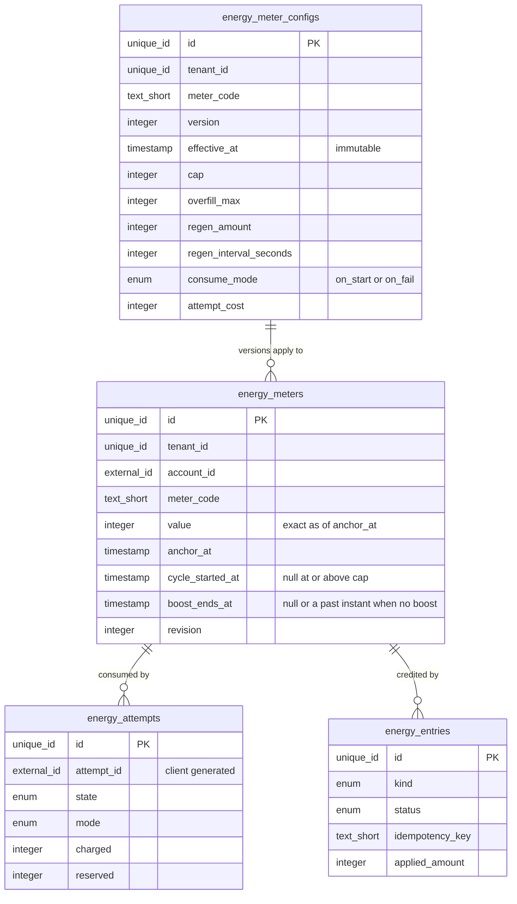
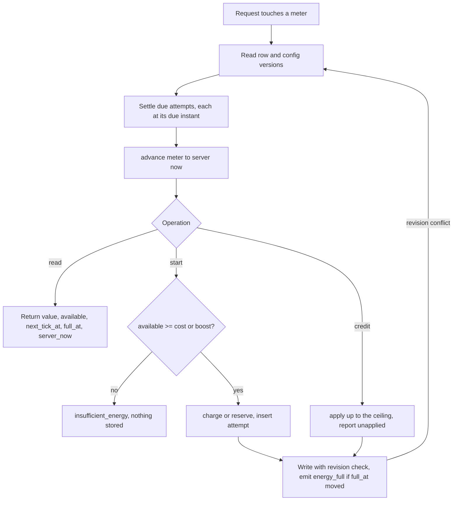
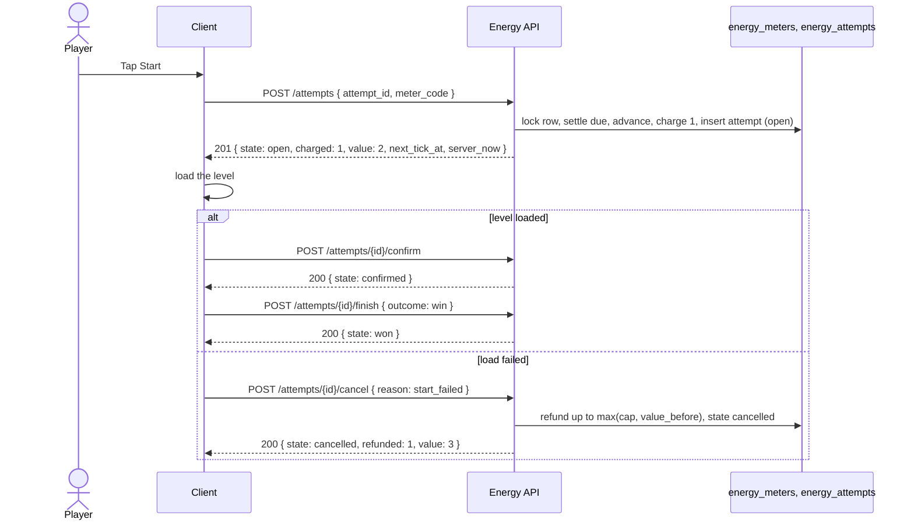
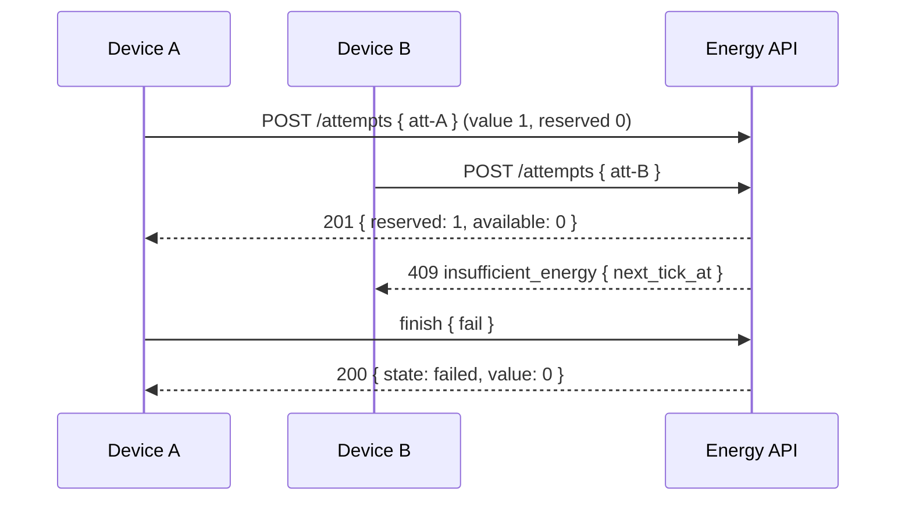
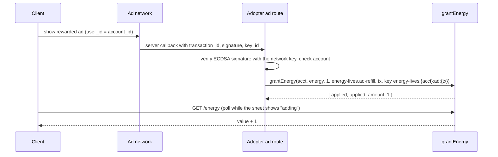
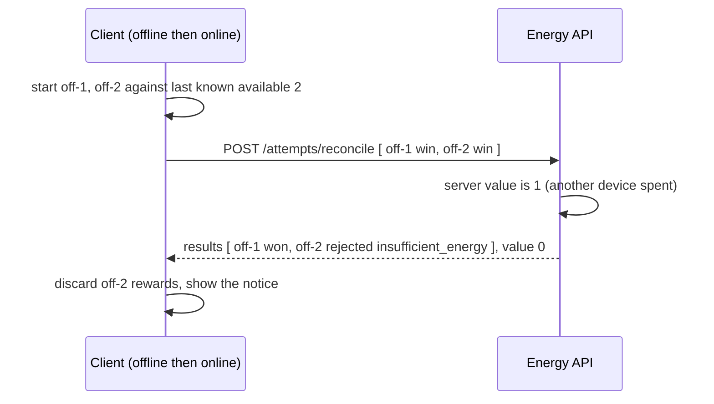
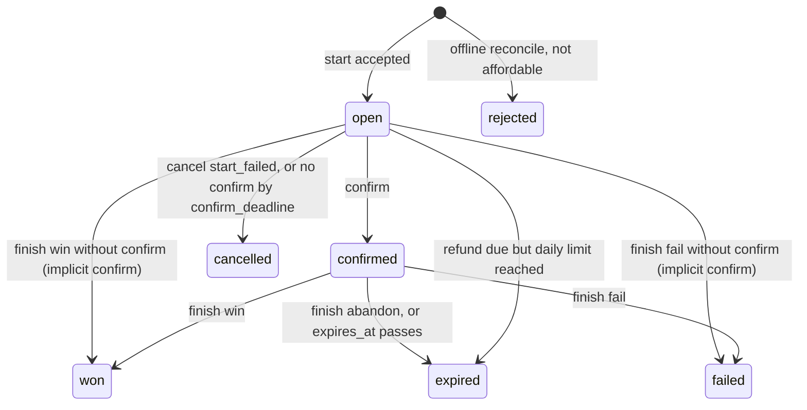

# Energy and Lives (regenerating play allowance)

## 1. Overview

### Problem Statement

A game that limits how often a player can start a session (energy, stamina, lives, hearts) needs a counter that refills with time, caps, can be refilled by other means, and stays correct across two phones, a dead battery and a tampered device clock. The usual shortcut is a per-player timer job that adds one point every interval. It costs a scheduled write per player per interval, drifts when the job is late, and has no answer for a player who was away for ten hours. This block specifies the other model: **store the value and the instant it is exact for, and derive the current value from the server clock on every read**. Nothing runs per player.

On top of that core the block specifies the parts that break in practice:

- **Spending**: an atomic spend that cannot go below zero, idempotent per attempt id, with two variants for lives (spend at start, spend on fail) and a refund when a session fails to start.
- **Refilling**: a refill paid through the ledger of `billing.virtual-currency`, a rewarded-ad grant, an optional friend gift, and a timed infinite-energy boost whose expiry stacks by a stated rule.
- **Change and conflict**: a cap or interval change that does not punish players holding a half-finished interval, clock manipulation, two devices spending the last point, offline play, and a guest to account merge.
- **The ethical floor**: energy is a pacing tool that regulators and design critics treat as a pressure to pay. The block ships the softeners as configuration and states the floor as invariants (section 8, INV-15 and INV-16).

Terms: a **meter** is one regenerating counter per account (`energy`, `lives`; a game may run several). A **point** is one unit of a meter. An **attempt** is one request to start a session that consumes points. A **tick** is one regeneration step.

### User Stories

- **Player**: I see how many points I have, when the next one arrives and when I am full, and the numbers are right on every device.
- **Player**: if the game fails to open the level after I tapped Start, I do not lose a point.
- **Player**: when I am out, I see every way to continue, the free ones first, and the price of the paid one before I pay.
- **Player**: a gift or reward that arrives while I am full is kept, up to a stated ceiling, not thrown away.
- **Designer**: I change the cap or the interval mid-season and no player loses points or progress toward the next one.
- **Backend developer**: I get one atomic operation to spend, one to grant, one to refill, all idempotent, and a pure function that derives the value from stored state and server time.
- **Operator**: no scheduled job runs per player, and the block has no scheduled work at all.

### When to use this block

- The game limits session starts with a counter that regenerates (energy, lives, hearts, tickets).
- A server already exists, or can exist, to be the clock authority and to hold the counter per account.
- Currency refills should use the ledger of `billing.virtual-currency` and rewarded-ad refills a server-verified ad callback.

### When NOT to use

- A wait that is not a counter: build timers, chest timers and cooldowns of single items. They share the lazy-timer idea (`ends_at` and server time) but need none of the spend rules here.
- A single-player game with no account and no server. The client clock is then the only clock and the guarantees of this block do not hold; a local counter with the same shape can serve, with the tamper risk accepted.
- Real-time competitive modes where fairness depends on equal access. Energy limits who can play, which a ranked mode should not do.
- Currency balances: use `billing.virtual-currency`. This block never holds a currency; its value is a function of time.
- Daily rewards and streaks (`engagement.daily-streak`), event schedules (`engagement.event-calendar`) and push delivery (`messaging.push-reengagement`). They call this block's grant operation or consume its `energy_full` event.

### Ethical floor

Timers and energy lean on scarcity and impatience. A heuristic evaluation of casual mobile games defines "Playing by Appointment" as a game that forces the player to play at a specific time through rewards or punishments, and "Pay to Skip" as selling elements that let players skip core challenges ([deceptive.design, page dated 28 November 2022](https://www.deceptive.design/articles/finding-dark-patterns-in-casual-mobile-games-using-heuristic-evaluation), MEDIUM; the page names neither energy nor lives, and guide 06 and guide 11 date it 2025, a mismatch the kit owner should reconcile). Guide 06 applies three tests to any hook: would the player still choose it if shown exactly how it works and what it costs, does it work through anxiety or shortage, and is the audience likely to include children (`kits/game-engagement/guides/06-design-ethics-and-compliance.md`, rule 2). Guide 02 reads the market as softening: Royal Match gives unlimited lives to all team members in the last three days of two events ([Sensor Tower, May 2026](https://sensortower.com/blog/what-royal-matchs-calendar-teaches-about-live-ops-in-2026), HIGH), and Supercell tested instant and day-long chests with total reward value held constant ([Supercell, 15 January 2025](https://supercell.com/en/games/clashroyale/blog/news/chest-experiment-king-tower-levels-1-9), HIGH). Where churn happens is measured in one game: players stopped more often right after a gate level that a wait or coins opened (guide 09, rule 1, [Ascarza, Netzer and Runge, 2023](https://business.columbia.edu/sites/default/files-efs/citation_file_upload/ascarza_netzer_runge_2023-12-04.pdf), HIGH as reported by the guide, one game).

The EU consumer-protection network's key principles on in-game virtual currencies, adopted March 2025, ask for clear and transparent pricing and pre-contractual information, no practices that hide the cost of in-game content or oblige players to buy virtual currency, and respect for consumer vulnerabilities, in particular those of children ([European Commission, news item of 3 June 2025](https://commission.europa.eu/news-and-media/news/european-commission-hosts-stakeholders-talks-application-cpc-networks-key-principles-games-virtual-2025-06-03_en), HIGH; non-binding). The network's Star Stable assessment lists pressuring techniques such as "purchase through time-limited practices" among practices that could be harmful to children ([Lewis Silkin, 26 March 2025](https://www.lewissilkin.com/insights/2025/03/26/eu-bodies-act-against-gaming-companies-to-protect-children-from-in-game-purchase-102k658), MEDIUM, law-firm summary).

The block cannot make a game ethical. It makes the softer designs cheap and writes the floor down:

| Softener | Where it lives |
|---|---|
| Waiting always works: regeneration never stops for payment status, the countdown is exact | INV-1, INV-15, `frontend.md` HUD |
| Lives lost only on failure (`on_fail`) | `CONSUME_MODE`, section 3.2 |
| Free grants bank above the cap up to `OVERFILL_MAX` | section 3.3 |
| Opt-in rewarded-ad refill with a daily limit | `AD_GRANTS_PER_DAY`, section 3.4 |
| Timed infinite-energy windows as event, pass and streak rewards | section 3.5 |
| Optional friend gifts that are sent, never requested | `backend.md` optional extension |
| A start that fails costs nothing | section 3.2, INV-6 |
| Cap cuts keep the points players hold | section 3.6, INV-10 |
| The same wait and the same refill price for every account, whatever it has spent | section 3.6, INV-18 |
| Paid refill off for minors by default | `PAID_REFILL_FOR_MINORS`, INV-16 |
| Refill source recorded, so the team can check that energy is not the only reason players pay | `energy_refilled.source` |

Guide 15 asks three things of this block (`kits/game-engagement/guides/15-manipulation-and-the-line.md`, the energy row, E1 to E3): the player can always continue without paying and the wait is stated (INV-15); the refill price is an exact currency amount shown before the charge, with no forced remainder (INV-7, INV-16); wait length and price do not vary with spend history unless disclosed (INV-18).

Energy must not be the only pressure to buy. A game that sells nothing but refills has designed the wait as the product; the kit's economy guide (guide 03) lists the other sinks and offers to build first. No source in this kit supports a figure for energy's share of revenue, and the circulating one-third-of-bookings estimate is not used (research note, LOW).

---

## 2. Data Model

> Types are **logical types** (`docs/SPEC_GUIDELINES.md` section 5). Reference SQL for Postgres is in [Reference Migration](#reference-migration-postgres).



Five tables and two optional gift tables. Every table carries `tenant_id` (`unique_id`; single-app deployments use one constant value, as in `ugc.friends-leaderboard`) and keys by `account_id` (`external_id`, no foreign key: the account lives in the auth and progress blocks).

### Table: `energy_meter_configs`

Append-only versions of one meter's rules. The rule in effect at instant `t` is the version with the largest `effective_at <= t`.

| Column | Logical Type | Constraints | Notes |
|--------|------|-------------|-------|
| `id` | `unique_id` | PK | |
| `tenant_id` | `unique_id` | NOT NULL | |
| `meter_code` | `text_short` | NOT NULL | slug, lower-case letters, digits, hyphen, 2 to 32 characters (`energy`, `lives`) |
| `version` | `integer` | NOT NULL, UNIQUE per (`tenant_id`, `meter_code`) | 1, then +1 per publication |
| `effective_at` | `timestamp` | NOT NULL | When the version applies from. At publication it must be at or after the server's now (INV-10). Immutable |
| `cap` | `integer` | NOT NULL, >= 1 | Regeneration stops here |
| `overfill_max` | `integer` | NOT NULL, >= 0 | Points a grant may add above `cap`; the grant ceiling is `cap + overfill_max` |
| `regen_amount` | `integer` | NOT NULL, >= 1 | Points per tick |
| `regen_interval_seconds` | `integer` | NOT NULL, >= 1 | Seconds per tick |
| `consume_mode` | `enum` | NOT NULL | values: `on_start|on_fail` |
| `attempt_cost` | `integer` | NOT NULL, >= 1 | Points one attempt consumes (0 while a boost is active, section 3.5) |
| `created_at` | `timestamp` | NOT NULL | Server time |

No UPDATE or DELETE is issued against this table. Changing a rule publishes a new version. A version applies to every account of the tenant: the table has no account column and no operation selects a version per account (INV-18).

### Table: `energy_meters`

One row per account and meter. It stores the value and the instant that value is exact for.

| Column | Logical Type | Constraints | Notes |
|--------|------|-------------|-------|
| `id` | `unique_id` | PK | |
| `tenant_id` | `unique_id` | NOT NULL | |
| `account_id` | `external_id` | NOT NULL | From the verified session, never from a request body (INV-17) |
| `meter_code` | `text_short` | NOT NULL | |
| `value` | `integer` | NOT NULL, >= 0 | Points as of `anchor_at`. May exceed `cap` (grants, earlier cap, merge) |
| `anchor_at` | `timestamp` | NOT NULL | The instant `value` is exact for. Time after it that is shorter than one interval is progress toward the next tick and is kept |
| `cycle_started_at` | `timestamp` | nullable | The instant `value` last dropped below the cap; null while `value >= cap`. Names one drain-to-full cycle in the `energy_full` event |
| `boost_ends_at` | `timestamp` | nullable | End of the infinite-energy window; a boost is active when this is later than server time |
| `revision` | `integer` | NOT NULL, default 1 | +1 per write; the compare-and-swap token (INV-4) |
| `created_at` | `timestamp` | NOT NULL | |
| `updated_at` | `timestamp` | NOT NULL | Server time of the last write |

UNIQUE (`tenant_id`, `account_id`, `meter_code`) is the only lookup path. A row is created on the first touch with `value = cap` and `anchor_at = now`: a new player starts full.

### Table: `energy_attempts`

One row per attempt id. It carries the idempotency of the spend and the facts a refund or settlement needs.

| Column | Logical Type | Constraints | Notes |
|--------|------|-------------|-------|
| `id` | `unique_id` | PK | |
| `tenant_id` | `unique_id` | NOT NULL | |
| `account_id` | `external_id` | NOT NULL | |
| `meter_code` | `text_short` | NOT NULL | |
| `attempt_id` | `external_id` | NOT NULL, UNIQUE per (`tenant_id`, `account_id`) | Generated by the client (UUID or ULID), matches `ID_PATTERN` |
| `state` | `enum` | NOT NULL | values: see "Attempt states" below |
| `mode` | `enum` | NOT NULL | `consume_mode` at start: `on_start|on_fail` |
| `charged` | `integer` | NOT NULL, default 0 | Points taken from the meter for this attempt |
| `reserved` | `integer` | NOT NULL, default 0 | Points held but not yet taken (`on_fail`) |
| `boost_free` | `boolean` | NOT NULL | The attempt started while a boost was active |
| `value_before` | `integer` | NOT NULL | Meter value just before the start; ceiling input for a refund (section 3.2) |
| `offline` | `boolean` | NOT NULL, default false | Arrived through the offline reconcile |
| `cancel_reason` | `text_short` | nullable | `start_failed` or `start_timeout` |
| `refund_denied` | `text_short` | nullable | `daily_limit` when a refund was due and refused |
| `started_at` | `timestamp` | NOT NULL | Server time |
| `confirm_deadline` | `timestamp` | NOT NULL | `started_at + CONFIRM_TIMEOUT_SECONDS` |
| `confirmed_at` | `timestamp` | nullable | |
| `expires_at` | `timestamp` | nullable | `confirmed_at + ATTEMPT_TTL_SECONDS` |
| `settled_at` | `timestamp` | nullable | Server time of the terminal state; for a lazy settlement this is the due instant, not the read instant |

**Attempt states**: `open` (started, not confirmed), `confirmed` (session running), `won`, `failed`, `cancelled` (failed to start, refunded or released), `expired` (abandoned after confirmation, or a refund that hit its daily limit), `rejected` (an offline attempt the server could not afford). Terminal states: `won`, `failed`, `cancelled`, `expired`, `rejected`.

**Indexes**: the UNIQUE key; a partial index on (`tenant_id`, `account_id`, `meter_code`) where `state` is `open` or `confirmed`, which serves the due scan and the reserved total.

### Table: `energy_entries`

Append-mostly log of every credit and every paid refill. It is the idempotency record for grants and refills and the source of daily limits.

| Column | Logical Type | Constraints | Notes |
|--------|------|-------------|-------|
| `id` | `unique_id` | PK | Returned as `entry_id` |
| `tenant_id` | `unique_id` | NOT NULL | |
| `account_id` | `external_id` | NOT NULL | |
| `meter_code` | `text_short` | NOT NULL | |
| `kind` | `enum` | NOT NULL | values: `grant|refill|refund|boost|merge` (`grant` covers rewards, ads and gifts) |
| `status` | `enum` | NOT NULL | values: `pending|applied|rejected|refunded` |
| `reason` | `text_short` | NOT NULL | `<block-slug>.<action>`. A label on this block's own log: `energy-lives.refill`, `energy-lives.ad-refill`, `energy-lives.gift`, `energy-lives.start-refund`, `energy-lives.merge`, or the calling block's (`daily-streak.claim`). Only `energy-lives.refill` and `energy-lives.refill-refund` are ever sent to the ledger |
| `source_ref` | `text_short` | nullable | Ad transaction id, gift id, refill id, attempt id |
| `idempotency_key` | `text_short` | NOT NULL, UNIQUE per (`tenant_id`, `account_id`) | Built by the caller from stable facts (INV-8) |
| `requested` | `integer` | NOT NULL | Points requested, or seconds for `boost` |
| `applied_amount` | `integer` | NOT NULL, default 0 | Points or seconds that took effect |
| `cost_currency` | `text_short` | nullable | Set for `refill` |
| `cost_amount` | `integer` | nullable | Quoted price snapshot, charged through the ledger |
| `ledger_entry_id` | `text_short` | nullable | `entry_id` of the ledger spend |
| `balance_after` | `integer` | nullable | The ledger balance returned by the spend, kept so a replay answers without a second ledger call |
| `value_after` | `integer` | nullable | Meter value right after the credit, returned as `balance` on a replay |
| `day_key` | `text_short` | NOT NULL | The account's local date `YYYY-MM-DD` at creation (time contract); the daily limits count by it |
| `created_at` | `timestamp` | NOT NULL | |
| `updated_at` | `timestamp` | NOT NULL | |

**Indexes**: the UNIQUE key; (`tenant_id`, `account_id`, `reason`, `day_key`) for the daily limits; a partial index on `status = pending` for the re-drive.

### Optional gift tables

Built only when `GIFTS_ENABLED` is true (`backend.md`, optional extension).

| Table | Columns (all `tenant_id`-scoped) |
|-------|---------|
| `energy_gifts` | `id` (`unique_id`), `gift_id` (`external_id`, client generated, unique per sender), `sender_account_id` (`external_id`), `recipient_account_id` (`external_id`), `meter_code` (`text_short`), `units` (`integer`), `state` (`enum`: `sent|claimed|declined|expired`), `created_at`, `expires_at`, `resolved_at` (`timestamp`) |
| `energy_gift_settings` | `account_id` (`external_id`, unique per tenant), `accept_gifts` (`boolean`, default true), `updated_at` (`timestamp`) |

### Reference Migration (Postgres)

#### `energy_meter_configs` table

<!-- REFERENCE: dialect=postgres -->
<!-- ADAPT: MySQL - uuid and gen_random_uuid() become BINARY(16) with UUID() at the app layer, timestamptz becomes DATETIME(6), the CHECK on consume_mode becomes ENUM('on_start','on_fail');
       SQLite - uuid becomes TEXT with a uuid4 from the app, timestamptz becomes TEXT ISO 8601 with Z (lexical order equals time order), bigint becomes INTEGER;
       keep the append-only rule in app code or a trigger that raises on UPDATE and DELETE -->
```sql
CREATE TABLE IF NOT EXISTS energy_meter_configs (
  id                      uuid PRIMARY KEY DEFAULT gen_random_uuid(),
  tenant_id               uuid NOT NULL,
  meter_code              varchar(32) NOT NULL,
  version                 bigint NOT NULL,
  effective_at            timestamptz NOT NULL,
  cap                     bigint NOT NULL CHECK (cap >= 1),
  overfill_max            bigint NOT NULL CHECK (overfill_max >= 0),
  regen_amount            bigint NOT NULL CHECK (regen_amount >= 1),
  regen_interval_seconds  bigint NOT NULL CHECK (regen_interval_seconds >= 1),
  consume_mode            text NOT NULL CHECK (consume_mode IN ('on_start','on_fail')),
  attempt_cost            bigint NOT NULL CHECK (attempt_cost >= 1),
  created_at              timestamptz NOT NULL DEFAULT now(),
  UNIQUE (tenant_id, meter_code, version)
);
```

#### `energy_meters` table

<!-- REFERENCE: dialect=postgres -->
<!-- ADAPT: MySQL - same type mapping as above, UNIQUE KEY syntax;
       SQLite - same type mapping as above; revision is the compare-and-swap token for the single UPDATE ... WHERE revision = ? (backend.md section 2) -->
```sql
CREATE TABLE IF NOT EXISTS energy_meters (
  id                uuid PRIMARY KEY DEFAULT gen_random_uuid(),
  tenant_id         uuid NOT NULL,
  account_id        text NOT NULL,
  meter_code        varchar(32) NOT NULL,
  value             bigint NOT NULL CHECK (value >= 0),
  anchor_at         timestamptz NOT NULL,
  cycle_started_at  timestamptz,
  boost_ends_at     timestamptz,
  revision          bigint NOT NULL DEFAULT 1,
  created_at        timestamptz NOT NULL DEFAULT now(),
  updated_at        timestamptz NOT NULL DEFAULT now(),
  UNIQUE (tenant_id, account_id, meter_code)
);
```

#### `energy_attempts` table

<!-- REFERENCE: dialect=postgres -->
<!-- ADAPT: MySQL - ENUM for state and mode, boolean becomes TINYINT(1), the partial index becomes a plain index on (tenant_id, account_id, meter_code, state);
       SQLite - boolean becomes INTEGER 0/1, partial index syntax is the same -->
```sql
CREATE TABLE IF NOT EXISTS energy_attempts (
  id                uuid PRIMARY KEY DEFAULT gen_random_uuid(),
  tenant_id         uuid NOT NULL,
  account_id        text NOT NULL,
  meter_code        varchar(32) NOT NULL,
  attempt_id        text NOT NULL,
  state             text NOT NULL CHECK (state IN ('open','confirmed','won','failed','cancelled','expired','rejected')),
  mode              text NOT NULL CHECK (mode IN ('on_start','on_fail')),
  charged           bigint NOT NULL DEFAULT 0,
  reserved          bigint NOT NULL DEFAULT 0,
  boost_free        boolean NOT NULL,
  value_before      bigint NOT NULL,
  offline           boolean NOT NULL DEFAULT false,
  cancel_reason     varchar(32),
  refund_denied     varchar(32),
  started_at        timestamptz NOT NULL,
  confirm_deadline  timestamptz NOT NULL,
  confirmed_at      timestamptz,
  expires_at        timestamptz,
  settled_at        timestamptz,
  UNIQUE (tenant_id, account_id, attempt_id)
);
CREATE INDEX IF NOT EXISTS energy_attempts_live
  ON energy_attempts (tenant_id, account_id, meter_code) WHERE state IN ('open','confirmed');
```

#### `energy_entries` table

<!-- REFERENCE: dialect=postgres -->
<!-- ADAPT: MySQL - ENUM for kind and status, no partial index (use a plain index on status);
       SQLite - same type mapping as above; the UNIQUE constraint is what makes grants and refills idempotent, so keep it on every dialect -->
```sql
CREATE TABLE IF NOT EXISTS energy_entries (
  id               uuid PRIMARY KEY DEFAULT gen_random_uuid(),
  tenant_id        uuid NOT NULL,
  account_id       text NOT NULL,
  meter_code       varchar(32) NOT NULL,
  kind             text NOT NULL CHECK (kind IN ('grant','refill','refund','boost','merge')),
  status           text NOT NULL CHECK (status IN ('pending','applied','rejected','refunded')),
  reason           varchar(64) NOT NULL,
  source_ref       varchar(128),
  idempotency_key  varchar(255) NOT NULL,
  requested        bigint NOT NULL,
  applied_amount   bigint NOT NULL DEFAULT 0,
  cost_currency    varchar(32),
  cost_amount      bigint,
  ledger_entry_id  varchar(128),
  balance_after    bigint,
  value_after      bigint,
  day_key          varchar(10) NOT NULL,
  created_at       timestamptz NOT NULL DEFAULT now(),
  updated_at       timestamptz NOT NULL DEFAULT now(),
  UNIQUE (tenant_id, account_id, idempotency_key)
);
CREATE INDEX IF NOT EXISTS energy_entries_daily ON energy_entries (tenant_id, account_id, reason, day_key);
CREATE INDEX IF NOT EXISTS energy_entries_pending ON energy_entries (tenant_id, account_id) WHERE status = 'pending';
```

---

## 3. Data Flow

### 3.1 Lazy regeneration (the pure core)

`advance(meter, now, versions)` returns the meter as of `now`. It has no I/O and reads no clock. The full function is in `backend.md` section 1; the rules:

- A **tick** adds `regen_amount` points when `regen_interval_seconds` have passed since the cycle start. A tick that ends exactly at `now` counts.
- **Regeneration stops at the cap** and never raises the value above it. A value at or above the cap does not regenerate.
- Time left over after whole ticks stays as progress: `anchor_at` moves to the end of the last completed tick, not to `now`. A read that completes no tick leaves the row unchanged and needs no write.
- A spend that takes the value from at-or-above the cap to below it sets `anchor_at = now` and `cycle_started_at = now`: the first point of a new cycle arrives one full interval later. A spend while below the cap changes neither: the player keeps the progress already made.
- The function is composable: `advance(advance(m, t1), t2) = advance(m, t2)` for `t1 <= t2`. Any request may persist the normalized meter at any moment without changing later results (INV-2).
- **Projections.** `next_tick_at` is the end of the tick in flight, null at or above the cap. `full_at` is the instant the meter reaches the cap if nothing else changes, computed by applying the tick rule forward over all known versions, null at or above the cap. Both are recomputed on every read; neither is stored.
- A response carries `server_now`, `value`, `reserved`, `available` (`value - reserved`), `cap`, `next_tick_at`, `full_at`, `boost_ends_at`. Clients count down to these absolute instants and never decide that a tick has completed (time contract, INV-12).

### 3.2 Attempts: spend, reserve, refund

An attempt has three client calls, each idempotent on `attempt_id`: **start** (consumes or reserves), **confirm** (the session really began), **finish** (`win`, `fail` or `abandon`). A fourth, **cancel** with reason `start_failed`, is allowed only while the attempt is `open`.

| | `on_start` (energy, stamina) | `on_fail` (lives) |
|---|---|---|
| start | takes `attempt_cost` now; needs `available >= cost` | reserves `attempt_cost`; needs `available >= cost`; the value is unchanged |
| win | nothing | releases the reservation |
| fail | nothing | takes the reserved points |
| abandon, or `expires_at` passes before a finish | nothing | takes the reserved points when `ABANDON_COUNTS_AS_FAIL`, else releases |
| start failed (cancel, or no confirm by `confirm_deadline`) | refund of the charge (below) | releases the reservation |

Rules common to both:

- **Atomic and never below zero.** Reading the meter, advancing it, settling due attempts, checking `available`, and writing happen as one unit per meter row (INV-4). A start that finds `available < cost` returns `insufficient_energy` with `value`, `next_tick_at`, `full_at`, and stores nothing.
- **Idempotent per attempt id.** A repeat of `start` with the same id and meter returns the stored attempt (HTTP 200 and `replayed: true`) and changes nothing. The same id with another meter code is `attempt_conflict`. An id that was `rejected` stays rejected; a new try uses a new id (INV-5).
- **Reservation.** In `on_fail`, `available = value - reserved`, where `reserved` sums the `reserved` of the meter's `open` and `confirmed` attempts. Two devices cannot both start on one point.
- **Refund of a failed start (`on_start`).** The attempt's `charged` points return exactly once, as of the cancel instant or, for a missing confirm, as of `confirm_deadline`. The refund credit has the ceiling `max(cap, value_before)`: it can restore what the player held before the spend and never creates points above it. A refund that finds the meter already back at its ceiling restores 0 and the attempt still ends `cancelled`. At most `START_REFUND_LIMIT_PER_DAY` refunds apply per account and `day_key`; the next due refund is refused, the attempt ends `expired` with `refund_denied = daily_limit`, and the response says so.
- **Due-instant settlement.** An unconfirmed attempt past `confirm_deadline` is cancelled as of that deadline. A confirmed attempt past `expires_at` is abandoned as of `expires_at`. These are applied lazily, in due order, by the next touch of the meter, each at its own due instant (advance to the instant, apply, continue). The outcome therefore does not depend on when someone reads (INV-3).
- **Boost.** An attempt that starts while `boost_ends_at > now` has cost 0 for its whole life, `boost_free = true`, and is never charged or refunded (INV-9).
- **Proof of play.** Blocks that reward a session (`ugc.friends-leaderboard` reports, `engagement.objectives`, `engagement.season-pass`) accept only an attempt in state `confirmed`, `won` or `failed` through `attemptState(account_id, attempt_id)` (INV-13). An `open` attempt proves nothing, which is what makes a refund safe.

### 3.3 Credits: grants, refills and the ceiling

Every credit passes one operation shape, the ledger's: `grantEnergy(account_id, meter_code, amount, reason, source_ref, idempotency_key)` returns `{applied, balance, entry_id}` plus `applied_amount` and `unapplied_amount`. `meter_code` plays the role of the ledger's `currency` argument; amount is a positive integer.

| Credit | Ceiling | Excess |
|---|---|---|
| Grant (reward, ad, gift) | `cap + overfill_max` | reported as `unapplied_amount`; the caller keeps it (the ad unit is simply spent, a gift stays in the inbox, a streak block may hold the rest) |
| Bought refill `to_full` | `cap` (a bought refill never enters the overfill band) | not charged: priced on the missing points only |
| Bought refill `units` | `cap` | offered only while `value + units <= cap`, else the quote says `no_room` |
| Refund of a failed start | `max(cap, value_before)` | not applied, reported as `refunded: 0` |
| Regeneration | `cap` | none: it stops |

A value above the cap does not regenerate. Spending from the overfill band brings it down to the cap before a cycle starts; the cycle starts at the spend that crosses below the cap. A repeat of a grant with the same `idempotency_key` returns the original result and changes nothing, including when the original was partly applied (INV-8).

### 3.4 Refill paths

1. **Time**: regeneration, always on.
2. **Currency** (ledger reason `energy-lives.refill`): quote, confirm with `expected_cost`, ledger `spend`, then credit. Section 4 shows the sequence; `backend.md` section 4 the saga.
3. **Rewarded ad**: the ad network's server-to-server callback is verified by the adopter's ad route, which then calls `grantEnergy` with `reason energy-lives.ad-refill` (a label on the meter grant, not a ledger reason), `source_ref` the network's transaction id and `idempotency_key energy-lives:{account_id}:ad:{transaction_id}`. The client never claims an ad reward itself. Units come from `AD_GRANT_UNITS`, not from the callback; at most `AD_GRANTS_PER_DAY` per account and `day_key`. The contract with AdMob server-side verification is in `backend.md` section 5; the SDK integration is out of scope.
4. **Friend gift** (optional): the sender gives one point to a friend; the recipient claims it. `backend.md` optional extension.
5. **Timed boost** (section 3.5), from rewards or bought with currency.
6. **Other blocks' rewards**: `engagement.daily-streak`, `engagement.season-pass`, `engagement.event-calendar` and `engagement.objectives` grant points or boosts with their own `reason` and key.

### 3.5 Boost: infinite energy with an expiry

`boost_ends_at` is a real-time window. While it is later than server time, new attempts cost nothing. `grantBoost(account_id, meter_code, seconds, reason, source_ref, idempotency_key)` extends it by this rule:

- **Stacking is additive.** `new_end = max(now, boost_ends_at) + seconds`. Two one-hour boosts bought together give two hours; a boost granted while one runs starts when the running one ends.
- **Cap on remaining time.** The remaining window never exceeds `BOOST_MAX_REMAINING_SECONDS`. The part that does not fit is returned as `unapplied_seconds`. A bought boost that would not fit in full is refused before any charge (`boost_stack_limit`).
- The window does not pause. It runs while the app is closed and while the server is down; operators compensate a long outage with a grant, never by editing a timer.
- Regeneration continues under a boost. The `value` does not move while attempts are free, so regeneration only matters when the boost started below the cap.

### 3.6 Changing the rules mid-flight

Rules live in versions (`energy_meter_configs`). The pure core takes the ordered versions and applies each tick under the version in effect when it started, with these rules:

| Change | Rule | Why players are not punished |
|---|---|---|
| Cap raised | The new cap applies from `effective_at`. A meter that was full starts a cycle at `effective_at`; points are not granted retroactively | nobody loses; nobody gets a surprise gift either |
| Cap lowered | Points above the new cap stay and stay spendable; nothing regenerates until the value is below the cap | no confiscation (INV-10) |
| Interval lengthened | The tick in flight ends at its old end; later ticks use the new interval | progress already made is honored |
| Interval shortened | The tick in flight ends at the earlier of its old end and `start + new interval`, but not before `effective_at` | elapsed time counts at face value |
| `regen_amount` changed | Applies to ticks that end after `effective_at` | |
| `attempt_cost` or `consume_mode` changed | Applies to attempts that start after `effective_at`; an open attempt keeps the `mode` and cost it started with | |

A new version must have `effective_at` at or after the server's now. Back-dating would change values already shown to players (INV-10). Versions and offers are tenant-wide: the wait (cap, interval, amount) and the refill price are the same for every account in the same meter state, and nothing reads spend history to choose them (INV-18). `fixtures/regen-cases.json` holds the worked cases.

### 3.7 Pause rules

| Situation | Regeneration | Boost window | Open attempt timers |
|---|---|---|---|
| App closed, phone off, no network | runs (server time) | runs | run |
| Value at or above the cap | nothing accrues; the next spend below the cap starts a cycle | n/a | n/a |
| Boost active | runs | runs | run |
| A session is on screen | runs | runs | run |
| Server maintenance | runs when the server returns; the first read catches up | runs | run; operators lengthen `ATTEMPT_TTL_SECONDS` before planned downtime (new versions affect later attempts) |
| Player request | not offered: pausing could only hurt the player | not offered | not offered |

### 3.8 Clock manipulation and races

- Every timer input is the server clock, read once per atomic unit. A client timestamp is never read for regeneration, expiry, boost or day boundaries; `client_ts` in the envelope is analytics only.
- A server clock that steps backwards cannot reduce a value or extend a timer: the unit uses `max(now, anchor_at, updated_at)` of the row.
- Where several app instances share one database, read the instant from the same source for all of them (the database clock, or application clocks held within a stated skew), so two instances never disagree about which write came first.
- Two devices: the unit is serialized per meter row (row lock, or compare-and-swap on `revision` with up to `MAX_CONFLICT_RETRIES` retries). One spend wins the last point; the other gets `insufficient_energy` with the new `next_tick_at`.

### 3.9 Offline play

The client may always show the last response with an age. What else it may do is a product setting, `OFFLINE_ATTEMPTS`:

- **false (default)**: no attempt starts while offline. Menus and non-energy play stay available; the start button explains that a connection is needed.
- **true**: the client may queue up to `OFFLINE_MAX_ATTEMPTS` attempts against the last `available` it saw, each with its own `attempt_id`. On reconnect it sends them in order to `POST /api/energy/attempts/reconcile`. The server starts, confirms and finishes each as at its own now. An attempt the server cannot afford becomes `rejected`: its rewards are not valid because no confirmed attempt exists (INV-13), and the client says so. A replay of the batch changes nothing.

### 3.10 Account merge

`mergeAccounts(from_account_id, into_account_id, merge_id)` is called by the guest to account merge flow of `data.progress-sync` and the auth blocks. For each meter, inside one unit:

1. Settle both rows' due attempts; the source's open attempts end by the due-instant rules.
2. `value = max(value_from, value_into)` after advancing both to now; `anchor_at` and `cycle_started_at` come from the row that gave the higher value, the earlier anchor on a tie; `boost_ends_at = max` of the two.
3. The source row is deleted; the source's attempts and entries stay for audit under their old `account_id` until the account-deletion flow erases them.
4. A `merge` entry with key `energy-lives:merge:{merge_id}` makes the call idempotent.

The merge never sums two meters: two accounts regenerating in parallel must not double a player's allowance (INV-11). Pending refills of the source are re-driven under the source before the merge.

### Flow



---

## 4. Sequence Diagrams

### Start, confirm, finish (spend on start) and a start that fails



### Two devices, one point (spend on fail)



### Currency refill with a crash between spend and credit

```mermaid
sequenceDiagram
    participant C as Client
    participant S as Energy API
    participant L as Ledger (billing.virtual-currency)
    participant DB as energy_entries, energy_meters

    C->>S: POST /refills { refill_id, offer_code, expected_cost: 6 }
    S->>DB: advance; value < cap; price 6 <= expected; insert entry pending
    S->>L: spend(gems, 6, energy-lives.refill, key energy-lives:{acct}:refill:{refill_id})
    L-->>S: { applied: true, balance: 19, entry_id }
    S--xDB: credit fails (process dies)
    S-->>C: 503 unavailable
    C->>S: GET /energy (or the same POST again)
    S->>DB: entry pending: re-drive
    S->>L: spend(same key)
    L-->>S: original result, nothing charged twice
    S->>DB: credit to cap, entry applied
    S-->>C: 200 { value: 5, balance: 19 }
```

### Rewarded ad grant (server verified)



### Offline queue reconcile



---

## 5. State Management

### Attempt states



Invalid transitions: a terminal state never changes; `cancel` is refused (`attempt_not_cancellable`) once `confirmed`; `confirm` on a `cancelled` attempt returns `attempt_not_open` so the client knows the start was refunded.

### Entry status (refills)

`pending` (spend not yet known applied or credit not yet written) leads to `applied`, `rejected` (the ledger refused: `insufficient_balance`) or `refunded` (an undeliverable refill, section 6). A pending entry is re-driven on every read of the account's meters, up to `REDRIVE_MAX_PER_READ`, and by a repeat of the same `refill_id`. It is never abandoned: the ledger contract has no read by key, so a replay of the spend is the only way to learn its result (INV-7).

### Client state

| State | Storage | Survives reload | Notes |
|-------|---------|-----------------|-------|
| Last response per meter and its receipt instant on the monotonic clock | memory, mirrored to device storage with the wall-clock receipt time for the stale label | mirror only | Display only; never an authority and never part of a progress snapshot (INV-14) |
| Server offset | memory | no | `server_now` at receipt minus the monotonic clock; recomputed on every response |
| Pending attempt id and pending refill id | device storage | yes | Resume with the same id until a terminal answer arrives |
| Offline attempt queue | device storage | yes | Only when `OFFLINE_ATTEMPTS`; bounded by `OFFLINE_MAX_ATTEMPTS` |

### Server state

All state is in the five tables. No in-memory timers exist. `energy_full` emission (section 6) is the only scheduled-looking behavior and it is event-driven by writes.

---

## 6. Integration Points

### Inbound

| Caller | How | Purpose |
|--------|-----|---------|
| Game client | HTTP, session auth (`backend.md` Endpoints) | read, start, confirm, finish, cancel, quote, refill, reconcile |
| `engagement.daily-streak`, `engagement.season-pass`, `engagement.event-calendar`, `engagement.objectives` | in-process `grantEnergy` and `grantBoost` | rewards of kind energy or boost, with their own `reason` and key (for example `daily-streak:{account_id}:{day_key}`) |
| Adopter's ad route | in-process `grantEnergy` after verifying the callback | rewarded-ad refill |
| Reward-paying blocks | in-process `attemptState(account_id, attempt_id)` | accept play evidence only from `confirmed`, `won`, `failed` |
| Guest to account merge flow | in-process `mergeAccounts` | section 3.10 |
| Operator tooling | `publishMeterConfig` (admin auth) | new config versions |

### Outbound

| Target | How | Purpose |
|--------|-----|---------|
| `billing.virtual-currency` ledger | `spend(account_id, currency, amount, 'energy-lives.refill', source_ref, idempotency_key)`; `grant(...)` for an undeliverable-refill refund with reason `energy-lives.refill-refund` | paid refills; the block never writes a balance |
| `messaging.push-reengagement` | the `energy_full` event only; no call | "your energy is full" |
| `ugc.friends-leaderboard` (optional) | read friend links | gift eligibility |
| Database | SQL | the five tables |

### Cross-block contracts

- **Ledger** (`billing.virtual-currency`): `amount` is a positive integer; a replay with the same `idempotency_key` returns the original result; `spend` rejects with `insufficient_balance` and never goes below zero. This block builds its keys from stable facts: `energy-lives:{account_id}:refill:{refill_id}`.
- **Ledger reasons**: the only reasons this block sends to the ledger are `energy-lives.refill` (`spend`, a sink) and `energy-lives.refill-refund` (`grant`, a faucet). `energy-lives.ad-refill` and `energy-lives.gift` are `reason` values of `grantEnergy` meter grants; they never reach the ledger and are not registered there (`billing.virtual-currency` registers exactly the two above).
- **Energy as an item**: energy is not held in the ledger, because its value is a function of time. Other blocks reward energy through `grantEnergy`, whose shape and idempotency rules equal the ledger's `grant` with `meter_code` in the `currency` position. Decision for the orchestrator: if `billing.virtual-currency` prefers to route item grants for code `energy`, it calls `grantEnergy` and stores no balance.
- **Time**: server clock only; `day_key` from the account's IANA `timezone` (`engagement.daily-streak` rate-limits timezone changes); countdowns from `server_now` and absolute instants.
- **Account**: keyed by `account_id` and tenant; guest merge by section 3.10. Meter values are never part of a progress snapshot, export or import, so a restored snapshot cannot change energy (`data.progress-sync`, INV-14).
- **Account deletion** (`compliance.account-deletion`): erase the account's rows in all tables of this block.
- **Entitlements** (`billing.subscriptions`): an active subscription may be honored by a recurring `grantBoost` with key `subscriptions:{account_id}:{period}`, disclosed in the subscription's own offer. A larger cap or a shorter interval for one account is not supported, because config versions are never per account (INV-18). This block asks nothing of the entitlement contract.

### Events

Domain event for the push block (the shape `messaging.push-reengagement` consumes; fields on top of the shared envelope):

| Field | Value |
|-------|-------|
| `event_name` | `energy_full` |
| `subject_key` | `energy:{meter_code}:{cycle_started_at as epoch seconds}`, stable for one drain-to-full cycle |
| `state` | `armed` or `resolved` |
| `fire_at` | the server's `full_at` (absolute) |
| `expires_at` | `full_at + FULL_NOTICE_TTL_SECONDS` |
| `params` | flat json: `meter_code`, `cap`, `value`, `meter_revision` |

`armed` is emitted in the same transaction as every write that leaves the meter below the cap and changes `full_at` or opens a cycle; the same `subject_key` is re-emitted with the new `fire_at` as the timer moves. `resolved` with the same `subject_key` is emitted when a write brings the value to the cap or above (refill, grant, refund). A meter that fills by regeneration emits nothing: `fire_at` passes and the notification fires. Delivery is at-least-once through a transactional outbox or equivalent; the consumer upserts by (account, event, `subject_key`). The client emits the same fields on its event bus after every response, with `fire_at` taken from the server's `full_at`, so the device can schedule a local notification. This block never calls the push block and the push block never calls this one.

Analytics events. The shared envelope of guide 12 applies to every event (`event_name`, `account_id`, `session_id`, `server_ts`, `client_ts`, `app_version`, `platform`, `event_id`, `schema_version`). Money, claim and accepted-progress events are written by the server in the same transaction as the state change; events about what only the device sees are written by the client (guide 12, rule 4).

| Event | Writer | Properties |
|-------|--------|-----------|
| `energy_spent` | server | `meter_code`, `amount`, `mode`, `attempt_id`, `boost_free`, `value_after` |
| `energy_attempt_cancelled` | server | `meter_code`, `attempt_id`, `reason` (`start_failed|start_timeout`), `refunded`, `refund_denied` |
| `energy_refilled` | server | `meter_code`, `source` (`currency|ad|gift|boost|reward|refund`), `units`, `cost_currency`, `cost_amount`, `value_after` |
| `energy_offline_reconciled` | server | `meter_code`, `accepted`, `rejected` |
| `energy_gift_sent`, `energy_gift_claimed` | server | `meter_code`, `units` (optional extension) |
| `energy_empty_shown` | client | `meter_code`, `seconds_to_next`, `seconds_to_full`, `options_shown[]`, `ad_remaining_today` |
| `energy_sheet_action` | client | `meter_code`, `action` (`wait|ad|gift|refill|boost|dismiss`) |
| `energy_refill_confirm_shown` | client | `meter_code`, `offer_code`, `cost_currency`, `cost_amount`, `balance_after` |
| `energy_refill_failed` | client | `meter_code`, `offer_code`, `error` |

---

## 7. Configuration Surface

Per-meter rules (stored in `energy_meter_configs`, versioned):

| Key | Type | Default | Description |
|-----|------|---------|-------------|
| `CAP` | `number` | `5` | Regeneration stops here. Design default; the one cited example (Candy Crush, a fan wiki) shows five and a life per half hour, LOW |
| `OVERFILL_MAX` | `number` | `5` | Points a grant may add above `CAP`. Design default |
| `REGEN_AMOUNT` | `number` | `1` | Points per tick |
| `REGEN_INTERVAL_SECONDS` | `number` | `1800` | Seconds per tick. At the defaults, empty to full takes 9000 seconds |
| `CONSUME_MODE` | `string` | `on_start` | `on_start` for energy, `on_fail` for lives |
| `ATTEMPT_COST` | `number` | `1` | Points per attempt |

Block-level:

| Key | Type | Default | Description |
|-----|------|---------|-------------|
| `CONFIRM_TIMEOUT_SECONDS` | `number` | `120` | An attempt not confirmed by then is cancelled and refunded as of the deadline |
| `ATTEMPT_TTL_SECONDS` | `number` | `3600` | A confirmed attempt not finished by then is abandoned as of `expires_at` |
| `ABANDON_COUNTS_AS_FAIL` | `boolean` | `true` | `on_fail`: abandoning costs the reserved points |
| `START_REFUND_LIMIT_PER_DAY` | `number` | `10` | Refunds of failed starts per account and `day_key` |
| `AD_GRANT_UNITS` | `number` | `1` | Points per verified ad |
| `AD_GRANTS_PER_DAY` | `number` | `5` | Ad grants per account and `day_key` |
| `BOOST_MAX_REMAINING_SECONDS` | `number` | `86400` | Largest remaining boost window |
| `REFILL_OFFERS` | `json` | `[]` | Offers `{offer_code, meter_code, kind: to_full|units|boost, currency, amount, units?, seconds?}`; `amount` is per missing point for `to_full`, the whole price otherwise. Prices are the adopter's decision |
| `PAID_REFILL_FOR_MINORS` | `boolean` | `false` | Whether accounts the adopter flags `is_minor` may buy refills |
| `OFFLINE_ATTEMPTS` | `boolean` | `false` | Section 3.9 |
| `OFFLINE_MAX_ATTEMPTS` | `number` | `3` | Queue length when offline attempts are on |
| `FULL_NOTICE_TTL_SECONDS` | `number` | `21600` | `expires_at` of `energy_full` is `full_at` plus this |
| `MAX_CONFLICT_RETRIES` | `number` | `5` | Read-advance-write retries on a revision conflict |
| `REDRIVE_MAX_PER_READ` | `number` | `3` | Pending refills completed per read |
| `ID_PATTERN` | `string` | `^[A-Za-z0-9_-]{2,64}$` | Shape of `attempt_id`, `refill_id`, `gift_id`, `merge_id` |
| `RATE_LIMIT_PER_MINUTE` | `number` | `60` | Requests per account and minute across the player routes; above it the answer is 429 with `retry_after_seconds` |
| `STALE_NOTICE_SECONDS` | `number` | `60` | Client shows the age of a response older than this |
| `GIFTS_ENABLED` | `boolean` | `false` | Optional extension |
| `GIFT_UNITS` | `number` | `1` | Points per gift |
| `GIFTS_SENT_PER_DAY` | `number` | `5` | Per sender and `day_key` |
| `GIFT_INBOX_MAX` | `number` | `10` | Unclaimed gifts per recipient |
| `GIFT_TTL_SECONDS` | `number` | `604800` | A gift expires this long after it was sent |
| `GIFT_MIN_FRIEND_AGE_SECONDS` | `number` | `86400` | A friend link must be this old before a gift passes |

---

## 8. Invariants (referenced by features and acceptance)

| ID | Invariant |
|----|-----------|
| INV-1 | **Lazy regeneration.** The current value is a pure function of the stored row, the config versions and server time. No scheduled job, timer or per-player work changes a stored value. A server started with every scheduler disabled returns the correct value after three ticks. |
| INV-2 | **Normalization composes.** `advance(advance(m, t1), t2) = advance(m, t2)` for `t1 <= t2`; a read that completes no tick writes nothing; a write may store the normalized meter at any moment. |
| INV-3 | **Settlement is deterministic.** A due attempt is settled as of its due instant, in due order, so the result does not depend on who reads when. |
| INV-4 | **Atomic and never below zero.** Read, settle, advance, check and write are one unit per meter row (row lock or compare-and-swap on `revision`). `value` never goes below zero; `available` is checked against `cost` inside the unit; two devices cannot spend the same point. |
| INV-5 | **Idempotent per attempt.** The same `attempt_id` returns the stored attempt and changes nothing; another meter under that id is `attempt_conflict`; a `rejected` id stays rejected. |
| INV-6 | **Refund once, exactly, bounded.** Only an `open` attempt refunds; at most `charged` points, at most once, within the ceiling `max(cap, value_before)` and `START_REFUND_LIMIT_PER_DAY`; a boost-free attempt refunds nothing. |
| INV-7 | **Refill is price-true and crash-safe.** The charge never exceeds `expected_cost`; nothing is charged at or above the cap; the credit follows an applied ledger spend and never precedes it; a pending entry is re-driven and never abandoned; a replay with the same `refill_id` spends once. |
| INV-8 | **Credits are idempotent and honest.** A repeat of an `idempotency_key` returns the original result; a credit above its ceiling reports `unapplied_amount` and never discards silently. |
| INV-9 | **Boost.** It is decided at attempt start; it stacks additively; remaining time never exceeds `BOOST_MAX_REMAINING_SECONDS`; the excess is reported. |
| INV-10 | **Config is append-only and kind to holders.** Versions are never edited; `effective_at` is not in the past at publication; a lower cap never removes points; an in-flight tick keeps the earlier of its old and new end; a cap raise is not retroactive. |
| INV-11 | **Merge takes the maximum.** Never the sum; boost is the later end; the call is idempotent per `merge_id`. |
| INV-12 | **Server clock only.** No client timestamp reaches regeneration, expiry, boost or day computations; the client never decides that a tick elapsed; a backwards server clock cannot reduce a value or extend a timer. |
| INV-13 | **Proof of play.** Reward-paying blocks accept an attempt only in `confirmed`, `won` or `failed`; offline attempts count only after the server accepted them. |
| INV-14 | **Not in the snapshot.** Meter values and attempts are never part of a progress snapshot, export or import, and a client mirror is display only. |
| INV-15 | **Waiting is a complete path.** A player with no payment and no ad reaches a playable state within `cap * interval` at most; the empty-energy sheet states the exact time; regeneration never depends on payment or ad history. |
| INV-16 | **No hidden price, no pressure surface.** A paid prompt shows the exact cost and the balance after; the amount charged never exceeds the amount shown; no paid prompt opens without a player action; paid refills are off for accounts flagged `is_minor` unless `PAID_REFILL_FOR_MINORS`; no copy uses a countdown to push a purchase. |
| INV-17 | **Identity and tenancy from the session.** `account_id` and `tenant_id` come from the verified session (the ad route takes the account from a verified callback); a body field never selects whose meter is touched. |
| INV-18 | **One wait and one price for everyone.** The cap, interval, regeneration amount, attempt cost and every offer price come from tenant-wide config versions and offers; no input selects them per account, and none reads spend history, purchase count, segment or any vulnerability signal. A refill price varies only with the meter's own state (points missing). Any per-account rate an adopter adds is disclosed in the sheet that shows the price and stays out of experiments on minors or accounts of unknown age (guide 12, rule 13). |

---

## Origin and verification status

This block is specified from public documentation and published industry practice. No shipped app verified it, and it has not been run on stacks A, B or C. The 3-stack check in `acceptance.md` is a mental test by the author. The fixtures' expected values were computed by a JavaScript translation of the rules in `backend.md` and an in-memory model of the operations; no database or HTTP server ran them.

**Documented fact** (source read for this block):

- Hiro (Heroic Labs) documents an energy system that stores amounts per user and computes the current value "on get or spend", with `max_count`, `max_overfill` (excess gained "when granted directly"), `refill_count` and `refill_time_sec`, and separate energy modifiers for temporary infinite energy, faster refill and a higher maximum ([Hiro energy](https://heroiclabs.com/docs/hiro/concepts/energy/), HIGH for these field names; [Hiro energy modifiers](https://heroiclabs.com/docs/hiro/concepts/energy/energy-modifiers/llm.md), HIGH; neither page says how modifiers stack or how refill behaves for an offline player, which is why section 3.5 states a rule).
- PlayFab models regeneration as a recharge rate in units per day, "evenly distributed over a 24 hour period", with a recharge maximum; the page does not say how the balance is computed or whether the maximum caps the balance ([PlayFab currencies](https://devdocs.xbox.com/services/playfab/economy-monetization/economy/tutorials/currencies), HIGH for the field names). This block uses a cap and an interval; it does not copy the per-day model.
- AdMob server-side verification sends the query parameters `ad_network`, `ad_unit`, `custom_data`, `key_id`, `reward_amount`, `reward_item`, `signature`, `timestamp`, `transaction_id` and `user_id`, with `signature` and `key_id` last; the signature is ECDSA over every parameter before `&signature=` exactly as received; keys come from `gstatic.com/admob/reward/verifier-keys.json` and may be cached for at most 24 hours; `transaction_id` is a unique hex identifier per reward grant event; the page does not say how to guard against replay ([AdMob SSV](https://developers.google.com/admob/android/ssv), HIGH; the rewarded-ad page calls SSV optional, [AdMob rewarded](https://developers.google.com/admob/android/rewarded), HIGH).
- The EU key principles, the Star Stable list, "Playing by Appointment" and "Pay to Skip", the Royal Match and Supercell examples, and the churn finding are cited in the Ethical floor with their labels.
- A fan wiki gives one life per half hour up to five for Candy Crush Saga and a community answer says the timer follows the device clock ([Candy Crush Wiki](https://candycrush.fandom.com/wiki/Lives), LOW here: the page returned HTTP 402 and was read only as a search summary; King Community threads, LOW: sign-in wall). Guide 02 and guide 11 label the wiki MEDIUM.

**Design choice** (no source settles it): the `anchor_at` and `cycle_started_at` model; the in-flight-tick rules for interval changes; `on_start` and `on_fail` with reservation; the confirm handshake and its timeouts; the refund ceiling and daily limit; additive boost stacking and its cap; max-not-sum on merge; the offline queue; every default in section 7; the `energy_full` subject key per cycle; paid refill off for minors; the three-step atomic unit.

**Extrapolation**: that a confirm handshake is enough to make start refunds safe against play-without-confirm (security.md T-3 states the residual risk); that a per-account daily ad limit and a gift friend-age rule suppress farming (no data); that the ledger replay is a sufficient recovery for a crash between spend and credit (the ledger contract has no read by key; the replay relies on its idempotency rule).

**Not covered**: rewarded-ad SDK integration, ad fraud beyond callback verification, held boost items the player activates later, per-segment tuning, and any legal advice. The EU principles are non-binding and the rest of the legal picture is dated in guide 06.
