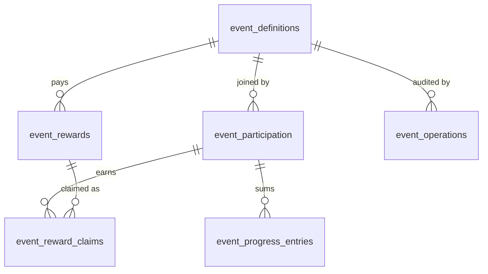
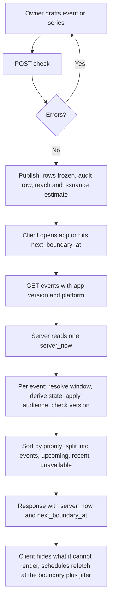
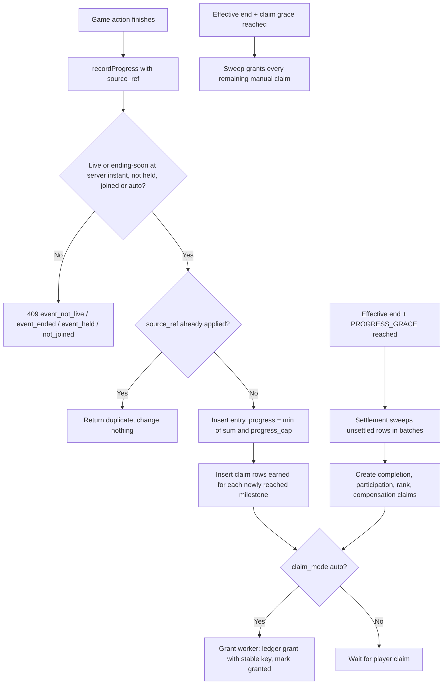
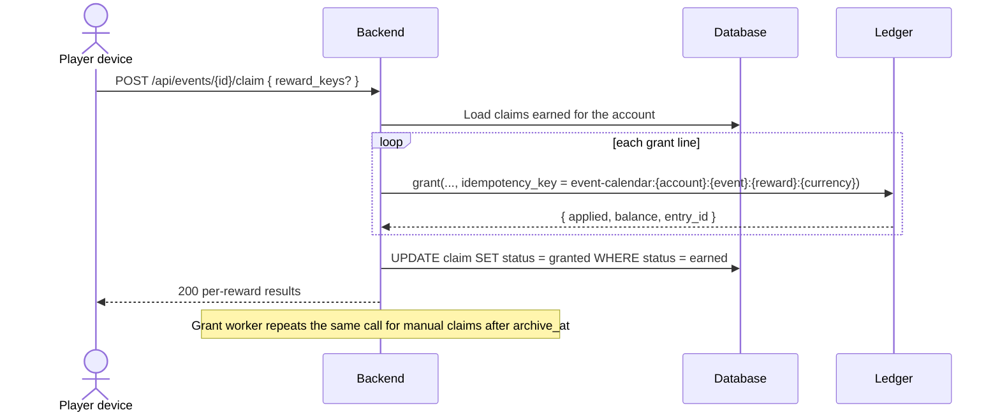
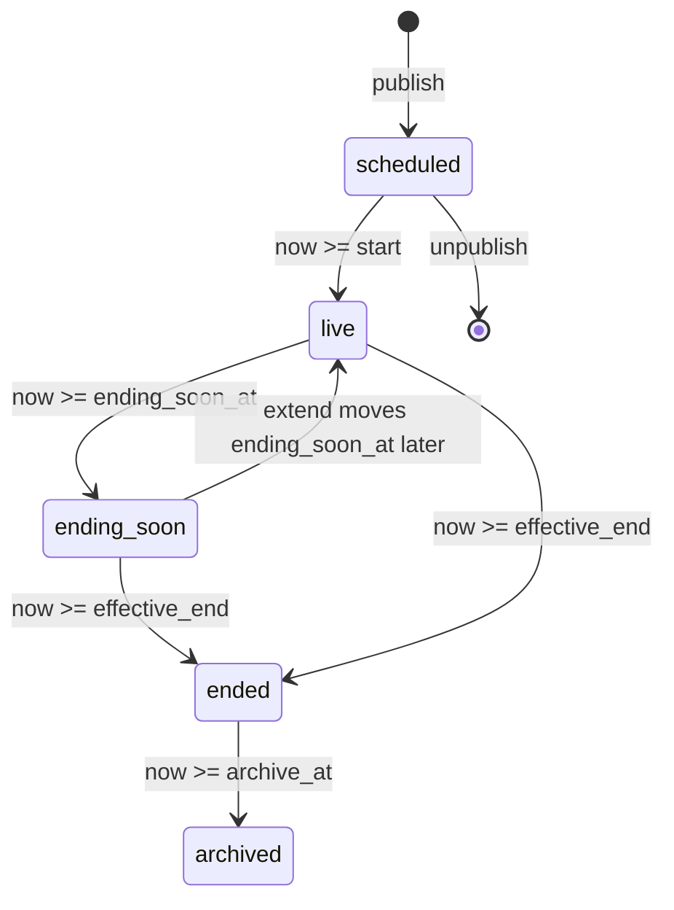

# Event Calendar

## 1. Overview

### Problem Statement

A mobile game keeps players returning at three time scales: something to do today, a goal across this week, a long arc across this season. The schedule of those reasons is the live-ops calendar. If the calendar is compiled into the app, every new event needs a store release, a release takes days to reach players, and a client with a wrong device clock decides for itself what is live.

This block moves the calendar to the server. Events are **data**: a definition with a window, an audience, a reward table and localized content. The client asks the server what is live, upcoming and just ended, receives the server's current time with every answer, and renders what it can. A new event of an existing type ships with no app update. An event that needs new client code carries a minimum app version, and older clients hide it.

Three properties make the calendar trustworthy to players and safe for the economy:

- **One clock.** The server decides every start, end, grace period and rollover. The client shows a countdown and never decides that a timer has elapsed.
- **Exactly-once rewards.** An earned reward is one row and one ledger grant, whether the player taps Claim, the server pays it automatically, a retry runs, or two devices race.
- **Fair endings.** When an operator ends or pauses an event early, rewards already earned stand, and compensation can never push a player above the reward table's maximum.

### User Stories

- **Player**: I want to see what is running today, this week and this season, with an exact timer, the rules and the full reward list, before I join.
- **Player**: I want rewards I earned to stay mine even if I forget to claim them or the event ends early.
- **Player**: I want events my app cannot show to stay out of my way, with a plain note when a newer version is needed.
- **Event owner**: I want to schedule an event weeks ahead, see gaps and clashes on a calendar view, and publish without an app release.
- **Event owner**: I want to stop a broken event within seconds, without a deploy, and decide what happens to players' partial progress.
- **Economy owner**: I want every event's maximum payout checked against a per-layer cap and a declared budget before it can go live.
- **Tester**: I want to see the calendar as a player would at any instant, without touching real players or real rewards.

### When to use this block

- User mentions: "event calendar", "live ops", "daily event", "weekly event", "seasonal event", "limited-time event", "event schedule", "ending soon", "events without an app update"
- The game has a backend, accounts (guest or signed in) and a reward ledger (`billing.virtual-currency`)
- The team ships live content on a schedule (kit interview 7: daily, daily and weekly, or all three layers)

### When NOT to use

- Season pass tiers, premium unlock, pass progress and the season window: `engagement.season-pass` owns the window in its own `season_definitions`. A seasonal-layer event here may carry an optional `season_ref` (a season id of the pass) for display only; the calendar never defines or changes the pass window and the pass never reads the calendar (INV-24)
- Daily and weekly missions as a checklist: `engagement.objectives`
- Streaks and daily login calendars: `engagement.daily-streak`
- Ranking players against each other: `ugc.friends-leaderboard`. A ranked event names a rank source; this block never computes ranks (section 6)
- Push delivery: `messaging.push-reengagement` consumes the `event_ending_soon` hand-off; this block sends nothing to a device
- Paid entry, prices, offers and personalized pricing: not in this block, by design (INV-6, INV-8)
- Rewards with real-world value, or any ranking with stakes: progress can be client-reported (`security.md` T-4)
- A/B experiment allocation and percentage rollouts: not in version 0.1.0

### The rhythm: three layers

Sensor Tower groups top-grossing live operations into recurring events (daily tasks, check-ins, win streaks, which "sustain daily engagement and prepare players for mid-term and large-scale events"), feature events (the game's "rhythm layer": passes, mini-games, treasure hunts) and large-scale events (major seasonal events, competitions, collection systems) ([Sensor Tower, March 2026](https://sensortower.com/blog/top-grossing-mobile-games-live-ops-strategies-2025-report), HIGH). Royal Match's calendar shows the same shape: short-term pressure events, a weekly rhythm of contests and team events "timed to weekends", and a two-month collection ([Sensor Tower, May 2026](https://sensortower.com/blog/what-royal-matchs-calendar-teaches-about-live-ops-in-2026), HIGH). The words daily, weekly and seasonal are this kit's reading of those layers (`kits/game-engagement/guides/02-return-reasons.md`, rule 1).

The layer is a field on every event. It selects defaults and checks; every layer runs on the same engine.

| Layer | Role in the rhythm | Usual window | Ending-soon window | Claim grace |
|---|---|---|---|---|
| `daily` | A reason to return today | A series of `local` windows, one per local calendar day, so each player's day starts at their own midnight | 3600 s | 86400 s |
| `weekly` | A goal across the week | `absolute`; aligned to Monday 00:00 UTC (the week rule of `ugc.friends-leaderboard`) or to a weekend | 86400 s | 259200 s |
| `seasonal` | The long arc | `absolute`, several weeks | 259200 s | 604800 s |

Layers are design choices (MEDIUM): the three-day seasonal window mirrors the final three days in which Royal Match offers a team gift, and the rest are tunable defaults (section 7). The kit's build order applies: launch the daily layer, add the weekly layer after the soft launch, add the seasonal layer when the team can ship to a calendar. A calendar that stops trains players to expect events that never come, so the authoring checks warn about gaps in required layers and about days with too many live events (`backend.md` "Authoring checks").

### Identity precondition

Rows are keyed by `account_id` (a guest or signed-in account, per the account contract) and `tenant_id` (single-app deployments use one constant value, as in `ugc.friends-leaderboard`). Guest progress moves to the signed-in account through the merge rule in section 3. The host supplies account facts through the `AccountFacts` port: `created_at`, `previous_session_ended_at`, IANA `timezone`, `country`, `platform`, `app_version`.

---

## 2. Data Model

> Types are **logical types** (`docs/SPEC_GUIDELINES.md` section 5). Dialect SQL is in [Reference Migration](#reference-migration-postgres) at the end of this section. Timestamps are UTC instants; the API renders them as RFC 3339 with milliseconds and a `Z`.



### Table: `event_definitions`

One row per concrete event. A recurring event (a daily jackpot) is a **series of concrete rows** that share `series_key`, each with its own window, participation and rewards. A published row is immutable except through the operations in `backend.md` (INV-4).

| Column | Logical Type | Constraints | Notes |
|---|---|---|---|
| `id` | `unique_id` | PK | Appears in APIs as `event_id` |
| `tenant_id` | `unique_id` | NOT NULL | Tenant isolation |
| `type` | `text_short` | NOT NULL | Code from the type registry (`EVENT_TYPES`); it selects the client renderer and the config schema |
| `config_schema_version` | `integer` | NOT NULL, `>= 1` | With `type`, the pair the client must know how to render (INV-13) |
| `cadence_layer` | `enum` | NOT NULL | values: `daily|weekly|seasonal` |
| `window_kind` | `enum` | NOT NULL | values: `absolute|local` |
| `starts_at` | `timestamp` | NOT NULL | `absolute`: the start for everyone. `local`: derived outer bound = local start read as UTC minus 14 hours; used for indexing and conservative overlap checks only |
| `ends_at` | `timestamp` | NOT NULL, `> starts_at` | `absolute`: the end for everyone (exclusive). `local`: derived outer bound = local end read as UTC plus 12 hours |
| `local_starts_at` | `text_short` | required iff `window_kind = local` | Wall-clock `YYYY-MM-DDTHH:MM:SS`, no offset, resolved per player in the account timezone |
| `local_ends_at` | `text_short` | required iff `window_kind = local` | Same format; exclusive |
| `min_app_version` | `text_short` | nullable | One to three dot-separated integers; null means every version |
| `audience` | `json` | NOT NULL | Closed schema, see "Audience rules"; unknown keys are rejected at authoring |
| `allow_list` | `id_list` | NOT NULL, default empty | list of unique_id (account ids); max `ALLOW_LIST_MAX`; used only with `audience.allow_list_only` |
| `priority` | `integer` | NOT NULL, default `0` | Higher wins; ordering rule in "Overlap and priority" |
| `exclusive_group` | `text_short` | nullable | Events in one group may not overlap (authoring check) |
| `join_mode` | `enum` | NOT NULL | values: `auto|opt_in`. `auto`: the first accepted progress joins the player. `opt_in`: the player must join first |
| `progress_cap` | `integer` | NOT NULL, `>= 1` | Progress never exceeds it |
| `progress_max_per_call` | `integer` | NOT NULL, `>= 1` | Largest single increment one report may add |
| `config` | `json` | NOT NULL | Type-specific parameters, validated against the registry schema |
| `content` | `json` | NOT NULL | Localized text, asset references, call-to-action route; see "Content" |
| `issuance_budget` | `json` | NOT NULL | Map currency or item code to the total the owner funded for this event; a planning ceiling checked at authoring |
| `series_key` | `text_short` | nullable | Links the instances of a recurring event. An event with a `series_key` is recurring and is always returned with a recurrence label (INV-26) |
| `occurrence_index` | `integer` | nullable | Position in the series; UNIQUE with `series_key` per tenant |
| `season_ref` | `text_short` | nullable, `seasonal` layer only | A season id of `engagement.season-pass`, passed to the client for display only. Never validated against, read from or written to the pass (INV-24) |
| `authoring_status` | `enum` | NOT NULL, default `draft` | values: `draft|published`. Only `published` rows are ever returned to players |
| `held_at` | `timestamp` | nullable | Set by the kill switch (`hold`); cleared by `release` |
| `closes_at` | `timestamp` | nullable | Set by an emergency end; the effective end is `min(ends_at, closes_at)` |
| `original_ends_at` | `timestamp` | nullable | The authored end before the first `extend`; null while never extended. Returned to players so an extension is disclosed (INV-25) |
| `published_at` | `timestamp` | nullable | Server time of publish |
| `created_at` | `timestamp` | NOT NULL, default = now | |
| `updated_at` | `timestamp` | NOT NULL, default = now | |

**Indexes**: `(tenant_id, ends_at)` for discovery over published rows; UNIQUE `(tenant_id, series_key, occurrence_index)` where `series_key` is set; `(tenant_id, exclusive_group)` where set.

### Table: `event_rewards`

The reward table of one event, frozen at publish. One reward is paid once per player; a reward may carry several grant lines (a currency amount and an item).

| Column | Logical Type | Constraints | Notes |
|---|---|---|---|
| `id` | `unique_id` | PK | |
| `tenant_id` | `unique_id` | NOT NULL | |
| `event_id` | `unique_id` | NOT NULL, FK to `event_definitions.id`, ON DELETE CASCADE | |
| `reward_key` | `text_short` | NOT NULL, UNIQUE per event | Stable author-chosen key; part of the idempotency key |
| `trigger_kind` | `enum` | NOT NULL | values: `milestone|completion|participation|rank|compensation` |
| `threshold` | `integer` | required iff `milestone` | Progress value that earns the reward; strictly increasing across an event's milestones, `<= progress_cap` |
| `rank_from` | `integer` | required iff `rank` | Inclusive lower rank of the band, from the rank source |
| `rank_to` | `integer` | required iff `rank` | Inclusive upper rank; bands do not overlap |
| `claim_mode` | `enum` | NOT NULL | values: `auto|manual`. `auto`: the server pays when earned. `manual`: the player claims, and the server pays after the claim grace |
| `grants` | `json` | NOT NULL | List of `{currency, amount}`; `currency` is a ledger currency or an item code, `amount` a positive integer |
| `sort_order` | `integer` | NOT NULL, default `0` | Display order |
| `created_at` | `timestamp` | NOT NULL, default = now | |

Trigger meaning:
- `milestone`: earned when progress reaches `threshold`; recorded in the same transaction as the progress write.
- `completion`: earned at settlement when progress reaches the highest milestone threshold of the event.
- `participation`: earned at settlement when progress is at least 1.
- `rank`: earned at settlement when the rank source reports a final rank inside the band. Requires a rank source that can freeze final ranks (section 6).
- `compensation`: created by an emergency end (`backend.md` "Operator actions"); earned at settlement by every participant with progress of at least 1, clamped (INV-11).

### Table: `event_participation`

One row per (event, account). It is the opt-in record, the progress total, the eligibility latch and the settlement marker.

| Column | Logical Type | Constraints | Notes |
|---|---|---|---|
| `id` | `unique_id` | PK | |
| `tenant_id` | `unique_id` | NOT NULL | |
| `event_id` | `unique_id` | NOT NULL, FK to `event_definitions.id`, ON DELETE CASCADE | |
| `account_id` | `unique_id` | NOT NULL, FK to the host's accounts, ON DELETE CASCADE | UNIQUE with `event_id` |
| `first_seen_at` | `timestamp` | NOT NULL, default = now | When the event was first listed to this account as live. Latches segment membership and the local window (INV-7, INV-19) |
| `joined_at` | `timestamp` | nullable | Null until the player joins (`opt_in`) or the first progress is accepted (`auto`) |
| `window_starts_at` | `timestamp` | nullable | Resolved start; set only when `window_kind = local` |
| `window_ends_at` | `timestamp` | nullable | Resolved end; set only when `window_kind = local`; never changed afterwards (INV-19) |
| `progress` | `integer` | NOT NULL, default `0`, `>= 0` | Equals the sum of `applied_amount` over the account's progress entries |
| `eligibility_snapshot` | `json` | NOT NULL, default empty object | Facts the latch was based on (segment, platform, country, app version); audit only |
| `settled_at` | `timestamp` | nullable | Set when settlement has processed the row (INV-20) |
| `updated_at` | `timestamp` | NOT NULL, default = now | |

**Indexes**: UNIQUE `(event_id, account_id)`; `(tenant_id, account_id)` for discovery; `(tenant_id, settled_at)` where `joined_at` is set and `settled_at` is null, for the settlement sweep.

A row is created on first listing only when the audience segment is not `all` or the window is `local`; otherwise it is created at join or first progress.

### Table: `event_progress_entries`

Append-only log that makes progress idempotent.

| Column | Logical Type | Constraints | Notes |
|---|---|---|---|
| `id` | `unique_id` | PK | |
| `tenant_id` | `unique_id` | NOT NULL | |
| `event_id` | `unique_id` | NOT NULL, FK, ON DELETE CASCADE | |
| `account_id` | `unique_id` | NOT NULL, FK, ON DELETE CASCADE | |
| `source_ref` | `text_short` | NOT NULL | Stable fact that caused the progress, for example `level-complete:{level_id}:{attempt_id}`; UNIQUE with `(event_id, account_id)` |
| `amount` | `integer` | NOT NULL, `>= 1` | What the caller reported |
| `applied_amount` | `integer` | NOT NULL, `>= 0` | What counted after `progress_cap` |
| `occurred_at` | `timestamp` | NOT NULL | Server receipt time for client reports; the caller's fact for trusted server callers (within `PROGRESS_GRACE_SECONDS`) |
| `created_at` | `timestamp` | NOT NULL, default = now | |

### Table: `event_reward_claims`

One row per earned (event, account, reward). The UNIQUE constraint is the first of two exactly-once barriers; the ledger idempotency key is the second (INV-9).

| Column | Logical Type | Constraints | Notes |
|---|---|---|---|
| `id` | `unique_id` | PK | |
| `tenant_id` | `unique_id` | NOT NULL | |
| `event_id` | `unique_id` | NOT NULL, FK, ON DELETE CASCADE | |
| `account_id` | `unique_id` | NOT NULL, FK, ON DELETE CASCADE | |
| `reward_id` | `unique_id` | NOT NULL, FK to `event_rewards.id`, ON DELETE CASCADE | UNIQUE with `(event_id, account_id)` |
| `status` | `enum` | NOT NULL, default `earned` | values: `earned|granted` |
| `earned_at` | `timestamp` | NOT NULL, default = now | |
| `granted_at` | `timestamp` | nullable | Set with `status = granted` |
| `grant_path` | `enum` | nullable | values: `milestone_auto|player_claim|settlement|sweep`; set with `granted` |
| `ledger_refs` | `json` | NOT NULL, default empty list | List of `{currency, entry_id}` returned by the ledger, for reconciliation |
| `detail` | `json` | NOT NULL, default empty object | Facts at earning time: progress, final rank, clamp applied |
| `attempts` | `integer` | NOT NULL, default `0` | Failed grant attempts |
| `next_attempt_at` | `timestamp` | nullable | Backoff schedule |
| `last_error` | `text_short` | nullable | Last ledger failure class, never a payload |

**Indexes**: UNIQUE `(event_id, account_id, reward_id)`; `(status, next_attempt_at)` where `status = earned`.

### Table: `event_operations`

Append-only audit of every authoring and operator action (INV-22).

| Column | Logical Type | Constraints | Notes |
|---|---|---|---|
| `id` | `unique_id` | PK | |
| `tenant_id` | `unique_id` | NOT NULL | |
| `event_id` | `unique_id` | NOT NULL, FK, ON DELETE CASCADE | |
| `kind` | `enum` | NOT NULL | values: `create|update|publish|unpublish|extend|hold|release|end_now|grant_retry` |
| `operator_id` | `external_id` | NOT NULL | Identity from the operator auth system, never a player account |
| `reason` | `text_short` | NOT NULL | Required free text |
| `before` | `json` | nullable | Changed fields before |
| `after` | `json` | nullable | Changed fields after |
| `created_at` | `timestamp` | NOT NULL, default = now | |

### Table: `event_account_merges`

Record of one guest-to-account merge, so a repeated merge returns the first result and a guest is merged once (`auth.guest-account` calls `mergeAccounts` with a `merge_id`).

| Column | Logical Type | Constraints | Notes |
|---|---|---|---|
| `id` | `unique_id` | PK | |
| `tenant_id` | `unique_id` | NOT NULL | |
| `merge_id` | `text_short` | NOT NULL, UNIQUE per tenant | Supplied by the caller; the idempotency key of the merge |
| `from_account_id` | `unique_id` | NOT NULL, UNIQUE per tenant, FK to the host's accounts, ON DELETE CASCADE | The guest; a second merge of the same guest with another `merge_id` fails `already_merged` |
| `into_account_id` | `unique_id` | NOT NULL, FK to the host's accounts, ON DELETE CASCADE | The surviving account |
| `result` | `json` | NOT NULL | The first result: counts of participation rows moved, merged and claims kept |
| `created_at` | `timestamp` | NOT NULL, default = now | |

### Content and config shapes

`content` (rendered as plain text; no markup is interpreted, INV-18):

- `default_locale`: locale tag every event must provide.
- `locales`: map from locale tag to `{title, summary, teaser, rules[]}`. Limits are in `CONTENT_LIMITS` (section 7).
- `assets`: map from slot (`banner`, `icon`) to `{url, alt{locale: text}}`; `url` is HTTPS on an origin in `ASSET_ORIGIN_ALLOWLIST`, and an asset URL is immutable (a changed image gets a new URL).
- `cta`: `{route}` where `route` names a screen in the client's closed route registry.

The server resolves one locale per request from `Accept-Language` (RFC 9110 section 12.5.4) with fallback to `default_locale`, and returns only that locale.

`config` is opaque to this block except for validation against the type registry's schema for `(type, config_schema_version)`. The registry also marks each type `shared_outcome` (true when players' results depend on each other, for example a community goal).

### Audience rules

`audience` is a closed object. Every key is optional; an event with none is open to all.

| Key | Values | Evaluated | Meaning |
|---|---|---|---|
| `segment` | `all|new_player|lapsed_player` | At first listing, then latched | `new_player`: `now - created_at < NEW_PLAYER_WINDOW_SECONDS`. `lapsed_player`: `previous_session_ended_at` exists and `now - previous_session_ended_at >= LAPSED_AFTER_SECONDS` |
| `platforms` | subset of `ios|android|web` | Each request until joined | Client-declared platform |
| `countries_include` / `countries_exclude` | ISO 3166-1 alpha-2 codes; at most one of the two | Each request until joined | Country resolved by the server from `COUNTRY_SOURCE` |
| `allow_list_only` | boolean | Each request | When true, only accounts in `allow_list` may see the event (QA) |

`min_app_version` is a separate column because it also decides renderability. Not allowed, and rejected with `audience_key_not_allowed`: any key describing spending, purchase history, payer status, predicted value, price sensitivity or device value. One event has one reward table for everyone eligible: the audience selects **who** sees an event, never **what** it pays. The reasoning is in `security.md` T-7.

### Derived values (computed on read, never stored)

These rules are shared by discovery, writes, settlement and tests. All run on the server against one `server_now` per request.

**Window.** `absolute`: `[starts_at, ends_at)`. `local`: each bound is the player's wall-clock time resolved in the account's IANA timezone and latched in `event_participation.window_*` at first listing. A wall-clock time that does not occur (clocks move forward) uses the UTC offset before the gap; a time that occurs twice (clocks move back) is the first occurrence (RFC 5545 section 3.3.5, FORM #3; HIGH). A local calendar day is therefore 23, 24 or 25 hours long; `fixtures/time-cases.json` carries the three cases.

**State.** With `effective_end = min(window end, closes_at)`:

```
window        = min(ENDING_SOON_WINDOW_SECONDS[layer], floor((authored end - start) / 4))
ending_soon_at = max(start, effective_end - window)
archive_at     = effective_end + CLAIM_GRACE_SECONDS[layer]

scheduled    now <  start
live         start          <= now < ending_soon_at
ending-soon  ending_soon_at <= now < effective_end
ended        effective_end  <= now < archive_at
archived     archive_at     <= now
```

Intervals are half-open: at the start instant the event is live; at the end instant it is ended. The authored end already includes any extension.

**Renderable version.** `compareVersion(client, min)` compares up to three integer components numerically; a missing component is 0; any other string is malformed and counts as `0.0.0`. `2.10.0` is newer than `2.9.0`.

**Recurrence.** For an event with a `series_key`, `recurrence = { repeats: true, next_starts_at }`, where `next_starts_at` is the start, resolved for the account, of the published instance of the same series with the earliest start after this event's start, or null when none is published. An event without a `series_key` has `recurrence = null`.

**Extension disclosure.** `original_ends_at` is non-null exactly when an `extend` happened; the player-facing end is `ends_at`, and the original is returned beside it.

**Table maximum.** `table_max(currency)` is the sum of that currency over `milestone`, `completion` and `participation` rewards, plus the largest single `rank` band amount. It is what the best-placed player can earn, and it is the figure the per-player cap and the budget check use.

### Reference Migration (Postgres)

#### `event_definitions` table

<!-- REFERENCE: dialect=postgres -->
<!-- ADAPT: uuid/timestamptz/jsonb/bigint/text[] map per docs/SPEC_GUIDELINES.md section 5; MySQL: CHAR(36), DATETIME(6), JSON, BIGINT, JSON array; SQLite: TEXT, ISO 8601 TEXT, TEXT JSON, INTEGER, JSON text. Keep both CHECK constraints in every dialect -->

```sql
CREATE TABLE IF NOT EXISTS event_definitions (
  id uuid PRIMARY KEY DEFAULT gen_random_uuid(),
  tenant_id uuid NOT NULL,
  type varchar(64) NOT NULL,
  config_schema_version bigint NOT NULL CHECK (config_schema_version >= 1),
  cadence_layer text NOT NULL CHECK (cadence_layer IN ('daily','weekly','seasonal')),
  window_kind text NOT NULL CHECK (window_kind IN ('absolute','local')),
  starts_at timestamptz NOT NULL, ends_at timestamptz NOT NULL,
  local_starts_at varchar(19), local_ends_at varchar(19),
  min_app_version varchar(32),
  audience jsonb NOT NULL DEFAULT '{}',
  allow_list text[] NOT NULL DEFAULT '{}',
  priority bigint NOT NULL DEFAULT 0,
  exclusive_group varchar(64),
  join_mode text NOT NULL CHECK (join_mode IN ('auto','opt_in')),
  progress_cap bigint NOT NULL CHECK (progress_cap >= 1),
  progress_max_per_call bigint NOT NULL CHECK (progress_max_per_call >= 1),
  config jsonb NOT NULL DEFAULT '{}',
  content jsonb NOT NULL,
  issuance_budget jsonb NOT NULL DEFAULT '{}',
  series_key varchar(64), occurrence_index bigint, season_ref varchar(64),
  authoring_status text NOT NULL DEFAULT 'draft' CHECK (authoring_status IN ('draft','published')),
  held_at timestamptz, closes_at timestamptz,
  original_ends_at timestamptz, published_at timestamptz,
  created_at timestamptz NOT NULL DEFAULT now(), updated_at timestamptz NOT NULL DEFAULT now(),
  CHECK (ends_at > starts_at),
  CHECK ((window_kind = 'local') = (local_starts_at IS NOT NULL AND local_ends_at IS NOT NULL))
);
```

<!-- REFERENCE: dialect=postgres -->
<!-- ADAPT: partial indexes (WHERE) work in SQLite; MySQL has none, so use full indexes and keep the predicate in the query -->

```sql
CREATE INDEX idx_ed_discovery ON event_definitions(tenant_id, ends_at) WHERE authoring_status = 'published';
CREATE UNIQUE INDEX idx_ed_series ON event_definitions(tenant_id, series_key, occurrence_index)
  WHERE series_key IS NOT NULL;
CREATE INDEX idx_ed_group ON event_definitions(tenant_id, exclusive_group) WHERE exclusive_group IS NOT NULL;
```

#### `event_rewards` table

<!-- REFERENCE: dialect=postgres -->
<!-- ADAPT: same type mapping as event_definitions; the UNIQUE (event_id, reward_key) is portable and must stay -->

```sql
CREATE TABLE IF NOT EXISTS event_rewards (
  id uuid PRIMARY KEY DEFAULT gen_random_uuid(),
  tenant_id uuid NOT NULL,
  event_id uuid NOT NULL REFERENCES event_definitions(id) ON DELETE CASCADE,
  reward_key varchar(64) NOT NULL,
  trigger_kind text NOT NULL
    CHECK (trigger_kind IN ('milestone','completion','participation','rank','compensation')),
  threshold bigint, rank_from bigint, rank_to bigint,
  claim_mode text NOT NULL CHECK (claim_mode IN ('auto','manual')),
  grants jsonb NOT NULL,
  sort_order bigint NOT NULL DEFAULT 0,
  created_at timestamptz NOT NULL DEFAULT now(),
  UNIQUE (event_id, reward_key)
);
```

#### `event_participation` and `event_progress_entries` tables

<!-- REFERENCE: dialect=postgres -->
<!-- ADAPT: same type mapping; `accounts(id)` is the host's account table; the partial settlement index works in SQLite, MySQL uses a full index on (tenant_id, settled_at) -->

```sql
CREATE TABLE IF NOT EXISTS event_participation (
  id uuid PRIMARY KEY DEFAULT gen_random_uuid(),
  tenant_id uuid NOT NULL,
  event_id uuid NOT NULL REFERENCES event_definitions(id) ON DELETE CASCADE,
  account_id uuid NOT NULL REFERENCES accounts(id) ON DELETE CASCADE,
  first_seen_at timestamptz NOT NULL DEFAULT now(),
  joined_at timestamptz,
  window_starts_at timestamptz, window_ends_at timestamptz,
  progress bigint NOT NULL DEFAULT 0 CHECK (progress >= 0),
  eligibility_snapshot jsonb NOT NULL DEFAULT '{}',
  settled_at timestamptz,
  updated_at timestamptz NOT NULL DEFAULT now(),
  UNIQUE (event_id, account_id)
);
CREATE INDEX idx_ep_account ON event_participation(tenant_id, account_id);
CREATE INDEX idx_ep_unsettled ON event_participation(tenant_id, settled_at)
  WHERE joined_at IS NOT NULL AND settled_at IS NULL;
```

<!-- REFERENCE: dialect=postgres -->
<!-- ADAPT: same type mapping; UNIQUE (event_id, account_id, source_ref) is the progress idempotency barrier and must stay in every dialect -->

```sql
CREATE TABLE IF NOT EXISTS event_progress_entries (
  id uuid PRIMARY KEY DEFAULT gen_random_uuid(),
  tenant_id uuid NOT NULL,
  event_id uuid NOT NULL REFERENCES event_definitions(id) ON DELETE CASCADE,
  account_id uuid NOT NULL REFERENCES accounts(id) ON DELETE CASCADE,
  source_ref varchar(128) NOT NULL,
  amount bigint NOT NULL CHECK (amount >= 1),
  applied_amount bigint NOT NULL CHECK (applied_amount >= 0),
  occurred_at timestamptz NOT NULL,
  created_at timestamptz NOT NULL DEFAULT now(),
  UNIQUE (event_id, account_id, source_ref)
);
```

#### `event_reward_claims` and `event_operations` tables

<!-- REFERENCE: dialect=postgres -->
<!-- ADAPT: same type mapping; UNIQUE (event_id, account_id, reward_id) is the exactly-once record barrier and must stay; the partial index works in SQLite, MySQL uses a full index -->

```sql
CREATE TABLE IF NOT EXISTS event_reward_claims (
  id uuid PRIMARY KEY DEFAULT gen_random_uuid(),
  tenant_id uuid NOT NULL,
  event_id uuid NOT NULL REFERENCES event_definitions(id) ON DELETE CASCADE,
  account_id uuid NOT NULL REFERENCES accounts(id) ON DELETE CASCADE,
  reward_id uuid NOT NULL REFERENCES event_rewards(id) ON DELETE CASCADE,
  status text NOT NULL DEFAULT 'earned' CHECK (status IN ('earned','granted')),
  earned_at timestamptz NOT NULL DEFAULT now(), granted_at timestamptz,
  grant_path text CHECK (grant_path IN ('milestone_auto','player_claim','settlement','sweep')),
  ledger_refs jsonb NOT NULL DEFAULT '[]', detail jsonb NOT NULL DEFAULT '{}',
  attempts bigint NOT NULL DEFAULT 0, next_attempt_at timestamptz, last_error varchar(255),
  UNIQUE (event_id, account_id, reward_id)
);
CREATE INDEX idx_erc_pending ON event_reward_claims(status, next_attempt_at) WHERE status = 'earned';
```

<!-- REFERENCE: dialect=postgres -->
<!-- ADAPT: same type mapping; operator_id is an external id from the operator auth system, not a player account -->

```sql
CREATE TABLE IF NOT EXISTS event_operations (
  id uuid PRIMARY KEY DEFAULT gen_random_uuid(),
  tenant_id uuid NOT NULL,
  event_id uuid NOT NULL REFERENCES event_definitions(id) ON DELETE CASCADE,
  kind text NOT NULL CHECK (kind IN
    ('create','update','publish','unpublish','extend','hold','release','end_now','grant_retry')),
  operator_id text NOT NULL,
  reason varchar(255) NOT NULL,
  before jsonb, after jsonb,
  created_at timestamptz NOT NULL DEFAULT now()
);
CREATE INDEX idx_eo_event ON event_operations(event_id, created_at);
```

#### `event_account_merges` table

<!-- REFERENCE: dialect=postgres -->
<!-- ADAPT: same type mapping; both UNIQUE constraints are portable and must stay: merge_id makes the merge idempotent and from_account_id makes a second merge of the same guest fail -->

```sql
CREATE TABLE IF NOT EXISTS event_account_merges (
  id uuid PRIMARY KEY DEFAULT gen_random_uuid(),
  tenant_id uuid NOT NULL,
  merge_id varchar(128) NOT NULL,
  from_account_id uuid NOT NULL REFERENCES accounts(id) ON DELETE CASCADE,
  into_account_id uuid NOT NULL REFERENCES accounts(id) ON DELETE CASCADE,
  result jsonb NOT NULL,
  created_at timestamptz NOT NULL DEFAULT now(),
  UNIQUE (tenant_id, merge_id),
  UNIQUE (tenant_id, from_account_id)
);
```

---

## 3. Data Flow

### Authoring and discovery



### Play, earn and settle



### Account lifecycle

`auth.guest-account` calls every block that holds per-account state through three participant operations (its README section 3.7 and its hook table). This block registers all three; the full contract is in `backend.md` "Account lifecycle participant".

| Operation | Behavior here |
|---|---|
| `holdings(account_id)` | Lists what the account holds in this block: participation in events that are not yet archived (category `progress`, effect `carried`) and claims still `earned` (category `currency` or `items` by the grant, effect `carried`). `paid` is always false. Empty when none |
| `mergeAccounts(from_account_id, into_account_id, merge_id)` | One-way and idempotent by `merge_id`; a repeat returns the first result; a second merge of the same guest into another account fails `already_merged`. Rules below |
| `deleteAccount(account_id)` | Eraser: removes the account's participation, progress entries, claims and merge records; safe to repeat; ledger entries stay with the ledger |

Merge rules, for each event where the guest has a participation row:

1. The target has no row: the guest row, its entries and its claims move to the target.
2. Both have rows: entries are unioned by `source_ref`, `progress` is recomputed (sum of applied amounts, capped), claims are unioned by reward, and a reward granted on **either** side stays `granted` and is never paid again.
3. Settlement flags and latched windows keep the earlier values.

The ledger merges balances by its own rule; this block never moves balances. A dormant guest (`guest_dormant` from `auth.guest-account`) receives no new `event_ending_soon` `armed` hand-offs, and its pending ones are `resolved`.

---

## 4. Sequence Diagrams

### Discovery and the end boundary

```mermaid
sequenceDiagram
    actor P as Player device
    participant B as Backend
    participant DB as Database

    P->>B: GET /api/events (X-App-Version, X-Platform, Accept-Language)
    B->>B: server_now = clock (one read)
    B->>DB: published definitions near now; participation rows of the account
    B->>B: resolve windows, derive states, apply audience and version, sort
    B-->>P: 200 { server_now, next_boundary_at, events, upcoming, recent, unavailable }
    P->>P: offset from server_now; timers use server estimate, never device wall time
    Note over P: local countdown reaches ends_at
    P->>P: show "checking"; wait random 0..BOUNDARY_JITTER_MAX_SECONDS
    P->>B: GET /api/events
    B-->>P: 200 event now in "ended" or "recent"
    P->>P: render results; Join and progress stay disabled
```

### Progress to automatic reward

```mermaid
sequenceDiagram
    participant G as Game backend or client
    participant B as Backend
    participant DB as Database
    participant L as Ledger

    G->>B: POST /api/events/{id}/progress { amount, source_ref }
    B->>DB: Begin; lock participation row; read server instant
    B->>B: state live or ending-soon, not held, joined, amount within bound
    B->>DB: Insert entry (UNIQUE source_ref); progress = min(sum, cap)
    B->>DB: Insert claim rows earned for newly reached milestones
    B->>DB: Commit
    B-->>G: 200 { progress, new_claims }
    B->>L: grant(account_id, currency, amount, "event-calendar.reward", source_ref, idempotency_key)
    L-->>B: { applied, balance, entry_id }
    B->>DB: claim.status = granted, grant_path = milestone_auto, ledger_refs
```

If the ledger call fails or the process stops after the commit, the claim row stays `earned`; the grant worker retries with the same idempotency key, so a grant that did land is returned unchanged.

### Manual claim and sweep



### Emergency end

```mermaid
sequenceDiagram
    actor O as Operator
    participant B as Backend
    participant DB as Database

    O->>B: POST /admin/events/{id}/end-now { reason, closes_at?, compensation? }
    B->>DB: Insert audit row; set closes_at = max(now, requested); insert compensation reward row
    B-->>O: 200 { effective_end, ending_soon_at, archive_at }
    Note over B: state changes by time alone; players see ending-soon or ended
    B->>DB: Settlement at closes_at + PROGRESS_GRACE: as-earned claims, then clamped compensation
    B->>DB: Hand-off event_ending_soon re-armed or resolved
```

---

## 5. State Management

### Event state (server, derived)



| From | To | Trigger | Writes needed |
|---|---|---|---|
| (draft) | scheduled | `publish` | audit row, `published_at` |
| scheduled | (draft) | `unpublish`, only while `scheduled` | audit row |
| scheduled | live | server time reaches the start | none |
| live | ending-soon | server time reaches `ending_soon_at` | none |
| ending-soon | live | `extend` moved the end later | audit row, `ends_at` |
| live, ending-soon | ended | server time reaches `effective_end`, or `end_now` set `closes_at` | audit row for `end_now` |
| ended | archived | server time reaches `archive_at` | none (sweep has granted every claim) |

Invalid transitions: archived to any state; ended to live (an extension of an ended event is rejected); changing a published row's reward table, audience, type or config (INV-4).

**Hold** is a flag, not a state. While `held_at` is set, the event is withheld from discovery (a participant sees an `unavailable` stub with reason `held`), and join, progress, claim and settlement for it are refused or skipped. The clock keeps running; `release` clears the flag and the operator may `extend` to give the time back.

### Reward claim state

```
(none) --earned by progress or settlement--> earned --grant lands--> granted
earned: row exists, ledger not yet confirmed
granted: ledger confirmed; terminal
```

A claim never returns from `granted`, never expires and is never deleted by an operator action (INV-10, INV-11).

### Participation state

`seen` (row with `joined_at` null) -> `joined` (`joined_at` set) -> `settled` (`settled_at` set). A row never leaves `settled`.

### Client state

| State | Storage | Survives reload | Notes |
|---|---|---|---|
| `snapshot` | In-memory and persisted for offline | Yes | Last discovery body, `received_at_monotonic`, `received_at_wall`, account id, build version |
| `status` | In-memory | No | `loading|fresh|stale|offline|error` |
| `offset` | In-memory | No | `server_now - device wall time` at receipt, used only to display absolute times in server terms |
| `boundaryTimer` | In-memory | No | Next refetch at `next_boundary_at` plus jitter |
| `seenEventIds` | Persisted | Yes | Drives the "new" dot; cleared per account |
| `epoch` | In-memory | No | Bumps on account change; a late answer for the previous account is dropped |
| `claimBusy` | In-memory | No | One claim request per event at a time |

Transitions: open hub -> show persisted snapshot as `stale` while loading -> `fresh` on 200; network failure -> `offline` (no connection) or `error` (server failure) with the snapshot kept; account change -> `epoch++`, snapshot cleared.

---

## 6. Integration Points

### Inbound

| Caller | How | Purpose |
|---|---|---|
| Player client | `GET /api/events`, `GET /api/events/{id}`, `POST .../join`, `POST .../claim` | Discover, join, claim |
| Game backend (preferred) or player client | `POST /api/events/{id}/progress` | Report progress with a stable `source_ref` |
| Operator console | `/admin/events...`, `/admin/calendar`, `/admin/preview/events` | Author, publish, operate, preview |
| `auth.guest-account` | Participant calls `holdings`, `mergeAccounts(from, into, merge_id)`, `deleteAccount` | Guest linking, import and purge (section 3 "Account lifecycle") |
| `compliance.account-deletion` | `deleteAccount(account_id)` | Erase the account's participation, entries, claims and merge records; ledger entries stay with the ledger |

### Outbound

| Target | How | Purpose |
|---|---|---|
| `billing.virtual-currency` | `grant(account_id, currency, amount, reason, source_ref, idempotency_key)` with reason `event-calendar.reward`; key `event-calendar:{account_id}:{event_id}:{reward_key}:{currency}` | Every reward. The block never calls `spend` and never writes a balance (INV-8) |
| `AccountFacts` port (host) | Read `created_at`, `previous_session_ended_at`, `timezone`, `country`, `platform`, `app_version` | Audience and window resolution. The timezone is the account's IANA `timezone`; its change rate limit belongs to `engagement.daily-streak` |
| `RankSource` port (optional) | `finalRanks(event_id, account_ids)` once per event at settlement | Rank rewards. The source must return a list frozen at the effective end |
| `messaging.push-reengagement` | Hand-off event `event_ending_soon` (below) | Ending-soon notice. This block sends nothing to a device |
| `engagement.season-pass` | None at runtime. A seasonal-layer event may carry `season_ref`, a season id of the pass, which the calendar passes to the client for display | The pass owns its season window in `season_definitions`; the calendar never defines or changes it and the pass never reads the calendar (INV-24) |
| `ugc.friends-leaderboard` | Weekly layer windows align with its Monday 00:00 UTC week | Alignment only; see the rank-source gap below |

**Rank source gap.** `ugc.friends-leaderboard` computes the weekly board on read, and last week's rows drop out of the weekly query at the Monday boundary (`blocks/ugc/friends-leaderboard/week-rollover.feature`). It does not freeze a final ranking. Until a board component provides a frozen final list, ranked events cannot use `rank` rewards, and authoring rejects them (`rank_source_missing`). Progress-based rewards work without it.

### Domain events

| Event | Payload | When |
|---|---|---|
| `event_published` | `{event_id, tenant_id}` | After publish |
| `event_unpublished` | `{event_id}` | Before the start |
| `event_extended` | `{event_id, ends_at}` | After extend |
| `event_held` / `event_released` | `{event_id}` | Kill switch on and off |
| `event_ended_early` | `{event_id, closes_at}` | After end-now |
| `event_settled` | `{event_id, participants, claims_created}` | Settlement finished for an event |
| `event_reward_granted` | `{event_id, account_id, reward_key, grant_path}` | Ledger confirmed |
| `event_ending_soon` | see below | Hand-off to push |

**`event_ending_soon` hand-off.** On top of the shared envelope (`event_name`, `account_id`, `server_ts`), the fields are `subject_key` (`event:{event_id}`, stable for one occurrence), `state` (`armed` or `resolved`), `fire_at`, `expires_at` and `params` (flat; `event_id`, `event_title`). This block emits one `armed` per account that has **joined** and still has something to earn or claim; `fire_at` is that account's `ending_soon_at` and `expires_at` is its effective end. It emits `armed` again, with the same `subject_key`, whenever either instant changes (extend, end-now); and `resolved` when the event is held, ended early with nothing left to notify, or the player has reached every milestone. Players who never joined are not notified: an urgency message to someone who never opted in is the pressure pattern guide 06 warns about. Examples are in `fixtures/rewards-and-participation.json` (`ending_soon_handoff`).

### Analytics events

Server and client events are listed in `frontend.md` "Analytics" (prefix `live_event_`, shared envelope from guide `12-live-ops-and-instrumentation.md`).

---

## 7. Configuration Surface

| Key | Type | Default | Description |
|---|---|---|---|
| `ENDING_SOON_WINDOW_SECONDS` | `object` | `{daily: 3600, weekly: 86400, seasonal: 259200}` | Ending-soon window per layer; clamped to a quarter of the event's authored length |
| `CLAIM_GRACE_SECONDS` | `object` | `{daily: 86400, weekly: 259200, seasonal: 604800}` | After the effective end, manual rewards are still claimable; at the end of it the sweep grants what remains |
| `UPCOMING_HORIZON_SECONDS` | `number` | `604800` | How far ahead `upcoming` looks |
| `UPCOMING_MAX` | `number` | `5` | Teasers per response; one per series |
| `UNAVAILABLE_STUBS_MAX` | `number` | `3` | Cap on `unavailable` stubs for `update_required` |
| `UPDATE_STUBS_ENABLED` | `boolean` | `true` | Return `update_required` stubs; when false the client only learns by deep link |
| `DISCOVERY_REFRESH_SECONDS` | `number` | `300` | Longest a client waits before refetching while the app is open |
| `BOUNDARY_JITTER_MAX_SECONDS` | `number` | `5` | Client refetch delay after a boundary, uniform in `[0, max]`, to spread load |
| `STALE_AFTER_SECONDS` | `number` | `900` | A snapshot older than this is labelled stale and Join and Claim wait for a fresh response |
| `NEW_PLAYER_WINDOW_SECONDS` | `number` | `604800` | Account age below which a player is `new_player` |
| `LAPSED_AFTER_SECONDS` | `number` | `1209600` | Gap after which a player is `lapsed_player`; chosen inside the 7 to 30 day dormancy range used in vendor win-back practice (LOW) |
| `COUNTRY_SOURCE` | `enum` | `ip` | `ip|account`; IP is reduced to a country code at request time and not stored with event data |
| `ALLOW_LIST_MAX` | `number` | `200` | Accounts in one allow-list |
| `ALLOW_LIST_EVENT_MAX_SECONDS` | `number` | `86400` | Longest authored length of an `allow_list_only` event; allow-lists are for testers, not for long targeted benefits |
| `PROGRESS_RATE_LIMIT_PER_MINUTE` | `number` | `60` | Client progress calls per account per minute |
| `PROGRESS_GRACE_SECONDS` | `number` | `0` | Late acceptance for trusted server callers that pass `occurred_at`; settlement starts after this delay. `0` means judged by receipt time only |
| `SETTLEMENT_INTERVAL_SECONDS` | `number` | `60` | Sweeper cadence |
| `SETTLEMENT_BATCH_SIZE` | `number` | `500` | Participation rows per settlement transaction batch |
| `GRANT_RETRY_BASE_SECONDS` | `number` | `30` | First retry delay; doubles each attempt |
| `GRANT_RETRY_MAX_SECONDS` | `number` | `3600` | Cap on the retry delay |
| `GRANT_MAX_ATTEMPTS` | `number` | `12` | After this many failures the claim stays `earned` and raises an operator alert; `grant_retry` resets it |
| `MAX_EXTENSION_SECONDS` | `number` | `86400` | Total an event's end may be extended |
| `PUBLISH_MIN_LEAD_SECONDS` | `number` | `3600` | Minimum time between publish and start; `allow_list_only` events are exempt |
| `PUBLISH_REQUIRES_SECOND_APPROVER` | `boolean` | `false` | When true the publisher must differ from the creator; set it once two operators exist |
| `DURATION_RANGE_SECONDS` | `object` | `{daily: [3600, 172800], weekly: [86400, 864000], seasonal: [604800, 10368000]}` | Allowed authored lengths per layer; `allow_list_only` events are exempt |
| `MAX_CONCURRENT_LIVE` | `number` | `5` | Authoring warning when one player would see more live events at once |
| `REQUIRED_LAYERS` | `array` | `["daily"]` | Layers for which a gap in the next `RHYTHM_LOOKAHEAD_SECONDS` raises `layer_gap` |
| `RHYTHM_LOOKAHEAD_SECONDS` | `number` | `1209600` | Horizon of the gap and cluster checks |
| `END_CLUSTER_MAX` | `number` | `3` | Warning when more events than this end within one hour of each other |
| `REWARD_CAP_PER_PLAYER` | `object` | `{}` | Map `{layer}.{currency}` to the largest `table_max` allowed. A currency with no entry is rejected, so the economy owner must set each one |
| `RELEASED_APP_VERSIONS` | `object` | `{}` | Latest store-released version per platform; `min_app_version` above it is rejected |
| `ASSET_ORIGIN_ALLOWLIST` | `array` | `[]` | HTTPS origins allowed in `content.assets`; empty means no assets |
| `CONTENT_LIMITS` | `object` | `{title: 60, summary: 280, rule: 160, rules_max: 8}` | Character and item limits for `content` |
| `EVENT_TYPES` | `object` | `{}` | Type registry: per type the allowed `config_schema_versions`, the schema, `shared_outcome` |
| `SERIES_MAX_INSTANCES` | `number` | `60` | Instances one series request may create |
| `REACH_ACTIVE_WINDOW_SECONDS` | `number` | `604800` | Window that defines an active account for the reach estimate |
| `VERSION_SHARE_WARN` | `number` | `0.2` | Warning when more than this share of reachable accounts runs a build below `min_app_version` |
| `HOLD_ALERT_SECONDS` | `number` | `86400` | A hold older than this raises an operator alert; it is never released automatically |
| `PREVIEW_TOKEN_TTL_SECONDS` | `number` | `3600` | Lifetime of a preview token |
| `HISTORY_RETENTION_SECONDS` | `number` | `7776000` | How long entries and claims of archived events are kept before purge |

Defaults marked as design choices in section 1 and here are not benchmarks; no public source gives tuned values for these parameters (`Origin and verification status`).

---

## 8. Invariants

| ID | Invariant |
|---|---|
| INV-1 | **One clock.** Every start, end, ending-soon instant, grace period and rollover is computed from server instants. The client displays and corrects; it never decides that an event started, ended or expired. |
| INV-2 | **State is a pure function.** An event's state is derived from its definition, `closes_at` and `server_now`. No job moves an event between states. Settlement runs later and changes what is paid, never what state is shown. |
| INV-3 | **Half-open windows, judged at commit.** An event is live at `start` and ended at `effective_end`. A write is judged by the server instant read inside its own transaction (or by `occurred_at` within `PROGRESS_GRACE_SECONDS` for a trusted caller). |
| INV-4 | **Published means frozen.** Type, config, audience, reward table, window start and `min_app_version` of a published event never change. The only mutations are `extend`, `hold`, `release`, `end_now` and `unpublish` (scheduled only), each audited. |
| INV-5 | **Extensions only move the end later.** `extend` applies to `absolute` windows, adds at most `MAX_EXTENSION_SECONDS` in total and is refused on an ended event. A shorter end is only possible through `end_now`. |
| INV-6 | **Audience selects who, never what.** The audience schema is closed and contains no spending, purchase, payer, value or price attribute. One event has one reward table for all eligible players, and no reward trigger depends on a purchase or on spend: triggers are `milestone`, `completion`, `participation`, `rank` and `compensation`, and progress comes from play. |
| INV-7 | **Eligibility is latched.** Segment membership is decided at first listing as live; once a participation row exists, later changes to the player's facts never remove the event or revoke progress. |
| INV-8 | **Grant only, through the ledger.** This block never debits, never sets a price and never writes a balance. Every reward is a ledger `grant` with reason `event-calendar.reward`. |
| INV-9 | **Exactly-once rewards.** A reward is one `event_reward_claims` row (UNIQUE per event, account, reward) and one ledger idempotency key per grant line. Auto grant, claim, sweep and retry all use the same key. |
| INV-10 | **Earned rewards never expire and are never revoked.** A manual reward not claimed within the claim grace is granted by the sweep. No operator action deletes or voids a claim row. |
| INV-11 | **Fair endings.** Rewards earned before an operator action stand. Compensation per currency is `min(requested, table_max - already earned)`, so earned plus compensation never exceeds the reward table's maximum. Players with no progress receive none. |
| INV-12 | **Ending-soon is presentation.** It changes no earning rule, reward amount or threshold. |
| INV-13 | **Hide what cannot be rendered.** A client shows only events whose `(type, config_schema_version)` it has a renderer for and whose enum values it knows; the server also withholds events above the client's version. An unsupported event is never half-rendered. |
| INV-14 | **Time travel is operator-only and read-only.** Player routes have no time parameter. Preview routes need an operator preview token, return `server_now` set to the requested instant and refuse every write. |
| INV-15 | **Uniform not-found.** For a player, an unknown event, a draft, an allow-list event they are not on, and an event outside their audience all answer `404 event_not_found`. Only `update_required` and, for participants, `event_held` are distinguishable, because the player can act on them. |
| INV-16 | **Progress is idempotent and bounded.** One `source_ref` counts once per event and account; one call adds at most `progress_max_per_call`; total progress never exceeds `progress_cap`; client calls are rate limited. |
| INV-17 | **Tenant isolation.** Every row and every query carries `tenant_id`. |
| INV-18 | **Content is data, not markup or code.** Text renders as plain text; asset URLs are HTTPS on allow-listed origins; `cta.route` comes from the client's closed route registry. The calendar delivers no executable code. |
| INV-19 | **Local windows are latched.** A `local` window is resolved once, at first listing, and stored on the participation row; a later timezone change never moves it. |
| INV-20 | **Settlement is idempotent and resumable.** Settlement processes each participation row in its own transaction, may run late or twice, and produces the same claim rows. |
| INV-21 | **Hold is reversible, end is not.** `hold` stops joins, progress, claims and settlement for an event and keeps all state; `release` restores it. `end_now` cannot be undone. |
| INV-22 | **Every operator action is audited.** Create, update, publish, unpublish, extend, hold, release, end-now and grant retry append an `event_operations` row with operator, reason and changed fields. |
| INV-23 | **Rhythm checks warn, they do not silently drop.** Gaps, density and end clusters are authoring warnings. At runtime nothing is hidden because of density. |
| INV-24 | **The pass owns its season.** `engagement.season-pass` defines the season window in its own `season_definitions`. `season_ref` on a seasonal-layer event is an opaque string returned for display; the calendar never defines, changes, validates against or reads a pass window, and the pass never reads the calendar. |
| INV-25 | **An end never restarts.** An event id passes through the five states once, in order; an ended event never returns to live. The `ends_at` a player sees is the server's, and a client countdown is rebuilt from it on every response, never from a duration. An `extend` is allowed only before the end, within `MAX_EXTENSION_SECONDS` in total, with a recorded reason, and is disclosed to players through `original_ends_at`. |
| INV-26 | **A recurring event says it repeats.** Every event with a `series_key` is returned with `recurrence = {repeats: true, next_starts_at}` and the client shows it on the card and the detail. The next occurrence is a different event id with its own window. Authoring warns when a new event repeats the type and title of an earlier one without a series (`repeat_without_series`). |
| INV-27 | **Account lifecycle is idempotent.** `mergeAccounts` is idempotent by `merge_id` and one-way (`already_merged` for a second target); a reward granted on either side stays granted; `deleteAccount` is safe to repeat and leaves ledger entries alone. |

---

## Origin and verification status

This block is specified from public platform documentation and published industry practice. No shipped app verified it, and it has not been run on stacks A, B or C. The 3-stack check in `acceptance.md` is a mental test.

**Documented fact** (carries a source and a confidence label):

- Live-ops layering into recurring, feature ("rhythm layer") and large-scale events: [Sensor Tower, March 2026](https://sensortower.com/blog/top-grossing-mobile-games-live-ops-strategies-2025-report), HIGH. Royal Match's short, weekly (weekend-timed) and long-term calendar, and the team gift in the last three days of its long events: [Sensor Tower, May 2026](https://sensortower.com/blog/what-royal-matchs-calendar-teaches-about-live-ops-in-2026), HIGH. Top casual puzzle games converged on a daily jackpot and leaderboard events: [Naavik, Nov 2025](https://naavik.co/digest/live-ops-trends-powering-mobile-puzzle/), HIGH.
- Local-time resolution across daylight-saving changes (gap uses the offset before the gap; overlap uses the first occurrence): [RFC 5545 section 3.3.5](https://www.rfc-editor.org/rfc/rfc5545#section-3.3.5), HIGH. UTC offsets span -12:00 to +14:00 (checked with a runtime's IANA time zone data for `Etc/GMT+12` and `Pacific/Kiritimati` on 2026-10-27), HIGH.
- Apple App Review Guideline 2.5.2 forbids downloading, installing or executing code that introduces or changes features or functionality; Google Play's Device and Network Abuse policy forbids downloading executable code from outside Google Play and exempts code that runs in an interpreter or webview with indirect API access ([Apple guidelines](https://developer.apple.com/app-store/review/guidelines/), [Google Play policy](https://support.google.com/googleplay/android-developer/answer/9888379), both HIGH, read 2026-10-27). This is why events are data and a new event type waits for an app release.
- Apple Guideline 2.3.13: an event featured on the App Store must happen at the times and dates set in App Store Connect and its deep link must lead to the right place in the app (same Apple page, HIGH). A game that promotes an event on the store must keep its calendar entry identical.
- Fake or resettable urgency timers are a regulated practice: the UK banned practice of an in-game item "only available for five days" that returns ten days later, and the EU network's "misleading countdown timers", both graded HIGH in `kits/game-engagement/guides/15-manipulation-and-the-line.md` (catalog row 5). That row asks of this block a server `ends_at` that never restarts and a recurring event that says it returns; INV-25 and INV-26 are those rules.
- Under the EU Omnibus Directive a trader must disclose when a price is personalized through automated decision-making (law-firm summary, [Addleshaw Goddard](https://www.addleshawgoddard.com/en/insights/insights-briefings/2020/competition/the-eu-omnibus-directive--time-to-prepare-for-strengthened-consumer-laws/), MEDIUM; the official text was not opened). This block goes further and carries no price at all.
- Dormancy segments of 7 to 30 days in win-back practice: [XtremePush](https://www.xtremepush.com/blog/gamification-dormant-player-reactivation), LOW (vendor).

**Design choice** (reasoned, not sourced): the closed audience schema and the ban on spend-based targeting (aligned with the three tests in `kits/game-engagement/guides/06-design-ethics-and-compliance.md`, decision rule 2, and its enforcement list); every default in section 7; the two-barrier exactly-once model; earned rewards never expiring; compensation clamping; `hold` as a reversible kill switch; latching of segments and local windows; series of concrete rows with no recurrence rules; the `ending_soon_at` clamp; operator-only preview.

**Extrapolation** (reasoned from the contracts, untested): the shared ledger contract from the kit brief is assumed to retain idempotency keys at least as long as `CLAIM_GRACE_SECONDS` plus the retry window; the guest-merge rules; the rank-source port; the `event_ending_soon` field mapping with `messaging.push-reengagement`; the registration of this block as a participant of `auth.guest-account` (`holdings`, `mergeAccounts` idempotent by `merge_id`, `deleteAccount`, as that block's README section 3.7 states them), including which categories and effects `holdings` reports; the ownership split with `engagement.season-pass` (INV-24).

**Known gaps**: no public source gives a measured retention or revenue effect of an event calendar, tuned defaults for ending-soon windows, claim grace or density caps, or a benchmark for events per month that this block can cite; vendor figures circulate (for example 8 to 15 events per month, [ThinkingData](https://thinkingdata.io/?p=3867), LOW) and are not used as defaults. Guide 03 describes offers tuned toward likely big spenders; this block rejects spend-based audiences for events and carries no offers.
