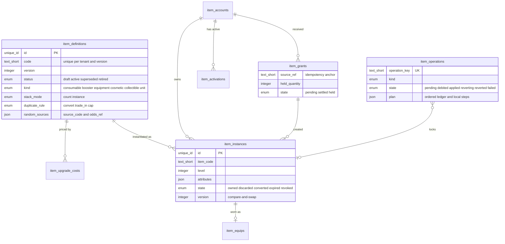
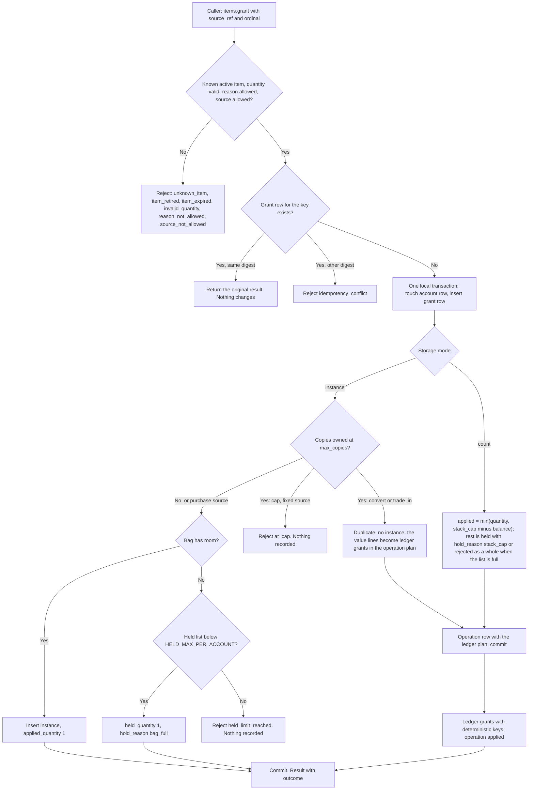
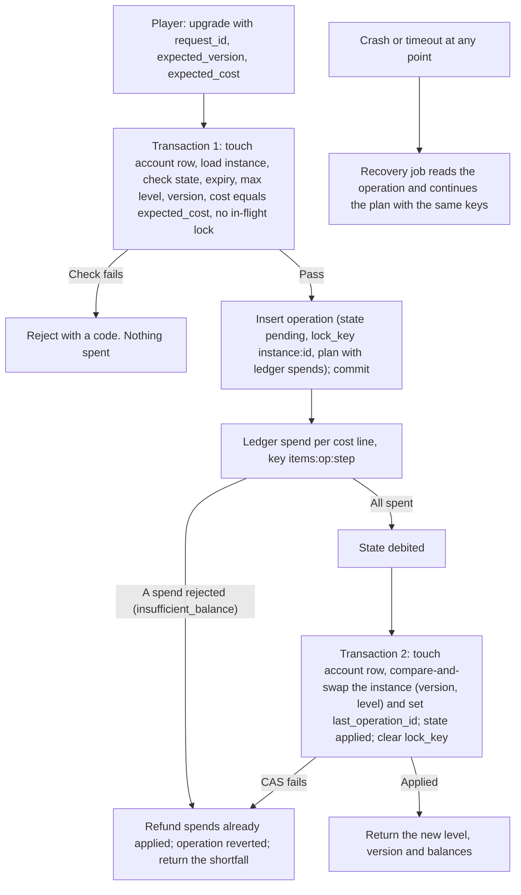
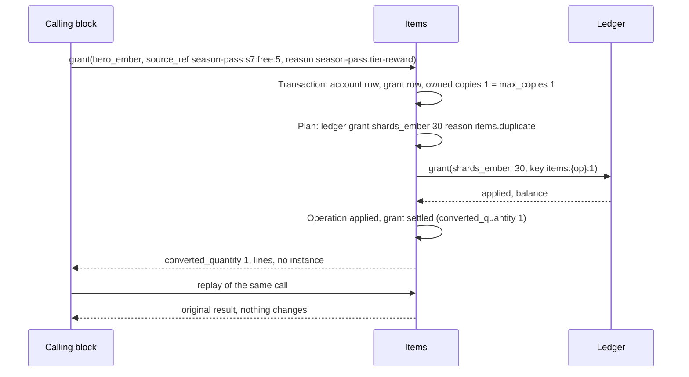
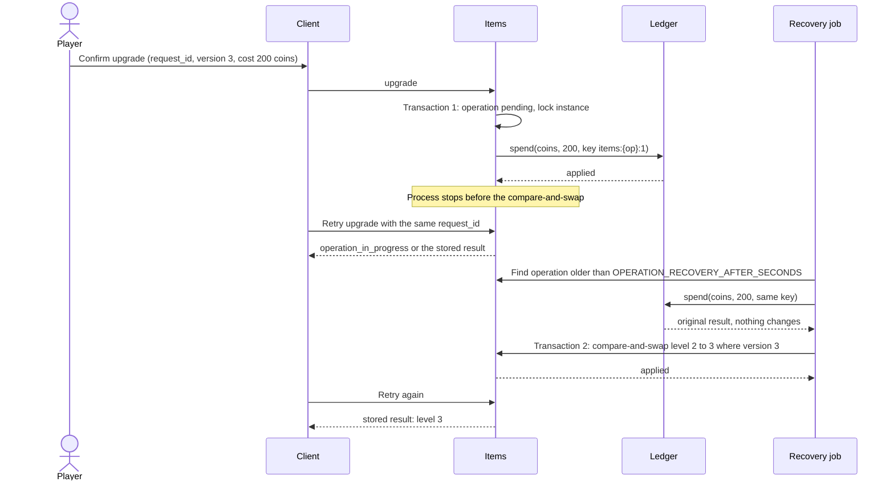
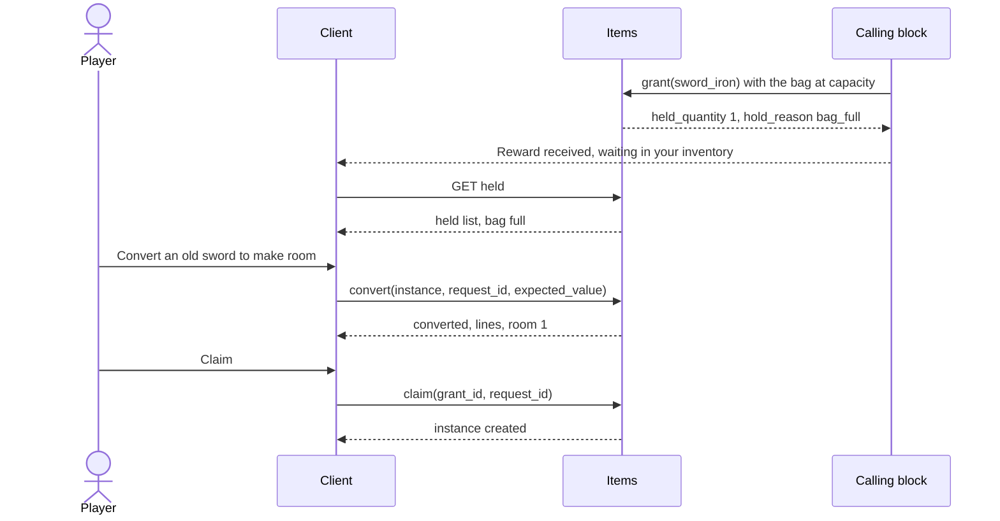
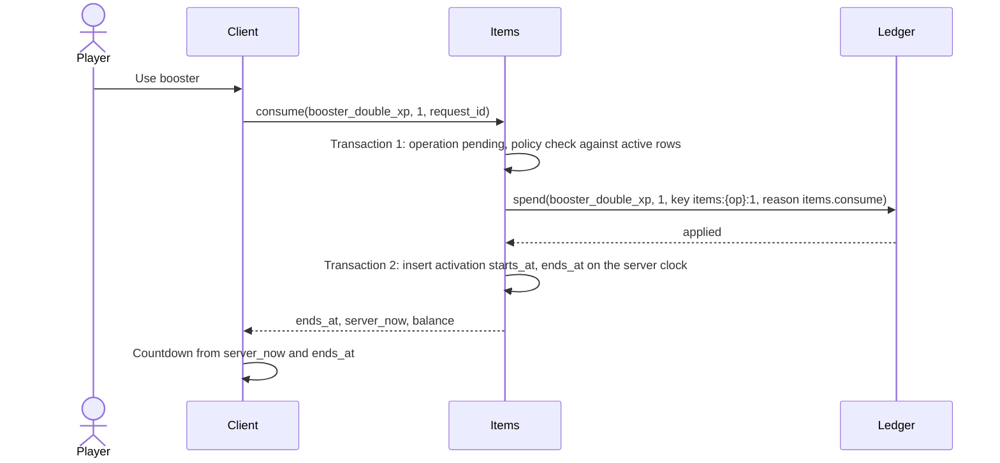

# Items: Definitions, Owned Instances, Upgrades, Inventory Limits and Expiry

## 1. Overview

### Problem Statement

A mobile game (a web app in a native wrapper) has things a player owns that are not currencies: a booster, a key, a hero, a sword at level 4, a cosmetic, a card. The wallet ledger of `billing.virtual-currency` stores one thing about each of them: a count under an item code (`README.md` of that block, `currencies.kind` value `item`, line 176 and the balance column, line 244). A count is enough when every copy is the same. Two copies of one sword at different levels, an item that expires on its own date, or a hero wearing a particular helmet cannot be a count.

Four problems make this block necessary:

1. **Two storage shapes, one inventory.** Interchangeable items belong in the ledger, which already gives idempotent grants, a non-negative balance and an audit trail. Items with their own level, attributes, expiry or equipped state need a record per copy. Without a rule that says which shape a definition uses, a team stores the same item both ways and the two disagree.
2. **An upgrade spends in one store and changes state in another.** Paying materials to the ledger and raising a level in the item table are two writes. A crash between them either charges the player for nothing or hands over a level for free. The block specifies the order, the idempotency keys and the recovery job that make the pair behave as one unit.
3. **Duplicates, full bags and expiry destroy value unless they are designed.** A duplicate of a unique hero, a reward that arrives when the bag is full, and a timed item that expires while the player is offline each decide whether the player loses something. The kit says collections and duplicates need a defined use ("convert, trade in or cap", `kits/game-engagement/guides/11-feature-specs.md` item 12) and that a full bag offers an exit and "never destroys a reward silently" (`kits/game-engagement/guides/14-rewards-resources-and-items.md`, Decision rule 12).
4. **Random sources need a hook, not a mechanism.** A pull, a chest or a pack grants items by chance. Odds, pity rules and minor protections are a separate design (`kits/game-engagement/guides/06-design-ethics-and-compliance.md`, Decision rule 1); this block gives such a source one call to grant through and carries the disclosure data an item must hold so that the odds are visible where the item is obtained.

This block specifies the **item definition** (versioned, with a kind, a rarity, a storage mode, limits, a duplicate rule, expiry and disclosure fields), the **item instance** (a record with a level, attributes, a state and a version for compare-and-swap), the **rule that picks the storage mode**, the operations **grant, upgrade, equip, unequip, consume, discard, convert and claim**, **inventory limits** with held grants and a claim path, **expiry** with fair handling of offline players, a **stable ordering and pagination contract** for inventory reads, **definition versioning** with retirement, **account merge** and **account deletion**, and the screens (`frontend.md`).

The block owns one contract that sibling blocks use: `items.grant` (section 6). It never writes a balance itself: every count and every material goes through the ledger contract of `billing.virtual-currency`.

### User Stories

- **Player**: my inventory shows what I own with its level, what is equipped, and what is about to expire, in the same order every time I open it.
- **Player**: before I upgrade, the sheet shows the exact cost, what I have, and what is missing. The cost I confirm is the cost I pay.
- **Player**: if the app closes in the middle of an upgrade, I either have the new level or I have my materials back. I never lose both.
- **Player**: when my bag is full and I earn an item, the item waits for me in a visible list with a way to make room. Nothing is deleted.
- **Player**: when I get a duplicate, the app tells me before the reward what a duplicate becomes and how much it is worth.
- **Player**: when a timed item expires while I was away, I see what happened and what I received for it.
- **Player**: when I sign in to an existing account, the items I earned as a guest come with me, once.
- **Game designer**: each item has one definition that says how it is stored, how it upgrades, what a duplicate is worth, when it expires and where it can come from.
- **Developer of another block**: I call `items.grant` with a stable `source_ref`; a retry cannot double-grant, and I learn whether the item was applied, converted or held.
- **Developer of a random source**: I grant through the same call and pass the source code and the odds version, so every random grant is auditable against the odds the player saw.
- **Operator**: I see operations stuck between the ledger and the item table, held grants by age, and the count of items near expiry.

### When to use this block

- The game has owned objects with attributes of their own (a level, a state, an expiry) or needs duplicates, a bag limit, or timed boosters, on top of the ledger of `billing.virtual-currency`.
- The backend is SQL-family and the client is a web-tech shell.
- User says: "inventory", "items", "equipment", "heroes", "cards", "duplicates", "upgrade an item", "bag full", "booster", "item expiry", "collectibles".

### When NOT to use

- Every item in the game is interchangeable and nothing has a level, a slot or its own expiry. Use the ledger with item codes (`billing.virtual-currency`) and skip this block.
- Currencies and currency packs: `billing.virtual-currency` owns the ledger and the packs.
- Random reward mechanics, odds tables, pity counters, banners: no block covers them. This block only offers the grant hook and the disclosure fields (section 6, "Random source hook").
- Stat and combat formulas. An instance stores `level` and an opaque `attributes` bag; what a level means in play is the game's.
- Trading, gifting, auctions or any player-to-player transfer. The ledger has no transfer either. Apple allows gifting of purchasable items only with refunds to the original purchaser and no exchange ([App Review Guidelines 3.1.1](https://developer.apple.com/app-store/review/guidelines/), HIGH, read 2026-10-27), so a transfer feature needs its own abuse and refund rules.
- A crafting or upgrade queue with a duration. Timed work is `engagement.timed-queues`. Upgrades here complete in the request.
- Currency exchange shops (spend one currency, receive another). The ledger spends one currency per call and the exchange rate is an economy decision outside this block. Conversion here covers duplicates, expiry and the player's own "convert this item" action only.
- Collection books, sets and set-completion rewards. They read this block's inventory; no block covers them yet.
- Document NoSQL as the primary store: non-goal (`docs/SPEC_GUIDELINES.md` section 4).

### Related blocks (referenced by id only)

| Block | Relation |
|---|---|
| `billing.virtual-currency` | Prerequisite. Owns the ledger (`grant`, `spend`, `balance`), the currency registry and `currency_flows`. Count items, upgrade materials and conversion values all pass through it. A store product whose `fulfilment` is `external` and whose `owner_block` is `engagement.items` is delivered by this block from the purchase record. |
| `engagement.objectives`, `engagement.season-pass`, `engagement.event-calendar`, `engagement.daily-streak` | Callers of `items.grant` for item rewards. Each keeps its own claim state and learns from the grant result whether the item was applied, converted or held. `engagement.objectives` may count this block's server events (`item_upgraded`, `item_equipped`, `item_granted`) as server-derived metrics through its adapter table (`ingest_server_event`); this block never calls it. |
| `engagement.energy-lives` | Independent. Energy and lives are meters; an item that refills one is a count item consumed here and applied by that block. |
| `engagement.timed-queues` | Sibling for timed crafting and any upgrade with a duration. When a queued job outputs an item it calls `items.grant`; upgrades in this block complete inside the request. |
| `messaging.push-reengagement` | Optional. Consumes the `item_expiring_soon` event as a notification trigger; this block sends no push. |
| `auth.guest-account` | Runs the guest-to-account import. This block registers a participant with `holdings`, `mergeAccounts(from, into, merge_id)` and `deleteAccount` (section 6) and moves instances, held grants and booster time by the rules of section 3, "Account merge". |
| `data.progress-sync` | Syncs client progress, not items. Items live on the server only. |
| `compliance.account-deletion` | Erasure registry. This block registers an eraser for every table that holds account data (section 6). |
| `auth.google-login`, `auth.sign-in-with-apple` | Supply the account. |

---

## 2. Data Model

> Types below are **logical types** (canonical mapping in `docs/SPEC_GUIDELINES.md` section 5). Dialect-specific SQL is in [Reference Migration](#reference-migration-postgres) at the end of this section.

Every table carries `tenant_id` (tenant isolation, as in `blocks/ugc/friends-leaderboard/README.md`). `account_id` is the project's account id (a guest or a signed-in account) with no foreign key to a users table, so guest accounts and merges work.



### Table: `item_definitions` (versioned, immutable once published)

One row per (code, version). The current definition of a code is its row with `status` `active` or `retired` and the highest `version`. A published row is never edited; a change publishes a new version and sets the old row to `superseded`. The validation rules that tie the columns together are in "Choosing the storage mode" below.

| Column | Logical Type | Constraints | Notes |
|---|---|---|---|
| `id` | `unique_id` | PK | |
| `tenant_id` | `unique_id` | NOT NULL | Tenant isolation |
| `code` | `text_short` | NOT NULL | Lowercase `[a-z][a-z0-9_]*`, at most `ITEM_CODE_MAX_LENGTH` characters. The same string is the `currency` argument of the ledger for count items |
| `version` | `integer` | NOT NULL, CHECK `>= 1` | UNIQUE (`tenant_id`, `code`, `version`) |
| `status` | `enum` | NOT NULL | values: `draft`, `active`, `superseded`, `retired`. `retired` stops new grants only (section 3, "Definition versioning") |
| `kind` | `enum` | NOT NULL | values: `consumable`, `booster`, `equipment`, `cosmetic`, `collectible`, `unit`. Immutable across versions |
| `stack_mode` | `enum` | NOT NULL | values: `count`, `instance`. Immutable across versions; chosen by the rule below |
| `rarity_rank` | `integer` | NOT NULL, default 1, CHECK `>= 1` | 1 is the lowest tier. The game names tiers; the block sorts and compares numbers |
| `rarity_key` | `text_short` | NOT NULL | Localization key of the tier label; the server never sends display text |
| `display_name_key`, `description_key` | `text_short` | NOT NULL | Localization keys |
| `bag` | `text_short` | nullable | Instance mode: the capacity bucket the item occupies (for example `equipment`, `units`). Null: the item does not count against any bag |
| `slot` | `text_short` | nullable | Where the item sits when equipped (for example `weapon`). Set together with `equip_target` |
| `equip_target` | `enum` | nullable | values: `account`, `unit`. `account`: worn by the player (an avatar frame). `unit`: worn by an owned instance of kind `unit` (a helmet on a hero). Immutable across versions |
| `max_level` | `integer` | NOT NULL, default 1, CHECK `>= 1` | 1 means not upgradable. May rise in a new version, never fall |
| `max_copies` | `integer` | nullable, CHECK `>= 1` | Instance mode: the most copies one account may own. Null: unlimited. 1 makes the item unique |
| `duplicate_rule` | `enum` | nullable | values: `convert`, `trade_in`, `cap`. Required when `max_copies` is set |
| `duplicate_value` | `json` | nullable | List of `{currency, amount}` lines granted **per duplicate copy** for `convert` (any currency or item code) and `trade_in` (fragment item codes the item's own upgrade costs use) |
| `duplicate_note_key` | `text_short` | nullable | Localization key of the one-sentence duplicate disclosure. Required when `random_sources` is not empty and `max_copies` is set |
| `convert_value` | `json` | nullable | List of `{currency, amount}` lines granted **per copy** when the player converts the item, when a held grant converts at its time limit, and (count mode) when the stack is converted |
| `stack_cap` | `integer` | nullable | Count mode: the most one account may hold from free sources. Null: `STACK_CAP_DEFAULT` |
| `expiry_mode` | `enum` | NOT NULL, default `none` | values: `none`, `relative`, `absolute`. `relative`: each copy lives `expiry_seconds` from its grant (instance mode only). `absolute`: every copy ends at `expires_at` (the event-item pattern; the only form count mode allows) |
| `expiry_seconds` | `integer` | nullable, CHECK `> 0` | Required for `relative` |
| `expires_at` | `timestamp` | nullable | Required for `absolute`; UTC instant on the server clock |
| `expiry_outcome` | `enum` | nullable | values: `convert`, `remove`. Required when `expiry_mode` is not `none`. Count mode allows only `convert` |
| `expiry_value` | `json` | nullable | Lines **per copy** granted at expiry; required for `convert` |
| `expiry_note_key` | `text_short` | nullable | Localization key of the expiry disclosure. Required when `expiry_mode` is not `none` |
| `activation_seconds` | `integer` | nullable, CHECK `> 0` | Kind `booster` only: how long one activation lasts |
| `activation_policy` | `enum` | nullable | values: `extend`, `refuse`. Kind `booster` only. `extend`: a second activation starts when the first ends. `refuse`: a second activation is rejected while one is running |
| `random_sources` | `json` | NOT NULL, default empty list | List of `{source_code, odds_ref}`: the random sources that may grant this item. `odds_ref` is an opaque key the source's odds screen understands. Empty: the item is never granted by chance |
| `obtainable_free` | `boolean` | NOT NULL, default true | The designer's attestation that a free route to the item exists. False for items sold only for money |
| `progress_gating` | `boolean` | NOT NULL, default false | True when the game requires the item to progress. CHECK: `progress_gating` implies `obtainable_free` |
| `faucet_reasons` | `json` | NOT NULL, default empty list | Count mode: the ledger reasons that may grant the item. Publishing registers one `currency_flows` faucet row per reason |
| `sort_order` | `integer` | NOT NULL, default 0 | Order of count stacks in `GET /api/items/stacks` |
| `published_at` | `timestamp` | nullable | Set when `status` leaves `draft` |
| `created_at`, `updated_at` | `timestamp` | NOT NULL, default = now | UTC instant |

**Indexes**: UNIQUE (`tenant_id`, `code`, `version`); (`tenant_id`, `code`, `status`).

### Table: `item_upgrade_costs`

| Column | Logical Type | Constraints | Notes |
|---|---|---|---|
| `id` | `unique_id` | PK | |
| `tenant_id` | `unique_id` | NOT NULL | |
| `item_code` | `text_short` | NOT NULL | With `definition_version`, FK to `item_definitions` |
| `definition_version` | `integer` | NOT NULL | |
| `to_level` | `integer` | NOT NULL, CHECK `>= 2` | The level this row pays for. Every level from 2 to `max_level` has at least one row and at most `UPGRADE_MAX_COST_LINES` |
| `currency_code` | `text_short` | NOT NULL | A currency or count-item code in the ledger registry |
| `amount` | `integer` | NOT NULL, CHECK `> 0` | Spent through the ledger |

**Indexes**: UNIQUE (`tenant_id`, `item_code`, `definition_version`, `to_level`, `currency_code`).

### Table: `item_accounts` (serialization anchor and merge pointer)

| Column | Logical Type | Constraints | Notes |
|---|---|---|---|
| `id` | `unique_id` | PK | |
| `tenant_id` | `unique_id` | NOT NULL | |
| `account_id` | `unique_id` | NOT NULL, UNIQUE per tenant | Created on first use |
| `inventory_version` | `integer` | NOT NULL, default 0 | Incremented by every mutating transaction. The first write of every such transaction is this row, which serializes mutations per account on all three dialects. The client compares it to detect a stale view |
| `merged_into_account_id` | `unique_id` | nullable | Set after a guest merge; every operation on this account id resolves to the target |
| `created_at`, `updated_at` | `timestamp` | NOT NULL, default = now | |

### Table: `item_instances`

One row per owned copy of an instance-mode item. Terminal rows stay for audit and replay and stop counting against capacity.

| Column | Logical Type | Constraints | Notes |
|---|---|---|---|
| `id` | `unique_id` | PK | |
| `tenant_id` | `unique_id` | NOT NULL | |
| `account_id` | `unique_id` | NOT NULL | The owner. Changes only through account merge |
| `item_code` | `text_short` | NOT NULL | |
| `definition_version` | `integer` | NOT NULL | The version in force at grant; display and rules resolve the current version of the code |
| `rarity_rank` | `integer` | NOT NULL | Copied at grant so that rarity ordering never changes under a pagination cursor |
| `level` | `integer` | NOT NULL, default 1, CHECK `>= 1` | Written only by `upgrade` and the initial grant. The client never sends a level |
| `attributes` | `json` | NOT NULL, default empty object | Opaque, server-written at grant (for example traits a random source rolled), at most `INSTANCE_ATTRIBUTES_MAX_BYTES`. Not changed after grant in this version |
| `state` | `enum` | NOT NULL, default `owned` | values: `owned`, `discarded`, `converted`, `expired`, `revoked` |
| `source_kind` | `enum` | NOT NULL | values: `fixed`, `random`, `purchase` |
| `source_ref` | `text_short` | NOT NULL | The caller's stable reference, for example `season-pass:s7:premium:12` |
| `grant_id` | `unique_id` | NOT NULL, FK → `item_grants.id` | |
| `granted_at` | `timestamp` | NOT NULL | Server clock, when the grant was recorded; audit only |
| `added_at` | `timestamp` | NOT NULL | Server clock, when the row joined this account's inventory: the grant time, or the merge time for a row that moved in. The inventory orders by it, so every insertion lands at the top of the newest order |
| `expires_at` | `timestamp` | nullable | From `relative` (grant time plus `expiry_seconds`) or `absolute` expiry |
| `warned_at` | `timestamp` | nullable | First moment the player was shown the expiry notice for this copy (section 3, "Expiry") |
| `state_changed_at` | `timestamp` | nullable | When `state` left `owned` |
| `last_operation_id` | `unique_id` | nullable | The `item_operations.id` that last changed the row; lets recovery tell "already applied" from "not yet applied" |
| `version` | `integer` | NOT NULL, default 1 | Compare-and-swap counter, incremented by every change of the row |
| `created_at`, `updated_at` | `timestamp` | NOT NULL, default = now | |

**Indexes**: (`tenant_id`, `account_id`, `state`, `added_at` DESC, `id` DESC) for the newest order; (`tenant_id`, `account_id`, `state`, `rarity_rank` DESC, `added_at` DESC, `id` DESC) for the rarity order; (`tenant_id`, `account_id`, `item_code`, `state`) for copy counts; (`tenant_id`, `state`, `expires_at`) for the expiry sweep.

### Table: `item_equips`

| Column | Logical Type | Constraints | Notes |
|---|---|---|---|
| `id` | `unique_id` | PK | |
| `tenant_id` | `unique_id` | NOT NULL | |
| `account_id` | `unique_id` | NOT NULL | |
| `target_key` | `text_short` | NOT NULL | The text `account`, or the instance id of the unit that wears the item |
| `slot` | `text_short` | NOT NULL | |
| `instance_id` | `unique_id` | NOT NULL, UNIQUE per tenant, FK → `item_instances.id` | One place per instance |
| `created_at` | `timestamp` | NOT NULL, default = now | |

**Indexes**: UNIQUE (`tenant_id`, `account_id`, `target_key`, `slot`): one item per slot per target. A separate table keeps this constraint portable (a partial unique index on the instance row does not exist on MySQL).

### Table: `item_grants`

One row per `items.grant` call. It is the idempotency anchor, the record of what happened to the requested quantity, and the home of held quantities.

| Column | Logical Type | Constraints | Notes |
|---|---|---|---|
| `id` | `unique_id` | PK | |
| `tenant_id` | `unique_id` | NOT NULL | |
| `account_id` | `unique_id` | NOT NULL | |
| `item_code` | `text_short` | NOT NULL | |
| `source_ref` | `text_short` | NOT NULL | At most `SOURCE_REF_MAX_LENGTH` characters |
| `ordinal` | `integer` | NOT NULL, default 0 | Distinguishes several grants of one item from one `source_ref` (a chest with two identical swords) |
| `source_kind` | `enum` | NOT NULL | values: `fixed`, `random`, `purchase` |
| `source_code` | `text_short` | nullable | The random source's code; required for `random` |
| `odds_version` | `text_short` | nullable | The version of the odds the source showed the player; required for `random`; recorded, not interpreted |
| `reason` | `text_short` | NOT NULL | `<block-slug>.<action>`; forwarded to the ledger for count items |
| `quantity` | `integer` | NOT NULL, CHECK `>= 1` | Requested. Instance items: always 1 |
| `applied_quantity` | `integer` | NOT NULL, default 0 | Stacked into the ledger, or created as instances |
| `converted_quantity` | `integer` | NOT NULL, default 0 | Turned into value by the duplicate rule |
| `held_quantity` | `integer` | NOT NULL, default 0 | Waiting in the claim list |
| `hold_reason` | `enum` | nullable | values: `bag_full`, `stack_cap` |
| `held_until` | `timestamp` | nullable | When a held quantity with a conversion value converts by itself (`HELD_GRANT_TTL_SECONDS` after the hold) |
| `initial_attributes` | `json` | nullable | Attributes the source supplied for the instance |
| `request_digest` | `text_short` | NOT NULL | Digest of the grant arguments; a replay with a different digest is `idempotency_conflict` |
| `state` | `enum` | NOT NULL | values: `pending`, `settled`, `held` (section 5) |
| `created_at`, `updated_at` | `timestamp` | NOT NULL, default = now | |

**Indexes**: UNIQUE (`tenant_id`, `account_id`, `source_ref`, `item_code`, `ordinal`); (`tenant_id`, `account_id`, `state`).

### Table: `item_activations`

| Column | Logical Type | Constraints | Notes |
|---|---|---|---|
| `id` | `unique_id` | PK | |
| `tenant_id` | `unique_id` | NOT NULL | |
| `account_id` | `unique_id` | NOT NULL | |
| `item_code` | `text_short` | NOT NULL | A booster |
| `starts_at` | `timestamp` | NOT NULL | Server clock; under `extend` the later of now and the latest `ends_at` of the same code |
| `ends_at` | `timestamp` | NOT NULL | `starts_at` plus the definition's `activation_seconds` |
| `operation_id` | `unique_id` | NOT NULL, UNIQUE per tenant | The consuming operation; one activation per operation |
| `created_at` | `timestamp` | NOT NULL, default = now | |

**Indexes**: (`tenant_id`, `account_id`, `ends_at`).

### Table: `item_operations` (journal of multi-step work)

One row per operation that touches the ledger and this block, or that a player started with a `request_id`. It is both the idempotency record and the saga journal.

| Column | Logical Type | Constraints | Notes |
|---|---|---|---|
| `id` | `unique_id` | PK | Source of the deterministic ledger keys of the operation |
| `tenant_id` | `unique_id` | NOT NULL | |
| `account_id` | `unique_id` | NOT NULL | |
| `kind` | `enum` | NOT NULL | values: `grant`, `upgrade`, `consume`, `convert`, `discard`, `claim`, `expire`, `revoke`, `merge` |
| `operation_key` | `text_short` | NOT NULL, UNIQUE per tenant | Player operations: `request:{account_id}:{request_id}`. Grants: `grant:{grant_id}`. Expiry: `expire:{...}`. Merge: `merge:{merge_id}` |
| `request_digest` | `text_short` | NOT NULL | A replay with the same key and a different digest is `idempotency_conflict` |
| `state` | `enum` | NOT NULL | values: `pending`, `debited`, `applied`, `reverting`, `reverted`, `failed` (section 5) |
| `subject_id` | `unique_id` | nullable | The instance the operation targets |
| `lock_key` | `text_short` | nullable, UNIQUE per tenant | `instance:{id}` while the operation is not terminal, null afterwards. Allows one in-flight operation per instance; several nulls are allowed on all three dialects |
| `plan` | `json` | NOT NULL | The ordered steps (ledger spends and grants with their keys, the local change). Written before the first ledger call |
| `result` | `json` | nullable | The response a replay returns |
| `error_code` | `text_short` | nullable | Set on `failed` and `reverted` |
| `notice_state` | `enum` | NOT NULL, default `none` | values: `none`, `unseen`, `seen`. `unseen` for outcomes the player did not start (expiry, automatic conversion, a reverted upgrade found by recovery) |
| `attempts` | `integer` | NOT NULL, default 0 | Recovery attempts |
| `next_attempt_at` | `timestamp` | nullable | |
| `completed_at` | `timestamp` | nullable | |
| `created_at`, `updated_at` | `timestamp` | NOT NULL, default = now | |

**Indexes**: UNIQUE (`tenant_id`, `operation_key`); UNIQUE (`tenant_id`, `lock_key`); (`tenant_id`, `state`, `next_attempt_at`); (`tenant_id`, `account_id`, `notice_state`).

### Choosing the storage mode

A definition is `count` (lives in the ledger) when **every** line holds, and `instance` (lives in this block) otherwise:

| # | Test | If it fails |
|---|---|---|
| 1 | All copies are interchangeable: no copy has its own level, attributes or source worth keeping | `instance` |
| 2 | No copy is equipped anywhere | `instance` |
| 3 | No copy has its own expiry (an `absolute` expiry that ends every copy together is allowed) | `instance` |
| 4 | `max_level` is 1 | `instance` |
| 5 | The item is not a `unit` and not `equipment` | `instance` |

Consequences, enforced when a definition is published:

| Rule | Check |
|---|---|
| `consumable` and `booster` are `count`; `equipment`, `cosmetic` and `unit` are `instance`; `collectible` is either | kind and mode agree |
| `count`: `max_level` 1, no `max_copies`, no `duplicate_rule`, no `bag`, no `slot`, `expiry_mode` is `none` or `absolute` with outcome `convert` | no per-copy features on a count |
| `instance`: no `stack_cap`, no `faucet_reasons` | counts and instances never share a code |
| Mode, kind, `slot` and `equip_target` never change in a later version | a different shape is a new code |
| `booster`: `activation_seconds` and `activation_policy` set; every other kind: both null | |
| `slot` and `equip_target` are set together, and only for `equipment` and `cosmetic` | |
| `max_copies` set: `duplicate_rule` set. `convert`: at least one `duplicate_value` line. `trade_in`: the lines are fragment item codes that appear in at least one `item_upgrade_costs` row of this item. `cap`: `random_sources` is empty (a chance outcome cannot be refused after the player paid for it) | every duplicate has a defined use |
| `random_sources` not empty and `max_copies` set: `duplicate_note_key` set | the duplicate rule is disclosed where the item is obtained |
| `expiry_mode` not `none`: `expiry_outcome`, `expiry_note_key` set; `convert` needs `expiry_value` | |
| `expiry_mode` not `none`: the code appears in no `store_product_contents` row of `billing.virtual-currency` and is not a value of `ITEM_PRODUCTS` | an item sold for money does not expire in the inventory (a conservative reading of Apple 3.1.1, which names credits and in-game currencies; MEDIUM) |
| `progress_gating` implies `obtainable_free` | no required item that only payment obtains |
| `max_level` never decreases across versions | |
| A count code is registered in the ledger's `currencies` with `kind` `item`; an instance code is never registered there, and no `store_product_contents` row names it | one shape per code |

---

### Reference Migration (Postgres)

#### `item_definitions` and `item_upgrade_costs`

<!-- REFERENCE: dialect=postgres -->
<!-- ADAPT: `uuid ... gen_random_uuid()` -> MySQL `BINARY(16)`, SQLite `TEXT` with a uuid4 from the app; `timestamptz` -> MySQL `DATETIME(6)`, SQLite `TEXT` ISO 8601 with `Z`; `jsonb` -> MySQL `JSON`, SQLite `TEXT` (validate in the app); `text CHECK (col IN ...)` -> MySQL `ENUM(...)`; the cross-column rules of "Choosing the storage mode" that name other tables (store_product_contents) run in the publish step on every dialect, the single-table ones stay as CHECKs -->
```sql
CREATE TABLE IF NOT EXISTS item_definitions (
  id uuid PRIMARY KEY DEFAULT gen_random_uuid(), tenant_id uuid NOT NULL,
  code varchar(255) NOT NULL, version bigint NOT NULL CHECK (version >= 1),
  status text NOT NULL CHECK (status IN ('draft','active','superseded','retired')),
  kind text NOT NULL CHECK (kind IN ('consumable','booster','equipment','cosmetic','collectible','unit')),
  stack_mode text NOT NULL CHECK (stack_mode IN ('count','instance')),
  rarity_rank bigint NOT NULL DEFAULT 1 CHECK (rarity_rank >= 1), rarity_key varchar(255) NOT NULL,
  display_name_key varchar(255) NOT NULL, description_key varchar(255) NOT NULL,
  bag varchar(255), slot varchar(255), equip_target text CHECK (equip_target IN ('account','unit')),
  max_level bigint NOT NULL DEFAULT 1 CHECK (max_level >= 1), max_copies bigint CHECK (max_copies >= 1),
  duplicate_rule text CHECK (duplicate_rule IN ('convert','trade_in','cap')),
  duplicate_value jsonb, duplicate_note_key varchar(255), convert_value jsonb, stack_cap bigint,
  expiry_mode text NOT NULL DEFAULT 'none' CHECK (expiry_mode IN ('none','relative','absolute')),
  expiry_seconds bigint CHECK (expiry_seconds > 0), expires_at timestamptz,
  expiry_outcome text CHECK (expiry_outcome IN ('convert','remove')), expiry_value jsonb,
  expiry_note_key varchar(255), activation_seconds bigint CHECK (activation_seconds > 0),
  activation_policy text CHECK (activation_policy IN ('extend','refuse')),
  random_sources jsonb NOT NULL DEFAULT '[]', obtainable_free boolean NOT NULL DEFAULT true,
  progress_gating boolean NOT NULL DEFAULT false, faucet_reasons jsonb NOT NULL DEFAULT '[]',
  sort_order bigint NOT NULL DEFAULT 0, published_at timestamptz,
  created_at timestamptz NOT NULL DEFAULT now(), updated_at timestamptz NOT NULL DEFAULT now(),
  UNIQUE (tenant_id, code, version),
  CHECK (NOT progress_gating OR obtainable_free), CHECK ((slot IS NULL) = (equip_target IS NULL))
);
```

<!-- REFERENCE: dialect=postgres -->
<!-- ADAPT: same type mapping as above; the composite FK to `item_definitions` works unchanged on all three dialects (enable `PRAGMA foreign_keys=ON` on SQLite) -->
```sql
CREATE TABLE IF NOT EXISTS item_upgrade_costs (
  id uuid PRIMARY KEY DEFAULT gen_random_uuid(), tenant_id uuid NOT NULL,
  item_code varchar(255) NOT NULL, definition_version bigint NOT NULL,
  to_level bigint NOT NULL CHECK (to_level >= 2),
  currency_code varchar(255) NOT NULL, amount bigint NOT NULL CHECK (amount > 0),
  UNIQUE (tenant_id, item_code, definition_version, to_level, currency_code),
  FOREIGN KEY (tenant_id, item_code, definition_version)
    REFERENCES item_definitions (tenant_id, code, version)
);
```

#### `item_accounts`, `item_instances` and `item_equips`

<!-- REFERENCE: dialect=postgres -->
<!-- ADAPT: same type mapping as above; the `grant_id` FK is added after `item_grants` exists; the four indexes are plain B-tree indexes on all dialects (DESC columns are accepted by Postgres, MySQL 8 and SQLite) -->
```sql
CREATE TABLE IF NOT EXISTS item_accounts (
  id uuid PRIMARY KEY DEFAULT gen_random_uuid(), tenant_id uuid NOT NULL, account_id uuid NOT NULL,
  inventory_version bigint NOT NULL DEFAULT 0, merged_into_account_id uuid,
  created_at timestamptz NOT NULL DEFAULT now(), updated_at timestamptz NOT NULL DEFAULT now(),
  UNIQUE (tenant_id, account_id)
);
CREATE TABLE IF NOT EXISTS item_instances (
  id uuid PRIMARY KEY DEFAULT gen_random_uuid(), tenant_id uuid NOT NULL, account_id uuid NOT NULL,
  item_code varchar(255) NOT NULL, definition_version bigint NOT NULL, rarity_rank bigint NOT NULL,
  level bigint NOT NULL DEFAULT 1 CHECK (level >= 1), attributes jsonb NOT NULL DEFAULT '{}',
  state text NOT NULL DEFAULT 'owned' CHECK (state IN ('owned','discarded','converted','expired','revoked')),
  source_kind text NOT NULL CHECK (source_kind IN ('fixed','random','purchase')),
  source_ref varchar(255) NOT NULL, grant_id uuid NOT NULL, granted_at timestamptz NOT NULL,
  added_at timestamptz NOT NULL,
  expires_at timestamptz, warned_at timestamptz, state_changed_at timestamptz,
  last_operation_id uuid, version bigint NOT NULL DEFAULT 1,
  created_at timestamptz NOT NULL DEFAULT now(), updated_at timestamptz NOT NULL DEFAULT now()
);
CREATE INDEX IF NOT EXISTS idx_inst_newest ON item_instances (tenant_id, account_id, state, added_at DESC, id DESC);
CREATE INDEX IF NOT EXISTS idx_inst_rarity ON item_instances (tenant_id, account_id, state, rarity_rank DESC, added_at DESC, id DESC);
CREATE INDEX IF NOT EXISTS idx_inst_code ON item_instances (tenant_id, account_id, item_code, state);
CREATE INDEX IF NOT EXISTS idx_inst_expiry ON item_instances (tenant_id, state, expires_at);
```

<!-- REFERENCE: dialect=postgres -->
<!-- ADAPT: same type mapping as above; the two UNIQUE constraints replace a partial unique index, which MySQL lacks -->
```sql
CREATE TABLE IF NOT EXISTS item_equips (
  id uuid PRIMARY KEY DEFAULT gen_random_uuid(), tenant_id uuid NOT NULL, account_id uuid NOT NULL,
  target_key varchar(255) NOT NULL, slot varchar(255) NOT NULL,
  instance_id uuid NOT NULL REFERENCES item_instances (id),
  created_at timestamptz NOT NULL DEFAULT now(),
  UNIQUE (tenant_id, instance_id), UNIQUE (tenant_id, account_id, target_key, slot)
);
```

#### `item_grants`, `item_activations` and `item_operations`

<!-- REFERENCE: dialect=postgres -->
<!-- ADAPT: same type mapping as above; then `ALTER TABLE item_instances ADD FOREIGN KEY (grant_id) REFERENCES item_grants (id)`; `request_digest` is a hex digest string on every dialect -->
```sql
CREATE TABLE IF NOT EXISTS item_grants (
  id uuid PRIMARY KEY DEFAULT gen_random_uuid(), tenant_id uuid NOT NULL, account_id uuid NOT NULL,
  item_code varchar(255) NOT NULL, source_ref varchar(255) NOT NULL, ordinal bigint NOT NULL DEFAULT 0,
  source_kind text NOT NULL CHECK (source_kind IN ('fixed','random','purchase')),
  source_code varchar(255), odds_version varchar(255), reason varchar(255) NOT NULL,
  quantity bigint NOT NULL CHECK (quantity >= 1), applied_quantity bigint NOT NULL DEFAULT 0,
  converted_quantity bigint NOT NULL DEFAULT 0, held_quantity bigint NOT NULL DEFAULT 0,
  hold_reason text CHECK (hold_reason IN ('bag_full','stack_cap')), held_until timestamptz,
  initial_attributes jsonb, request_digest varchar(255) NOT NULL,
  state text NOT NULL CHECK (state IN ('pending','settled','held')),
  created_at timestamptz NOT NULL DEFAULT now(), updated_at timestamptz NOT NULL DEFAULT now(),
  UNIQUE (tenant_id, account_id, source_ref, item_code, ordinal)
);
CREATE INDEX IF NOT EXISTS idx_grants_state ON item_grants (tenant_id, account_id, state);
```

<!-- REFERENCE: dialect=postgres -->
<!-- ADAPT: same type mapping as above; several NULL `lock_key` values are allowed under UNIQUE on Postgres, SQLite and MySQL -->
```sql
CREATE TABLE IF NOT EXISTS item_activations (
  id uuid PRIMARY KEY DEFAULT gen_random_uuid(), tenant_id uuid NOT NULL, account_id uuid NOT NULL,
  item_code varchar(255) NOT NULL, starts_at timestamptz NOT NULL, ends_at timestamptz NOT NULL,
  operation_id uuid NOT NULL, created_at timestamptz NOT NULL DEFAULT now(),
  UNIQUE (tenant_id, operation_id)
);
CREATE INDEX IF NOT EXISTS idx_act_ends ON item_activations (tenant_id, account_id, ends_at);
CREATE TABLE IF NOT EXISTS item_operations (
  id uuid PRIMARY KEY DEFAULT gen_random_uuid(), tenant_id uuid NOT NULL, account_id uuid NOT NULL,
  kind text NOT NULL CHECK (kind IN ('grant','upgrade','consume','convert','discard','claim','expire','revoke','merge')),
  operation_key varchar(255) NOT NULL, request_digest varchar(255) NOT NULL,
  state text NOT NULL CHECK (state IN ('pending','debited','applied','reverting','reverted','failed')),
  subject_id uuid, lock_key varchar(255), plan jsonb NOT NULL, result jsonb, error_code varchar(255),
  notice_state text NOT NULL DEFAULT 'none' CHECK (notice_state IN ('none','unseen','seen')),
  attempts bigint NOT NULL DEFAULT 0, next_attempt_at timestamptz, completed_at timestamptz,
  created_at timestamptz NOT NULL DEFAULT now(), updated_at timestamptz NOT NULL DEFAULT now(),
  UNIQUE (tenant_id, operation_key), UNIQUE (tenant_id, lock_key)
);
CREATE INDEX IF NOT EXISTS idx_ops_recovery ON item_operations (tenant_id, state, next_attempt_at);
```

---

## 3. Data Flow

### Grant

`items.grant(account_id, item_code, quantity, reason, source_ref, ordinal, source, initial_attributes)` is called by a server-side module of another block, never by a device. `source` is `{kind, source_code, odds_version}`.



Rules the flow encodes:

- A duplicate is decided before capacity, so a duplicate converts even when the bag is full.
- A `cap` rule refuses only `fixed` sources. A `purchase` source under `cap` is delivered above `max_copies` (a paid purchase is delivered, INV-12 of `billing.virtual-currency`), and under `convert` or `trade_in` it pays the value lines; a full bag holds a purchase-sourced grant like any other. A `random` source cannot use `cap` (publish rule).
- The grant row, the instance and the capacity check commit in one local transaction. Only the ledger calls are outside it; they are idempotent and driven to completion by the operation row.
- The result carries `applied_quantity`, `converted_quantity`, `held_quantity`, `instance_ids` and, for count items, the `balance`.

### Random source hook

A random source (a pull, a chest, a pack opener; none is specified here) rolls its result on its own server code and then calls `items.grant` once per rolled item with `source = {kind: "random", source_code, odds_version}`. This block checks only what it can: the item's `random_sources` lists `source_code`; `odds_version` is present; the outcome rules above apply. It records `source_code` and `odds_version` on the grant row and the instance, so that a later audit can show which published odds were live when an item was granted. The odds table, the roll, the pity counter, the price of a pull and the screen that shows the odds belong to the source. A definition that lists a random source carries `odds_ref` so that the item detail screen can open that source's odds (`frontend.md`, "Item detail").

### Upgrade (one unit across two stores)



Default and ordering:

- **Default: the idempotent saga above, spend first.** It is correct whether or not the ledger and this block share a database, because the ledger contract of `billing.virtual-currency` (its `README.md` section 6) has no parameter that joins a caller's transaction.
- **Why spend first.** The worst intermediate state is "charged, level not yet raised", which the recovery job resolves within `OPERATION_RECOVERY_AFTER_SECONDS` plus one interval either by applying the level or by refunding. Apply-first would leave "level raised, never paid" after a failed spend, which only a clawback could repair.
- **Shared-database rule.** If the ledger exposes its writer so that it runs inside the caller's transaction, and enforces its idempotency-key uniqueness in that same transaction, the spends, the compare-and-swap and the journal row commit together or roll back together, and the operation goes from `pending` to `applied` in one commit. Without both conditions, use the saga. Either path produces the same API results.
- **One in-flight operation per instance.** `lock_key` is unique; a second request on the same instance returns `operation_in_progress` before anything is spent, so compensation is needed only for real failures.
- **Refunds are ledger grants** with reason `items.upgrade-refund` and keys derived from the operation id, so a refund replayed by recovery is applied once.

### Held grants and the claim path

A grant that cannot be applied because the bag is full or a stack is at its cap is held, not dropped. The player sees the list (`GET /api/items/held`) and has three exits: claim (when room exists), make room (discard or convert an owned instance, then claim) or convert the held grant when the definition has a `convert_value`. A held grant whose definition has a `convert_value` converts by itself at `held_until`. A held grant without conversion value stays until claimed. The list is capped at `HELD_MAX_PER_ACCOUNT`; when it is full, `items.grant` rejects with `held_limit_reached`, the caller keeps its own claim open, and the player is told in the caller's screen.

### Expiry

1. The server clock decides. From `expires_at` the server rejects `consume`, `equip` and `upgrade` on the copy with `item_expired`.
2. At `expires_at` the copy moves to `expired` (lazily on the next touch and by the sweep, with `state_changed_at` set to `expires_at`), and its outcome runs. `convert`: the `expiry_value` lines are granted through the ledger, keyed from the instance id. `remove`: nothing is granted.
3. **A stack that expires** is a count item with `expiry_mode` `absolute`. At `expires_at` the account's whole balance of the code is spent with reason `items.expire` and the `expiry_value` lines times the balance are granted. Grants of that code after `expires_at` are rejected with `item_expired`, so the balance is final. Count stacks always convert; nothing silent is removed.
4. **Offline fairness for `remove`.** The player is warned `EXPIRY_WARNING_SECONDS` before `expires_at`: an inventory read inside that window returns the copy with `expiring` set and records `warned_at`. A copy with `expiry_outcome` `remove` is removed at the first sweep after the later of `expires_at` and `warned_at` plus `EXPIRY_REMOVAL_GRACE_SECONDS`. A copy never shown to the player is removed at `expires_at` plus `EXPIRY_REMOVE_DEFER_MAX_SECONDS` at the latest. Until removal it is visible as expired and unusable. A player who was offline for the whole warning therefore sees the copy once, with time to act, and a `convert` outcome always pays out.
5. Every outcome the player did not start produces a notice (`notice_state` `unseen`) the next inventory open shows: what expired, what it became.

### Account merge

`auth.guest-account` decides whether a guest is imported into an existing account and calls every registered participant in registration order, only after the player confirmed the list of holdings (`blocks/auth/guest-account/README.md`, section 3.7). This block is one participant. Its `mergeAccounts(from, into, merge_id)` is one operation keyed `merge:{merge_id}`, idempotent: a repeat with the same `merge_id` returns the first result; a second `merge_id` for a guest already merged fails `already_merged`.

1. If any of the guest's operations is non-terminal, the call fails with the retryable error `merge_incomplete`; `auth.guest-account` keeps its attempt `importing` and the same request resumes it (that block answers `503 import_incomplete`).
2. For each guest `owned` instance, in order of level descending then `granted_at` ascending (the older copy first): if the target owns fewer than `max_copies` of the code (or the code is unlimited), the row moves (`account_id` changes, `added_at` becomes the merge time, `version` increments). Otherwise the copy is a surplus: `convert` and `trade_in` pay their `duplicate_value` lines to the target through the ledger and the instance becomes `converted`; `cap` has no value lines, so the instance moves anyway and the account holds more than `max_copies` until copies leave (grants of that code are rejected `at_cap` meanwhile). The existing account's copy stays even when the guest's copy has a higher level. Merge never creates an instance; every guest instance either moves or converts for its disclosed value.
3. Held grants move with their `account_id`. Equips of moved instances move with them; an equip whose target did not move is removed (the item stays owned).
4. Active booster time moves as new `item_activations` rows on the target that start after the target's latest `ends_at` for the same code, each for the remaining duration. No time is lost and none is added.
5. `item_accounts.merged_into_account_id` is set on the guest row. Count items and materials are the wallet's holdings: `billing.virtual-currency` carries them in its own participant (its `README.md` section 3, "Guest wallet merge"), which covers item codes because they live in the same balances. This block never moves a count.
6. Every participant holds only the facts it owns, so the order of participants does not change this block's result.

Which holdings the player sees before confirming is the output of `holdings(account_id)` (section 6). Every instance, held grant and booster time this block lists has the effect `carried`. The `label_key` of the instances row tells the player that copies of an item the account already owns convert to their listed value, because `holdings(account_id)` sees only the guest and cannot know which copies are surplus.

### Definition versioning

- Publishing a new version of a code sets the previous row to `superseded` and the new one to `active`. Instances keep the `definition_version` they were granted under and resolve rules and display from the current version, within the "never changes" columns of "Choosing the storage mode".
- `retire` sets `status` to `retired`: `items.grant` rejects with `item_retired`; everything else keeps working. A retired item stays owned, displayable, equippable, convertible and discardable, and (with `RETIRED_ALLOW_UPGRADE` true) upgradable. A held grant created before the retirement stays claimable.
- A definition row is never deleted while any instance, grant or ledger balance refers to its code.
- A change to `duplicate_rule`, `duplicate_value`, `expiry_*`, `random_sources` or upgrade costs applies to operations that start after the publish. The new values are shown wherever the item is obtained from that moment.

---

## 4. Sequence Diagrams

### Grant of a duplicate (convert)



### Upgrade with a crash after the spend



### Grant held on a full bag, then claimed



### Booster consume on the server clock



---

## 5. State Management

### Instance state (`item_instances.state`)

| State | Meaning | Capacity |
|---|---|---|
| `owned` | The player holds the copy. Usable until `expires_at` when one is set | Counts against its bag |
| `discarded` | The player threw it away | Frees the slot |
| `converted` | Turned into value by the player, a duplicate rule, a held-grant time limit or a merge | Frees the slot |
| `expired` | Reached `expires_at` and its outcome ran | Frees the slot |
| `revoked` | Removed because its purchase was refunded | Frees the slot |

```
(new) -> owned
owned -> discarded | converted | expired | revoked
discarded, converted, expired, revoked -> terminal
```

Every other transition is rejected. A merge changes `account_id` of an `owned` row without changing its state.

### Operation state (`item_operations.state`)

| State | Meaning |
|---|---|
| `pending` | Journal written, no ledger step done or the steps are in progress |
| `debited` | Every spend of the plan is applied; the local change is outstanding |
| `applied` | The whole plan is done. Terminal |
| `reverting` | A step failed after a spend; refunds are in progress |
| `reverted` | Every spend was refunded; nothing changed locally. Terminal |
| `failed` | Rejected before any ledger call (a precondition). Terminal; replays return the same error |

```
pending -> debited -> applied
pending -> failed
pending | debited -> reverting -> reverted
```

Grant, convert, expire, revoke and merge operations have no spend; they go from `pending` to `applied`.

### Grant state (`item_grants.state`)

| State | Meaning |
|---|---|
| `pending` | The ledger steps of the grant are outstanding |
| `settled` | Nothing is held. Terminal |
| `held` | `held_quantity` is greater than 0 and waits for a claim, a conversion or its time limit |

```
(new) -> pending -> settled | held
held -> held (partial claim) | settled
```

### Server state

| State | Storage | Notes |
|---|---|---|
| Count balances | `billing.virtual-currency` ledger | Never copied here |
| Instances, equips, activations, grants | this block's tables | Authoritative |
| Operation journal | `item_operations` | Recovery source after a crash |
| Sweep cursors | The job's own run record | Not part of the data model |

### Client state

| State | Storage | Survives reload | Notes |
|---|---|---|---|
| `inventory`, `stacks`, `held`, `definitions` | In memory, refreshed from the server | No | Never authoritative |
| `inventory_version`, `server_offset` | In memory | No | `server_offset` = `server_now` minus device time, used for countdowns |
| `pending_requests` | In memory | No | Maps an action to its `request_id` so a retry after a timeout reuses it |
| Last inventory snapshot | Local storage | Yes | Shown read-only offline with "Last updated" |

---

## 6. Integration Points

### Inbound: the item grant contract (owned here)

Callers are server-side modules of other blocks; devices never call these.

| Call | Arguments | Result |
|---|---|---|
| `items.grant` | `account_id`, `item_code`, `quantity`, `reason`, `source_ref`, `ordinal` (default 0), `source` = `{kind: fixed|random|purchase, source_code?, odds_version?}`, `initial_attributes?` | `{outcome, applied_quantity, converted_quantity, held_quantity, instance_ids, balance?, grant_id}` where `outcome` is `applied`, `converted`, `held` or `partial` |
| `items.revoke` | `account_id`, `source_ref` (a purchase), `reason` | The instance granted from that purchase becomes `revoked`; idempotent |
| `items.owned` | `account_id`, `item_code` | `{copies, highest_level, balance}` for callers that gate on ownership |
| `items.active_effects` | `account_id` | Active booster rows `{item_code, starts_at, ends_at}` and `server_now` |

Rules (all tested in `grant-and-duplicates.feature`):

- A replay with the same `(account_id, source_ref, item_code, ordinal)` and the same arguments returns the original result and changes nothing. The same key with any different argument is `idempotency_conflict`.
- An instance-mode `quantity` is 1; callers grant several copies with several `ordinal` values. A count-mode `quantity` is at most `GRANT_MAX_QUANTITY`.
- `reason` is `<block-slug>.<action>`. For count items it must appear in the definition's `faucet_reasons` and it is forwarded to the ledger unchanged, so the faucet audit shows the caller's reason.
- Errors: `unknown_item`, `item_retired`, `item_expired`, `invalid_quantity`, `reason_not_allowed`, `source_not_allowed`, `at_cap`, `held_limit_reached`, `idempotency_conflict`.
- A caller keeps its own claim state until the result says `applied`, `converted` or `held`. After `at_cap` or `held_limit_reached` the caller's reward stays unclaimed.

### Outbound: the ledger contract (owned by `billing.virtual-currency`)

| Call | Used for | Reason | Key built from |
|---|---|---|---|
| `spend` | Upgrade materials; consuming a count item; discarding a count stack; expiring a stack | `items.upgrade`, `items.consume`, `items.discard`, `items.expire` | `items:{operation_id}:{step}` |
| `grant` | Count-item grants; duplicate value; conversion value; expiry value; refunds | the caller's reason; `items.duplicate`, `items.convert`, `items.expire`, `items.upgrade-refund`, `items.consume-refund` | `items:{operation_id}:{step}` |
| `balance` | Stack reads; stack-cap room; quote sufficiency | | |

Each of these reasons is registered in `currency_flows` for the currencies it touches when a definition is published (`backend.md`, "Publish"). The ledger rejects a reason without an enabled row (`unknown_reason`), which is the guard that keeps this block's reasons honest.

### Inbound: guest-account participant (owned by `auth.guest-account`)

| Call | Contract here |
|---|---|
| `holdings(account_id)` | Returns up to three rows, each only when non-empty: `{category: "items", label_key: "items.holdings.instances", paid, effect: "carried"}` for owned instances (`paid` is true when any owned instance has `source_kind` `purchase`); `items.holdings.held` for held grants; `items.holdings.boosters` for booster time still running. `paid` is false for the last two |
| `mergeAccounts(from, into, merge_id)` | Section 3, "Account merge". Idempotent by `merge_id`; `already_merged` for a second `merge_id`; retryable `merge_incomplete` while the guest has a non-terminal operation |
| `deleteAccount(account_id)` | The eraser (below). Safe to repeat |

The block registers this participant at start-up. A block that is not registered counts as holding nothing in the guest flow, so registration is a release gate (`acceptance.md`).

### Inbound: store purchases of an item

A store product with `product_kind` `non_consumable`, `fulfilment` `external` and `owner_block` `engagement.items` sells an instance-mode item for money. The product's item is named in `ITEM_PRODUCTS`. This block grants it with `source = {kind: purchase}` and `source_ref = purchase:{store_transaction_id}` when `purchase_record` of `billing.virtual-currency` reads `verified`, and calls `items.revoke` when the record reads `refunded`. It never verifies receipts. Packs that deliver count items need no code here: the ledger delivers them.

### Host hooks (provided by the game)

| Hook | Contract | Default |
|---|---|---|
| `equip_policy(account_id, instance, target)` | `{allowed, reason_key}`. Game rules such as a class restriction | Allowed |
| `on_instance_changed(instance_id)` | In-process, after the commit of any change; a latency hint for derived data such as team power. The row is the truth | Not set |

### Inbound: client endpoints

`GET /api/items/inventory`, `GET /api/items/stacks`, `GET /api/items/instances/{id}`, `GET /api/items/definitions/{code}`, `POST /api/items/instances/{id}/upgrade`, `.../equip`, `.../unequip`, `.../discard`, `.../convert`, `POST /api/items/stacks/{code}/consume`, `.../discard`, `GET /api/items/active-effects`, `GET /api/items/held`, `POST /api/items/held/{grant_id}/claim`, `.../convert`, `GET /api/items/notices`, `POST /api/items/notices/ack` (details in `backend.md`).

### Outbound

| Target | How | Purpose |
|---|---|---|
| Ledger | In-process contract | Every count and material change |
| `purchase_record` | In-process read | Purchase-sourced grants and revocations |
| Host hook `equip_policy` | In-process | Game-specific equip rules |

### Erasure registration

`compliance.account-deletion` requires every table that holds data about a user to cascade or to have an eraser (`blocks/compliance/account-deletion/README.md`, "Erasure inventory"), and `auth.guest-account` calls `deleteAccount(account_id)` of every block when it purges a guest. This block registers one eraser, `deleteAccount(account_id)`, for both callers:

| Table | Action on account deletion |
|---|---|
| `item_instances`, `item_equips`, `item_grants`, `item_activations`, `item_operations`, `item_accounts` | Hard delete for the account, in one transaction, in the order equips, activations, instances, grants, operations, account row. Re-running after a partial run finishes the rest |

The deletion confirmation must state that unclaimed held items and all owned items are deleted and not refunded by the game (refund rights stay with the store). An operation still `pending` or `debited` at deletion is deleted with the rest; the ledger rows of the same account are deleted by `billing.virtual-currency`, so no charge outlives the account.

### Events (analytics)

Shared envelope from the kit guide `12-live-ops-and-instrumentation.md` (`event_name`, `account_id`, `session_id`, `server_ts`, `client_ts`, `app_version`, `platform`). Server events:

| Event | Properties | When |
|---|---|---|
| `item_granted` | `item_code`, `kind`, `stack_mode`, `reason`, `source_kind`, `source_code`, `odds_version`, `quantity`, `applied_quantity`, `converted_quantity`, `held_quantity` | A grant is recorded (first application only, not a replay) |
| `item_duplicate_converted` | `item_code`, `duplicate_rule`, `copies_owned`, `value_lines` | The duplicate rule ran at grant, claim or merge |
| `item_grant_held` | `item_code`, `quantity`, `hold_reason`, `held_count` | A quantity is held |
| `item_held_resolved` | `item_code`, `path` (`claim`, `convert`, `auto_convert`), `held_age_seconds` | A held quantity leaves the list |
| `item_upgraded` | `item_code`, `from_level`, `to_level`, `cost_lines`, `recovered` (true when recovery finished it) | An upgrade is applied |
| `item_upgrade_reverted` | `item_code`, `from_level`, `error_code`, `refunded_lines` | An upgrade ended with refunds |
| `item_equipped` | `item_code`, `slot`, `target_kind`, `replaced_item_code` | An equip is applied |
| `item_unequipped` | `item_code`, `slot`, `target_kind` | An unequip is applied |
| `item_consumed` | `item_code`, `quantity`, `activated` | A count item is spent by the player |
| `item_activated` | `item_code`, `duration_seconds`, `policy_outcome` (`started`, `extended`) | A booster activation row is written |
| `item_discarded` | `item_code`, `level`, `quantity`, `stack_mode` | The player discards |
| `item_converted` | `item_code`, `level`, `path` (`player`, `held_time_limit`), `value_lines` | A copy or stack converts |
| `item_expiring_soon` | `item_code`, `quantity`, `expires_at` | A copy or stack enters the warning window (the trigger `messaging.push-reengagement` may use) |
| `item_expired` | `item_code`, `quantity`, `outcome`, `value_lines` | An expiry outcome ran |
| `item_revoked` | `item_code`, `reason` | A purchase refund revoked an instance |
| `items_merged` | `moved_instances`, `converted_duplicates`, `moved_held`, `moved_activation_seconds` | A guest merge completes |
| `item_operation_recovered` | `kind`, `from_state`, `result` (`applied`, `reverted`) | Recovery finished an operation |
| `item_definition_published` | `item_code`, `version`, `status` | Publish or retire |

Client events are listed in `frontend.md`. No event carries a price or a money amount.

### Shared data

| Item | Agreement |
|---|---|
| Item codes | One namespace with the ledger's `currencies.code`; count codes appear in both registries, instance codes only here |
| Reasons | The `items.*` reasons above are registered by this block; the caller's reasons by the caller |
| Idempotency keys | Built from stable facts: `items:{operation_id}:{step}` for ledger calls made here; the caller's `source_ref` for grants |

---

## 7. Configuration Surface

Defaults marked "design" are this block's choices; none comes from a source. Values dictated by a store are cited.

| Key | Type | Default | Description |
|---|---|---|---|
| `ITEM_CODE_MAX_LENGTH` | `integer` | `64` | Longest item code (design; the ledger key limit is 200 and keys embed the code) |
| `SOURCE_REF_MAX_LENGTH` | `integer` | `120` | Longest `source_ref` (design) |
| `GRANT_MAX_QUANTITY` | `integer` | `1000` | Largest count-mode quantity in one grant (design) |
| `BAG_CAPACITY_DEFAULT` | `integer` | `200` | Copies one account may hold per bag (design) |
| `BAG_CAPACITY_OVERRIDES` | `json` | empty object | Capacity per bag name, for example `{"units": 300}` (design) |
| `STACK_CAP_DEFAULT` | `integer` | `999` | Stack cap when a count definition leaves `stack_cap` null (design). Free sources only; purchases are delivered in full by the ledger |
| `HELD_MAX_PER_ACCOUNT` | `integer` | `100` | Held grants per account; beyond it `items.grant` rejects (design) |
| `HELD_GRANT_TTL_SECONDS` | `integer` | `2592000` | Time before a held grant with a `convert_value` converts by itself; 30 days (design) |
| `UPGRADE_MAX_COST_LINES` | `integer` | `3` | Cost lines per level (design) |
| `INSTANCE_ATTRIBUTES_MAX_BYTES` | `integer` | `2048` | Largest `attributes` bag (design) |
| `ACTIVATION_MAX_REMAINING_SECONDS` | `integer` | `2592000` | Under `extend`, the most booster time one account may have queued; a consume past it is rejected `activation_limit` and spends nothing (design) |
| `RETIRED_ALLOW_UPGRADE` | `boolean` | `true` | Whether a retired item may still be upgraded (design) |
| `OPERATION_RECOVERY_AFTER_SECONDS` | `integer` | `60` | Age of a non-terminal operation before recovery touches it (design) |
| `OPERATION_RECOVERY_INTERVAL_SECONDS` | `integer` | `60` | Recovery job period (design) |
| `OPERATION_STUCK_ALERT_SECONDS` | `integer` | `3600` | Alert when an operation stays non-terminal this long (design) |
| `OPERATION_RETENTION_SECONDS` | `integer` | `7776000` | How long terminal operations answer replays; 90 days (design). After it, a replayed request is a new request and the version check protects it |
| `EXPIRY_WARNING_SECONDS` | `integer` | `259200` | Warning window before `expires_at`; three days (design) |
| `EXPIRY_REMOVAL_GRACE_SECONDS` | `integer` | `86400` | Time between the warning being shown and removal for `remove` outcomes (design) |
| `EXPIRY_REMOVE_DEFER_MAX_SECONDS` | `integer` | `2592000` | Latest removal of a never-warned `remove` copy after `expires_at`; 30 days (design) |
| `EXPIRY_SWEEP_INTERVAL_SECONDS` | `integer` | `300` | Expiry sweep period (design) |
| `PAGE_SIZE_DEFAULT` | `integer` | `50` | Inventory page size (design) |
| `PAGE_SIZE_MAX` | `integer` | `100` | Largest accepted page size (design) |
| `ITEM_PRODUCTS` | `json` | empty object | Map from a store `product_code` (non-consumable, `fulfilment` `external`, `owner_block` `engagement.items`) to the instance item code it grants, for example `{"frame_gold_pack": "frame_gold"}` (design) |
| `PUBLISH_REQUIRE_FLOW_ROWS` | `boolean` | `true` | Publishing a definition fails when a required `currency_flows` row cannot be registered (design) |

Client-side defaults: `INVENTORY_REFRESH_ON_RESUME` = `true`; `REQUEST_RETRY_BACKOFF_SECONDS` = `[2, 5, 15]` for a mutation that timed out, reusing the same `request_id` (design).

### Platform constants (not tunable)

| Fact | Value | Source | Confidence |
|---|---|---|---|
| Purchased in-app currencies may not expire | "Any credits or in-game currencies purchased via in-app purchase may not expire" | [Apple, App Review Guidelines 3.1.1](https://developer.apple.com/app-store/review/guidelines/), read 2026-10-27 | HIGH for the text. The sentence names credits and currencies, not items; the item expiry rule in section 2 is a conservative design reading (MEDIUM) |
| Odds before purchase (Apple) | "must disclose the odds of receiving each type of item to customers prior to purchase" | same | HIGH |
| Odds before purchase (Google) | "must clearly disclose the odds of receiving those items in advance of, and in close and timely proximity to, that purchase" | [Google Play Payments policy](https://support.google.com/googleplay/android-developer/answer/9858738), section 7, read 2026-10-27 | HIGH |
| Purchased virtual currency stays in its game | "In-app virtual currencies must only be used within the app or game title for which they were purchased." | same, section 5 | HIGH |
| Gifted items | Refundable only to the original purchaser, not exchangeable | Apple 3.1.1 | HIGH |

---

## 8. Invariants

| # | Invariant |
|---|---|
| INV-1 | **One shape per code.** A code is `count` (ledger balance only) or `instance` (rows here only). No code has both, and the publish step enforces it. |
| INV-2 | **Only the ledger writes counts and materials.** This block never writes a balance; every change goes through `grant` and `spend` with registered reasons. |
| INV-3 | **The server decides every level, cost, state and clock reading.** A request names an instance, an expected version and an expected cost; it never carries a level, an attribute, an amount or a time the server trusts. |
| INV-4 | **A grant is idempotent per `(account_id, source_ref, item_code, ordinal)`.** A replay returns the original result; a different argument set is `idempotency_conflict`. |
| INV-5 | **A grant is applied, converted or held; it is never dropped.** Rejection (`at_cap`, `held_limit_reached`) leaves the caller's own claim open and records nothing. |
| INV-6 | **Duplicate handling is atomic with the grant.** The copy count, the capacity check, the instance insert and the grant row commit together; only idempotent ledger steps follow. |
| INV-7 | **Every duplicate has a defined use.** `convert` and `trade_in` carry value lines greater than zero; `cap` never applies to a random source; a random source with a duplicate rule carries the disclosure key. |
| INV-8 | **An upgrade is one unit.** Either the level rose and the materials were spent once, or the materials are back and the level is unchanged. Recovery drives every non-terminal operation to one of the two. |
| INV-9 | **Spend before apply.** The block never raises a level before the spend is applied. |
| INV-10 | **Ledger keys are deterministic.** They derive from the operation id and the step, so a retry or a recovery run repeats a call without repeating its effect. |
| INV-11 | **One in-flight operation per instance.** A second request returns `operation_in_progress` before spending anything. |
| INV-12 | **The player pays the cost shown.** A changed cost returns `cost_changed` with the new quote and spends nothing. |
| INV-13 | **A version check guards every instance change.** A stale `expected_version` is `version_conflict`; a replay with the same `request_id` returns the stored result. |
| INV-14 | **Capacity never destroys.** A full bag holds the grant with a claim path; a copy cap refuses only free fixed sources, so a paid purchase is delivered above `max_copies` and a merge moves every copy. |
| INV-15 | **Expiry follows the server clock.** Usability ends at `expires_at`; no client reading ends or extends it. |
| INV-16 | **Expiry converts or warns.** A count stack and a `convert` copy pay their value at expiry; a `remove` copy is removed only after the player was shown the warning, or after `EXPIRY_REMOVE_DEFER_MAX_SECONDS`. |
| INV-17 | **A purchased item does not expire in the inventory.** A definition with expiry cannot appear in store product contents. |
| INV-18 | **Retirement stops grants only.** A retired item stays owned, displayable and convertible; a definition row with references is never deleted. |
| INV-19 | **Inventory reads have a total, stable order.** The sort key ends in the instance id and uses only columns that never change under a cursor. |
| INV-20 | **Merge neither duplicates nor loses.** Every guest instance moves or converts for its disclosed value; `mergeAccounts` is idempotent per `merge_id` and a second `merge_id` for a merged guest fails `already_merged`. |
| INV-21 | **Disclosure travels with the definition.** Random sources, duplicate value, expiry and the free route are fields of the definition and appear wherever the item is obtained. |
| INV-22 | **No required item is sold only for money.** `progress_gating` implies `obtainable_free`. |
| INV-23 | **Erasure and merge are registered.** Every table here is deleted by `deleteAccount`, and `holdings` and `mergeAccounts` are registered with `auth.guest-account`. |
| INV-24 | **Every mutation serializes on the account row.** The first write of a mutating transaction is the account's `inventory_version`, so capacity, copy counts and equips cannot race. |

---

## Origin and verification status

This block is specified from public platform documentation (Apple App Review Guideline 3.1.1, the Google Play Payments policy), from the contracts of `billing.virtual-currency` in this repository and from published industry practice summarized in the kit guide `14-rewards-resources-and-items.md`. No shipped app verified it. It has not been run on stacks A, B or C; the 3-stack check in `acceptance.md` is a mental test. The two platform pages were read on 2026-10-27 and quoted where used.

**Documented fact (cited above, HIGH):**
- Apple 3.1.1: purchased credits and in-game currencies may not expire; randomized virtual items for purchase need their odds disclosed before purchase; gifts of purchasable items are refundable only to the original purchaser and not exchangeable.
- Google Play Payments policy: randomized virtual items need their odds disclosed in advance of and in close and timely proximity to the purchase; purchased in-app currency may be used only in its own game.
- The ledger contract this block calls (`grant`, `spend`, `balance`, idempotency keys, `currency_flows`, the purchase record) is read from `blocks/billing/virtual-currency/README.md` section 6, and the participant contract (`holdings`, `mergeAccounts`, `deleteAccount`) from `blocks/auth/guest-account/README.md` section 3.7, both as they stood on 2026-10-27. Both blocks are `0.1.0` and may change; re-read them when either is revised.

**Taken from the kit guides, not re-read from the sources (MEDIUM):**
- The duplicate options (convert, trade in, cap) and their player reactions come from one practitioner's list quoted in guide 14 (Decision rule 10, "MEDIUM, one practitioner"). The EU consumer-protection network's principle on showing the real-money value of content bought with virtual currency is read through guide 14 (Decision rule 4) and `billing.virtual-currency` (its "Real-money value" section); this block did not open that document.

**Design choice (this block's, no source):**
- The two storage modes and the five-test rule that picks one; the definition columns and every constraint of "Choosing the storage mode"; versioned immutable definitions and the retire rule.
- The saga for upgrades (spend first, deterministic keys, one in-flight lock per instance, compensation by refund grants) and the shared-database variant; the journal table.
- Held grants, the claim path, the held-list cap and the time limit; the carve-outs from copy caps for paid purchases and merges.
- The expiry rules: lazy-plus-sweep evaluation, count stacks always converting, `remove` copies deferred until the warning was shown, the warning window and grace values.
- The inventory ordering and cursor contract; the account row as the per-account serialization point.
- Booster activation rows and the `extend` and `refuse` policies; the merge rules for surplus copies and booster time.
- Every default marked "design" in section 7.

**Extrapolation or unconfirmed (verify before relying):**
- Whether Apple's no-expiry sentence reaches items bought with in-app currency or items bought directly is not stated on the page; the conservative reading is applied only to items sold for money.
- Whether the ledger will expose its writer inside a caller's transaction is open; the saga is the default because the published contract has no such parameter.
- The ledger registers one `currency_flows` row per currency, direction and reason. A catalog of many items needs those rows generated at publish; how large catalogs behave under that registry was not tested.
- No source measures how bag limits, held lists or timed items affect retention or revenue (guide 14, Gaps). The capacity, hold and expiry defaults are untested starting points.
- Whether a player-visible undo window after a discard is worth its cost is not settled by any source; none is specified.
- A surplus guest copy converts even when its level is higher than the target's copy, so the levels invested in the surplus copy are not carried. Keeping the higher-level copy would change the existing account, which `auth.guest-account` keeps in full by default; the choice is open.
