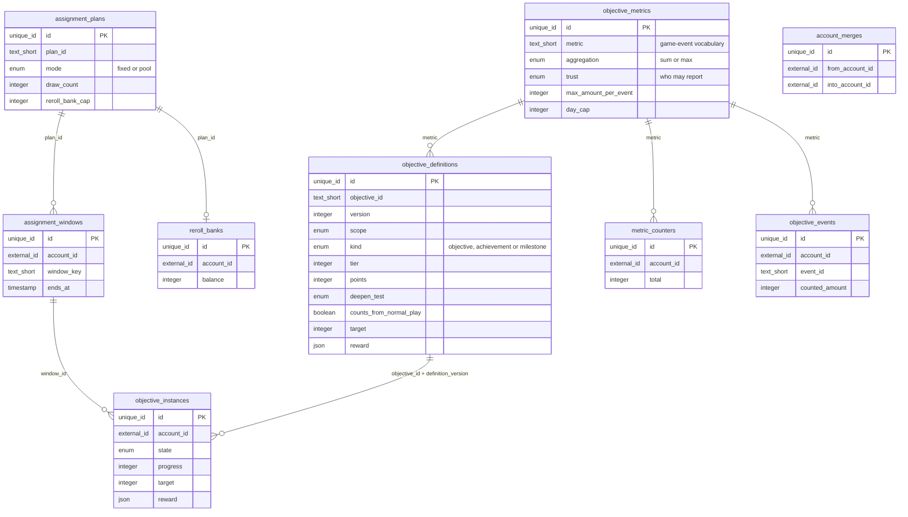
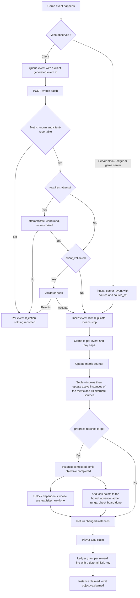
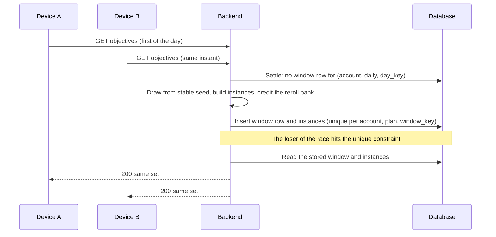
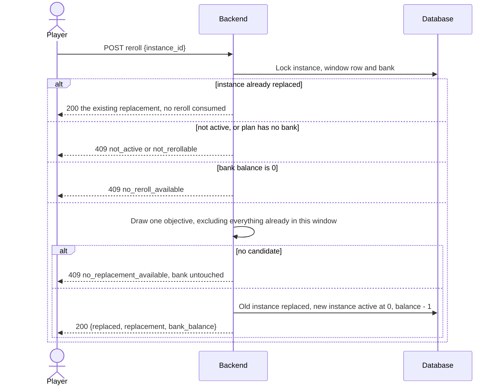

# Objectives, Missions and Achievements

## 1. Overview

### Problem Statement

A mobile game keeps a player coming back when a goal is always within reach at three ranges: this session, this week or season, and the whole life of the account. A hard-coded list of goals per range does not survive the first live-ops change, and three problems recur:

- **The "now what?" gap.** The scripted first session ends and nothing tells the player what to do next. The kit guide `01-first-session.md` (rule 4) asks the last tutorial step to hand over a short, a medium and a long goal.
- **Client-trusted progress that mints currency.** If the device says "I won 400 matches" and the server pays, every reward is forgeable. Progress must come from named events, with caps, and the economically valuable ones must come from the server.
- **Pressure that the player did not agree to.** Expiring goals, countdowns, chores and "almost there" copy are the standard way to turn a goal list into a compulsion. The block fixes what happens to near-complete progress at reset, makes a board forgiving (free rerolls that bank up, a missed day that costs nothing, a visible "done" state) and fixes what the screens may and may not say. The content rules of the kit guide `13-missions-and-activities.md` are carried as data fields and publish-time checks, not as advice.

This block is one model for every range. An **objective** is a definition (a metric, a target, a reward) that the server assigns to an account in a **window** (a session, a day, a week, a season, or no window), counts from **named game events**, and pays through the ledger of `billing.virtual-currency` when the player **claims** it. An **achievement** is an objective of lifetime scope that never resets and may stay hidden until earned. A **board** is the set of objectives of one window, with an optional **ladder** of milestone points on top.

| Scope | Window (`window_key`) | Ends | Resets | Typical use |
|---|---|---|---|---|
| `starter` | `starter` (one per account) | never | `none` | Guided first session, then the short, medium and long goal |
| `session` | the play session id | idle timeout or a newer session | `forfeit` or `carry_over` | "Clear 3 levels this session" |
| `daily` | `day_key` of the account's local date | local midnight | `forfeit` or `carry_over` | A rotating set drawn from a pool, with a points ladder |
| `weekly` | `day_key` of the local Monday | next local Monday 00:00 | `forfeit` or `carry_over` | A fixed list of larger goals |
| `seasonal` | `season_id` from the season window provider | `ends_at` of the season | `forfeit` or `carry_over` | One long goal per season |
| `lifetime` | `lifetime` (one per account) | never | `none` | Achievements, tiered milestones |

### User Stories

- **Player (first session)**: when the tutorial ends I see one goal I can finish now, one for the next few days and one that takes weeks, each with its reward and my true progress.
- **Player (daily)**: I see today's goals easiest first, how much is left on each, the reward for each, and exactly when they end; the same goals show on every device I use. At least one of them closes by playing normally, in any mode.
- **Player (choice)**: I can replace one goal I dislike with a free reroll, rerolls I did not use bank up to a small cap, and I know what a reroll costs me (the progress on that goal) before I confirm.
- **Player (a missed day)**: if I skip a day nothing is taken from me: no currency, no banked reroll, no backlog of old goals.
- **Player (done)**: when I finish the board the screen says "done for today" and when the next board comes; I can leave tasks undone and still reach every milestone reward.
- **Player (reward)**: finishing a goal and receiving its reward are two separate actions; a finished goal is mine until I claim it, even after its window closed, and the screen says what happens to unclaimed rewards.
- **Player (achievements)**: lifetime milestones show my real total from the start, and a secret achievement stays secret until I earn it.
- **Designer**: I add or retire an objective by publishing a new definition version, and no player's in-flight goal changes under their feet. I tag every objective deepens, neutral or occupies, and the block caps the occupying ones.
- **Operator**: I can bound the worst-case daily payout from the plan structure, I can see which objectives players leave unfinished at reset, and I can read the repeat rate per template.
- **Backend developer**: every economically valuable metric comes from the server, and a published definition that breaks that rule is rejected before any player sees it.

### When to use this block

- The game has goals at more than one range (a first-session script, daily or weekly missions, lifetime milestones) and wants one model for all of them.
- Rewards are currencies or items granted through `billing.virtual-currency`.
- User mentions: "daily quests", "missions", "achievements", "goals", "starter quests", "onboarding goals", "weekly challenges", "quest reroll", "mission board".

### When NOT to use

- Branching narrative quests with dialogue or world state: this block counts events, it does not script stories.
- Login calendars and streak rewards: use `engagement.daily-streak`. Season XP tiers and the reward track: use `engagement.season-pass` (it takes XP from `objective.completed`). The event schedule: use `engagement.event-calendar`. Build, craft and expedition slots with speed-ups: use `engagement.timed-queues` (this block can count their completions as a metric, nothing more).
- Rewards drawn at random (loot boxes, gacha): reward lines here are fixed integers shown before the player starts.
- Rankings or prizes with real stakes: client-reported metrics are bounded, not prevented (`security.md` T-1).
- Shared progress across several accounts (guild or co-op goals): every instance here belongs to one account.

### Ethical floor

These rules hold in every configuration; each has an invariant in section 8 and a scenario in the `.feature` files.

1. No objective requires the player to spend money or to invite someone to buy, and no definition has a price. No metric is derived from a store purchase, a pack purchase, a subscription state, the spending of a premium currency, a speed-up, an invitation or referral to buy, or a gift purchase (INV-23). The EU consumer-protection network's principles for in-game currencies include no forced currency purchases ([Forbrukertilsynet](https://www.forbrukertilsynet.no/eng-articles/national-consumer-authorities-and-commission-take-action-on-harmful-practices-in-the-gaming-industry), HIGH for the action, MEDIUM for the reading: the principles are non-binding; taken from guide 13, not re-opened). Kit guide 15 (`15-manipulation-and-the-line.md`, objective checks O1 to O3, a kit synthesis) asks for no purchase and no invitation to buy, no loss of earned progress for a missed objective (INV-15), and invitations and gifts that stay optional with a free path to the reward (INV-27).
2. No objective rewards a store rating, a store review, or the install of another app. Apple allows incentives for in-app actions and forbids forcing store actions ([Guideline 3.2.2(x)](https://developer.apple.com/app-store/review/guidelines/), HIGH) and treats incentivized feedback as manipulation of reviews (same page, section 3 introduction, HIGH); Google Play states "Don't offer rewards or incentives for ratings or reviews" ([User Ratings, Reviews, and Installs](https://support.google.com/googleplay/android-developer/answer/9898684), HIGH).
3. No fake urgency. A countdown shows the real `ends_at`; windows are not shortened after assignment; copy implies nearness only when it is true (`frontend.md`).
4. No pay-to-skip. Rerolls are free, banked and capped; no reroll, refresh, revive or extension is sold for a currency (INV-16). Supercell prices reviving an expired Clan Games task at 5 to 20 gems (per guide 13); this block offers no such path.
5. Difficulty scaling never reads spending, entitlements or ads, is bounded, and keeps the reward per unit of effort constant (INV-17).
6. A finished objective is never taken back: claiming has no deadline (INV-9), and a missed day takes nothing (INV-15).
7. Chores are bounded: the occupying objectives of a board are optional, skippable and capped (INV-27), and a board can be finished without finishing every task (INV-28).

---

## 2. Data Model

> Types below are **logical types** (canonical mapping in `docs/SPEC_GUIDELINES.md` section 5). The Reference Migration (Postgres) is in `backend.md`.



Content tables (`objective_metrics`, `objective_definitions`, `assignment_plans`) are the game's design data, written by the operator through a publish step (`backend.md` "Publish-time validation"). Per-account tables hold what the server knows about one player. Every table carries `tenant_id` (`unique_id`, NOT NULL, indexed; single-app deployments use one constant), and every query filters by it, as in `ugc.friends-leaderboard`.

### Table: `objective_metrics`

The game-event vocabulary: one row per metric the game can count.

| Column | Logical Type | Constraints | Notes |
|--------|------|-------------|-------|
| `id` | `unique_id` | PK | |
| `tenant_id` | `unique_id` | NOT NULL | |
| `metric` | `text_short` | NOT NULL, UNIQUE per tenant | snake_case name, for example `level_completed`, `round_played` (any mode), `queue_item_collected` (from `engagement.timed-queues`) |
| `aggregation` | `enum` | NOT NULL | values: `sum|max` (`max` keeps the highest value ever seen, for scores and streak lengths) |
| `trust` | `enum` | NOT NULL | values: `server_derived|client_validated|client_reported` (see "Trust classes") |
| `requires_attempt` | `boolean` | NOT NULL, default `false` | True for play-based metrics (a level, a round, a match, a score): an event counts only with an `attempt_id` that `attemptState` reports as `confirmed`, `won` or `failed` (see "Proof of play") |
| `source` | `text_short` | NOT NULL | Where the value originates, for example `game-client`, `ledger.soft-spend`, `engagement.daily-streak`, `objectives.board`. Checked against `FORBIDDEN_METRIC_SOURCES` at publish |
| `max_amount_per_event` | `integer` | NOT NULL, `> 0` | An event above this is clamped, not rejected |
| `day_cap` | `integer` | nullable, `> 0` | Counted amount allowed per local day (`sum` metrics only). Required when `trust = client_reported` and `aggregation = sum` |
| `created_at` | `timestamp` | NOT NULL, default = now | |

### Table: `objective_definitions`

One row per `(objective_id, version)`. Rows are immutable once `status` leaves `draft`.

| Column | Logical Type | Constraints | Notes |
|--------|------|-------------|-------|
| `id` | `unique_id` | PK | |
| `tenant_id` | `unique_id` | NOT NULL | |
| `objective_id` | `text_short` | NOT NULL, at most 48 characters | Stable identifier across versions, for example `daily.win-3`; the length keeps the ledger key within its limit |
| `version` | `integer` | NOT NULL, `>= 1`, UNIQUE with `(tenant_id, objective_id)` | |
| `status` | `enum` | NOT NULL | values: `draft|active|retired`. At most one `active` version per `objective_id` |
| `kind` | `enum` | NOT NULL | values: `objective|achievement|milestone`. A `milestone` is a rung of a plan's points ladder or its whole-board bonus (see "Board rule") |
| `scope` | `enum` | NOT NULL | values: `starter|session|daily|weekly|seasonal|lifetime` |
| `metric` | `text_short` | NOT NULL | Refers to `objective_metrics.metric`; never changes between versions |
| `alt_sources` | `json` | NOT NULL, default empty list | List of `{metric, multiplier}`: other metrics whose counted events also advance this objective, each counted amount times the positive integer `multiplier` (see "Alternate sources") |
| `counting` | `enum` | NOT NULL | values: `since_activation|lifetime_total` (see "Counting and progress rule") |
| `target` | `integer` | NOT NULL, `> 0` | Nominal target; an instance may hold a scaled copy |
| `reward` | `json` | NOT NULL, at least one line | List of `{currency, amount}`; `amount` is a positive integer; `currency` is a ledger currency or item code. A definition has no price field |
| `tier` | `integer` | NOT NULL, `1 <= n <= 3` | Difficulty and reward tier inside the scope; 1 is the easiest. Lists show tiers ascending; a chain never descends; a reroll may change it (see "Reroll rule") |
| `points` | `integer` | NOT NULL, default `0`, `>= 0` | Milestone points the instance adds to its board when it completes; always `0` for `milestone` and `achievement` definitions |
| `deepen_test` | `enum` | NOT NULL | values: `deepens|neutral|occupies` (see "Deepen-or-occupy tag") |
| `counts_from_normal_play` | `boolean` | NOT NULL, default `false` | True when the objective closes by playing normally, in any mode, with no off-meta action |
| `template_id` | `text_short` | nullable | The parameterized template the definition came from (for example `win-matches`); used for the repeat-rate log |
| `prerequisite_ids` | `id_list` | NOT NULL, default empty | list of `objective_id` in the same plan; all must be `completed` or `claimed` before this one becomes `active` |
| `chain_id` | `text_short` | nullable | Display grouping ("step 2 of 3"); must follow `prerequisite_ids` |
| `chain_position` | `integer` | nullable | 1-based position in the chain |
| `horizon` | `enum` | nullable | values: `short|medium|long`; used by `starter` objectives to label the goal triplet |
| `visibility` | `enum` | NOT NULL | values: `visible|preview|hidden_until_earned` (see "Visibility rule") |
| `reset_policy` | `enum` | NOT NULL | values: `none|forfeit|carry_over` (see "Reset policy") |
| `requires_feature` | `text_short` | nullable | A feature gate of the game; the objective is drawn or shown only for accounts that unlocked it |
| `scalable` | `boolean` | NOT NULL, default `false` | May receive a scaled target (see "Scaling rule") |
| `scaling_reference` | `integer` | nullable | The calibration point of the scaling input; required when `scalable` |
| `sort_order` | `integer` | NOT NULL | Display order inside a tier |
| `title_key` | `text_short` | NOT NULL | i18n key; the server never sends localized copy |
| `description_key` | `text_short` | NOT NULL | i18n key |
| `created_at` | `timestamp` | NOT NULL, default = now | |

### Table: `assignment_plans`

How a scope is filled: a fixed list, or N objectives drawn from a pool; plus the reroll bank and the points ladder of the board.

| Column | Logical Type | Constraints | Notes |
|--------|------|-------------|-------|
| `id` | `unique_id` | PK | |
| `tenant_id` | `unique_id` | NOT NULL | |
| `plan_id` | `text_short` | NOT NULL, UNIQUE per tenant | For example `daily` |
| `scope` | `enum` | NOT NULL | Same values as `objective_definitions.scope`; every member has this scope |
| `mode` | `enum` | NOT NULL | values: `fixed|pool` |
| `draw_count` | `integer` | nullable | `pool` only; `1 <= n <=` number of distinct exclusive groups (a member without a group is its own group) |
| `reroll_earn_per_window` | `integer` | NOT NULL, default `0` | Rerolls the account earns per elapsed window; `daily` and `weekly` `pool` plans only |
| `reroll_bank_cap` | `integer` | NOT NULL, default `0` | Most rerolls the account can hold; at least `reroll_earn_per_window` |
| `scaling_enabled` | `boolean` | NOT NULL, default `false` | Plan-level switch, effective only when `SCALING_ENABLED` is true |
| `avoid_repeat` | `boolean` | NOT NULL, default `false` | `pool` only: prefer objectives not drawn in the previous window |
| `members` | `json` | NOT NULL | List of `{objective_id, weight?, exclusive_group?}`; `weight` is a positive integer (default 1); at most one pick per `exclusive_group` among live instances |
| `ladder` | `id_list` | NOT NULL, default empty | list of `objective_id` of `milestone` definitions assigned with every window of the plan (the points rungs and the whole-board bonus); `daily` and `weekly` plans only |
| `board_points_metric` | `text_short` | nullable | Metric that receives the task points; required when a ladder rung counts points |
| `board_cleared_metric` | `text_short` | nullable | Metric that receives `1` when the board is done; required when the ladder holds a whole-board bonus |
| `status` | `enum` | NOT NULL | values: `active|retired` |

### Table: `assignment_windows`

One row per account, plan and window. It marks "this window has been assigned", so two devices or two concurrent requests produce one set.

| Column | Logical Type | Constraints | Notes |
|--------|------|-------------|-------|
| `id` | `unique_id` | PK | |
| `tenant_id` | `unique_id` | NOT NULL | |
| `account_id` | `external_id` | NOT NULL | Verified account id from the auth block; never from a request body |
| `plan_id` | `text_short` | NOT NULL | |
| `window_key` | `text_short` | NOT NULL, UNIQUE with `(tenant_id, account_id, plan_id)` | See "Window rule" |
| `starts_at` | `timestamp` | nullable | Null for `starter` and `lifetime` |
| `ends_at` | `timestamp` | nullable | Null for `starter`, `session` and `lifetime`; never changes after insert |
| `draw_seed` | `text_short` | nullable | Stored seed of the draw, for audit |
| `last_seen_at` | `timestamp` | nullable | `session` scope only: last request inside the session, for the idle timeout |
| `superseded_at` | `timestamp` | nullable | Set when a newer window of the same plan opened first (timezone change) |
| `created_at` | `timestamp` | NOT NULL, default = now | |

### Table: `reroll_banks`

The rerolls an account holds for a plan. Rerolls are earned per elapsed window and bank up to the plan's cap.

| Column | Logical Type | Constraints | Notes |
|--------|------|-------------|-------|
| `id` | `unique_id` | PK | |
| `tenant_id` | `unique_id` | NOT NULL | |
| `account_id` | `external_id` | NOT NULL | |
| `plan_id` | `text_short` | NOT NULL, UNIQUE with `(tenant_id, account_id)` | |
| `balance` | `integer` | NOT NULL, `0 <= n <= reroll_bank_cap` | |
| `credited_through_key` | `text_short` | NOT NULL | The latest `window_key` for which the earn was credited |
| `updated_at` | `timestamp` | NOT NULL | |

### Table: `objective_instances`

One row per account and objective inside a window. This is the row the player sees.

| Column | Logical Type | Constraints | Notes |
|--------|------|-------------|-------|
| `id` | `unique_id` | PK | The id clients use for claim and reroll |
| `tenant_id` | `unique_id` | NOT NULL | |
| `account_id` | `external_id` | NOT NULL | |
| `window_id` | `unique_id` | NOT NULL, FK → `assignment_windows.id`, ON DELETE CASCADE | |
| `objective_id` | `text_short` | NOT NULL, UNIQUE with `window_id` | |
| `definition_version` | `integer` | NOT NULL | The version this instance was assigned under; every other definition field is read from that version |
| `metric` | `text_short` | NOT NULL | Copied from the definition for the hot-path lookup |
| `counting` | `enum` | NOT NULL | Copied; same values as the definition |
| `state` | `enum` | NOT NULL | values: `locked|active|completed|claimed|expired|replaced` (see section 5) |
| `progress` | `integer` | NOT NULL, default `0`, `0 <= n <= target` | Clamped at `target` |
| `target` | `integer` | NOT NULL, `> 0` | Snapshot, possibly scaled. Never changes after insert except by a favorable migration |
| `reward` | `json` | NOT NULL | Snapshot, possibly scaled; this is what the claim pays |
| `scale_factor` | `decimal` | nullable | precision/scale: (4,2); null when not scaled |
| `carried_in` | `integer` | NOT NULL, default `0` | Progress that arrived from the previous window under `carry_over` |
| `activated_at` | `timestamp` | nullable | Null while `locked` |
| `completed_at` | `timestamp` | nullable | |
| `claimed_at` | `timestamp` | nullable | |
| `expired_at` | `timestamp` | nullable | |
| `replaced_by_instance_id` | `unique_id` | nullable | Set when `state = replaced` |
| `ledger_entry_ids` | `id_list` | nullable | list of external_id from `billing.virtual-currency`; one entry per reward line; max ~20 |
| `created_at` | `timestamp` | NOT NULL, default = now | |
| `updated_at` | `timestamp` | NOT NULL, default = now | Server time of the last change |

**Indexes**: `(tenant_id, account_id)` partial on `state = 'active'` (event application reads the account's active instances with their definitions, then filters by metric and alternate sources in application code); `(tenant_id, account_id)` partial on `state = 'completed'` (claim-all, claimable count).

### Table: `metric_counters`

The lifetime total (`sum`) or highest value (`max`) of a metric for an account. It feeds `lifetime_total` objectives and survives definition changes.

| Column | Logical Type | Constraints | Notes |
|--------|------|-------------|-------|
| `id` | `unique_id` | PK | |
| `tenant_id` | `unique_id` | NOT NULL | |
| `account_id` | `external_id` | NOT NULL | |
| `metric` | `text_short` | NOT NULL, UNIQUE with `(tenant_id, account_id)` | |
| `total` | `integer` | NOT NULL, default `0` | |
| `updated_at` | `timestamp` | NOT NULL | |

### Table: `objective_events`

The idempotency record of every accepted event. It is not a general event log.

| Column | Logical Type | Constraints | Notes |
|--------|------|-------------|-------|
| `id` | `unique_id` | PK | |
| `tenant_id` | `unique_id` | NOT NULL | |
| `account_id` | `external_id` | NOT NULL | |
| `event_id` | `text_short` | NOT NULL, UNIQUE with `(tenant_id, account_id)` | Client-generated unique id, or `<source>:<source_ref>` for a server-derived event |
| `metric` | `text_short` | NOT NULL | |
| `attempt_id` | `external_id` | nullable | The play attempt that proved the event (`engagement.energy-lives`); null for metrics without `requires_attempt` |
| `counted_amount` | `integer` | NOT NULL, `>= 0` | What the caps allowed |
| `outcome` | `enum` | NOT NULL | values: `counted|capped` |
| `occurred_at` | `timestamp` | NOT NULL | `min(client time, received_at)`; informational only |
| `received_at` | `timestamp` | NOT NULL | Server time; the only time that decides the window |

**Indexes**: `(tenant_id, account_id, metric, received_at)` for the day-cap sum; `received_at` for retention.

### Table: `account_merges`

| Column | Logical Type | Constraints | Notes |
|--------|------|-------------|-------|
| `id` | `unique_id` | PK | |
| `tenant_id` | `unique_id` | NOT NULL | |
| `merge_id` | `text_short` | NOT NULL, UNIQUE per tenant | Idempotency id supplied by the caller of `mergeAccounts` |
| `from_account_id` | `external_id` | NOT NULL, UNIQUE per tenant | A guest account merges at most once |
| `into_account_id` | `external_id` | NOT NULL | |
| `applied_at` | `timestamp` | NOT NULL | |

### Trust classes

Every metric belongs to one class. The class decides who may report it and what the server checks first.

| `trust` | Who may report | What the server does | Use for |
|---|---|---|---|
| `server_derived` | Only server-side callers (`ingest_server_event`): other blocks, the ledger, the game server, the block's own session tracking and board points | Dedupes by `<source>:<source_ref>`; the HTTP endpoint rejects it with `metric_not_client_reportable` | Anything tied to money, the ledger, streaks, active days, queue completions, board points, and every metric behind a premium reward |
| `client_validated` | The client reports; the game's validator hook decides | Calls `validate_event(account_id, event)`; a rejection is `validation_failed` and nothing is recorded | Gameplay facts the game server can verify, for example a finished level with a run record |
| `client_reported` | The client | Counts within the caps (`max_amount_per_event`, `day_cap`); no per-event check | Cosmetic or low-value counters: items collected, matches won, rounds played, best score |

**Value rule.** A definition whose reward contains a currency listed in `PREMIUM_CURRENCY_CODES` binds, through its metric and through every alternate source, only to `server_derived` or `client_validated` metrics and is never `scalable`. Publishing a definition that breaks the rule fails with `premium_reward_requires_trusted_metric` or `premium_reward_not_scalable`.

**Proof of play.** An event of a metric with `requires_attempt` must carry the `attempt_id` of the play attempt that produced it, and the server asks `attemptState(account_id, attempt_id)` of `engagement.energy-lives`. The event counts only when the state is `confirmed`, `won` or `failed`; an `open` attempt proves nothing (a start that is refunded must not have paid anything), and `cancelled`, `expired`, `rejected` or an unknown attempt are rejected with `attempt_not_proven`. A missing `attempt_id` on such a metric is `attempt_required`. The check runs before the validator hook. An attempt proves that a session existed, not what happened in it: the amount per attempt is bounded only by the per-event cap, the day cap and the validator. A game with no energy block leaves `requires_attempt` false on every metric.

### Derived rules

These are shared by the server, the tests and the clients. The server computes them; clients render the result.

**Window rule.** The window of an account at server instant `t`:
- `daily`: `window_key = day_key` (`YYYY-MM-DD`, the account's local date, computed on the server from the account's IANA `timezone`); `starts_at` and `ends_at` are the local midnights around `t`, converted to UTC with the timezone database (a local day lasts 23, 24 or 25 hours).
- `weekly`: `window_key` is the `day_key` of the local day with ISO weekday `WEEK_START_DAY` (default Monday) on or before `t`; `ends_at` is the next such local midnight.
- `seasonal`: `window_key = season_id`, `starts_at` and `ends_at` come from the season window provider (section 6), the same instants for every account.
- `session`: `window_key = session_id`; `ends_at` is null; the window closes when a newer session opens or `SESSION_IDLE_TIMEOUT_SECONDS` pass without a request.
- `starter` and `lifetime`: the single window `starter` or `lifetime`; no bounds.
Windows are assigned lazily: a day the player never opens produces no window, no instances and no expiry. Vectors: `fixtures/assignment-cases.json` `window_vectors`.

**Counting and progress rule.** `aggregation` belongs to the metric, `counting` to the definition.

| `aggregation` | `counting` | Instance `progress` |
|---|---|---|
| `sum` | `since_activation` | Sum of counted amounts received while the instance is `active` |
| `sum` | `lifetime_total` | The metric counter (the lifetime sum), read when the instance becomes `active` and after each event |
| `max` | `since_activation` | Highest counted value received while `active` |
| `max` | `lifetime_total` | The metric counter (the lifetime maximum) |

`progress` is stored as `min(target, value)`. The instance completes when `value >= target`. Window scopes (`session`, `daily`, `weekly`, `seasonal`) use `since_activation` only. `remaining = target - progress`, computed by the server.

**Alternate sources.** A definition may list other metrics in `alt_sources`. A counted event of such a metric advances the instance by `counted_amount * multiplier`, after that metric's own caps. This lets progress come from several kinds of normal play: "play 3 rounds in any mode" can count `round_played` plus `match_won` with multiplier 1, so a win counts twice. Alternate sources apply to `sum` metrics with `since_activation` counting only, and obey the Value rule. The shape follows the practice of letting several activities stand in for one chore (kit guide 13, rule 3).

**Reset policy.** Applies when a window closes with the instance `active` or `locked`.

| `reset_policy` | Allowed scopes | At window end |
|---|---|---|
| `none` | `starter`, `lifetime` | Nothing resets |
| `forfeit` (the default for a window scope) | `session`, `daily`, `weekly`, `seasonal` | The instance becomes `expired` and keeps its final count for display. Progress does not carry |
| `carry_over` | `session`, `daily`, `weekly`, `seasonal`, only for members of `fixed` plans | If `progress >= CARRY_OVER_MIN_PERCENT` of `target`, the next window's instance of the same objective starts with that progress (`carried_in`), once: an instance that started with a carry-in forfeits at its own end |

A `completed` instance is never affected by the window end (INV-9). An absent player loses nothing that was banked (INV-15).

*Trade-off.* `forfeit` is the simplest rule to explain and keeps every window comparable, but it ends 90 percent of a goal at the boundary, and that loss is what makes a late scramble feel obligatory. `carry_over` removes the cliff at the price of a rule the player must be told ("progress carried over") and of progress that outlives the window it was earned in. The kit guide 13 (rule 4) records a shipped game that carries incomplete weekly progress into the next week, so content that counts running totals over a week should choose `carry_over` per objective; goals about distinct days do not carry. The pro-rata payout of unfinished goals was left out: it pays for not finishing and inflates the economy.

**Visibility rule.** `visible`: returned once the instance is `active` or later. `preview`: also returned while `locked`, greyed, with the prerequisite named. `hidden_until_earned`: not returned at all, in any field or count, until the instance is `completed`; only `kind = achievement` may use it. Hiding happens in the server's projection, never in the client.

**Ordering rule.** Inside a scope the list is ordered by `tier` ascending, then `sort_order`, then instance id: easy first. A chain never descends in tier (publish check), so a later step is never easier than the one before it. Milestone rungs follow the tasks of their board, ordered by target.

**Next-goal rule.** Among the caller's `active`, returnable task instances (not milestones), the next goal is the one with the highest `progress / target`; ties break by `sort_order`, then by instance id. The server returns it so every device shows the same chip.

**Deepen-or-occupy tag.** `deepen_test` records the designer's answer to the test of kit guide 13: **deepens** needs only normal play, or teaches or opens a feature the player keeps; **neutral** asks something the player may enjoy but would not choose; **occupies** needs an action the player would skip with no reward, or repeats one already done. The server never computes it; it is carried on the analytics events so reports can compare what players do after each class (INV-27 caps the occupying class).

**Draw rule.** For a `pool` plan and a window, the server picks `draw_count` objectives:
1. Candidates are the plan's `active` members whose `requires_feature` the account has unlocked.
2. **Normal-play slot.** If any candidate has `counts_from_normal_play`, the first pick is drawn among them (preferring ones not drawn in the previous window when `avoid_repeat`), so every board holds at least one objective that closes by normal play.
3. The remaining slots fill in two passes: pass 1 uses candidates not drawn in the previous window (when `avoid_repeat`), pass 2 fills what is left from the rest. Inside a pass the pick is a weighted draw without replacement; a pick removes the other members of its `exclusive_group`; no more than `MAX_OCCUPIES_PER_BOARD` picks have `deepen_test = occupies`.
4. The randomness is seeded from stable facts only: tenant, account, plan, `window_key`, and the reroll index. Never a device id or a request time.
5. The result is stored (`assignment_windows` row plus instances in one transaction) and every later read returns the stored set. If fewer than `draw_count` candidates exist the window gets fewer.
6. The plan's `ladder` milestones are assigned with the window, always.

**Reroll rule.** A `daily` or `weekly` `pool` plan with `reroll_bank_cap > 0` gives each account a bank (`reroll_banks`). The bank is credited when a window is assigned: `balance = min(reroll_bank_cap, balance + reroll_earn_per_window * elapsed)`, where `elapsed` is the number of windows (day keys or week keys) since `credited_through_key`, at least 1 for the first window. Only the window that is assigned is ever shown, so a returning player gets a full bank and one current board, never a backlog. A reroll spends one banked reroll on one `active` instance: the instance becomes `replaced`, and one new instance is drawn with the plan's rules, excluding every objective already in the window (replaced ones included), at progress 0 (counting `since_activation` from now). With `REROLL_TIER_POLICY = same_tier` (default) the replacement has the replaced instance's `tier`, so the reward level stays comparable; with `any_tier` it may differ and the reroll sheet says so. If no candidate exists the reroll fails with `no_replacement_available` and the bank is untouched.

**Board rule.** The board of a window is its task instances (`kind = objective`, state other than `replaced`) plus the plan's ladder. When a task instance becomes `completed` the server adds its `points` through a server event on the plan's `board_points_metric` (`source = objectives.board`, `source_ref = <instance_id>:points`), which advances the ladder rungs like any other metric. When every task instance of the window is `completed` or `claimed` (and there is at least one), the board is **done**: the server sends one event on `board_cleared_metric` (`source_ref = <window_id>:cleared`), which completes the whole-board bonus, and lists return `board.done = true`. Publish checks (INV-28): the top points rung is below the smallest total a possible board is worth, so a player can leave tasks undone and still reach every rung; milestones carry no points themselves. Rewards of rungs and of the bonus are claimed like any other. The ladder shape (small payouts often, a bonus for the whole board) follows boards documented in kit guide 13 (rule 5).

**Unclaimed rule.** `UNCLAIMED_AT_RESET` (default `stay_claimable`) states what happens to a `completed` instance when its window closes: it stays in the list and claimable, or (`auto_grant`) the server claims it at the next settle with the same ledger keys as a player claim. No setting makes a finished reward expire. Every list response carries the active rule so the screen can state it (kit guide 11, feature 4: "the screen says which").

**Scaling rule** (optional, off by default). When `SCALING_ENABLED`, the plan has `scaling_enabled` and the definition is `scalable`: `factor = clamp(input / scaling_reference, SCALE_MIN, SCALE_MAX)`. With `SCALING_INPUT = recent_activity` (default) `input` is the median (lower middle for an even count) of the account's counted totals of the metric in its last `SCALING_LOOKBACK_WINDOWS` windows of the same scope; with `player_level` it is the account's level from the game (`player_level(account_id)`), and `scaling_reference` is the level at which the nominal target is calibrated. With fewer than `SCALING_MIN_HISTORY_WINDOWS` windows of history, or no level, the factor is 1. Target and each reward amount become `round(nominal * factor)` (half up, minimum 1) and are stored on the instance. The fairness rules are INV-17.

---

## 3. Data Flow



---

## 4. Sequence Diagrams

### Event to completion, unlock and claim

```mermaid
sequenceDiagram
    actor P as Player device
    participant B as Backend
    participant DB as Database
    participant L as Ledger

    P->>B: POST events [{event_id, metric, amount, occurred_at}]
    B->>B: Authenticate, account from session, check batch size and daily rate
    B->>DB: Begin, settle windows for this account at server now
    loop each event in order
        B->>DB: Insert event row (account, event_id), conflict means duplicate
        B->>B: Clamp amount to per-event and day caps
        B->>DB: Update counter and every active instance of the metric or an alternate source
        B->>DB: On completion: unlock dependents, add board points, check board done
    end
    B->>DB: Commit
    B-->>P: 200 {results, changed instances, completed ids, board, next_goal}
    Note over P: Completion shows a celebration; nothing was granted yet
    P->>B: POST claim {instance_id}
    B->>DB: Lock instance, state must be completed
    loop each reward line
        B->>L: grant(account, currency, amount, "objectives.reward", instance_id, key)
        L-->>B: {applied, balance, entry_id}
    end
    B->>DB: state = claimed, ledger_entry_ids, commit
    B-->>P: 200 {state claimed, grants}
```

### First read of a window on two devices



### Reroll



---

## 5. State Management

### Instance states (server)

| State | Meaning | Leaves by |
|---|---|---|
| `locked` | Assigned, prerequisites not complete | all prerequisites `completed` or `claimed` → `active`; window end → `expired` |
| `active` | Counting events | progress reaches target → `completed`; window end or supersede → `expired`; reroll → `replaced` |
| `completed` | Earned, reward not yet paid | claim (player, claim-all, or `auto_grant` at settle) → `claimed`; no other exit, no deadline |
| `claimed` | Reward paid | terminal |
| `expired` | The window closed before the target was reached; keeps its final count | terminal |
| `replaced` | Swapped out by a reroll | terminal |

Invalid transitions are rejected: `claimed` never returns to `completed`; `expired` and `replaced` never become `active`; `progress` never decreases inside an instance.

**Settling.** Time-driven transitions (assign the current windows, credit the reroll bank, expire instances whose `ends_at <= server now`, apply carry-over, close superseded windows, auto-grant when configured) run as one idempotent function, `settle(account, now)`, at the start of every list, event, claim and reroll request. Correctness never depends on a scheduled job; a sweep only trims history (`HISTORY_RETENTION_SECONDS`).

### Client state

| State | Storage | Survives reload | Notes |
|---|---|---|---|
| `items`, `board`, `next_goal`, `claimable_count`, `server_now`, `rules` | In-memory plus a cached copy | Cache only | Always replaced by the next server answer |
| `clock_offset` | In-memory | No | `server_now - device_now` at the last answer; countdowns use it |
| `pending_events` | Device storage | Yes | Queue of events not yet acknowledged, capped at `EVENT_QUEUE_MAX`, each with its fixed `event_id` |
| `celebrated_ids` | Device storage | Yes | Instance ids whose completion celebration was shown, so it is shown once |
| `show_chip` | Device storage | Yes | Player setting for the home chip |

---

## 6. Integration Points

### Inbound

| Caller | How | Purpose |
|---|---|---|
| Game client | `GET objectives`, `POST events`, `POST sessions`, `POST claim`, `POST claim-all`, `POST reroll` | The player-facing surface (`backend.md`) |
| Other blocks, the ledger, the game server | `ingest_server_event(account, source, source_ref, metric, amount, reason?)` | Server-derived metrics, mapped by the adapter table below |
| `auth.guest-account` (its conflict import) | `mergeAccounts(from_account_id, into_account_id, merge_id)`; `holdings(account_id)`; `deleteAccount(account_id)` | The participant hooks that block asks of every block with per-account state. `mergeAccounts` runs only when a guest links to a credential that already owns another account; a same-account link keeps the id and re-keys nothing, so this block does nothing then. `holdings` lets the player see what a conflict choice keeps (`backend.md` "Holdings"); `deleteAccount` is the eraser and is safe to repeat |
| Operator | `publish_definitions(set)` | Validated content publish, with warnings (`backend.md`) |

### Outbound

| Target | How | Purpose |
|---|---|---|
| `billing.virtual-currency` | `grant(account_id, currency, amount, reason, source_ref, idempotency_key)` with reason `objectives.reward` | Pays claims. Balances are never written here |
| `engagement.energy-lives` | `attemptState(account_id, attempt_id) → state or none` | Proof of play for metrics with `requires_attempt` |
| Game validator hook | `validate_event(account_id, event) → ok or rejected` | `client_validated` metrics |
| Feature gate | `feature_unlocked(account_id, feature) → boolean` | `requires_feature` |
| Player level | `player_level(account_id) → integer or none` | `SCALING_INPUT = player_level` only |
| `engagement.season-pass` | `ingest_xp(account_id, event_id, source, units, occurred_at)` with `event_id = completion_id`, `source = "objective.completed"`, `units = 1`, `occurred_at = completed_at`, for the kinds in `SEASON_XP_KINDS` | XP source of the season track. Optional: a project without the block configures no kinds. Delivered at least once after the completion commits; a retry repeats the same `event_id`, so the receiver credits once |
| Account profile | `timezone` (IANA) of the account | `day_key` and window bounds |
| Season window provider | `current_season() → {season_id, starts_at, ends_at} or none` | Seasonal windows. `engagement.event-calendar` or `engagement.season-pass` satisfies it; this block stores only the `season_id` |

### Metric adapters

Each row maps an event of another block to a `server_derived` metric. The adapter drops what must not count: the filters are INV-23 and INV-24 applied. A dropped event is answered `ignored` with the reason in the last column. No metric exists for speed-up use (`queue_speedup_quoted`, `queue_speedup_applied`), for purchases, for subscriptions, or for invitations to buy.

| Source event | Metric (aggregation, amount) | Filter | Reason when dropped |
|---|---|---|---|
| `engagement.daily-streak` `streak_extended` | `streak_length` (max, its `streak` value) | none | |
| `engagement.daily-streak` `daily_reward_claimed` | `daily_reward_claimed` (sum, 1) | none | |
| Ledger entry, soft currency spent | `soft_currency_spent` (sum, amount) | currency not in `PREMIUM_CURRENCY_CODES` | `paid_with_premium` |
| Ledger entry, soft currency granted | `soft_currency_earned` (sum, amount) | reason is not `objectives.reward` | `self_feeding` |
| `engagement.timed-queues` `queue_item_collected` | `queue_item_collected` (sum, 1; `source_ref = item_id`) | none: collecting is counted whether or not a speed-up was used, and no objective may depend on `sped_up` | |
| `engagement.items` `item_granted` | `item_granted` (sum, `applied_quantity`) | `source_kind` is not `purchase`; reason is not `objectives.reward` | `paid_source`, `self_feeding` |
| `engagement.items` `item_upgraded` | `item_upgraded` (sum, 1) | no cost line is in a premium currency | `paid_with_premium` |
| `engagement.items` `item_equipped` | `item_equipped` (sum, 1) | none | |
| This block, first request of a local day / a session opening | `active_day` / `session_started` (sum, 1) | once per `day_key` / `session_id` | |

### Events

Internal events (server bus, dotted names as in `ugc.friends-leaderboard`):

| Event | Payload | When |
|---|---|---|
| `objective.completed` | `{account_id, tenant_id, completion_id, instance_id, objective_id, scope, kind, tier, window_key, completed_at}` | An instance reaches `completed`. `completion_id` is `{objective_id}:{window_key}`: stable, and unique per account and instance (INV-29). It is the `event_id` of the season XP call |
| `objective.claimed` | `{account_id, tenant_id, completion_id, instance_id, objective_id, scope, claim_source, grants[]}` | A claim succeeds (`claim_source`: `player`, `claim_all`, `auto`) |
| `objective.expired` | `{account_id, instance_id, objective_id, scope, progress, target}` | An incomplete instance expires |

Analytics events (snake_case; the shared envelope of the kit's instrumentation guide, `event_name`, `account_id`, `session_id`, `server_ts`, `client_ts`, `app_version`, `platform`, is added by the analytics layer). Names and properties are listed in `backend.md` "Analytics events" (server-written) and `frontend.md` (client-written): `objectives_viewed`, `objective_assigned`, `objective_progress`, `objective_completed`, `objective_claimed`, `objective_claim_failed`, `objective_expired`, `objective_rerolled`, `objective_board_done`, `objective_chip_tapped`, `starter_checklist_viewed`, `starter_objectives_completed`, `objective_events_rejected`, `objective_events_dropped`, `objective_reroll_sheet_viewed`, `objective_chip_setting_changed`, `objectives_merged`.

Hand-off event for `messaging.push-reengagement` (REMOTE lane, fire and forget): `objective_reward_ready` with the fields `subject_key` (`objective:{objective_id}:{window_key}`), `state` (`armed` when the instance completes in a scope listed in `REWARD_READY_SCOPES`, `resolved` when it is claimed), `fire_at` (`completed_at + REWARD_READY_DELAY_SECONDS`), `expires_at` (`fire_at + REWARD_READY_NOTIFY_WINDOW_SECONDS`) and `params` (`{objective_id, scope}`). The reward itself never lapses (INV-9); `expires_at` only ends the reminder. Reminder copy must not imply that the reward expires.

### Shared with other blocks

- **`billing.virtual-currency`**: owns balances and the ledger contract. A claim is `grant` calls with reason `objectives.reward` and `idempotency_key = objectives:{account_id}:{objective_id}:{window_key}:{line_index}`; a replay returns the original result. This block ships the `currency_flows` rows it needs (one `faucet` row per reward currency or item, reason `objectives.reward`, source block `engagement.objectives`), and publishing a definition whose reward has no such row fails. A ledger rejection (`balance_limit_exceeded`, `unknown_currency`, `unknown_reason`, `idempotency_conflict`) leaves the instance `completed` and is answered `409 ledger_rejected` with the ledger's error name; an outage is `503 ledger_unavailable`. The key stays within the ledger's `LEDGER_IDEMPOTENCY_KEY_MAX_LENGTH` (default 200) because `objective_id` is at most 48 characters and `window_key` at most 64.
- **`engagement.daily-streak`**: owns the timezone and its change rate limit. This block reads the timezone; at most one live window per plan exists even if the timezone changes (INV-12).
- **`engagement.season-pass`**: takes XP from `objective.completed` through `ingest_xp` with the `completion_id` as `event_id` and the source `objective.completed`; this block does not know about tiers or XP amounts, and the season block's `XP_SOURCES` decides how much a unit is worth.
- **`engagement.event-calendar`**: may supply seasonal windows through the season window provider; this block does not store the calendar.
- **`engagement.timed-queues`**: owns queue slots and speed-ups; this block only counts `queue_item_collected` as a server-derived metric.
- **`data.progress-sync`**: the local snapshot carries no objective state. Objective state is server-owned; a guest account joins the signed-in one through `mergeAccounts`, called by `auth.guest-account`.
- **`compliance.account-deletion`**: deleting an account deletes every row keyed by its `account_id` in all per-account tables; merge records of a deleted account are removed too.
- **`billing.in-app-purchase`, `billing.subscriptions`**: never a metric source (INV-23).

---

## 7. Configuration Surface

| Key | Type | Default | Description |
|-----|------|---------|-------------|
| `WEEK_START_DAY` | `number` | `1` | ISO 8601 weekday that starts the weekly window (1 = Monday) |
| `SESSION_IDLE_TIMEOUT_SECONDS` | `number` | `1800` | Idle time after which a session window closes |
| `SESSIONS_WITH_OBJECTIVES_PER_DAY` | `number` | `5` | Sessions per local day that receive a `session` plan; later sessions get none |
| `EVENT_BATCH_MAX` | `number` | `50` | Events per `POST events` request; above it the request fails with `batch_too_large` |
| `EVENT_MAX_AGE_SECONDS` | `number` | `172800` | Oldest accepted `occurred_at` relative to server time (48 hours covers a long offline stretch) |
| `EVENT_RETENTION_SECONDS` | `number` | `604800` | How long `objective_events` rows are kept; must be at least `EVENT_MAX_AGE_SECONDS` (startup check) so a replayed id is still recognized |
| `ACCOUNT_EVENTS_PER_DAY_MAX` | `number` | `5000` | Recorded events per account per local day; above it requests get `429 rate_limited` |
| `CLAIM_ALL_MAX` | `number` | `50` | Instances one `claim-all` call settles |
| `UNCLAIMED_AT_RESET` | `enum` | `stay_claimable` | values: `stay_claimable|auto_grant`; what happens to a completed, unclaimed instance when its window closes (no value makes it expire) |
| `REROLL_TIER_POLICY` | `enum` | `same_tier` | values: `same_tier|any_tier`; the tier the replacement of a reroll may have |
| `MAX_OCCUPIES_PER_BOARD` | `number` | `1` | Draws allowed per window with `deepen_test = occupies` |
| `POOL_MIN_WIDTH_FACTOR` | `number` | `3` | Publish warns (`pool_narrow`) when a pool has fewer members than this times `draw_count` |
| `SCALING_ENABLED` | `boolean` | `false` | Master switch for difficulty scaling |
| `SCALING_INPUT` | `enum` | `recent_activity` | values: `recent_activity|player_level` |
| `SCALE_MIN` / `SCALE_MAX` | `decimal` | `0.5` / `2.0` | Bounds of the scaling factor |
| `SCALING_LOOKBACK_WINDOWS` | `number` | `7` | Windows of history the median reads |
| `SCALING_MIN_HISTORY_WINDOWS` | `number` | `3` | Fewer windows than this: factor 1 |
| `CARRY_OVER_MIN_PERCENT` | `number` | `80` | Share of the target an unfinished instance needs to carry into the next window |
| `PREMIUM_CURRENCY_CODES` | `string[]` | `[]` (adopter sets) | Currencies for which the Value rule applies; set it to every currency that can be bought with money |
| `FORBIDDEN_METRIC_SOURCES` | `string[]` | `billing.in-app-purchase`, `billing.subscriptions`, `billing.virtual-currency.purchase`, `premium-currency-spend`, `store-review`, `queue-speedup`, `invitation-to-buy`, `referral-purchase`, `gift-purchase` | A metric whose `source` is listed cannot be published. A metric with source `social-invite` (an invitation or gift that involves no purchase) is allowed only as a skippable, capped goal (INV-27) |
| `MAX_ACHIEVEMENT_DEFINITIONS` | `number` | `100` | Active achievement definitions; chosen so every achievement can be mirrored to Game Center (limit 100 per app) |
| `SEASON_XP_KINDS` | `string[]` | `objective`, `achievement` | Kinds whose completions are sent to `engagement.season-pass` as XP units; `milestone` rungs are left out by default because they restate the tasks that earned the points. Empty list when the season block is not installed |
| `HISTORY_RETENTION_SECONDS` | `number` | `7776000` | How long terminal instances (`claimed`, `expired`, `replaced`) are kept; `completed` instances are kept until claimed |
| `REWARD_READY_SCOPES` | `string[]` | `daily`, `weekly`, `seasonal` | Scopes that emit the `objective_reward_ready` hand-off |
| `REWARD_READY_DELAY_SECONDS` | `number` | `3600` | Wait before the reminder may fire; a claim inside the delay resolves it |
| `REWARD_READY_NOTIFY_WINDOW_SECONDS` | `number` | `86400` | How long after `fire_at` the reminder is still worth sending |
| `LIST_STALE_SECONDS` | `number` | `60` | Client refetches a list older than this on screen open |
| `EVENT_FLUSH_DELAY_MS` | `number` | `2000` | Client waits this long to batch events before sending |
| `EVENT_QUEUE_MAX` | `number` | `500` | Client queue cap; when full, the oldest `client_reported` events go first |
| `NEAR_COMPLETE_COPY_PERCENT` | `number` | `20` | "Nearly there" wording is allowed only when `remaining / target` is at or below this share |

---

## 8. Invariants

| ID | Invariant |
|----|-----------|
| INV-1 | **The server owns state and time.** Progress, completion, windows, expiry and claims are computed only on the server from the server clock. A client timestamp is informational; a client never decides that a window ended or an objective completed. |
| INV-2 | **Events are idempotent.** An event is identified by `(account, event_id)`; a replay returns the original outcome and changes no counter or instance. Rows live at least `EVENT_MAX_AGE_SECONDS`. |
| INV-3 | **Trust classes hold.** A `server_derived` metric is accepted only from server-side callers; a `client_validated` event counts only after the validator accepts it; a `client_reported` event counts only within its caps. |
| INV-4 | **Value rule.** A definition paying a premium currency binds, through its metric and every alternate source, only to `server_derived` or `client_validated` metrics and is not `scalable`. Publish rejects a violation. |
| INV-5 | **Caps clamp, they do not fail.** An event amount above `max_amount_per_event` or above the remaining `day_cap` is counted at the allowed amount and answered with `counted_amount`; malformed events are rejected per event without failing the batch. |
| INV-6 | **Every window-scoped target is reachable.** A `daily` target is at most the metric's `day_cap`; a `weekly` target at most seven times it. Publish rejects an objective the caps make impossible. |
| INV-7 | **Completion pays nothing.** Reaching the target changes state only; the ledger is called only by a claim (player, claim-all, or `auto_grant`). |
| INV-8 | **A claim pays once.** Each reward line is one ledger `grant` with reason `objectives.reward` and key `objectives:{account_id}:{objective_id}:{window_key}:{line_index}`; a repeated or concurrent claim returns the stored result and grants nothing more. |
| INV-9 | **Completed means earned.** A `completed` instance stays claimable until claimed, whatever its window, the definition version, or later edits; the reward paid is the snapshot stored on the instance. `UNCLAIMED_AT_RESET` chooses between staying claimable and auto-granting; no setting expires a finished reward, and the screen states the active rule. |
| INV-10 | **True progress.** `progress` is the real count, never pre-filled, never above `target`, and never decreases inside an instance. Any head start comes from real work (a `lifetime_total` counter or a carry-in) and is shown with its reason. |
| INV-11 | **One set per window.** `(account, plan, window_key)` is unique; the draw is persisted, seeded only from stable facts (never a device id), so every device and every retry sees the same set. |
| INV-12 | **One live window per plan.** Opening a window closes the earlier live window of the same plan: its incomplete instances become `expired`, completed ones stay claimable. |
| INV-13 | **Windows do not move.** `starts_at` and `ends_at` are set at assignment from server time and the timezone database and never change afterwards. |
| INV-14 | **Time is settled lazily.** Expiry, assignment, bank credit, carry-over and auto-grant are a pure function of server now, applied at the start of each request; no job is required for correctness. |
| INV-15 | **Reset is stated and a missed day costs nothing.** Default `forfeit`; `carry_over` moves at most one hop, only at or above `CARRY_OVER_MIN_PERCENT`, only for `fixed` plans; a `completed` instance never carries. An unattended window deducts no currency, reduces no reroll bank, and leaves no backlog: only the current window is assigned. |
| INV-16 | **Rerolls are free, banked, capped and idempotent.** The bank earns `reroll_earn_per_window` per elapsed window up to `reroll_bank_cap`; a reroll spends one banked reroll on an `active` instance of a `pool` plan; the replacement is never an objective already in the window and follows `REROLL_TIER_POLICY`; a failed reroll spends nothing; repeating a reroll returns the same replacement. No reroll, revive or refresh is sold. |
| INV-17 | **Scaling is fair.** Inputs are gameplay facts only (recent metric totals or the player's level; never spending, entitlement, ads or device); the factor is clamped to `[SCALE_MIN, SCALE_MAX]`; target and reward scale by the same factor; the result is frozen on the instance; premium-reward objectives are never scaled; the switch is off by default. |
| INV-18 | **Chains unlock on completion and run easy to hard.** A dependent becomes `active` when every prerequisite is `completed` or `claimed`, not when it is claimed; prerequisites belong to the same plan and form no cycle; `tier` never descends along a chain. |
| INV-19 | **The first session is first-class.** The `starter` plan is assigned at first contact, never expires, and its last step unlocks the short, medium and long goals. |
| INV-20 | **Achievements never reset, hidden ones stay hidden.** `kind = achievement` implies lifetime scope and `reset_policy = none`; a `hidden_until_earned` instance appears in no response, field or count until `completed`. |
| INV-21 | **Definitions are versioned.** A version is immutable once active; instances snapshot target, reward and version; objectives are retired, never deleted; a retroactive migration may only favor the player; a metric change needs a new `objective_id`. |
| INV-22 | **Merge is deterministic and pays nothing.** Counters add (`sum`) or take the maximum (`max`); matching instances keep the more advanced state; reroll banks take the higher balance; the merge is idempotent by `merge_id` and by `from_account`; it never calls the ledger. |
| INV-23 | **Ethical floor.** No metric is derived from a store purchase, a pack purchase, a subscription state, a premium-currency spend (including an item upgrade paid with one), a speed-up, an invitation or referral to buy, a gift purchase, a store rating or review, or the install of another app; no definition has a price and none requires a purchase or an invitation to buy; countdowns show only a real `ends_at`. |
| INV-24 | **No self-feeding.** Ledger-derived and item-derived metrics ignore entries whose reason is `objectives.reward`. |
| INV-25 | **Isolation.** Every query filters by tenant and by the session's account; an instance id that belongs to another account resolves as `not_found`; the account id never comes from a request body. |
| INV-26 | **Normal play always counts.** Every `daily` and `weekly` plan holds at least one objective with `counts_from_normal_play`; the draw reserves its first slot for one when the pool has an eligible one; alternate sources let several kinds of play advance one objective. |
| INV-27 | **Occupying and social objectives are optional and capped.** `deepen_test = occupies`, and any objective on a `social-invite` metric (an invitation or a gift), is allowed only in a `pool` plan with a reroll bank (so the player can skip it), at most `MAX_OCCUPIES_PER_BOARD` per window, never in a `starter` plan, never as a prerequisite; the reward of such an objective is also reachable without an invitation (a design rule checked in acceptance, not by publish). |
| INV-28 | **A board can be left unfinished.** Points are added to the board when a task completes (not when it is claimed); `milestone` definitions carry no points; the top points rung is below the smallest total a possible board is worth; the board is done when every non-replaced task is completed or claimed, and a replaced instance never holds it open. |
| INV-29 | **The completion id is stable and unique.** `completion_id = {objective_id}:{window_key}` identifies one completion per account and instance; it never changes after the instance completes, a replaced instance never completes, and every consumer (the season XP call, the push hand-off `subject_key`) treats it as the idempotency key. |
| INV-30 | **Play needs proof.** A metric with `requires_attempt` counts only for an `attempt_id` that `attemptState` reports as `confirmed`, `won` or `failed`; the check precedes the validator; a missing or unproven attempt is rejected per event. |

---

## Origin and verification status

These blocks are specified from public platform documentation and published industry practice. No shipped app has verified this block, and it has not been run on stack A, B or C. The 3-stack check in `acceptance.md` is a mental test. Version stays 0.1.0.

**Documented fact (sources read this session unless noted)**

- Game Center achievements: up to 100 per app; an achievement can be hidden until earned and can be configured as repeatable; once available in any app version it cannot be deleted and its point value cannot change; achievements can be archived ([App Store Connect Help, Configure achievements](https://developer.apple.com/help/app-store-connect/configure-game-center/configure-achievements/), HIGH). The point limits are on a different page that was not opened.
- Google Play Games Services achievements: standard and incremental types; hidden, revealed and unlocked states; at least ten achievements across the life of a game; a maximum of 400 achievements (stated next to the Quests eligibility rules, so its scope is MEDIUM); a total of 2,000 points, at most 200 per achievement, in multiples of 5; "The target number should be high enough that it requires at least ten sessions to achieve"; hidden achievements "sparingly"; an achievement can be unlocked offline and syncs later ([Android Developers, Achievements](https://developer.android.com/games/pgs/achievements), HIGH).
- App Store Review Guidelines: 3.2.2(x) (no forced rating, review or store actions; in-app incentives allowed), the section 3 introduction (incentivized feedback is manipulation), 5.6.3 (manipulating reviews or referrals is not permitted), 5.6.1 (use the provided review API; custom review prompts are disallowed) ([Apple](https://developer.apple.com/app-store/review/guidelines/), HIGH). Google Play: "Don't offer rewards or incentives for ratings or reviews" ([Play Console Help](https://support.google.com/googleplay/android-developer/answer/9898684), HIGH).
- Goals at three ranges: "Providing short, mid, and long-term goals help players conceptualize future play sessions" and low early thresholds so players "level up quickly" ([Roblox Creator Docs, Onboarding](https://create.roblox.com/docs/production/game-design/onboarding), MEDIUM: one platform's guidance). Layered quests from "simple daily tasks and milestones to more involved multi-day efforts", a daily reward in the first session, and showing the next week or month of rewards ([Unity Learn](https://learn.unity.com/tutorial/how-to-build-in-retention-and-player-engagement-as-part-of-your-early-concept), MEDIUM).
- Recurring events (daily missions, check-ins, win streaks, milestone progression) are "designed to sustain daily engagement" and lay "the groundwork for mid-term and large-scale event participation" ([Sensor Tower, March 2026](https://sensortower.com/blog/top-grossing-mobile-games-live-ops-strategies-2025-report), HIGH).
- Goal gradient: effort accelerates near a reward in coffee-shop stamp cards ([Columbia Business School](https://business.columbia.edu/faculty/research/goal-gradient-hypothesis-resurrected-purchase-acceleration-illusionary-goal), HIGH for the study's existence). Endowed progress: a pre-stamped loyalty card needing the same purchases was redeemed 34% of the time versus 19% for a blank card, and a stated reason for the head start strengthens the effect ([Wharton Knowledge](https://knowledge.wharton.upenn.edu/podcast/knowledge-at-wharton-podcast/the-lowdown-on-customer-loyalty-programs-which-are-the-most-effective-and-why/), MEDIUM: secondary summary, taken from this repo's research notes and not re-read). Both come from loyalty-card studies, not games; the transfer is plausible and untested (`kits/game-engagement/guides/06-design-ethics-and-compliance.md`).
- Rewards for engagement can lower later free-choice interest: a meta-analysis of 128 studies reports effect sizes of d = -0.40 for engagement-contingent and -0.36 for completion-contingent rewards ([Deci, Koestner and Ryan 1999](https://depts.washington.edu/techdocs/papers/deciExtrinsicRewardsAndIntrinsicMotivation99.pdf), MEDIUM: figures read from the abstract in search results; the effect is disputed by Cameron and Pierce, and Cameron, Banko and Pierce 2001 report rewards "not harmful" in general). This is why reward lines are small fixed integers shown up front, why the home chip can be switched off, and why nothing here is presented as payment for playing.
- Shipped boards, as recorded in kit guide 13 (`kits/game-engagement/guides/13-missions-and-activities.md`, rules 3 to 5 and 7; the underlying pages were not re-opened for this block): one reroll earned a day with two banked and no backlog for an absent player ([Riot support](https://support.riotgames.com/en-us/legends-of-runeterra/gameplay/let-s-talk-about-quests), HIGH per the guide); incomplete weekly progress carried into the next week ([patch notes via MP1st](https://mp1st.com/news/overwatch-2-update-3-53-dropped-for-season-5-this-june-13-here-are-the-patch-notes), MEDIUM per the guide, secondary); alternate progress sources standing in for a daily mission ([RPG Site, Sept 2023](https://rpgsite.net/news/14808-genshin-impact-version-41-will-make-it-simpler-for-players-to-do-their-dailies), HIGH for the announcement); "Play 1 Game" challenges counting in any mode ([Dexerto, 18 Nov 2021](https://www.dexerto.com/gaming/halo-infinite-devs-promise-better-battle-pass-progression-1700390/), HIGH for the events); a points ladder whose top threshold is below the sum of the quest points ([Game Developer, 2020](https://www.gamedeveloper.com/design/flexible-time-session-design-in-afk-arena), MEDIUM, one analyst's reading); a daily quest list ordered easy to hard ([Duolingo, June 2024](https://blog.duolingo.com/time-spent-learning-well/), HIGH as the company's statement; an education app); boosted rewards for finishing all three daily quests ([Duolingo, Dec 2025](https://blog.duolingo.com/product-highlights/), HIGH, no outcome given). The pool-width factor (`POOL_MIN_WIDTH_FACTOR`) follows the guide's LOW recommendation of a pool wider than a week of boards.
- Rerolling one daily quest per day with progress erased and no duplicates is also described for a published card game ([community wiki](https://hearthstone.wiki.gg/wiki/Daily_quest), LOW: no official page found; used only as precedent for the shape of the feature).

**Design choices (this block's own, not found in a source):** the metric trust classes and the Value rule; the `sum`/`max` aggregation and the two `counting` modes; completion unlocking dependents; claim without a deadline and the `auto_grant` alternative; the reset policies and the 80 percent carry-over threshold; the seeded persisted draw, `exclusive_group`, `avoid_repeat`, the normal-play slot and the occupies cap; the reroll bank accounting and the tier policy; the milestone points implemented as server events on a board metric; the scaling formula, its two inputs and its bounds; the reward-snapshot and favorable-only migration rules; the merge ranking; the proof-of-play rule built on `attemptState` of `engagement.energy-lives` (that block's INV-13 says an `open` attempt proves nothing); the adapter filters; the invitation rules (kit guide 15, objective checks O1 to O3, a kit synthesis); the numeric defaults in section 7 (every default there is a starting value to tune, none is a benchmark).

**Extrapolation (reasoned, not observed):** that forfeiting unfinished goals at the boundary increases a late scramble (the loss-avoidance reading is contested: guide 06 notes loss aversion is disputed for small stakes); that median-based scaling with proportional rewards is perceived as fair; that the starter plan closes the "now what?" gap and that a free banked reroll lowers the chore feeling (the sources state the intent, none measures the effect; see guide 01 and guide 13 Gaps).

**Not verified:** Game Center point limits; Apple's `GKAchievement` progress semantics; whether platform policies treat a "rate the app" objective differently for in-app currency than for cash; no retention or revenue effect of any objective type, board size or ladder shape is quantified by any source used here.
