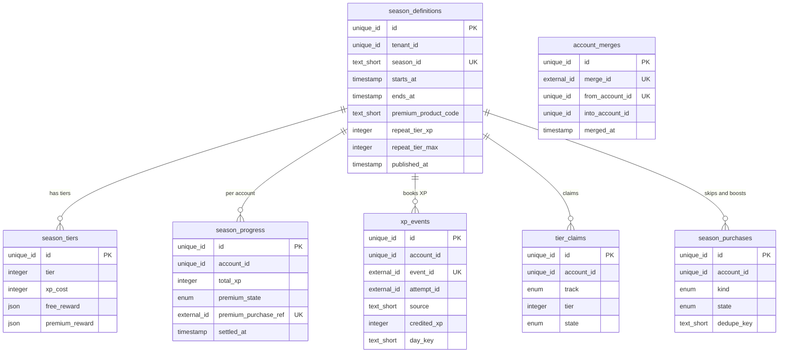
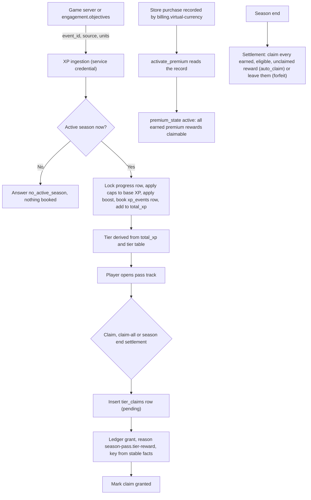
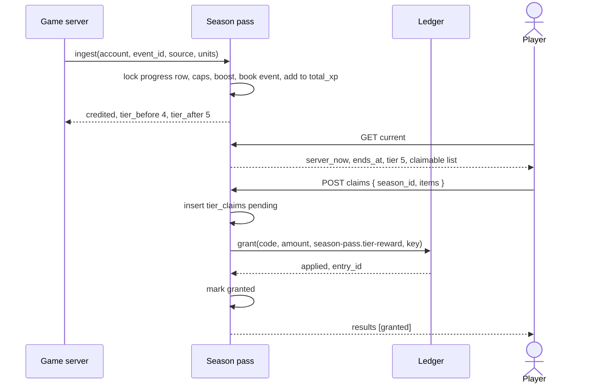
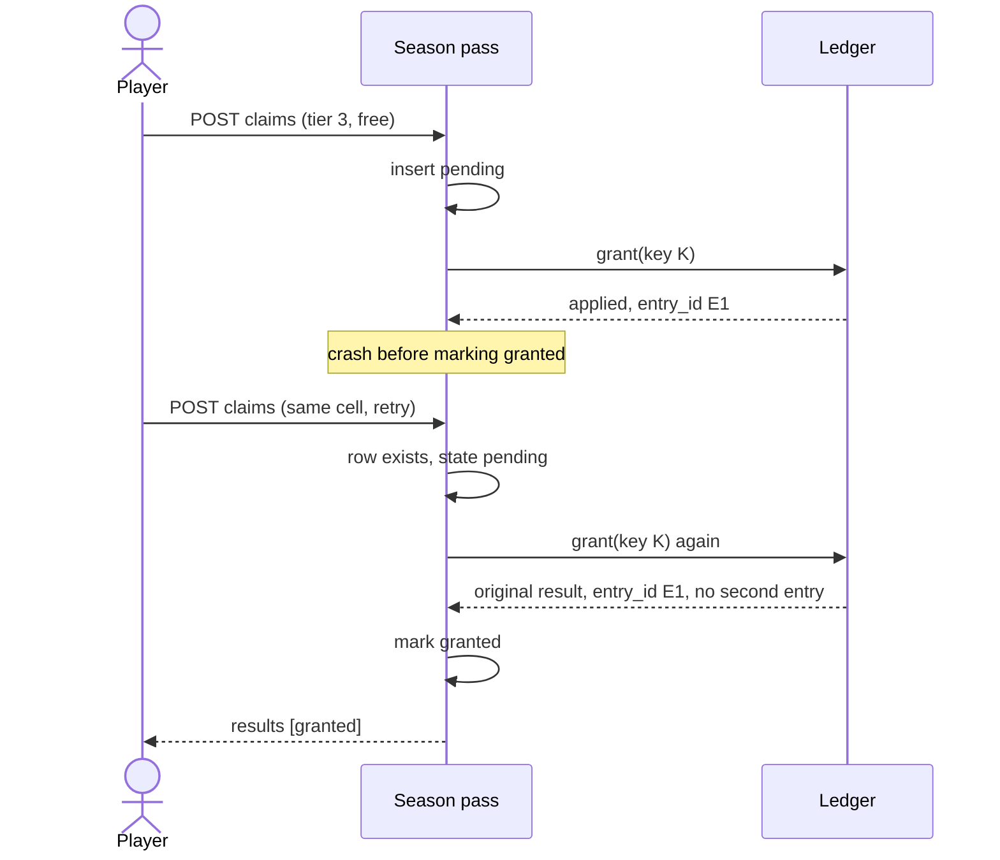
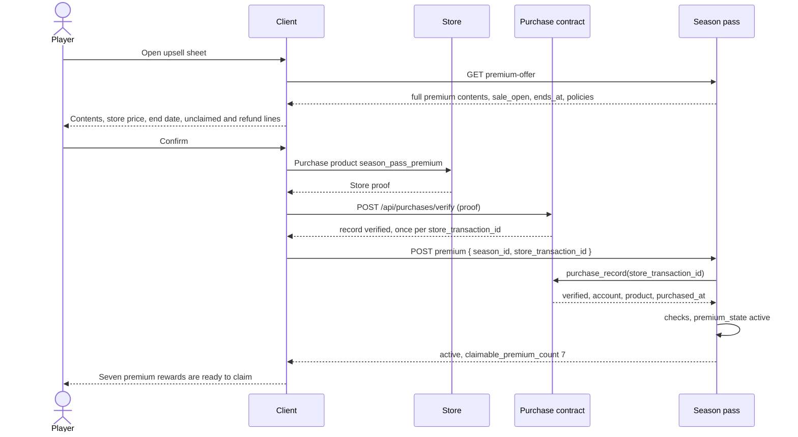
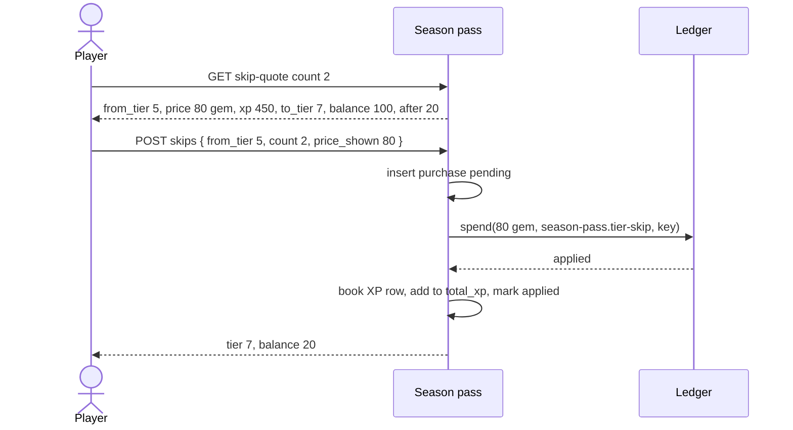
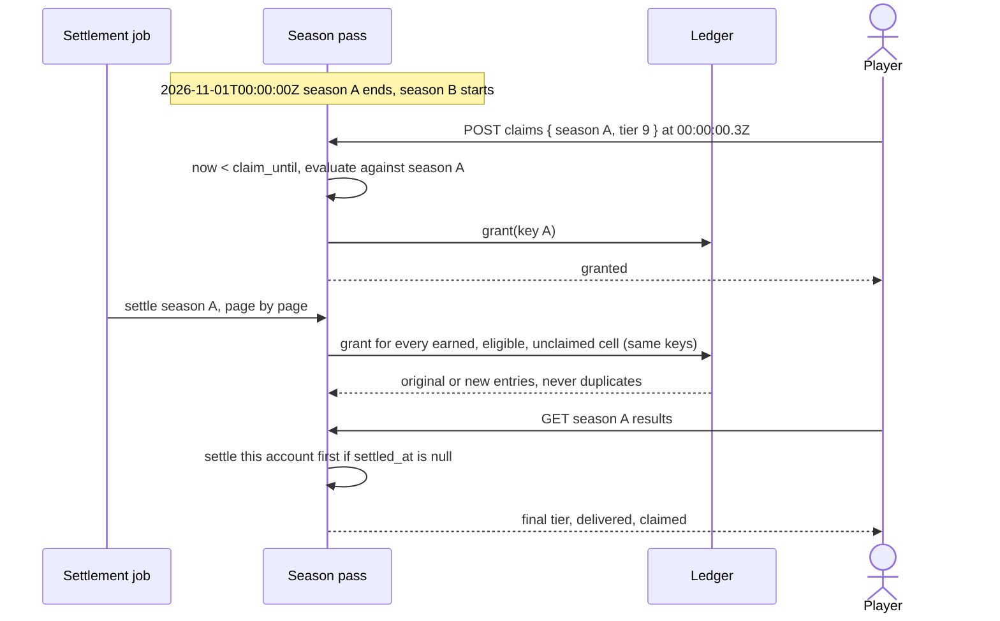

# Season Pass

## 1. Overview

### Problem Statement

A mobile game wants a season-long reason to come back: a track of tiers the player climbs by playing, a free reward at some tiers for everyone, and a premium track the player can buy for better rewards. The industry names this a battle pass, season pass, or event pass: a time-limited pass with free and premium tiers of rewards, with some premium rewards visible to non-buyers ([GameAnalytics, updated 2025-02-26](https://www.gameanalytics.com/blog/designing-battle-passes-in-mobile-games-the-whats-whys-and-hows), MEDIUM: vendor blog, prices as of the article). It sits in the seasonal layer of live operations next to collections and large events ([Sensor Tower, March 2026](https://sensortower.com/blog/top-grossing-mobile-games-live-ops-strategies-2025-report), HIGH; carried from the repository's research notes, not reopened for this block).

The hard parts are not the tier table. They are the places where money, time and idempotency meet: XP that arrives twice, a claim tapped twice or at the last second of a season, a premium purchase made halfway through, a refund, two seasons that touch at midnight, and a countdown that must never lie. This block specifies those rules so the pass is correct before it is pretty.

The block owns: the season definition, XP ingestion, tier derivation, claims, the premium unlock, tier skips, XP boosts, end-of-season settlement, and the screens. It does not own the currency ledger or purchase verification (`billing.virtual-currency`), missions that feed it XP (`engagement.objectives`), or the event schedule (`engagement.event-calendar`).

### User Stories

- **Player**: I see the whole season at a glance: my tier, the XP to the next tier, a free row and a premium row, and what the next reward is.
- **Player**: I claim a reward once. Tapping twice, losing signal mid-tap, or claiming in the last second never loses it and never duplicates it.
- **Player**: before I pay, I see everything the premium track contains, the store price, the end date, what happens to unclaimed rewards, and what happens if the purchase is refunded.
- **Player**: if I buy premium at tier 7, I receive every premium reward from tiers 1 to 7 as claimable, immediately.
- **Player**: I can see the price of a tier skip or an XP boost, and my balance after, before I confirm. The price I confirmed is the price I pay.
- **Player**: when the season ends I see what I earned and what was delivered. The default is that nothing earned is lost.
- **Operator**: I publish a season with a start, an end, a tier table and a premium product. Two seasons can never overlap, and a published season never changes.
- **Operator**: I cap XP per source and per day so one repeatable action cannot fill the pass.
- **Developer**: I derive the tier from total XP with one pure function and keep no stored tier that can drift.

### When to use this block

- The game has a seasonal progression with a free and a paid track and rewards granted into the game's currency ledger.
- XP comes from named game events on the server (level completed, objective completed, event stage completed).
- The premium unlock is a store purchase recorded through `billing.virtual-currency`.
- User says: "battle pass", "season pass", "premium track", "tier rewards", "claim all", "tier skip", "XP boost", "season rollover".

### When NOT to use

- A game with no server. Rewards, XP and the premium unlock live on a server (`security.md` T1).
- Several passes running at the same time. This block runs one season per tenant at a time (INV-2). A short event pass runs as a season of its own.
- Randomized tier rewards. Every cell holds a fixed reward. A randomized reward that can be bought must disclose the odds of each item before purchase ([Apple App Review Guidelines 3.1.1](https://developer.apple.com/app-store/review/guidelines/), HIGH); that is outside this block.
- A subscription that includes premium. Subscriptions belong to `billing.subscriptions`; this block unlocks premium from one verified purchase of the season product.
- A one-time permanent unlock: use `billing.in-app-purchase`.
- Daily check-in calendars: use `engagement.daily-streak`.

### Related blocks (referenced by id only)

| Block | Relation |
|---|---|
| `billing.virtual-currency` | Required. Owns the ledger (`grant`, `spend`) and the purchase record. Every reward, skip price, boost price and clawback goes through it; premium unlock reads its purchase record. |
| `engagement.objectives` | Feeds XP. Its completion id is the `event_id` of an XP event with source `objective.completed`. |
| `engagement.daily-streak` | Owns the account timezone rule. This block takes `day_key` from the same computation for daily XP caps. |
| `engagement.event-calendar` | May mark a seasonal-layer event with an optional `season_ref` equal to a `season_id` of this block, for display only. The calendar never defines or changes the pass window and this block never reads the calendar (INV-24). |
| `engagement.energy-lives` | Proof of play. XP from a play session is accepted only for an attempt in state `confirmed`, `won` or `failed`, asked through `attemptState(account_id, attempt_id)` (INV-23). |
| `auth.guest-account` | Calls this block's `holdings`, `mergeAccounts` and `deleteAccount` (section 3, "Account lifecycle"). |
| `messaging.push-reengagement` | May send an ending-soon push using the unclaimed count this block exposes. This block sends no push. |
| `data.progress-sync` | Season state lives on the server and is not part of a client snapshot. A guest account's season state moves by the merge in section 3, "Account lifecycle". |
| `billing.in-app-purchase`, `billing.subscriptions` | Independent. |

---

## 2. Data Model

> Types below are **logical types** (canonical mapping in `docs/SPEC_GUIDELINES.md` section 5). Dialect-specific SQL is in [Reference Migration](#reference-migration-postgres) at the end of this section.



A season is data, not code: an operator publishes a definition and the tier table; nothing is deployed. If your project prefers a versioned file loaded at boot, keep the same validation rules (section 3, "Publishing a season") and the same immutability (INV-3).

### Table: `season_definitions`

| Column | Logical Type | Constraints | Notes |
|---|---|---|---|
| `id` | `unique_id` | PK | distributed-safe ID, immutable |
| `tenant_id` | `unique_id` | NOT NULL, indexed | tenant isolation; single-app deployments use one constant value |
| `season_id` | `text_short` | NOT NULL, UNIQUE per tenant, at most 64 characters | slug used in the API and in ledger idempotency keys, for example `season-2026-10`; immutable. The ledger accepts keys of at most 200 characters, and the longest key this block builds (`season-pass:{account_id}:{season_id}:premium:{tier}:clawback`) stays below that with a 36-character account id |
| `name` | `text_short` | NOT NULL | display name |
| `starts_at` | `timestamp` | NOT NULL | UTC instant, inclusive |
| `ends_at` | `timestamp` | NOT NULL, greater than `starts_at` | UTC instant, exclusive: the season is active while `starts_at <= now < ends_at` |
| `premium_product_code` | `text_short` | NOT NULL | the store product code the purchase contract records for the premium unlock; may be the same code every season |
| `repeat_tier_xp` | `integer` | NOT NULL, >= 0 | XP per repeat tier after the last defined tier; 0 means no repeat tiers |
| `repeat_tier_max` | `integer` | NOT NULL, >= 0, <= `REPEAT_TIER_LIMIT` | how many repeat tiers exist |
| `repeat_free_reward` | `json` | nullable | `{ code, amount }` granted at every repeat tier on the free track |
| `repeat_premium_reward` | `json` | nullable | same for the premium track |
| `published_at` | `timestamp` | nullable | set by publish; from then on the row and its tiers are immutable (INV-3) |
| `created_at` | `timestamp` | NOT NULL, default = now | UTC instant |
| `updated_at` | `timestamp` | NOT NULL, default = now | UTC instant |

**Indexes**: (`tenant_id`, `season_id`) UNIQUE; (`tenant_id`, `starts_at`).
**Overlap guard**: published rows of one tenant never overlap as half-open intervals (INV-2). A season may start at the instant the previous one ends.

### Table: `season_tiers`

| Column | Logical Type | Constraints | Notes |
|---|---|---|---|
| `id` | `unique_id` | PK | |
| `season_definition_id` | `unique_id` | NOT NULL, FK to `season_definitions.id`, ON DELETE CASCADE | |
| `tier` | `integer` | NOT NULL | 1-based and contiguous: 1 to N with no gaps |
| `xp_cost` | `integer` | NOT NULL, >= 1 | XP needed to go from tier - 1 to this tier. A cost of 0 is rejected so thresholds strictly increase |
| `free_reward` | `json` | nullable | `{ code, amount }`; `code` is a currency or an item code in the ledger sense, `amount` a positive integer. Null means this tier has no free reward |
| `premium_reward` | `json` | nullable | same shape; null means no premium reward at this tier |

**Indexes**: (`season_definition_id`, `tier`) UNIQUE. A tier holds at most one reward per track (one ledger grant per claim, INV-7).
**Limits**: N is at most `MAX_TIERS`.

### Table: `season_progress`

One row per account per season, created by the first credited XP event or by the first premium activation.

| Column | Logical Type | Constraints | Notes |
|---|---|---|---|
| `id` | `unique_id` | PK | |
| `tenant_id` | `unique_id` | NOT NULL | tenant isolation |
| `account_id` | `unique_id` | NOT NULL | the guest or signed-in account from the account contract; never read from a request body |
| `season_definition_id` | `unique_id` | NOT NULL, FK | |
| `total_xp` | `integer` | NOT NULL, default 0, >= 0 | sum of `credited_xp` over this account's `xp_events` for the season; changes only inside the transaction that inserts the event row. The tier is derived from it, never stored (INV-4) |
| `premium_state` | `enum` | NOT NULL, default `none` | values: `none|active|revoked` |
| `premium_purchase_ref` | `external_id` | nullable, UNIQUE per tenant | `store_transaction_id` of the purchase that unlocked premium; one transaction unlocks at most one account-season (INV-12) |
| `premium_purchased_at` | `timestamp` | nullable | the store's purchase instant from the purchase record |
| `premium_activated_at` | `timestamp` | nullable | server instant of activation |
| `premium_revoked_at` | `timestamp` | nullable | server instant of the refund handling |
| `joined_at` | `timestamp` | NOT NULL | server instant the row was created |
| `settled_at` | `timestamp` | nullable | server instant end-of-season settlement finished for this account; cleared when a late premium activation adds claimable rewards (INV-11) |
| `created_at` | `timestamp` | NOT NULL, default = now | UTC instant |
| `updated_at` | `timestamp` | NOT NULL, default = now | UTC instant |

**Indexes**: (`tenant_id`, `account_id`, `season_definition_id`) UNIQUE; (`tenant_id`, `premium_purchase_ref`) UNIQUE where not null; (`season_definition_id`, `settled_at`) for the settlement scan.
**Concurrency**: every operation that changes `total_xp`, `premium_state` or reads caps takes this row's lock for the duration of its transaction (section 3).

### Table: `xp_events`

Every ingested event is booked, including events credited zero by a cap, so a replay returns the first answer.

| Column | Logical Type | Constraints | Notes |
|---|---|---|---|
| `id` | `unique_id` | PK | |
| `tenant_id` | `unique_id` | NOT NULL | |
| `account_id` | `unique_id` | NOT NULL | |
| `season_definition_id` | `unique_id` | NOT NULL, FK | |
| `event_id` | `external_id` | NOT NULL | the id the caller gives its event. Skips use `skip:{purchase_id}`; the catch-up grant uses `catch-up:{season_id}` |
| `attempt_id` | `external_id` | nullable | the `engagement.energy-lives` attempt that proves the play behind the event; required for a source with `requires_attempt`, null otherwise (INV-23) |
| `source` | `text_short` | NOT NULL | a key of `XP_SOURCES`, or the reserved `tier_skip` and `catch_up` |
| `units` | `integer` | NOT NULL, >= 1 | |
| `requested_xp` | `integer` | NOT NULL | `xp_per_unit x units` before caps |
| `allowed_xp` | `integer` | NOT NULL | after caps, before the boost |
| `boost_percent` | `integer` | NOT NULL, default 100 | 100 means no boost |
| `credited_xp` | `integer` | NOT NULL | added to `total_xp` |
| `capped_by` | `enum` | nullable | values: `source_daily|source_season|total_daily` |
| `day_key` | `text_short` | NOT NULL | the account's local calendar date at ingestion, `YYYY-MM-DD`, computed on the server |
| `credited_at` | `timestamp` | NOT NULL | server instant |

**Indexes**: (`tenant_id`, `account_id`, `event_id`) UNIQUE; (`tenant_id`, `account_id`, `source`, `attempt_id`) UNIQUE where `attempt_id` is not null, so one attempt credits one source once; (`season_definition_id`, `account_id`, `source`, `day_key`) for daily cap sums; (`season_definition_id`, `account_id`, `source`) for season cap sums.
**Retention**: rows older than `XP_EVENT_RETENTION_DAYS` whose season has ended may be deleted. The retention is at least `INGEST_MAX_EVENT_AGE_SECONDS`, so a deleted row cannot be replayed into a new credit (security.md T2).

### Table: `tier_claims`

| Column | Logical Type | Constraints | Notes |
|---|---|---|---|
| `id` | `unique_id` | PK | |
| `tenant_id` | `unique_id` | NOT NULL | |
| `account_id` | `unique_id` | NOT NULL | |
| `season_definition_id` | `unique_id` | NOT NULL, FK | |
| `track` | `enum` | NOT NULL | values: `free|premium` |
| `tier` | `integer` | NOT NULL, >= 1 | repeat tiers continue the numbering after the last defined tier |
| `state` | `enum` | NOT NULL | values: `pending|granted`; `pending` means the intent is recorded and the ledger answer is not yet confirmed |
| `claim_source` | `enum` | NOT NULL | values: `player|claim_all|season_end_auto` |
| `reward_code` | `text_short` | NOT NULL | copied from the definition at claim time, for audit |
| `reward_amount` | `integer` | NOT NULL | same |
| `ledger_entry_id` | `external_id` | nullable | the ledger's `entry_id`; set when `state` becomes `granted` |
| `clawback_entry_id` | `external_id` | nullable | set when `REFUND_POLICY = claw_back_unspent` took value back |
| `clawed_back_amount` | `integer` | nullable | the amount actually taken (never more than the balance, INV-17) |
| `restore_entry_id` | `external_id` | nullable | set when a reversed refund returned a clawed-back amount |
| `claimed_at` | `timestamp` | NOT NULL | server instant the intent row was created |
| `granted_at` | `timestamp` | nullable | server instant the grant was confirmed |

**Indexes**: (`tenant_id`, `account_id`, `season_definition_id`, `track`, `tier`) UNIQUE; (`state`, `claimed_at`) for the reconcile job.

### Table: `season_purchases`

Tier skips and XP boosts bought with currency. A row exists before any money moves (INV-20).

| Column | Logical Type | Constraints | Notes |
|---|---|---|---|
| `id` | `unique_id` | PK | the `purchase_id` used in the ledger idempotency key |
| `tenant_id` | `unique_id` | NOT NULL | |
| `account_id` | `unique_id` | NOT NULL | |
| `season_definition_id` | `unique_id` | NOT NULL, FK | |
| `kind` | `enum` | NOT NULL | values: `tier_skip|xp_boost` |
| `dedupe_key` | `text_short` | nullable | `skip:{season_id}:{tier_from}` or `boost:{season_id}:{ordinal}`; set to null when the row fails, so a new attempt can reuse the fact |
| `state` | `enum` | NOT NULL | values: `pending|applied|failed` |
| `tier_from` | `integer` | nullable | skip only: the tier the player stood on |
| `tier_count` | `integer` | nullable | skip only |
| `xp_granted` | `integer` | nullable | skip only: XP of the skipped tiers |
| `boost_code` | `text_short` | nullable | boost only |
| `multiplier_percent` | `integer` | nullable | boost only; 200 means double |
| `boost_starts_at` | `timestamp` | nullable | boost only: the intent's `created_at` |
| `boost_ends_at` | `timestamp` | nullable | boost only: `boost_starts_at` plus the duration, never after the season's `ends_at` |
| `price_currency` | `text_short` | NOT NULL | the currency charged |
| `price_amount` | `integer` | NOT NULL | the total charged; equals the price the player was shown (INV-13) |
| `ledger_entry_id` | `external_id` | nullable | the ledger's `entry_id` of the spend |
| `created_at` | `timestamp` | NOT NULL | server instant of the intent |
| `applied_at` | `timestamp` | nullable | server instant the effect was recorded |

**Indexes**: (`tenant_id`, `account_id`, `dedupe_key`) UNIQUE (nulls are distinct on all three dialects); (`account_id`, `season_definition_id`, `kind`, `state`).

### Table: `account_merges`

One row per guest account merged into another account (section 3, "Account lifecycle").

| Column | Logical Type | Constraints | Notes |
|---|---|---|---|
| `id` | `unique_id` | PK | |
| `tenant_id` | `unique_id` | NOT NULL | |
| `merge_id` | `external_id` | NOT NULL | the caller's idempotency id; a repeat returns `result` |
| `from_account_id` | `unique_id` | NOT NULL | the guest; a second merge of the same guest fails `already_merged` |
| `into_account_id` | `unique_id` | NOT NULL | the target |
| `result` | `json` | NOT NULL | counts of seasons, events, claims and purchases moved; the first answer, returned on a repeat |
| `merged_at` | `timestamp` | NOT NULL | server instant |

**Indexes**: (`tenant_id`, `merge_id`) UNIQUE; (`tenant_id`, `from_account_id`) UNIQUE.

### Derived values (computed on read, never stored)

Let `cum(0) = 0` and `cum(i) = cum(i-1) + xp_cost(i)` for the defined tiers 1 to N. Let `R = repeat_tier_xp`, `M = repeat_tier_max`.

```
tier(total_xp):
  if total_xp < cum(N):   return the largest i in 0..N with cum(i) <= total_xp
  if R = 0 or M = 0:      return N
  return N + min( floor((total_xp - cum(N)) / R), M )

xp_into_tier(total_xp):   total_xp - cum(t)             for t in 0..N
                          (total_xp - cum(N)) mod R     for N < t < N + M
                          0                             for t = N + M (final tier)
xp_for_next_tier(total_xp): xp_cost(t + 1) for t < N; R for N <= t < N + M; null at the final tier
```

`fixtures/season-2026-10.json` carries 15 vectors (`tier_derivation_cases`). Every tier is a function of `total_xp` and the tier table and nothing else, so a client, a server, and a test compute the same value (INV-4).

**Catch-up XP (option, off by default)** for an account whose first credited event arrives `elapsed` whole seconds after `starts_at`:

```
catch_up_xp = floor( cum(N) x CATCH_UP_PERCENT x elapsed / (100 x duration_seconds) )
```

Integer arithmetic, multiply before dividing. It is booked once per account per season as an `xp_events` row with `event_id = catch-up:{season_id}` and source `catch_up`, before the event that triggered it. Vectors are in `fixtures/season-2026-10.json` (`catch_up_cases`).

### Reference Migration (Postgres)

#### `season_definitions` table

<!-- REFERENCE: dialect=postgres -->
<!-- ADAPT: `uuid ... gen_random_uuid()` -> MySQL `BINARY(16)` with UUID_TO_BIN(UUID()), SQLite `TEXT` with a uuid4 generated in the app; `timestamptz` -> MySQL `DATETIME(6)`, SQLite `TEXT` ISO 8601 with `Z`; `varchar(255)` -> SQLite `TEXT`; `bigint` -> SQLite `INTEGER`; `jsonb` -> MySQL `JSON`, SQLite `TEXT`. The EXCLUDE constraint is Postgres-only (needs the btree_gist extension): on MySQL and SQLite enforce INV-2 inside the publish transaction by locking the tenant's published rows and checking for an interval overlap before setting `published_at`. -->
```sql
CREATE EXTENSION IF NOT EXISTS btree_gist;
CREATE TABLE IF NOT EXISTS season_definitions (
  id                    uuid PRIMARY KEY DEFAULT gen_random_uuid(),
  tenant_id             uuid NOT NULL,
  season_id             varchar(255) NOT NULL,
  name                  varchar(255) NOT NULL,
  starts_at             timestamptz NOT NULL,
  ends_at               timestamptz NOT NULL,
  premium_product_code  varchar(255) NOT NULL,
  repeat_tier_xp        bigint NOT NULL DEFAULT 0 CHECK (repeat_tier_xp >= 0),
  repeat_tier_max       bigint NOT NULL DEFAULT 0 CHECK (repeat_tier_max >= 0),
  repeat_free_reward    jsonb,
  repeat_premium_reward jsonb,
  published_at          timestamptz,
  created_at            timestamptz NOT NULL DEFAULT now(),
  updated_at            timestamptz NOT NULL DEFAULT now(),
  UNIQUE (tenant_id, season_id),
  CHECK (ends_at > starts_at),
  CONSTRAINT season_no_overlap EXCLUDE USING gist
    (tenant_id WITH =, tstzrange(starts_at, ends_at, '[)') WITH &&)
    WHERE (published_at IS NOT NULL)
);
CREATE INDEX IF NOT EXISTS idx_sd_start ON season_definitions(tenant_id, starts_at);
```

#### `season_tiers` table

<!-- REFERENCE: dialect=postgres -->
<!-- ADAPT: same type mapping as `season_definitions`; the composite UNIQUE and the CHECKs work unchanged on all three dialects; `ON DELETE CASCADE` needs `PRAGMA foreign_keys = ON` on SQLite. -->
```sql
CREATE TABLE IF NOT EXISTS season_tiers (
  id                   uuid PRIMARY KEY DEFAULT gen_random_uuid(),
  season_definition_id uuid NOT NULL REFERENCES season_definitions(id) ON DELETE CASCADE,
  tier                 bigint NOT NULL CHECK (tier >= 1),
  xp_cost              bigint NOT NULL CHECK (xp_cost >= 1),
  free_reward          jsonb,
  premium_reward       jsonb,
  UNIQUE (season_definition_id, tier)
);
```

#### `season_progress` table

<!-- REFERENCE: dialect=postgres -->
<!-- ADAPT: same type mapping as `season_definitions`; the partial UNIQUE on `premium_purchase_ref` becomes a plain UNIQUE on MySQL and SQLite (nulls are distinct there); `text CHECK (... IN (...))` -> MySQL `ENUM(...)`. -->
```sql
CREATE TABLE IF NOT EXISTS season_progress (
  id                    uuid PRIMARY KEY DEFAULT gen_random_uuid(),
  tenant_id             uuid NOT NULL,
  account_id            uuid NOT NULL,
  season_definition_id  uuid NOT NULL REFERENCES season_definitions(id),
  total_xp              bigint NOT NULL DEFAULT 0 CHECK (total_xp >= 0),
  premium_state         text NOT NULL DEFAULT 'none'
                        CHECK (premium_state IN ('none','active','revoked')),
  premium_purchase_ref  text,
  premium_purchased_at  timestamptz,
  premium_activated_at  timestamptz,
  premium_revoked_at    timestamptz,
  joined_at             timestamptz NOT NULL DEFAULT now(),
  settled_at            timestamptz,
  created_at            timestamptz NOT NULL DEFAULT now(),
  updated_at            timestamptz NOT NULL DEFAULT now(),
  UNIQUE (tenant_id, account_id, season_definition_id)
);
CREATE UNIQUE INDEX IF NOT EXISTS idx_sp_purchase
  ON season_progress(tenant_id, premium_purchase_ref) WHERE premium_purchase_ref IS NOT NULL;
CREATE INDEX IF NOT EXISTS idx_sp_settle ON season_progress(season_definition_id, settled_at);
```

#### `xp_events` table

<!-- REFERENCE: dialect=postgres -->
<!-- ADAPT: same type mapping as `season_definitions`; the day_key column is plain text `YYYY-MM-DD` on all dialects so the daily cap sum is an equality filter, never a date function; the partial UNIQUE on `attempt_id` becomes a plain UNIQUE on MySQL (nulls are distinct there) and stays partial on SQLite. -->
```sql
CREATE TABLE IF NOT EXISTS xp_events (
  id                   uuid PRIMARY KEY DEFAULT gen_random_uuid(),
  tenant_id            uuid NOT NULL,
  account_id           uuid NOT NULL,
  season_definition_id uuid NOT NULL REFERENCES season_definitions(id),
  event_id             text NOT NULL,
  attempt_id           text,
  source               varchar(255) NOT NULL,
  units                bigint NOT NULL CHECK (units >= 1),
  requested_xp         bigint NOT NULL,
  allowed_xp           bigint NOT NULL,
  boost_percent        bigint NOT NULL DEFAULT 100,
  credited_xp          bigint NOT NULL,
  capped_by            text CHECK (capped_by IN ('source_daily','source_season','total_daily')),
  day_key              varchar(255) NOT NULL,
  credited_at          timestamptz NOT NULL DEFAULT now(),
  UNIQUE (tenant_id, account_id, event_id)
);
CREATE UNIQUE INDEX IF NOT EXISTS idx_xe_attempt
  ON xp_events(tenant_id, account_id, source, attempt_id) WHERE attempt_id IS NOT NULL;
CREATE INDEX IF NOT EXISTS idx_xe_day
  ON xp_events(season_definition_id, account_id, source, day_key);
CREATE INDEX IF NOT EXISTS idx_xe_season ON xp_events(season_definition_id, account_id, source);
```

#### `tier_claims` table

<!-- REFERENCE: dialect=postgres -->
<!-- ADAPT: same type mapping as `season_definitions`; `text CHECK (... IN (...))` -> MySQL `ENUM(...)`; the 5-column UNIQUE is the race guard and must exist on every dialect. -->
```sql
CREATE TABLE IF NOT EXISTS tier_claims (
  id                   uuid PRIMARY KEY DEFAULT gen_random_uuid(),
  tenant_id            uuid NOT NULL,
  account_id           uuid NOT NULL,
  season_definition_id uuid NOT NULL REFERENCES season_definitions(id),
  track                text NOT NULL CHECK (track IN ('free','premium')),
  tier                 bigint NOT NULL CHECK (tier >= 1),
  state                text NOT NULL CHECK (state IN ('pending','granted')),
  claim_source         text NOT NULL CHECK (claim_source IN ('player','claim_all','season_end_auto')),
  reward_code          varchar(255) NOT NULL,
  reward_amount        bigint NOT NULL CHECK (reward_amount >= 1),
  ledger_entry_id      text,
  clawback_entry_id    text,
  clawed_back_amount   bigint,
  restore_entry_id     text,
  claimed_at           timestamptz NOT NULL DEFAULT now(),
  granted_at           timestamptz,
  UNIQUE (tenant_id, account_id, season_definition_id, track, tier)
);
CREATE INDEX IF NOT EXISTS idx_tc_pending ON tier_claims(state, claimed_at);
```

#### `season_purchases` table

<!-- REFERENCE: dialect=postgres -->
<!-- ADAPT: same type mapping as `season_definitions`; the UNIQUE over a nullable `dedupe_key` relies on nulls being distinct, which holds on Postgres, MySQL and SQLite. -->
```sql
CREATE TABLE IF NOT EXISTS season_purchases (
  id                   uuid PRIMARY KEY DEFAULT gen_random_uuid(),
  tenant_id            uuid NOT NULL,
  account_id           uuid NOT NULL,
  season_definition_id uuid NOT NULL REFERENCES season_definitions(id),
  kind                 text NOT NULL CHECK (kind IN ('tier_skip','xp_boost')),
  dedupe_key           varchar(255),
  state                text NOT NULL CHECK (state IN ('pending','applied','failed')),
  tier_from            bigint,
  tier_count           bigint,
  xp_granted           bigint,
  boost_code           varchar(255),
  multiplier_percent   bigint,
  boost_starts_at      timestamptz,
  boost_ends_at        timestamptz,
  price_currency       varchar(255) NOT NULL,
  price_amount         bigint NOT NULL CHECK (price_amount >= 1),
  ledger_entry_id      text,
  created_at           timestamptz NOT NULL DEFAULT now(),
  applied_at           timestamptz,
  UNIQUE (tenant_id, account_id, dedupe_key)
);
```

#### `account_merges` table

<!-- REFERENCE: dialect=postgres -->
<!-- ADAPT: same type mapping as `season_definitions`; both UNIQUE constraints are the idempotency and one-way guards and must exist on every dialect. -->
```sql
CREATE TABLE IF NOT EXISTS account_merges (
  id               uuid PRIMARY KEY DEFAULT gen_random_uuid(),
  tenant_id        uuid NOT NULL,
  merge_id         text NOT NULL,
  from_account_id  uuid NOT NULL,
  into_account_id  uuid NOT NULL,
  result           jsonb NOT NULL,
  merged_at        timestamptz NOT NULL DEFAULT now(),
  UNIQUE (tenant_id, merge_id),
  UNIQUE (tenant_id, from_account_id)
);
```

---

## 3. Data Flow



Data movement: XP flows in from trusted servers only. The client sends intents (claim, skip, boost, confirm purchase) and receives state. Every effect on a balance is a ledger call; this block never writes a balance (INV-19).

### Publishing a season

An operator action, outside the player API. `published_at` is set only when all hold; otherwise the publish fails with the named error and nothing changes.

1. `ends_at > starts_at` (`invalid_season_window`), and `season_id` is a slug of at most 64 characters (`invalid_season_id`).
2. The half-open interval `[starts_at, ends_at)` overlaps no other published season of the tenant (`season_overlap`). Touching is allowed: a season may start at the instant the previous one ends.
3. Tiers are numbered 1 to N with no gap, 1 <= N <= `MAX_TIERS`, every `xp_cost >= 1`, every reward has a positive integer `amount` and a non-empty `code` (`invalid_tier_table`).
4. If `repeat_tier_xp > 0` then `repeat_tier_max >= 1` and `repeat_tier_max <= REPEAT_TIER_LIMIT`; if `repeat_tier_max > 0` then `repeat_tier_xp >= 1` (`invalid_tier_table`).
5. Every `code` in a reward exists in the ledger's currency and item catalog (`unknown_reward_code`), so a claim cannot fail later on configuration.
6. `published_at <= starts_at` (`late_publish`). Publishing after the start would change what players see mid-season.
7. At least one tier has a premium reward (`empty_premium_track`), because a premium product with nothing to unlock is a sale of nothing.

After `published_at` is set, the season row and its tiers are immutable (INV-3). A mistake is fixed by publishing a corrected season before `starts_at`, which requires deleting the faulty unpublished copy; a season already started is not edited.

### XP ingestion

The caller is a trusted server (the game backend, `engagement.objectives`), never the player's device (INV-5). It sends `{ account_id, event_id, source, units, attempt_id?, occurred_at? }`. The XP amount is not part of the request; `XP_SOURCES` gives `xp_per_unit`, so a caller cannot choose a number.

1. Reject an unknown `source` (`unknown_source`), `units` outside 1 to `max_units_per_event`, a client-supplied amount field, any extra field, a missing `attempt_id` for a source with `requires_attempt`, or an `attempt_id` on a source without it (`invalid_event`). If `occurred_at` is present and older than `INGEST_MAX_EVENT_AGE_SECONDS` before the server instant, reject (`event_too_old`); a value later than the server instant plus `INGEST_FUTURE_SKEW_SECONDS` is `invalid_event`. These checks need no I/O and run before the replay lookup.
2. **Proof of play (INV-23).** For a source with `requires_attempt`, unless this `event_id` is already booked for the account (a replay returns its first answer and the proof is not asked again, so an attempt that later became `expired` does not void XP already booked), call `attemptState(account_id, attempt_id)` of `engagement.energy-lives`. Only `confirmed`, `won` or `failed` prove play. `open`, `cancelled`, `expired`, `rejected`, or null for an unknown id answer `attempt_not_proven` and book nothing. The default value of `requires_attempt` is true for every source produced by a play session. A source that another block already gates on the same rule (`objective.completed` from `engagement.objectives`) sets it false.
3. Look up the active season at the server instant. None: answer `no_active_season`, book nothing. The season is the one containing the server instant at ingestion, not the one containing `occurred_at`; an event that arrives after `ends_at` is not credited (INV-1).
4. In one transaction: ensure the progress row exists and lock it. Look up `event_id` for this account; if found, return the booked result with `duplicate: true` and change nothing (INV-5). For a source with an attempt, look up (`source`, `attempt_id`): an attempt already booked under another `event_id` answers `attempt_already_credited` and books nothing, so one play credits one source once.
5. If the account has no `catch_up` row for the season and `CATCH_UP_PERCENT > 0`, book the catch-up grant first (formula in section 2).
6. Compute the account's `day_key` from its IANA timezone (UTC when none is set) on the server (INV-1).
7. Apply caps to the base XP, in this order of reporting. `requested = xp_per_unit x units`. Remaining allowances: `source_daily = daily_cap_xp - sum(allowed_xp)` over this account's rows with this source and this `day_key`; `source_season = season_cap_xp - sum(allowed_xp)` over this source in the season; `total_daily = DAILY_XP_CAP_TOTAL - sum(allowed_xp)` over all configured sources for this `day_key` (skipped when `DAILY_XP_CAP_TOTAL = 0`). `allowed = max(0, min(requested, the remaining allowances))`. `capped_by` names the cap with the smallest remaining allowance when `allowed < requested`; ties resolve in the order `source_daily`, `source_season`, `total_daily`. Rows with source `tier_skip` or `catch_up` are not counted.
8. `credited = floor(allowed x boost_percent / 100)` where `boost_percent` is the highest multiplier among the applied boosts active at the server instant (two can exist after an account merge and never stack), else 100 (INV-6). Caps bind the base, so a boost bought on a capped day still multiplies what is allowed.
9. Insert the `xp_events` row with its `attempt_id` (also when `credited = 0`), add `credited` to `total_xp`, commit. Return `{ outcome, requested_xp, allowed_xp, boost_percent, credited_xp, capped_by, total_xp, tier_before, tier_after }`, with `outcome` `credited` or `capped` (credited 0).

Cap check and credit are one atomic step per account and season: two concurrent events cannot both pass a cap that only one fits.

### Claims

A claim names a season, a track and a tier. It is allowed when all hold:

1. The season exists, the caller has a progress row, and the server instant is before `claim_until = ends_at + CLAIM_GRACE_SECONDS` (`claim_window_closed`). The season is the one the request names, never "the current one" (INV-8).
2. `tier <= tier(total_xp)` (`tier_not_reached`).
3. The cell has a reward on that track (`no_reward`); repeat tiers use the repeat reward.
4. On the premium track, `premium_state = active` at this instant (`premium_required`; INV-9).

Execution, per cell, is intent first, effect second, confirmation third (INV-20):

1. Insert the `tier_claims` row in state `pending`. The 5-column UNIQUE decides a race: the loser reads the winner's row.
2. Call `grant(account_id, code, amount, "season-pass.tier-reward", source_ref, key)` with `source_ref = {season_id}:{track}:{tier}` and `key = season-pass:{account_id}:{season_id}:{track}:{tier}`.
3. Set the row `granted` with the ledger's `entry_id`.

A `pending` row is completed by whoever finds it: any later claim, the settlement, the read-repair, or the reconcile job. Completing means calling `grant` again with the same key, which the ledger answers with the original result and no second entry (INV-7). The per-cell outcome is `granted`, or `already_claimed` when the row was `granted` before this request began.

**Claim-all** collects every cell that passes the four rules, ascending by tier, free before premium within a tier, and runs the per-cell execution. It is resumable: a request cut off midway is repeated and finishes the rest. The response lists one outcome per cell; a ledger failure on one cell leaves it `pending` and does not stop the others.

### Premium unlock

The premium unlock is a store purchase that `billing.virtual-currency` has verified and recorded once per `store_transaction_id`. The client submits the store proof to that block's verification endpoint, never to this one; this block reads the resulting record with `purchase_record(store_transaction_id)` and never verifies a receipt itself (INV-12). The premium product is a row of that block's `store_products` catalog with `fulfilment = external`: the purchase contract verifies and records it, and grants nothing to the ledger.

`activate_premium(account_id, store_transaction_id)` runs when the client confirms a purchase, when the purchase contract fires `on_purchase_state_changed`, and on reconcile. It is idempotent. From the callback and the reconcile job the account is the record's own `account_id` (a record with a null account is ignored). It requires:

1. A record exists (`purchase_not_found`) in state `verified` (`purchase_not_valid`). `pending`, `unclaimed`, `canceled`, `refunded` and `rejected` are not paid.
2. The record's `account_id` equals the caller (`purchase_account_mismatch`). A record whose `account_id` is null (the account was erased) matches nobody.
3. The record's `product_code` equals the `premium_product_code` of the season whose interval contains `purchased_at` (`purchase_product_mismatch`; none contains it: `purchase_outside_season`). The season comes from the store's `purchased_at`, not from when the record arrived (INV-11).
4. `premium_purchase_ref` is unused or already this transaction (a replay returns `already_active: true`). Premium already active through a different transaction answers `premium_already_active`: the store charged the player twice, the second purchase delivers nothing, and operations is alerted so support can refund it.

Effect: set `premium_state = active` with the three timestamps and the ref, clear `settled_at`, and stop. No reward is granted by activation itself. Every premium reward at tiers up to the current tier is now claimable, and each later tier becomes claimable as it is reached (INV-10). The response carries `claimable_premium_count` so the screen can say how many rewards the purchase just opened. A premium state of `revoked` becomes `active` again by a new valid purchase or by a reversed refund. A purchase recorded at or after `claim_until` (the record arrived late, but `purchased_at` is inside the season) is delivered by settlement under both policies: the premium-track cells are claimed with `claim_source = season_end_auto` even when `UNCLAIMED_AT_END = forfeit` (INV-11).

### Disclosure before purchase

The offer (`GET premium-offer`) lists both tracks in full: for every tier the free reward and the premium reward side by side, and the repeat rewards of both tracks, so the player sees what is free and what premium adds (INV-18). It also states the fate of unclaimed rewards at season end for the configured policy and the refund rule. By default it carries no "worth", "value" or "save" figure. When `PREMIUM_VALUE_FIGURE` is on, the server computes one from prices actually charged: for each premium reward in tiers 1 to N whose code the shop sells, `amount x unit_price`, where `unit_price` is the lowest price per unit at which `billing.virtual-currency` sells that code at the server instant, in the real-money currency the store charges the player. Rewards the shop does not sell contribute nothing and are listed as not sold separately, and repeat tiers are excluded because they depend on play. No crossed-out or reference price that was never charged appears anywhere (INV-26).

### Tier skips and XP boosts

Both are priced in a ledger currency, shown to the player, and confirmed by the player (INV-13).

**Tier skip.** The player picks `count` tiers (1 to `MAX_SKIP_TIERS_PER_REQUEST`, and not past tier N). The quote is `price = count x TIER_SKIP_PRICE.amount_per_tier` and `xp_granted = cum(t + count) - cum(t)` where `t` is the tier now. Partial progress inside the tier is kept: XP is added, not set. The request carries `from_tier`, `count` and `price_shown`.

1. Existing non-failed purchase for `skip:{season_id}:{from_tier}`: complete it and return it (a retry never re-prices). A different `count` is `purchase_conflict`.
2. Else the season is active (`season_not_active`), `from_tier == tier(total_xp)` (`tier_changed`, with the fresh quote in the error body), `count` within limits (`skip_not_available`), premium held when `TIER_SKIP_REQUIRES_PREMIUM` (`premium_required`), and `price_shown` equals the server price (`price_changed`, fresh quote in the body).
3. Insert the `season_purchases` row `pending`, then `spend(account_id, currency, price, "season-pass.tier-skip", source_ref, key)` with `key = season-pass:{account_id}:{season_id}:skip:{purchase_id}`. On `insufficient_balance` mark the row `failed` and clear its `dedupe_key`.
4. On success, in one transaction: insert an `xp_events` row (`event_id = skip:{purchase_id}`, source `tier_skip`, no boost, no caps), add `xp_granted` to `total_xp`, mark the purchase `applied`. A `pending` skip created before `ends_at` is completed after the end as well, because value moved; it clears `settled_at` so settlement runs again.

**XP boost.** A catalog entry gives `multiplier_percent`, `duration_seconds` and a price. Sold only when the whole duration fits before `ends_at` (`boost_exceeds_season`) and no applied boost is active (`boost_active`); the player is never charged for time the season cannot honor and never for a boost that would sit idle behind another. `dedupe_key = boost:{season_id}:{ordinal}` where `ordinal` counts the account's non-failed boost rows in the season plus one. The window is `[created_at, created_at + duration)`. Reason `season-pass.xp-boost`, key `season-pass:{account_id}:{season_id}:boost:{purchase_id}`. A `pending` boost found after its window has ended stays `pending`, raises the stuck-pending alert for support, and is neither charged again nor silently dropped.

### End of season

At `ends_at` the season stops crediting XP, skips and boosts (INV-1). Rewards already earned follow `UNCLAIMED_AT_END`:

| Policy | What happens | Trade-off |
|---|---|---|
| `auto_claim` (default) | Settlement claims every earned, eligible, unclaimed reward with `claim_source = season_end_auto`. Eligible means: free track always; premium track while `premium_state = active`. | No player loses what they earned or what they paid for. It removes the "claim before it is gone" pressure, which is the fairer default for a paid track; the cost is that rewards arrive without a claim moment, so the results screen must show them. Large auto-grants can land in a full inventory: the ledger's own cap rules apply (`billing.virtual-currency`). |
| `forfeit` | Nothing is granted after `claim_until`. Earned rewards not claimed by then are lost. | Keeps urgency and a claim ritual, and is common in practice. It also makes a paid track expire value after payment, which draws store-policy and consumer-protection attention: Apple states that credits or in-game currencies purchased through in-app purchase may not expire ([App Review Guidelines 3.1.1](https://developer.apple.com/app-store/review/guidelines/), HIGH for the text; whether an unclaimed pass reward falls under it is not settled by the text, LOW). Disclosure is mandatory: the upsell sheet, the ending-soon banner and the results screen all say it (INV-15). |

Choosing `auto_claim` is a design choice of this block. One production precedent for a default at season end exists: a Clash of Clans Choice Node not claimed before the season ends defaults to the first option shown, and converts to Gems if the inventory is full ([Supercell, Gold Pass changes](https://supercell.com/en/games/clashofclans/blog/news/big-changes-are-coming-to-gold-pass/), HIGH for what the page states; it does not describe other rewards).

**Settlement** is idempotent and resumable. `settle_account` claims what is due through the same claim execution (same keys), then sets `settled_at`. It runs from three places and converges: a batch job over `settled_at IS NULL` after `ends_at` (in pages of `SETTLE_BATCH_SIZE`), lazily on the player's first read or claim after `ends_at`, and again after a late premium activation. Order between the job and a player's own claim never matters (INV-16).

**Rollover.** The next season may start at the instant this one ends. The clock decides everything: a claim names its season (INV-8), XP and skips go to the season active at the server instant, and the client reloads state when its countdown reaches zero and never decides the season is over. A player's claim accepted before `ends_at` is a claim in the old season even if the response arrives after the new season began.

**Claim window.** Explicit claims are accepted until `claim_until = ends_at + CLAIM_GRACE_SECONDS`. The grace absorbs network delay at the last second under both policies. Under `auto_claim` a claim that arrives in the grace finds the work done and answers `already_claimed` or grants it, whichever came first.

### Refunds

A store refund reaches this block through the purchase contract as the record leaving state `verified` (the stores' own signals: Apple `REFUND` and `REFUND_REVERSED` in App Store Server Notifications V2, and Google Play `VoidedPurchaseNotification` with `productType` 2 for a one-time purchase; section 6). `sync_premium_state(store_transaction_id)` finds the progress row whose `premium_purchase_ref` equals that id (no row, no action) and makes `premium_state` follow the record: `verified` means `active`, any other state means `revoked`. The callback is a latency hint delivered at most once per change; the record is the truth, so a reconcile job re-reads the record of every `active` row of a season in its `active` or claim-window phase every `PREMIUM_RECHECK_SECONDS` and calls the same function.

| Step | Effect |
|---|---|
| Premium state | `active` becomes `revoked`, `premium_revoked_at` set. The free track is untouched (INV-17). |
| Unclaimed premium rewards | Not claimable, and not auto-claimed. |
| Claimed premium rewards | Follow `REFUND_POLICY`: `keep_claimed` (default) leaves them. `claw_back_unspent` spends back each claimed premium reward up to the current balance, reason `season-pass.refund-clawback`, key `{claim key}:clawback`. The ledger's `spend` is all-or-nothing and never goes below zero, so the amount is `min(balance, reward)` read just before the spend; on `insufficient_balance` (a race) re-read the balance and retry with the same key. A spent reward is not recoverable and `clawed_back_amount` records the part taken. |
| Reversal | A record back in state `verified` (Apple `REFUND_REVERSED`) sets `premium_state = active` again, clears `settled_at`, and under `claw_back_unspent` re-grants each clawed amount with reason `season-pass.refund-restore`, key `{claim key}:restore`. |

`keep_claimed` is the default because a claw back is partial by construction (value already spent cannot be recovered under a zero floor), partial claw backs create support cases, and the stores already control refund abuse on their side. The cost is that a player can buy, claim everything and refund; `claw_back_unspent` narrows that and stays a config switch. Google's own guidance lists clawback as an option and notes the alternatives (warnings, temporary purchase blocks), not a duty ([Google Play Billing: security and fraud, Voided Purchases API](https://developer.android.com/google/play/billing/security), HIGH).

### Account lifecycle

This block registers as a participant of `auth.guest-account` (contract: that block's README, section 3.7 and its Integration Points table) with three operations. Ledger balances, entitlements and purchase records are the participants of `billing.virtual-currency`; this block moves only its own rows.

| Operation | Behavior here |
|---|---|
| `holdings(account_id)` | Returns `{ category, label_key, paid, effect }` entries for what the account holds in a season that is `active`, in its claim window, or not yet settled; an empty list when it holds nothing. Entry one: `progress`, `season-pass.progress`, `paid` false, `carried`, when the account has XP, a claim or an earned unclaimed reward. Entry two: `purchases`, `season-pass.premium`, `paid` true, `carried`, when `premium_state = active`. |
| `mergeAccounts(from_account_id, into_account_id, merge_id)` | One-way and idempotent by `merge_id`, described below |
| `deleteAccount(account_id)` | Deletes the account's rows in `season_progress`, `xp_events`, `tier_claims`, `season_purchases` and the `account_merges` rows that name it. Safe to repeat. Ledger entries and purchase records belong to `billing.virtual-currency`; a later refund signal for a deleted account's transaction finds no progress row and does nothing (section 3, "Refunds") |

**Merge.** A repeat of a `merge_id` returns the stored `result` of the first call and changes nothing; a second merge of the same guest under another `merge_id` fails `already_merged`. The merge:

1. Completes the guest's `pending` claim and purchase rows through the normal completion path first. A row that cannot complete fails the merge with `pending_unresolved` and changes nothing, so the caller retries; a re-keyed `pending` row would call the ledger with a different account than its first grant.
2. Locks both accounts' progress rows in ascending account id order.
3. For each season where the guest has a row. With no target row, the guest's rows are re-keyed to the target. With a target row: `xp_events` rows are re-keyed (an event id or an attempt the target already booked keeps the target's row and drops the guest's), `total_xp` becomes the sum of both totals, `tier_claims` rows are re-keyed (a collision on track and tier keeps the target's row), `season_purchases` rows are re-keyed (a colliding `dedupe_key` is cleared on the moved row, which stays as history), and `premium_state` is `active` when either side was. When both are active through different transactions the target keeps its reference and the guest's transaction raises the duplicate-purchase alert (README section 3, "Premium unlock"). A boost running on each side stays; the higher multiplier applies and they never stack.
4. Clears `settled_at` on the target rows, so an ended season settles again with the added XP.
5. Writes the `account_merges` row with the result counts.

A merge never deletes a claim and never grants a reward; ledger entries of both accounts remain (INV-25).

---

## 4. Sequence Diagrams

### Credit XP, cross a tier, claim



### Claim retried after a crash between grant and confirmation



### Buy premium mid-season



### Tier skip with price confirmation



### Season end and rollover



---

## 5. State Management

### Server-side states

| State | Storage | Notes |
|---|---|---|
| Season phase | Derived from `published_at`, `starts_at`, `ends_at`, `CLAIM_GRACE_SECONDS` and the server instant | `draft` (no `published_at`), `upcoming`, `active`, `claim_window` (`ends_at <= now < claim_until`), `closed` |
| `premium_state` | `season_progress` | `none`, `active`, `revoked` |
| Claim state | `tier_claims` | no row, `pending`, `granted` |
| Purchase intent state | `season_purchases` | `pending`, `applied`, `failed` |
| Tier, claimable set, `xp_into_tier`, boost active | Derived on read | never stored (INV-4) |

```
premium_state:  none --activate--> active --refund--> revoked --new purchase or reversal--> active
claim:          (no row) --claim--> pending --ledger answer--> granted
purchase:       (no row) --intent--> pending --spend and effect--> applied
                                       \--insufficient balance--> failed
```

### Client-side states

| State | Storage | Survives reload | Notes |
|---|---|---|---|
| `pass` (last server answer with `server_now`) | In memory, plus an optional cache with its `as_of` instant | Cache only | A cached pass is read-only; claims, skips, boosts and purchases need the network |
| `clockOffset` | In memory | No | `server_now - device_now` at the moment the answer arrived |
| `loadState` | In memory | No | `loading`, `ready`, `offline`, `error`, `no_season` |
| `claiming` | In memory | No | set of cells with a claim in flight; blocks a second tap on the same cell |
| `sheet` | In memory | No | `none`, `premium`, `skip`, `boost`, `claim_result` |
| `endingSoonDismissedFor` | Local storage, keyed by `season_id` | Yes | the banner returns for a new season |

Client rule: a countdown shows `ends_at - (device_now + clockOffset)`. When it reaches zero the client reloads from the server; it does not mark anything ended, claimable, or claimed on its own (INV-1).

---

## 6. Integration Points

### Inbound

| Caller | How | Purpose |
|---|---|---|
| Game backend, `engagement.objectives` | service call `ingest_xp(account_id, event_id, source, units, attempt_id?, occurred_at?)` with a service credential | Credit XP; `engagement.objectives` passes its completion id as `event_id` with source `objective.completed` |
| Client | HTTP, player session | read pass state, claim, premium confirm, skip quote and purchase, boost purchase, results |
| Purchase contract (`billing.virtual-currency`) | in-process callback `on_purchase_state_changed(store_transaction_id)` after every record state change, plus the reconcile re-read | trigger `activate_premium` and `sync_premium_state` |
| `auth.guest-account` | in-process participant calls `holdings`, `mergeAccounts(from_account_id, into_account_id, merge_id)`, `deleteAccount(account_id)` | guest link import and account purge (section 3, "Account lifecycle") |
| Settlement job | scheduler | `settle_season(season_id)` after `ends_at`; reconcile of `pending` rows older than `PENDING_RECONCILE_SECONDS` |
| Operator tooling | internal | publish a season (section 3) |

### Outbound

| Target | How | Purpose |
|---|---|---|
| Ledger (`billing.virtual-currency`) | `grant`, `spend` | tier rewards (`season-pass.tier-reward`), skip price (`season-pass.tier-skip`), boost price (`season-pass.xp-boost`), clawback (`season-pass.refund-clawback`), restore (`season-pass.refund-restore`) |
| Purchase record | `purchase_record(store_transaction_id)` returning `{ store_transaction_id, platform, account_id, product_code, product_kind, state, purchased_at, refunded_at }`; `state` is `pending`, `unclaimed`, `verified`, `canceled`, `refunded` or `rejected`; only `verified` is paid | premium unlock and refund handling |
| Ledger registry | one registered flow per currency and reason: faucets `season-pass.tier-reward`, `season-pass.refund-restore`; sinks `season-pass.tier-skip`, `season-pass.xp-boost`, `season-pass.refund-clawback` | the ledger rejects a write with an unregistered reason (`unknown_reason`), so register every currency your tier table, skip price and boost prices use before publishing a season |
| Account | read the IANA `timezone` | `day_key` for daily caps |
| `engagement.energy-lives` | in-process `attemptState(account_id, attempt_id)` returning `{ state }` or null | proof of play for XP sources with `requires_attempt` (INV-23) |
| Analytics | events below | funnel and economy monitoring |

The store signals the purchase contract consumes (documented facts, cited because they dictate the refund flow): Apple sends `REFUND` when it "refunds the transaction for a consumable or non-consumable In-App Purchase, a non-renewing subscription, or an auto-renewable subscription", and `REFUND_REVERSED` when it reverses a refund it had granted after a dispute the customer raised ([Apple, notificationType](https://developer.apple.com/documentation/appstoreservernotifications/notificationtype), HIGH). Google Play sends a `VoidedPurchaseNotification` whose `productType` is 1 for a subscription and 2 for a one-time purchase, with `refundType` 1 for a full refund ([Google, RTDN reference](https://developer.android.com/google/play/billing/rtdn-reference), HIGH). Google defines voided purchases as "purchases that have been canceled, revoked, or charged back" ([Google, Play Billing security](https://developer.android.com/google/play/billing/security), HIGH). The mapping from those signals to a record state is owned by `billing.virtual-currency`.

### Events

Analytics events, snake_case, wrapped in the shared envelope (`event_name`, `account_id`, `session_id`, `server_ts`, `client_ts`, `app_version`, `platform`, `event_id`, `schema_version`) defined by the kit guide `12-live-ops-and-instrumentation.md`, which also fixes the rules this table follows: server-written money and claim events in the same transaction as the state change, ledger events carrying the ledger `entry_id`, flat enumerated properties, no free text. A server event written outside a player request (ingestion, settlement) has no session and carries `session_id` null. The client screens that fire the rest are in `frontend.md`.

| Event | Fired by | Properties |
|---|---|---|
| `season_pass_xp_credited` | server | `season_id`, `source`, `requested_xp`, `allowed_xp`, `boost_percent`, `credited_xp`, `capped_by`, `total_xp` |
| `season_pass_tier_reached` | server | `season_id`, `from_tier`, `to_tier`, `via` (`play`, `skip`, `catch_up`) |
| `season_pass_reward_claimed` | server | `season_id`, `track`, `tier`, `claim_source`, `currency`, `amount`, `entry_id` |
| `season_pass_premium_activated` | server | `season_id`, `claimable_premium_count`, `tier` |
| `season_pass_premium_revoked` | server | `season_id`, `reward_claimed_count`, `refund_policy` |
| `season_pass_skip_purchased` | server | `season_id`, `from_tier`, `count`, `currency`, `amount`, `entry_id` |
| `season_pass_boost_purchased` | server | `season_id`, `boost_code`, `currency`, `amount`, `entry_id` |
| `season_pass_settled` | server | `season_id`, `accounts_settled`, `rewards_auto_claimed`, `policy` |
| `season_pass_viewed` | client | `season_id`, `tier`, `premium_state`, `entry_point` |
| `season_pass_premium_sheet_viewed` | client | `season_id`, `tier`, `claimable_premium_count`, `sale_open`, `entry_point` |
| `season_pass_premium_purchase_started` | client | `season_id`, `product_code` |
| `season_pass_claim_tapped` | client | `season_id`, `track`, `tier`, `mode` (`single`, `all`) |
| `season_pass_skip_sheet_viewed` | client | `season_id`, `from_tier`, `count` |
| `season_pass_ending_soon_shown` | client | `season_id`, `remaining_seconds`, `unclaimed_count`, `premium_state` |
| `season_pass_ending_soon_dismissed` | client | `season_id` |
| `season_pass_boost_sheet_viewed` | client | `season_id`, `boost_count` |
| `season_pass_results_viewed` | client | `season_id`, `final_tier`, `auto_claimed_count`, `forfeited_count` |
| `season_pass_error_shown` | client | `season_id`, `error_code`, `screen` |

### Shared data

The ledger and the purchase record belong to `billing.virtual-currency`; the timezone and `day_key` rule belong to `engagement.daily-streak`; attempts belong to `engagement.energy-lives`; the reason strings in the table above are this block's registration with the ledger.

### Season window ownership

`season_definitions` owns the pass window. `engagement.event-calendar` may mark a seasonal-layer event with an optional `season_ref` equal to a `season_id` of this block, for display only. The calendar never defines or changes a pass window, and this block never reads the calendar: no endpoint, job or check here depends on it. A `season_ref` that names no season here is the calendar's display problem. The pass screen takes its dates from this block's state response alone (INV-24).

---

## 7. Configuration Surface

Defaults marked **design default** are this block's choice, not a sourced figure; no public source gives a value for them. Tune them from your own cohorts.

| Key | Type | Default | Description |
|---|---|---|---|
| `PREMIUM_VALUE_FIGURE` | boolean | `false` | when true the offer carries a value figure computed from prices actually charged (section 3, "Disclosure before purchase"); when false no "worth", "value" or "save" figure exists |
| `UNCLAIMED_AT_END` | enum | `auto_claim` | `auto_claim` or `forfeit` (section 3, "End of season") |
| `CLAIM_GRACE_SECONDS` | integer | `600` (design default) | claims for an ended season are accepted until `ends_at` plus this |
| `XP_SOURCES` | json | none; the fixture defines three | map from `source` key to `{ xp_per_unit, max_units_per_event, daily_cap_xp, season_cap_xp, requires_attempt }`; both caps are positive integers or 0 for "no cap"; `requires_attempt` is a boolean, true for every source produced by a play session (section 3, "XP ingestion"). Reward play, not opening the app: do not register an app-open source ([kit guide 02](../../../kits/game-engagement/guides/02-return-reasons.md), rule 2) |
| `DAILY_XP_CAP_TOTAL` | integer | `0` (disabled) | cap on allowed XP per account per `day_key` across all configured sources |
| `INGEST_MAX_EVENT_AGE_SECONDS` | integer | `86400` (design default) | oldest `occurred_at` accepted |
| `INGEST_FUTURE_SKEW_SECONDS` | integer | `60` (design default) | newest `occurred_at` accepted, ahead of the server clock |
| `XP_EVENT_RETENTION_DAYS` | integer | `90` (design default) | delete `xp_events` rows of ended seasons older than this; never less than `INGEST_MAX_EVENT_AGE_SECONDS` |
| `MAX_TIERS` | integer | `100` (design default) | upper bound of N when publishing |
| `REPEAT_TIER_LIMIT` | integer | `100` (design default) | upper bound of `repeat_tier_max` |
| `CATCH_UP_PERCENT` | integer | `0` (off) | 0 to 50; the late-join grant of section 2. Above 50 is rejected at start-up |
| `TIER_SKIP_PRICE` | json | unset (skips off) | `{ currency, amount_per_tier }`; no source gives a price, the owner sets it from the economy |
| `TIER_SKIP_REQUIRES_PREMIUM` | boolean | `false` | when true only premium holders may skip |
| `MAX_SKIP_TIERS_PER_REQUEST` | integer | `10` (design default) | upper bound of `count` |
| `XP_BOOST_CATALOG` | json | empty (boosts off) | list of `{ boost_code, multiplier_percent, duration_seconds, price: { currency, amount } }`; `multiplier_percent` above 100 |
| `PREMIUM_SALE_MIN_REMAINING_SECONDS` | integer | `3600` (design default) | the upsell shows the sale as closed when less than this remains. The store, not the server, decides whether a purchase happens, so this is a display rule; a purchase made before `ends_at` is honored regardless (INV-11) |
| `REFUND_POLICY` | enum | `keep_claimed` | `keep_claimed` or `claw_back_unspent` (section 3, "Refunds") |
| `ENDING_SOON_WINDOW_SECONDS` | integer | `259200` (design default) | the ending-soon banner appears when less than this remains |
| `PENDING_RECONCILE_SECONDS` | integer | `300` (design default) | `pending` claims and purchases older than this are completed by the reconcile job and counted in a metric |
| `SETTLE_BATCH_SIZE` | integer | `200` (design default) | accounts per settlement page |
| `PREMIUM_RECHECK_SECONDS` | integer | `3600` (design default) | how often the reconcile job re-reads the purchase record of every `active` premium row of a running season; bounds how long a missed refund signal can leave premium on |
| `INGEST_SERVICE_CREDENTIAL` | secret | required | proves a caller may ingest XP; never reaches a client |
| `INGEST_RATE_LIMIT_PER_ACCOUNT_PER_MINUTE` | integer | `120` (design default) | back-pressure on a runaway caller; answers `rate_limited` |

Product on the store side: the premium product code is a season field and a row of the `store_products` catalog in `billing.virtual-currency` with `fulfilment = external`. That block takes the product kind per product: a per-season premium that players buy again every season is `consumable`; a one-time unlock is `non_consumable`. Apple defines a non-consumable as "purchased once and does not expire or decrease with use" ([Apple, in-app purchase types](https://developer.apple.com/help/app-store-connect/reference/in-app-purchase-types), HIGH), so a product code reused across seasons needs the consumable kind (inference from that definition, MEDIUM); a code that is new each season can be either. The unlock lives in this block's record keyed by `store_transaction_id`, so the premium follows the account rather than a store restore. Apple requires "a restore mechanism for any restorable in-app purchases" ([Guidelines 3.1.1](https://developer.apple.com/app-store/review/guidelines/), HIGH); a consumable is not restorable, which is why the guest-account notice in `frontend.md` tells the player where the premium lives.

Season tuning note: one vendor blog proposes that a season be completable about a week before it ends at the target daily playtime ([Playio, 2026](https://blog.playio.co/battle-pass-monetization), LOW: single vendor blog, carried from the repository's research notes and not opened). Treat it as a starting question for the designer, and measure the share of players who reach the last tier from your own cohorts.

---

## 8. Invariants

| ID | Invariant |
|---|---|
| INV-1 | **The server clock is the only authority.** Season boundaries are absolute UTC instants, half-open: active while `starts_at <= now < ends_at`. The client shows a countdown from `server_now` and `ends_at` and never decides that anything elapsed. XP, skips and boosts go to the season active at the server instant of the call. |
| INV-2 | **One active season per tenant.** Published intervals never overlap; touching at an instant is allowed. Publish rejects an overlap, and the read path treats two active seasons as a configuration error and credits nothing. |
| INV-3 | **A published season is immutable.** Window, tier table, rewards, repeat rule and premium product code never change after `published_at`; what the player saw before buying is what is delivered. |
| INV-4 | **The tier is a pure function of total XP and the tier table.** It is never stored, it never decreases (nothing subtracts XP), and claims name a tier number that stays valid. |
| INV-5 | **XP enters only by trusted server ingestion keyed by event id.** The amount comes from configuration, never from the caller or the device. One `event_id` credits at most once per account, ever; a replay returns the first answer. |
| INV-6 | **Caps bind base XP, atomically with the credit.** Cap check, boost and booking are one step per account and season. A boost multiplies the allowed base and is never swallowed by a cap. Skips and catch-up XP are outside the caps. |
| INV-7 | **Each (account, season, track, tier) is granted at most once.** The claim row's UNIQUE and the ledger's idempotency key (`season-pass:{account_id}:{season_id}:{track}:{tier}`) together make retries, races, claim-all and settlement converge on one ledger entry. |
| INV-8 | **A claim names its season.** Rollover never moves a claim to another season. A claim accepted before `claim_until` completes in the season it named. |
| INV-9 | **Premium rewards are claimable only while `premium_state = active`,** checked on the server at claim time; a client flag decides nothing. |
| INV-10 | **Buying premium mid-season opens every premium reward already earned.** After activation, each premium reward at a tier up to the current tier is claimable; each later tier becomes claimable as it is reached. Nothing is lost because the purchase came late. |
| INV-11 | **A verified purchase made before `ends_at` is never wasted.** The season comes from the store's `purchased_at`, and a purchase recorded after the season closed is settled into delivered rewards whatever `UNCLAIMED_AT_END` says. |
| INV-12 | **One store transaction unlocks premium at most once,** only for the account the purchase record names, only for the season containing `purchased_at` and matching the product code. This block never verifies a receipt. |
| INV-13 | **The price charged is the price shown.** A skip or boost executes only when `price_shown` equals the server's current price; otherwise the request is rejected with the fresh quote. |
| INV-14 | **A boost is sold only if it fits.** Its whole duration ends at or before `ends_at`, and no applied boost is active. |
| INV-15 | **The fate of unclaimed rewards is stated before purchase** under either policy, and again in the ending-soon banner and the results screen. Under `forfeit` the statement says they are lost; the default `auto_claim` delivers every earned, eligible reward. |
| INV-16 | **Settlement is idempotent, resumable and order-independent.** The job, a lazy settle on read and a late activation use the same claim execution and keys. |
| INV-17 | **A refund revokes premium going forward and leaves the free track alone.** Claimed rewards follow `REFUND_POLICY`; a claw back takes only what the balance holds, so the ledger never goes below zero. |
| INV-18 | **Disclosure precedes purchase.** Before the store sheet opens, the player sees both tracks in full (every free and every premium reward, repeat tiers included), the store's price string, the season end date, the unclaimed-rewards rule and the refund rule. |
| INV-19 | **The ledger is the only writer of balances.** Every effect is a `grant` or `spend` with a reason of the form `season-pass.<action>` and a key built from stable facts. |
| INV-20 | **Intent before effect.** Claims, skips and boosts record a `pending` row before any ledger call, and any later call can complete it. No state exists where value moved and the effect is unrecoverable. |
| INV-21 | **Account and tenant come from the session or the service credential,** never from a request body; every query filters by both. |
| INV-22 | **Catch-up XP is deterministic and booked once.** The formula uses integers and the server clock; the row `catch-up:{season_id}` makes it at most once per account per season. |
| INV-23 | **Play-session XP needs proof of play.** A source with `requires_attempt` credits only an attempt that `attemptState` reports as `confirmed`, `won` or `failed`, and one attempt credits one source once per account. A replay of a booked event is answered without asking again. |
| INV-24 | **This block owns the season window.** `season_definitions` alone defines `starts_at` and `ends_at`. `engagement.event-calendar` may reference a season by `season_id` for display; it never defines or changes a window, and this block never reads it. |
| INV-25 | **Account lifecycle is idempotent and loses nothing.** `mergeAccounts` is one-way and idempotent by `merge_id`, never deletes a claim and never grants a reward; `deleteAccount` is safe to repeat; `holdings` lists what a merge would carry. |
| INV-26 | **No value claim without a charged price.** The offer shows no "worth", "value" or "save" figure unless `PREMIUM_VALUE_FIGURE` is on, and then the figure is computed from prices the shop actually charges, never from a reference price. |

---

## Origin and verification status

This block is specified from public platform documentation and published industry practice. No shipped app verified it, and it has not been run on stacks A, B or C; the 3-stack check in `acceptance.md` is a mental test only.

**Documented fact** (opened and read for this block, 2026-10-27):

- Apple Guidelines 3.1.1: in-app currencies purchased through in-app purchase "may not expire", a restore mechanism is required for restorable purchases, and odds must be disclosed before purchase for randomized virtual items ([Apple](https://developer.apple.com/app-store/review/guidelines/), HIGH).
- Apple notification types `REFUND`, `REFUND_REVERSED`, `REFUND_DECLINED`, `ONE_TIME_CHARGE` and their event definitions ([Apple](https://developer.apple.com/documentation/appstoreservernotifications/notificationtype), HIGH).
- Apple's in-app purchase type definitions ([Apple](https://developer.apple.com/help/app-store-connect/reference/in-app-purchase-types), HIGH).
- Google Play voided purchases, the clawback options, and `VoidedPurchaseNotification` fields ([Google](https://developer.android.com/google/play/billing/security), [Google RTDN](https://developer.android.com/google/play/billing/rtdn-reference), HIGH).
- An FTC action against Epic Games over charges players did not intend, with $245 million in refunds, announced 2022-12-19 ([FTC](https://www.ftc.gov/news-events/news/press-releases/2022/12/fortnite-video-game-maker-epic-games-pay-more-half-billion-dollars-over-ftc-allegations), HIGH). It is the reason `frontend.md` requires an explicit confirm step on every spend and puts the price on the confirm control.
- Supercell's Gold Pass post: the Choice Node default at season end, and stamp cards that let a player catch up after a missed day ([Supercell](https://supercell.com/en/games/clashofclans/blog/news/big-changes-are-coming-to-gold-pass/), HIGH for the text of the page).

**Industry practice read from secondary sources** (labelled MEDIUM or LOW where used):

- Buying a Fortnite Battle Pass after levelling up unlocks the rewards of the levels already earned, per Epic's help-centre answer to that question ([Epic Games help](https://www.epicgames.com/help/c-202300000001637/c-202300000001726/if-i-buy-the-battle-pass-later-will-i-get-the-rewards-for-my-already-earned-levels-a202300000011985), MEDIUM: the page returned HTTP 403 to a direct fetch and the answer was read from a search summary). INV-10 follows this practice.
- Pass structure, price examples and tier-count caution ([GameAnalytics](https://www.gameanalytics.com/blog/designing-battle-passes-in-mobile-games-the-whats-whys-and-hows), MEDIUM). Pass prevalence: 31 of 40 top Korean games ([arXiv 2504.10714](https://arxiv.org/html/2504.10714), MEDIUM; one country, gacha-heavy sample; carried from the research notes, not reopened).
- Time-limited offers are listed as a pressure tactic by EU consumer authorities, and the EU coordinated action of 2026-10-15 targets variable rewards and dark patterns (carried from kit guide 06, MEDIUM; not reopened for this block).

**Design choices of this block** (no source decides them): one season per tenant; one reward per tier per track; XP from server events with amounts from configuration; caps on base XP with partial credit; attribution to the season by server instant at ingestion; claim execution as intent, ledger, confirm; `auto_claim` as the default; `keep_claimed` as the refund default; the claim grace window; skip pricing per tier with partial progress kept; boosts that must fit the season and do not stack; the `purchased_at` rule for the premium season; the guest merge rule and its `account_merges` table; the per-source `requires_attempt` flag and the one-attempt-one-credit rule; the value figure and its off default; all defaults marked in section 7.

**Extrapolations**: the late-join catch-up formula borrows endowed-progress reasoning (an experiment found 34% redemption for loyalty cards with two stamps already added against 19% for blank cards, [Wharton Knowledge](https://knowledge.wharton.upenn.edu/podcast/knowledge-at-wharton-podcast/the-lowdown-on-customer-loyalty-programs-which-are-the-most-effective-and-why/), MEDIUM via kit guide 06); no source measures catch-up XP in a pass. No public source gives a conversion, retention or revenue figure for a pass, and none is used.

**Agreed with sibling blocks, not public documentation**: the proof-of-play rule and `attemptState` come from `engagement.energy-lives` (its README sections 3.2 and 6, INV-13); the participant contract `holdings`, `mergeAccounts` and `deleteAccount` comes from `auth.guest-account` (its README section 3.7 and Integration Points). From the author of `billing.virtual-currency`, in the same authoring session: the record shape, the `on_purchase_state_changed` hint, the `unknown_reason` registry, the all-or-nothing `spend`, the rule that a rejected spend does not consume its idempotency key, and the `idempotency_conflict` error. Each sibling README is the authority for its contract, and the text here follows it as of its writing. This block does not depend on the rejected-spend rule, because every retry of a skip or boost reuses the `purchase_id` of its pending row and every new attempt takes a new one. A key replayed with different arguments returns `idempotency_conflict`; this block's keys are built from immutable facts (the season is immutable, INV-3), so its replays carry the same arguments.
