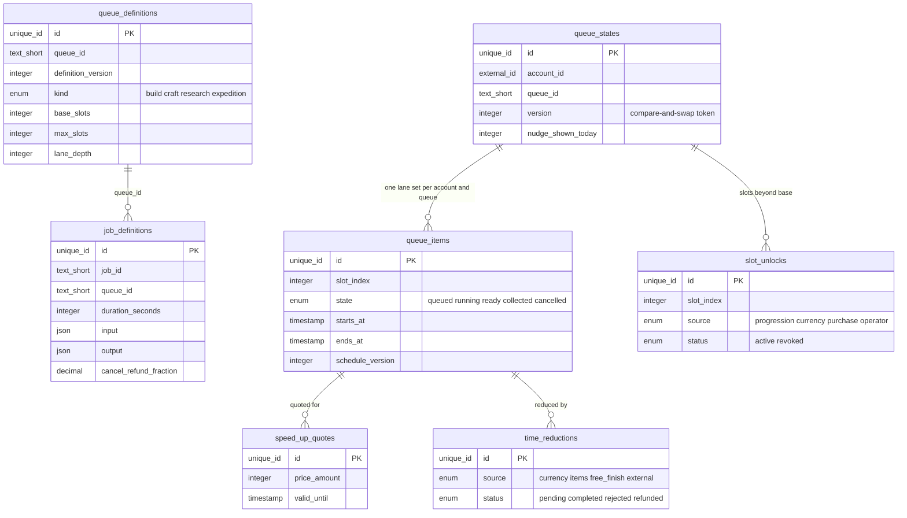
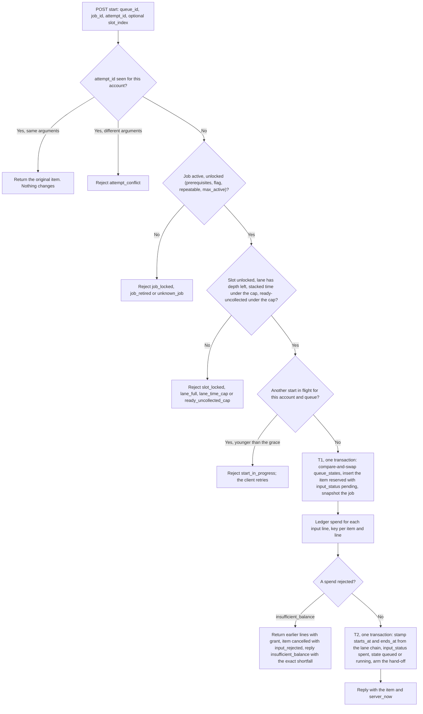
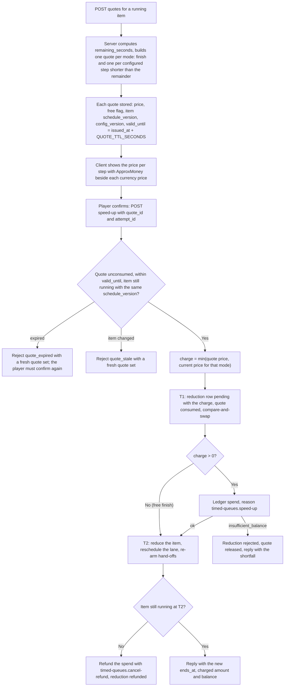
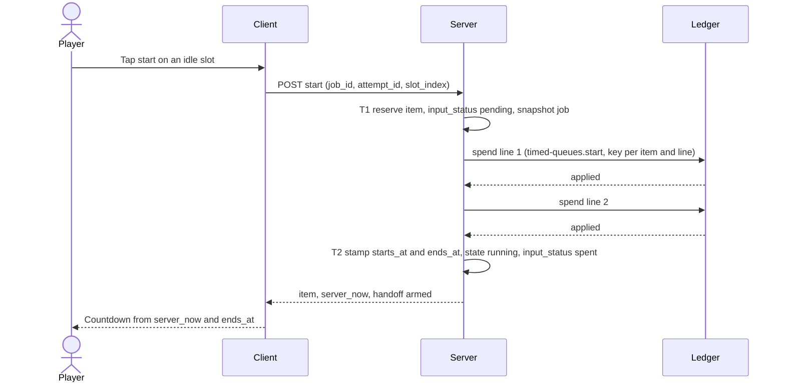
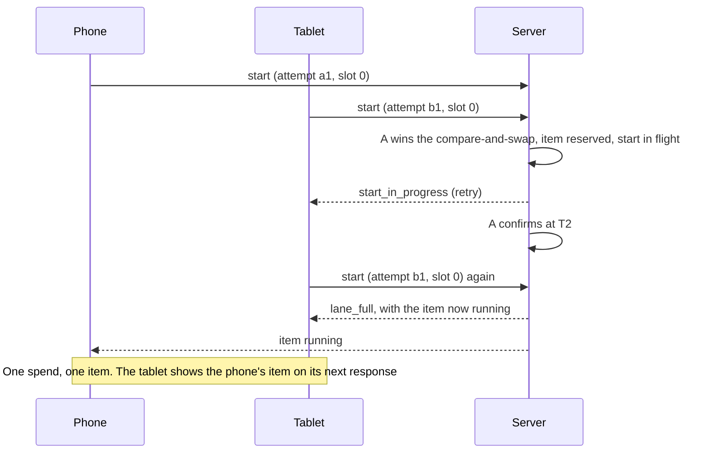
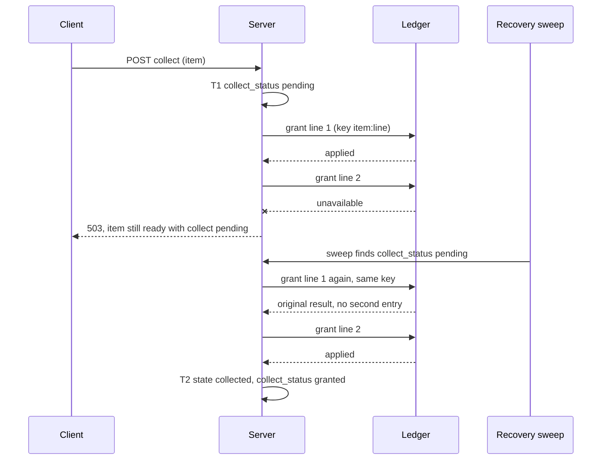
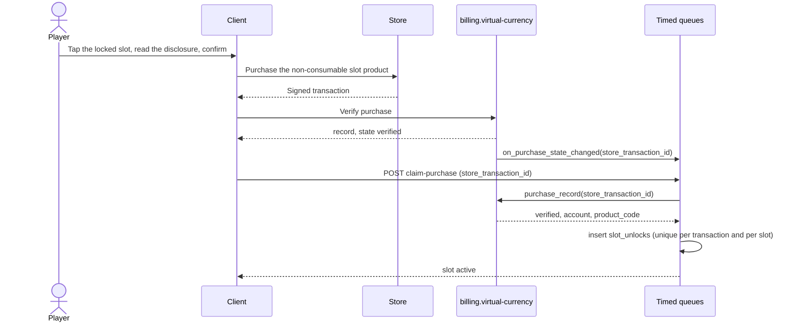
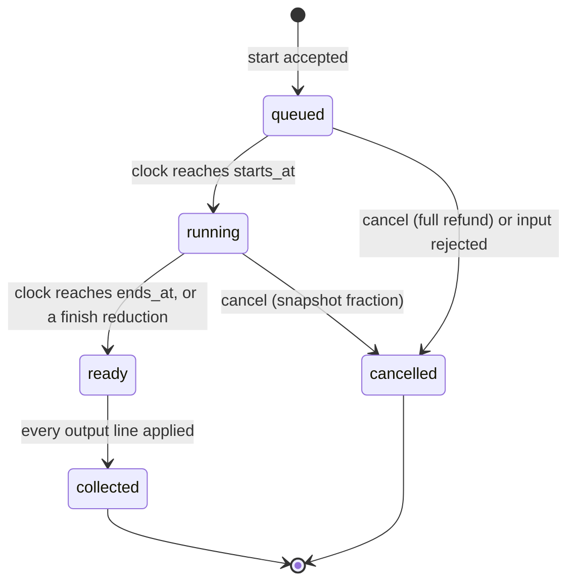

# Timed Queues (build, craft, research and expedition slots with server timers and speed-ups)

## 1. Overview

### Problem Statement

A mobile game keeps a player busy between sessions by letting the player start something that finishes later: a building upgrade, a crafted item, a research, an expedition. The player starts it, leaves, and comes back to collect. Kit guide `13-missions-and-activities.md` lists the "timed task or queue" as a mission type (a reason to return, cost: timers, speed-ups, a notice), and guide `02-return-reasons.md` (decision rule 5) names timers as the oldest pacing tool. The mechanic is easy to describe and easy to get wrong in six places, which is why it is a block:

- **Who decides that time has passed.** A device clock the player can change must not finish anything. The block follows the kit time contract: only the server clock decides, `ends_at` is an absolute instant, and the client counts down from `server_now`.
- **No timer per player.** A game with a million accounts must not run a million timers. An item is done when server time passes `ends_at`; nothing runs to make it so (lazy completion, section 3).
- **Start, collect and speed-up move resources.** Each is a ledger call (`billing.virtual-currency`) that can be retried, raced from two phones, or cut off by a crash. The block records the intent first, spends and grants with deterministic idempotency keys, and recovers half-finished work.
- **A price that the player can predict.** A speed-up sells time for premium currency. The price is a stated function of remaining time with a named rounding rule, shown before the spend as a quote with a validity window, and the amount charged never exceeds the amount quoted.
- **Config changes while items run.** Durations, costs and outputs get retuned. An item keeps the numbers the player saw at start; no edit lengthens a running item.
- **The wait is a product decision, and a dark pattern when it is the only way forward.** A 2022 heuristic evaluation lists "Pay to Skip" and "Playing by Appointment" among the dark patterns of casual mobile games ([deceptive.design](https://www.deceptive.design/articles/finding-dark-patterns-in-casual-mobile-games-using-heuristic-evaluation), MEDIUM). The block builds the ethical floor into configuration validation and invariants (see Design ethics).

The block does not own balances (`billing.virtual-currency` does), push delivery (`messaging.push-reengagement` does), missions (`engagement.objectives`) or energy and lives (`engagement.energy-lives`).

### User Stories

- **Player**: I start a craft, close the game, and the next time I open it the item is ready; I collect it once, never twice.
- **Player (away)**: my queue keeps working while I am away: the next item in the lane starts the moment the previous one ends, and my phone tells me when something finished (if I allowed notifications).
- **Player (two devices)**: I start an item on my phone; my tablet shows the same slot busy with the same countdown. If I tap start on both at once, one item starts and the other device learns why.
- **Player (impatient)**: I can skip time with a speed-up. The sheet shows the price before I pay, shows what it costs in real money, and charges me no more than it showed.
- **Player (free)**: I never have to pay. Every item finishes by waiting, every wait is listed in plain words, and a short remainder finishes for free.
- **Player (changed my mind)**: I cancel an item and the sheet told me before I started what share of the input comes back.
- **Player (idle slot)**: when a slot is empty and I can afford something, the game offers to start it, a few times a day at most, and stops offering when I dismiss it.
- **Designer**: I define queues, slots, jobs, durations, costs, outputs, the speed-up curve and the unlock rules as data and publish a new version without an app release.
- **Operator**: after a config change, running items finish on the numbers the players saw.
- **Compliance owner**: I can show the speed-up price formula, its per-hour cap, the free path, and that no premium currency is needed to start anything.

### When to use this block

- The game has things that take real time to finish and the player starts them from inside the game: building upgrades, production, research, expeditions, chest slots.
- The game wants a return reason of hours rather than days (guide `13-missions-and-activities.md`, the 4X and idle boards).
- The game has a ledger (`billing.virtual-currency`) or adopts its `grant` and `spend` contract.
- User mentions: "build queue", "builder slots", "crafting timer", "research queue", "expedition", "speed-up", "skip the wait", "production slots", "chest slots".

### When NOT to use

- A resource that refills with time (energy, lives, hearts): `engagement.energy-lives`. A queue item is a job with an output; a meter is a number that regenerates.
- Rewards that are random or odds-based. Outputs here are deterministic lines. A random output sold for money needs odds disclosure and age handling the block does not provide (guide `06-design-ethics-and-compliance.md`, rule 1; guide `11-feature-specs.md`, feature 15).
- Offline earnings of an idle game (a number that accrues per second while away). That is a rate times elapsed time, with no start, slot or collect step.
- A countdown that exists only to sell something (a timer with no job behind it). Guide 06 rule 2 test (a) fails for it.
- Shared timers between players (alliance help, shared construction). The block exposes one internal operation for a time reduction from another source (section 6), and the social layer is outside it.
- Games where a speed-up buys an advantage over other players in a contest. Most limiters can be bypassed with money, which is a fairness problem in PvP games ([research note on timers and energy](../../../research_notes/Mobile%20game%20retention%20mechanics/retention_mechanics_catalog.md), LOW: a search summary of secondary sources).

### Design ethics

Guide `06-design-ethics-and-compliance.md` rates "timers, energy, lives" as leaning on scarcity and impatience, labelled "Playing by Appointment" and "Pay to Skip" in a 2022 heuristic evaluation (MEDIUM). The CPC network of EU consumer authorities asks for the real-money price of content bought with virtual currency (principle 1) and says traders should not force players to spend more real money on currency than the selected content needs (principle 3) ([CPC Network, Key Principles on In-game Virtual Currencies, 21 March 2025](https://esportslegal.news/wp-content/uploads/2025/03/Key-principles-on-in-game-virtual-currencies.pdf), HIGH for the text; non-binding). Guide `15-manipulation-and-the-line.md` grades three nearby patterns: "friction, then paid skip" (build timers and wait gates tuned to sell) AMBER, because waiting is lawful and principle 3 targets design that forces more spend than needed; "fake or resettable urgency timers" RED; and a wait length "set by predicted spend" AMBER and rising. The floor below answers each: waits that pay out and a free finish, a countdown that never restarts, and a duration that never depends on the payer. The block's floor:

1. **A non-paying path always exists.** No job needs premium currency to start (V3); every item finishes by waiting; a remainder up to `FREE_FINISH_SECONDS` finishes for free; extra slots are capacity, not content, and base slots exist for every queue (INV-17).
2. **No wait is tuned to sell the skip.** A job's duration comes only from its definition and the player's own time-reduction items. It never depends on spend history, balance, payer status, device, or time of day (INV-18). Validation caps durations per queue kind (V2).
3. **The price per unit of time is stated and bounded.** The curve is data, its slope per hour is capped (`SPEEDUP_PRICE_PER_HOUR_CAP`, V5), the rounding rule is named (round up to whole units), and the sheet shows the price per step (INV-11, INV-13).
4. **The price shown is the price paid, or lower.** A quote carries an id and a validity window; the charge is `min(quote, current price)`; a changed price needs a new tap (INV-12).
5. **No countdown restarts or grows.** `ends_at` only moves earlier (INV-10).
6. **No obligation penalty.** An empty slot, a full queue or an uncollected item costs nothing, expires nothing and counts against nothing (INV-19).
7. **The nudge is capped.** An idle-slot suggestion appears at most `IDLE_NUDGE_PER_DAY` times a day, at most once per app open, and stops after repeated dismissals (INV-20).
8. **Real-money value is shown.** Every price in a purchasable currency is rendered with the shared `ApproxMoney` component of `billing.virtual-currency` (its README, "Real-money value"; guide `14-rewards-resources-and-items.md`, rule 4; CPC principle 1). This block computes no money figure.

The three tests of guide 06 (rule 2) apply to every default below: (a) shown exactly how it works and what it costs, would the player still choose it; (b) does it work through competence and choice rather than anxiety or shortage; (c) is the audience likely to include children. For (c), paid speed-ups are off for accounts the adopter flags `is_minor` (`PAID_SPEEDUP_FOR_MINORS`, section 7).

### Evidence behind the mechanic

- AFK Arena's bounty quests never exceed twelve hours, can only be collected when the timer reaches zero, and a designer reads that cap as keeping a quest from overlapping the day's second session ([Game Developer, 2020](https://www.gamedeveloper.com/design/flexible-time-session-design-in-afk-arena), HIGH for what the article says, MEDIUM as evidence: one analyst's reading).
- The maker of Idle Miner Tycoon says "our craftiest players can complete five expeditions in a day"; the article gives no durations or costs ([Kolibri Games](https://www.kolibrigames.com/blog/economy-in-free-to-play-mobile-games-part-2/), HIGH as the developer's statement).
- Supercell tested instant and 24-hour chests with total reward value held constant, for King Tower levels 1 to 9; the post gives no end date and calls the change temporary ([Supercell, Jan 2025](https://supercell.com/en/games/clashroyale/blog/news/chest-experiment-king-tower-levels-1-9), HIGH). Guide `02-return-reasons.md` rule 5 reads this as hard gates softening (MEDIUM, inference from two cases).
- A published reverse-engineering of one game's time-to-gems conversion reports piecewise-linear segments with anchors at one hour (20 gems), one day (260) and one week (1,000), and says "Skipping more time costs more money, but you get a better deal"; the author warns the game may have changed since 2014 ([Game Developer, April 2014](https://gamedeveloper.com/business/clash-of-clans-time-monetization-formulas-demistifyed), LOW: one game, old, community reverse-engineering). `fixtures/catalog.json` uses these anchors as an example curve, not as tuning advice.
- No source measures the retention or revenue effect of timers, queues or speed-ups; the evidence above describes what shipped games do (guide 13 Gaps; guide 02 Gaps).

### Kit feature spec (guide 11 shape)

Guide `11-feature-specs.md` has no entry for this feature. The entry in the kit's shape:

- **Timed queues** · rhythm · `engagement.timed-queues` · needs ledger, clock, purchase contract (for paid slots)
  - Rules: slots hold one item at a time and chain; durations, costs and outputs are data; a speed-up is priced from remaining time and quoted before the spend; the free path and the free short remainder always exist; no paid skip for flagged minors by default.
  - Bites: the device clock changes nothing; two devices start once and the second learns why; a start, speed-up or collect cut off by a crash completes or is compensated once; a config edit never lengthens a running item; a refunded slot purchase stops new starts in that slot and never destroys running work; a notification can fire for an item sped up on another device.
  - Events: `queue_item_started`, `queue_item_ready`, `queue_item_collected`, `queue_item_cancelled`, `queue_speedup_quoted`, `queue_speedup_applied`, `queue_slot_unlocked`, `queue_idle_nudge_shown`.

### Related blocks (referenced by id only)

| Block | Relation |
|---|---|
| `billing.virtual-currency` | Required. Every spend and grant uses its ledger contract; extra slots sold for money reuse its purchase contract (`record_verified_purchase`, `purchase_record`, `on_purchase_state_changed`) |
| `messaging.push-reengagement` | Consumes `queue_item_ready` (local lane in its reference mapping); this block never calls it |
| `engagement.objectives` | May count `queue_item_collected` through its adapter table; no direct coupling and no objective on speed-ups (section 6) |
| `engagement.energy-lives` | Independent. That block keeps energy outside the ledger, so a job input cannot be energy; a game that wants both spends energy in its own start flow before calling this block |
| `engagement.daily-streak` | Supplies the account timezone for the nudge's `day_key` (optional; UTC otherwise) |
| `engagement.event-calendar` | May schedule events that publish a new definition set (for example shortened durations for new items) |
| `data.progress-sync` | Queue state is server-owned and stays out of the client snapshot (`security.md` T-1) |
| `compliance.account-deletion` | Calls the erasure operation for the block's tables (section 6) |

---

## 2. Data Model

> Types are **logical types** (`docs/SPEC_GUIDELINES.md` section 5). Reference SQL for Postgres follows in [Reference Migration](#reference-migration-postgres). Every table carries `tenant_id` (tenant convention of `ugc.friends-leaderboard`; single-app deployments use one constant value) and keys account data by `account_id` (account contract of the kit: a guest or a signed-in account).



### Table: `queue_definitions`

Published data, versioned as a set: a publish inserts every queue and job row of the new `definition_version` in one transaction, and the active set is the highest version present. A queue is a group of parallel lanes (slots) of one kind.

| Column | Logical Type | Constraints | Notes |
|---|---|---|---|
| `id` | `unique_id` | PK | |
| `tenant_id` | `unique_id` | NOT NULL | Tenant isolation |
| `queue_id` | `text_short` | NOT NULL | Stable id, pattern `^[A-Za-z0-9._:-]{1,64}$` (the push block's route parameter rule); also the `queue_code` in the hand-off event |
| `definition_version` | `integer` | NOT NULL | The set version this row belongs to; UNIQUE with (`tenant_id`, `queue_id`) |
| `kind` | `enum` | NOT NULL | values: `build|craft|research|expedition`. Informational: copy, grouping, hand-off params. All four kinds share one mechanism |
| `base_slots` | `integer` | NOT NULL, `>= 1` | Lanes available to every account from the start (V1) |
| `max_slots` | `integer` | NOT NULL, `>= base_slots`, `<= SLOTS_HARD_MAX` | Lanes an account can reach |
| `lane_depth` | `integer` | NOT NULL, `>= 1` | Most items (queued plus running) one lane holds; 1 means no waiting item |
| `slot_unlocks` | `json` | NOT NULL | `[{ slot_index, options: [{ kind: flag\|currency\|store_product, flag?, currency?, amount?, product_code? }] }]` for every `slot_index` from `base_slots` to `max_slots - 1`; the player satisfies any one option |
| `sort_order` | `integer` | NOT NULL, default 0 | Panel order |
| `published_at` | `timestamp` | NOT NULL | UTC instant |

**Indexes**: UNIQUE (`tenant_id`, `queue_id`, `definition_version`).

### Table: `job_definitions`

What an item is made from. Items copy these values at start (section 3, snapshot).

| Column | Logical Type | Constraints | Notes |
|---|---|---|---|
| `id` | `unique_id` | PK | |
| `tenant_id` | `unique_id` | NOT NULL | |
| `job_id` | `text_short` | NOT NULL | Stable id; UNIQUE with (`tenant_id`, `definition_version`) |
| `definition_version` | `integer` | NOT NULL | |
| `queue_id` | `text_short` | NOT NULL | The queue the job runs in |
| `duration_seconds` | `integer` | NOT NULL, `>= 1` | Wall-clock run time; at most the cap of its queue kind (V2) |
| `input` | `json` | NOT NULL, default empty list | `[{ currency, amount }]`, at most `INPUT_LINES_MAX` lines; `currency` is a ledger currency or item code, never a premium currency (V3) |
| `output` | `json` | NOT NULL | `[{ kind: currency\|item\|effect, code, amount }]`, at most `OUTPUT_LINES_MAX` lines. `currency` and `item` lines are ledger grants; an `effect` line (for example a building level) is applied by the host hook (section 6) |
| `prerequisite_job_ids` | `id_list` | NOT NULL, default empty | Jobs the account must have collected at least once; list of text ids; max ~20 |
| `unlock_flag` | `text_short` | nullable | A host-defined flag the job additionally requires (section 6, hook `unlock_flag`) |
| `repeatable` | `boolean` | NOT NULL, default true | false: at most one non-cancelled item per account ever (a research) |
| `max_active_per_account` | `integer` | nullable | Most queued and running items of this job at once; null means no limit |
| `cancel_refund_fraction` | `decimal` | NOT NULL, default 0.5 | precision/scale: (3,2), range 0.00 to 1.00. Share of each input line returned when a running item is cancelled; shown before start (section 3) |
| `retired` | `boolean` | NOT NULL, default false | true: no new items; existing items finish and collect |
| `sort_order` | `integer` | NOT NULL, default 0 | |
| `published_at` | `timestamp` | NOT NULL | |

**Indexes**: UNIQUE (`tenant_id`, `job_id`, `definition_version`); (`tenant_id`, `queue_id`, `definition_version`).

### Table: `queue_states`

One row per account and queue. It is the compare-and-swap anchor: every write to the account's items in that queue bumps `version` in the same transaction, which is what makes starts race-safe across devices.

| Column | Logical Type | Constraints | Notes |
|---|---|---|---|
| `id` | `unique_id` | PK | |
| `tenant_id` | `unique_id` | NOT NULL | |
| `account_id` | `external_id` | NOT NULL | From the verified session, never from a request body. No foreign key: erasure deletes explicitly |
| `queue_id` | `text_short` | NOT NULL | UNIQUE with (`tenant_id`, `account_id`) |
| `version` | `integer` | NOT NULL, default 1 | Compare-and-swap token, `+1` on every write |
| `start_in_flight_item_id` | `unique_id` | nullable | The reserved item of a start that has not yet confirmed its spend; at most one per account and queue |
| `start_in_flight_since` | `timestamp` | nullable | Set with the item id; a value older than `RECOVERY_GRACE_SECONDS` is stale and recovery may finish it |
| `last_collected_job_id` | `text_short` | nullable | The job of the account's most recent collect in this queue; feeds "start again" |
| `nudge_day_key` | `text_short` | nullable | Local date `YYYY-MM-DD` the nudge counters below belong to |
| `nudge_shown_today` | `integer` | NOT NULL, default 0 | Idle-slot nudges shown on `nudge_day_key` |
| `nudge_last_shown_at` | `timestamp` | nullable | |
| `nudge_dismissals_in_row` | `integer` | NOT NULL, default 0 | Reset to 0 when the player acts on a nudge |
| `nudge_suppressed_until` | `timestamp` | nullable | Set after `IDLE_NUDGE_DISMISS_LIMIT` dismissals in a row |
| `created_at` | `timestamp` | NOT NULL, default = now | UTC instant |
| `updated_at` | `timestamp` | NOT NULL | UTC instant, set by the server |

**Indexes**: UNIQUE (`tenant_id`, `account_id`, `queue_id`).

### Table: `queue_items`

One row per started item. All numbers the player was shown are copied here at start.

| Column | Logical Type | Constraints | Notes |
|---|---|---|---|
| `id` | `unique_id` | PK | Server-generated at reservation; used as `source_ref` in ledger calls |
| `tenant_id` | `unique_id` | NOT NULL | |
| `account_id` | `external_id` | NOT NULL | |
| `queue_id` | `text_short` | NOT NULL | |
| `slot_index` | `integer` | NOT NULL, `>= 0` | The lane (0-based) |
| `lane_seq` | `integer` | NOT NULL | Increases per (account, queue, lane); the chain order inside a lane |
| `job_id` | `text_short` | NOT NULL | |
| `definition_version` | `integer` | NOT NULL | The version in force at start |
| `attempt_id` | `text_short` | NOT NULL | Client-generated opaque id; UNIQUE with (`tenant_id`, `account_id`) |
| `state` | `enum` | NOT NULL | values: `queued|running|ready|collected|cancelled`. The stored value can lag the clock; the effective state is a pure function of the row and `server_now` (section 3) |
| `input_status` | `enum` | NOT NULL | values: `none|pending|spent|failed|refund_pending|refunded`. `none` when the job has no input; `refund_pending` and `refunded` track a cancel refund (recorded first, applied after) |
| `collect_status` | `enum` | NOT NULL, default `none` | values: `none|pending|granted|blocked_cap`. `blocked_cap`: the ledger refused a grant for `balance_limit_exceeded` and the item stays `ready` |
| `cancel_reason` | `enum` | nullable | values: `player|input_rejected|operator` |
| `duration_seconds` | `integer` | NOT NULL | Snapshot of the job's duration at start |
| `reduced_seconds` | `integer` | NOT NULL, default 0 | Time removed by speed-ups and reductions; `ends_at` never moves later |
| `input_snapshot` | `json` | NOT NULL | The input lines spent |
| `output_snapshot` | `json` | NOT NULL | The output lines this item pays on collect |
| `cancel_refund_fraction` | `decimal` | NOT NULL | precision/scale: (3,2). Snapshot of the fraction disclosed at start |
| `starts_at` | `timestamp` | nullable | Null while the input spend is pending; the chain start of a queued item |
| `ends_at` | `timestamp` | nullable | `starts_at + duration_seconds - reduced_seconds`; null while pending |
| `schedule_version` | `integer` | NOT NULL, default 0 | `+1` whenever `starts_at` or `ends_at` changes; a quote names the value it was issued for |
| `notice_revision` | `integer` | NOT NULL, default 0 | `+1` whenever the hand-off event for this item is re-armed |
| `sped_up` | `boolean` | NOT NULL, default false | true after any reduction; carried by `queue_item_collected` |
| `refund_lines` | `json` | nullable | Ledger lines returned by a cancel or a failed start |
| `reserved_at` | `timestamp` | NOT NULL | Server time of the reservation |
| `collected_at` | `timestamp` | nullable | |
| `cancelled_at` | `timestamp` | nullable | |
| `created_at` | `timestamp` | NOT NULL, default = now | |
| `updated_at` | `timestamp` | NOT NULL | |

**Indexes**: UNIQUE (`tenant_id`, `account_id`, `attempt_id`); (`tenant_id`, `account_id`, `queue_id`, `state`); partial (`tenant_id`, `reserved_at`) where `input_status` is `pending` or `refund_pending`; partial (`tenant_id`, `updated_at`) where `collect_status = pending`.

### Table: `slot_unlocks`

A row exists only for a slot above the queue's `base_slots`. Base slots are implicit.

| Column | Logical Type | Constraints | Notes |
|---|---|---|---|
| `id` | `unique_id` | PK | Used as `source_ref` for a currency unlock |
| `tenant_id` | `unique_id` | NOT NULL | |
| `account_id` | `external_id` | NOT NULL | |
| `queue_id` | `text_short` | NOT NULL | |
| `slot_index` | `integer` | NOT NULL | UNIQUE with (`tenant_id`, `account_id`, `queue_id`): one row per slot, the race guard |
| `source` | `enum` | NOT NULL | values: `progression|currency|purchase|operator` |
| `source_ref` | `text_short` | nullable | The flag name, the ledger `entry_id`, or the product code |
| `store_transaction_id` | `external_id` | nullable | Set for `source = purchase`; UNIQUE per tenant, so one store transaction unlocks one slot |
| `status` | `enum` | NOT NULL | values: `active|revoked`. Revoked after a store refund; reversed refunds return it to `active` |
| `unlocked_at` | `timestamp` | NOT NULL | |
| `revoked_at` | `timestamp` | nullable | |
| `created_at` | `timestamp` | NOT NULL, default = now | |
| `updated_at` | `timestamp` | NOT NULL | |

### Table: `speed_up_quotes`

| Column | Logical Type | Constraints | Notes |
|---|---|---|---|
| `id` | `unique_id` | PK | The `quote_id` the client sends back |
| `tenant_id` | `unique_id` | NOT NULL | |
| `account_id` | `external_id` | NOT NULL | The quote is valid only for this account |
| `item_id` | `unique_id` | NOT NULL | |
| `mode` | `enum` | NOT NULL | values: `finish|step` |
| `step_seconds` | `integer` | nullable | Set for `mode = step` |
| `remaining_seconds` | `integer` | NOT NULL | Remaining time at issue, whole seconds rounded up |
| `price_currency` | `text_short` | nullable | Null when the quote is free |
| `price_amount` | `integer` | NOT NULL, `>= 0` | The most the spend can charge; 0 when free |
| `free` | `boolean` | NOT NULL | true when `remaining_seconds <= FREE_FINISH_SECONDS` for `finish` |
| `config_version` | `text_short` | NOT NULL | The speed-up config version in force |
| `item_schedule_version` | `integer` | NOT NULL | The item's `schedule_version` at issue |
| `issued_at` | `timestamp` | NOT NULL | |
| `valid_until` | `timestamp` | NOT NULL | `issued_at + QUOTE_TTL_SECONDS` |
| `consumed_at` | `timestamp` | nullable | Set when a spend takes the quote |

**Indexes**: (`tenant_id`, `account_id`, `item_id`, `issued_at`).

### Table: `time_reductions`

Every shortening of a running item, whatever pays for it. The record is written before the ledger call.

| Column | Logical Type | Constraints | Notes |
|---|---|---|---|
| `id` | `unique_id` | PK | Used as `source_ref` in ledger calls |
| `tenant_id` | `unique_id` | NOT NULL | |
| `account_id` | `external_id` | NOT NULL | |
| `item_id` | `unique_id` | NOT NULL | |
| `attempt_id` | `text_short` | NOT NULL | Client-generated; UNIQUE with (`tenant_id`, `account_id`). For `source = external` the caller's idempotency key |
| `source` | `enum` | NOT NULL | values: `currency|items|free_finish|external` |
| `quote_id` | `unique_id` | nullable | The quote a currency spend took |
| `seconds_applied` | `integer` | nullable | Set when completed |
| `cost_currency` | `text_short` | nullable | Currency or time-item code charged |
| `cost_amount` | `integer` | nullable | Amount actually charged; never above `quoted_amount` |
| `quoted_amount` | `integer` | nullable | The quote's `price_amount`, or the requested maximum item count |
| `status` | `enum` | NOT NULL | values: `pending|completed|rejected|refunded` |
| `reject_reason` | `text_short` | nullable | For example `insufficient_balance`, `item_not_running` |
| `created_at` | `timestamp` | NOT NULL | |
| `completed_at` | `timestamp` | nullable | |

**Indexes**: UNIQUE (`tenant_id`, `account_id`, `attempt_id`); partial (`tenant_id`, `created_at`) where `status = pending`.

### Table: `merge_log`

| Column | Logical Type | Constraints | Notes |
|---|---|---|---|
| `id` | `unique_id` | PK | |
| `tenant_id` | `unique_id` | NOT NULL | |
| `merge_id` | `text_short` | NOT NULL | The caller's id; UNIQUE per tenant. A repeat of the call returns `result` |
| `from_account_id` | `external_id` | NOT NULL | |
| `into_account_id` | `external_id` | NOT NULL | |
| `result` | `json` | NOT NULL | `{ kept_item_ids, cancelled: [{ item_id, refund_lines }], slots_carried, unplaced_purchases }` |
| `created_at` | `timestamp` | NOT NULL | |

**Account deletion**: `queue_states`, `queue_items`, `slot_unlocks`, `speed_up_quotes`, `time_reductions` and `merge_log` hold `account_id` as an external id with no foreign key; `compliance.account-deletion` must delete the account's rows in each (section 6). The definition tables hold no account data.

### Derived values (L1, pure functions)

They take a row (or rows), `server_now` and a config; they read no clock and write nothing. The server, the tests and the fixtures share them.

- **`effective_state(item, now)`**: `collected` and `cancelled` return themselves. A row with null `starts_at` is `queued` (reserved, spend pending). Otherwise `now < starts_at` is `queued`, `now < ends_at` is `running`, and anything later is `ready`. The stored `state` is advanced to this value by any write that touches the lane and is never trusted when it disagrees with the clock.
- **`remaining_seconds(item, now)`**: `ceil((ends_at - now) / 1 second)` for a running item, 0 otherwise. Whole seconds, rounded up.
- **`price(r)`**: the speed-up price for `r` remaining seconds, defined in section 3 and `backend.md` ("Price function").
- **`reschedule(lane_items, now)`**: returns new `starts_at` and `ends_at` for the queued items of one lane after a predecessor changed, using the rule `new_starts_at = min(old_starts_at, predecessor_ends_at)` (the first item in a lane uses `now` as the predecessor end). It can only move times earlier.
- **`refund_lines(item, now)`**: for each input line, `floor(amount * fraction)` where `fraction` is 1 for a queued item and the item's snapshot `cancel_refund_fraction` for a running item.
- **`idle_lanes(queue, unlocked_slots, items, now)`**: unlocked lanes whose count of queued and running items is 0.
- **`nudge_eligible(state, idle, affordable, now, day_key, config)`**: true only when an idle lane exists, an unlocked job is affordable, the day cap, the gap, the suppression and the per-open cap all allow it.

### Reference Migration (Postgres)

#### `queue_states` table

<!-- REFERENCE: dialect=postgres -->
<!-- ADAPT: `uuid ... gen_random_uuid()` -> MySQL `BINARY(16)` with UUID_TO_BIN(UUID()), SQLite `TEXT` with a uuid4 generated in the app; `timestamptz` -> MySQL `DATETIME(6)`, SQLite `TEXT` ISO 8601 with `Z`; `varchar(64)` -> SQLite `TEXT`; `bigint` -> SQLite `INTEGER`; the composite UNIQUE works unchanged on all three dialects -->
```sql
CREATE TABLE IF NOT EXISTS queue_states (
  id uuid PRIMARY KEY DEFAULT gen_random_uuid(), tenant_id uuid NOT NULL,
  account_id text NOT NULL, queue_id varchar(64) NOT NULL,
  version bigint NOT NULL DEFAULT 1,
  start_in_flight_item_id uuid, start_in_flight_since timestamptz,
  last_collected_job_id varchar(64), nudge_day_key varchar(10),
  nudge_shown_today bigint NOT NULL DEFAULT 0, nudge_last_shown_at timestamptz,
  nudge_dismissals_in_row bigint NOT NULL DEFAULT 0, nudge_suppressed_until timestamptz,
  created_at timestamptz NOT NULL DEFAULT now(), updated_at timestamptz NOT NULL DEFAULT now(),
  UNIQUE (tenant_id, account_id, queue_id)
);
```

#### `queue_items` table

<!-- REFERENCE: dialect=postgres -->
<!-- ADAPT: same type mapping as `queue_states`; `jsonb` -> MySQL `JSON`, SQLite `TEXT` (JSON string); `numeric(3,2)` -> MySQL `DECIMAL(3,2)`, SQLite `NUMERIC`; `boolean` -> MySQL `TINYINT(1)`, SQLite `INTEGER 0/1`; the CHECK lists work unchanged on all three dialects; the partial indexes (`WHERE`) work on Postgres and SQLite, on MySQL index the columns without the predicate and filter in the query -->
```sql
CREATE TABLE IF NOT EXISTS queue_items (
  id uuid PRIMARY KEY DEFAULT gen_random_uuid(), tenant_id uuid NOT NULL,
  account_id text NOT NULL, queue_id varchar(64) NOT NULL,
  slot_index bigint NOT NULL CHECK (slot_index >= 0), lane_seq bigint NOT NULL,
  job_id varchar(64) NOT NULL, definition_version bigint NOT NULL,
  attempt_id varchar(64) NOT NULL,
  state text NOT NULL CHECK (state IN ('queued','running','ready','collected','cancelled')),
  input_status text NOT NULL CHECK (input_status IN ('none','pending','spent','failed','refund_pending','refunded')),
  collect_status text NOT NULL DEFAULT 'none' CHECK (collect_status IN ('none','pending','granted','blocked_cap')),
  cancel_reason text CHECK (cancel_reason IN ('player','input_rejected','operator')),
  duration_seconds bigint NOT NULL CHECK (duration_seconds >= 1),
  reduced_seconds bigint NOT NULL DEFAULT 0, input_snapshot jsonb NOT NULL,
  output_snapshot jsonb NOT NULL, cancel_refund_fraction numeric(3,2) NOT NULL,
  starts_at timestamptz, ends_at timestamptz,
  schedule_version bigint NOT NULL DEFAULT 0, notice_revision bigint NOT NULL DEFAULT 0,
  sped_up boolean NOT NULL DEFAULT false, refund_lines jsonb,
  reserved_at timestamptz NOT NULL, collected_at timestamptz, cancelled_at timestamptz,
  created_at timestamptz NOT NULL DEFAULT now(), updated_at timestamptz NOT NULL DEFAULT now(),
  UNIQUE (tenant_id, account_id, attempt_id)
);
```

<!-- REFERENCE: dialect=postgres -->
<!-- ADAPT: partial indexes work on Postgres and SQLite; on MySQL create plain composite indexes on the same columns and filter by status in the query -->
```sql
CREATE INDEX IF NOT EXISTS queue_items_lane ON queue_items (tenant_id, account_id, queue_id, state);
CREATE INDEX IF NOT EXISTS queue_items_pending_spend ON queue_items (tenant_id, reserved_at) WHERE input_status IN ('pending','refund_pending');
CREATE INDEX IF NOT EXISTS queue_items_pending_collect ON queue_items (tenant_id, updated_at) WHERE collect_status = 'pending';
```

The definition, `slot_unlocks`, `speed_up_quotes` and `time_reductions` tables follow the column lists above one to one; `backend.md` ("Reference Migration, remaining tables") gives them.

---

## 3. Data Flow

### Lazy completion (L1)

No process runs when an item finishes. The row stores `starts_at` and `ends_at`, absolute server instants fixed when the item is confirmed. An item is `ready` when `server_now >= ends_at`, a fact any reader derives with `effective_state`. Consequences:

- A read never writes. A write that touches a lane first settles it (advances stored `state` to the effective state) in the same transaction.
- The only scheduled work is recovery of half-finished requests (`RECOVERY_SWEEP_SECONDS`), which handles rows stuck in a `pending` status. Nothing scans items to complete them.
- The client shows a countdown from the response's `server_now` and the item's `ends_at` and corrects the offset on every response. When the countdown reaches zero it asks the server; it never decides that an item is ready (INV-1).
- Items finish while the app is closed. The player learns by a notification (section 3, Hand-off) or on the next open.

### Start (L1)



Rules:

- **Pre-check, then reserve, then spend.** The server first reads the balance of every input line and rejects with `insufficient_balance` and the exact shortfall before reserving anything. A balance that changed after the check is handled by the undo path below.
- **Reserve, then spend.** The row exists before any ledger call, so a crash after the spend leaves a record recovery can finish, never an orphaned spend (INV-5). A row with `input_status = pending` older than `RECOVERY_GRACE_SECONDS` is finished by the recovery sweep: it repeats the spends with the same keys and either confirms (T2) or cancels it.
- **Times are stamped at T2.** A reserved item has no `starts_at` and no countdown. The player is never credited time for the milliseconds or minutes the spend took.
- **One start in flight per account and queue.** Two phones tapping at once: one wins the compare-and-swap; the other receives `start_in_progress` (retry), or `lane_full` / `slot_locked` after the winner commits. Neither case charges twice.
- **Lane choice.** With `slot_index` omitted the server picks the unlocked lane with depth left whose last item ends earliest (lowest index on a tie). A given `slot_index` is used or refused, never replaced silently.
- **Stacked time.** The sum of remaining durations of a lane's queued and running items plus the new duration may not exceed `MAX_LANE_SECONDS`.
- **Disclosure.** The start sheet shows cost, duration, the output, the cancel refund fraction as a percentage, and the lane's queue position (`frontend.md`). The values it shows are the values the item snapshots.

### Lane chain and rescheduling (L1)

Items in one lane run one after another in `lane_seq` order. A queued item's `starts_at` equals its predecessor's `ends_at`, so the chain keeps running while the player is away. A finished item does not hold the lane: its slot is free for the next item the moment `ends_at` passes, and the output waits in `ready` until the player collects it (INV-19).

`reschedule` runs inside any write that changes a predecessor (a speed-up, a cancel, an operator rebase). For each queued item in order, `new_starts_at = min(old_starts_at, predecessor_ends_at)`, with `now` as the predecessor end for the first item; `ends_at = starts_at + duration_seconds - reduced_seconds`. The `min` rule means no time ever moves later (INV-10). Every item whose `ends_at` changed gets `schedule_version + 1` and `notice_revision + 1`.

A new item appended to a lane takes `starts_at = max(server_now, ends_at of the lane's last queued or running item)`.

### Collect and collect-all (L1)

- **Collect one item.** Only an effective `ready` item can be collected. T1 sets `collect_status = pending` (the output lines are already in `output_snapshot`). Each `currency` and `item` line is a ledger `grant` with reason `timed-queues.collect` and the key `timed-queues:{account_id}:{item_id}:collect:{line_no}` (`line_no` is the 1-based position in the snapshot). `effect` lines call the host hook once with `item_id` as the idempotency key. When every line is applied, T2 sets `state = collected`, `collect_status = granted`, `collected_at`, updates `last_collected_job_id`, and emits `queue_item_collected` and the `resolved` hand-off (INV-7).
- **Replay.** Collecting a `collected` item returns the original result with `already_collected = true` and changes nothing. Collecting a running item returns `not_ready` with its `ends_at`.
- **A refused grant never destroys output.** If the ledger answers `balance_limit_exceeded` for a line, the item stays `ready` with `collect_status = blocked_cap`, the reply names the currency and the room needed, and a later collect resumes at the first line not yet applied (INV-8).
- **Collect-all.** Takes every effective `ready` item of the account (optionally one `queue_id`), in `ends_at` order, at most `COLLECT_ALL_MAX` per request. Each item is its own unit; the reply lists a result per item (`collected`, `already_collected`, `blocked_cap`, `error`) and `more = true` when the cap cut the list. One item's failure never rolls back another.

### Speed-up (L1)

A speed-up shortens a running item. It never applies to a queued item (`item_not_running`), so the player cannot buy the whole chain at once and every purchase has a visible, single target.

**Price function.** `price(r)` for `r` remaining whole seconds:

1. `r = 0`: nothing to skip (`nothing_to_skip`).
2. `finish` with `r <= FREE_FINISH_SECONDS`: 0 (free finish).
3. Otherwise `units(r)` by linear interpolation through the points `(0, 0)` and `SPEEDUP_CURVE` (a list of `(seconds, units)` anchors), computed as an exact rational, and `price(r) = ceil(units(r))`. The rounding rule is **round up to a whole unit of the spending currency** (a remainder of any size above the free threshold costs at least 1 unit; the player pays less than one unit above the curve at most).
4. A **step** of `s` seconds costs `price_raw(r) - price_raw(max(0, r - s))`, where `price_raw` is rule 3 without the free threshold. Steps telescope: paying steps never costs more in total than finishing at the start (INV-13).
5. The curve is validated at publish time: anchors strictly increasing in seconds, non-decreasing in units, every segment's slope at most `SPEEDUP_PRICE_PER_HOUR_CAP` units per hour, and the last anchor at least the longest job duration (V5). From these, `price(r) < r / 3600 * SPEEDUP_PRICE_PER_HOUR_CAP + 1` holds for every `r`.
6. No input other than `r` and the published curve enters the price: no balance, spend history, payer status, session count or time of day (INV-11).

`fixtures/price-vectors.json` holds the vectors (example curve: one hour 20 units, one day 260, one week 1,000).

**Quote, then spend.**



- The charge is `min(quote, current price)`. Remaining time only shrinks, so the current price is at most the quoted price and a later spend within the window is never dearer than the sheet showed (INV-12). The reply carries both `quoted` and `charged`.
- An expired or stale quote never charges. The reply carries a fresh quote set; the client shows the new price and waits for another confirmation. A silent refresh is allowed only when no amount went up.
- `attempt_id` makes the spend idempotent: a replay returns the original reduction. The ledger key is `timed-queues:{account_id}:{reduction_id}:speed-up`.
- **Time-reduction items** (owned items such as `speedup_1h`) are a second route with no quote: the request names `item_code` and `max_count`; the server consumes `used = min(max_count, ceil(remaining / item_seconds))` through the ledger with the same reason and never more than `max_count`.
- **Free finish.** A `finish` quote at `r <= FREE_FINISH_SECONDS` is free: no ledger call, a `time_reductions` row with `source = free_finish`, the item becomes `ready` now.
- **External reductions.** Another block (an alliance help, an event reward) may call `reduce_remaining` (section 6); it takes no price and follows the same lane rules.

### Cancel and refund (L1)

- A `queued` item can be cancelled for a full refund of every input line (nothing has run). A `running` item is refunded `floor(amount * cancel_refund_fraction)` per input line, using the fraction snapshotted at start; the start sheet states it as a percentage before the player confirms (INV-16).
- The refund is a ledger `grant` with reason `timed-queues.cancel-refund`, key `timed-queues:{account_id}:{item_id}:refund:{line_no}`, recorded first (`input_status = refund_pending`, lines stored in `refund_lines`) and applied after; recovery finishes a refund whose request died.
- A `ready` item cannot be cancelled: its work is done and the output is the player's. Speed-ups already paid on a cancelled item are not returned; the cancel sheet says so before the confirm when the item was sped up.
- After a cancel the lane is rescheduled: queued followers move earlier, never later.

### Changing definitions while items run (L1)

| Change | What happens |
|---|---|
| Any edit to a job (duration, input, output, refund fraction) | Published as a new `definition_version`. New starts use it. Items already started keep the snapshot they took at start: their `duration_seconds`, `input_snapshot`, `output_snapshot` and `cancel_refund_fraction` (INV-9) |
| A longer duration | Applies to new items only. No running item is extended (INV-10) |
| A shorter duration | Applies to new items. Queued and running items keep their snapshot unless an operator runs `rebase_shorter(job_id, definition_version, reason)`, which sets each queued and running item of the job to `duration_seconds = min(duration_seconds, new_duration)`, recomputes `ends_at` (never later than before), reschedules the lanes, and re-arms hand-offs. It can only shorten, it is idempotent, and it is logged with the operator's reason |
| A higher or lower input cost | Already spent; a cancel refunds from the snapshot, so a price change creates no refund arbitrage and no loss |
| A retired job | No new items; running and ready items finish and collect |
| A changed output | Items already started pay their snapshot |
| A new speed-up curve | New quotes only. An open quote keeps its price until `valid_until`, because the charge is `min(quote, current)` |
| Lower `max_slots`, `base_slots` or `lane_depth` | Slots an account already unlocked stay (earned stays earned, INV-21); items already in lanes stay. The new values bound new unlocks and new starts |

A published set that fails validation (section 7) leaves the previous set active.

### Extra slots (L1)

An account's lanes are `base_slots` plus its `active` `slot_unlocks` rows, up to `max_slots`. Slots unlock in index order (`slot_out_of_order` otherwise), so the panel always has one next locked slot to show. A locked slot lists its unlock options from the queue definition; satisfying any one unlocks it:

- **Progression (`flag`).** The host defines a named flag (for example a level or a tutorial step) and answers `unlock_flag(account_id, flag)`. The server evaluates it on read; the first time it is true, the server writes the `slot_unlocks` row (`source = progression`). An earned slot never relocks, even if the flag later turns false (INV-21).
- **Currency.** A one-time `spend` of the option's currency and amount with reason `timed-queues.slot-unlock` and key `timed-queues:{account_id}:slot:{queue_id}:{slot_index}`; the row's unique (account, queue, slot) makes a second device or retry return the first result.
- **Money (`store_product`).** The product is a non-consumable store product recorded in the catalog of `billing.virtual-currency` with `fulfilment = external` and `owner_block = engagement.timed-queues`. The player buys it through the store sheet; `billing.virtual-currency` verifies it and records it once per `store_transaction_id`. This block then reads `purchase_record(store_transaction_id)`, accepts it only when `state = verified`, `account_id` equals the session's account and `product_code` matches an option of a still-locked slot, and writes the row with `source = purchase` and the `store_transaction_id` (unique per tenant). It runs on `on_purchase_state_changed` and on the client's `claim-purchase` call, whichever arrives first; the second is a replay. Apple requires "a restore mechanism for any restorable in-app purchases" ([Apple App Review Guidelines 3.1.1](https://developer.apple.com/app-store/review/guidelines/), HIGH, read 2026-10-27), and a restored purchase reaches this block as the same verified record, so the player's slot returns without a second charge.
- **Store refund.** When the record becomes `refunded`, the row's `status` becomes `revoked`. A revoked slot accepts no new item; items already in it finish and collect (the player's work is never destroyed). A reversed refund returns the row to `active`.

### Idle-slot nudge (L1)

The design rule: the player is never left with an empty queue and nothing to do. The block gives that rule two parts and a ceiling.

- **A next step is always at hand.** After a collect, the response carries `suggestions`: the account's `last_collected_job_id` as "start again" when it is affordable and unlocked, then up to two other affordable, unlocked jobs of the queue by `sort_order`. When nothing is affordable the response names the missing input and where it comes from (the faucets registered in the ledger), so the player is not left at a dead end (V4 keeps such a path real).
- **A nudge when a slot is idle.** `nudge_eligible` is true only when all of these hold, checked in this order (the first failure is the reported reason): the nudge is enabled; an unlocked lane is idle (`no_idle_slot`); an unlocked job is affordable (`nothing_affordable`); `nudge_suppressed_until` has passed (`suppressed`); fewer than `IDLE_NUDGE_PER_OPEN` were shown in this app open (`per_open`); fewer than `IDLE_NUDGE_PER_DAY` were shown on the account's `day_key` (`per_day`); and at least `IDLE_NUDGE_MIN_GAP_SECONDS` passed since the last (`gap`). `GET /api/queues` returns `idle_nudge: { eligible, slot_index, job_id }`; the client reports `shown`, `dismissed` or `acted` to `POST /api/queues/nudge`, and the server owns the counters, so the cap holds across devices.
- **The ceiling.** After `IDLE_NUDGE_DISMISS_LIMIT` dismissals in a row the nudge is suppressed for `IDLE_NUDGE_SUPPRESS_DAYS`; acting on a nudge resets the run. The nudge is an inline, dismissible card in the queue panel: never a modal, never a push by default, never a timer, never a red badge (INV-20).

### Hand-off: offline completion (L1)

`queue_item_ready` is the hand-off event for `messaging.push-reengagement`. The push block's reference mapping puts it in the local lane (`EVENT_ROUTES` entry: category `timers`, route `queue`, parameter `queue_code`), where the device schedules a local notification at `fire_at` from state it already holds. This block's part:

| Field | Value |
|---|---|
| `event_name` | `queue_item_ready` |
| `subject_key` | `queue-item:{item_id}`, stable for one item |
| `state` | `armed` or `resolved` |
| `ends_at` | the item's `ends_at` (absolute) |
| `fire_at` | equal to `ends_at` |
| `expires_at` | `ends_at + READY_NOTICE_TTL_SECONDS` |
| `revision` | the item's `notice_revision` |
| `params` | flat: `queue_code` (the `queue_id`), `queue_kind`, `job_id`, `slot_index` |

`armed` is produced when an item gets its `ends_at` (T2 of a start) and again, with the same `subject_key`, a larger `revision` and the new `fire_at`, whenever `ends_at` moves earlier (a speed-up, a chain shift, a rebase); the consumer upserts by (account, event, `subject_key`). `resolved` is produced when the item is collected, cancelled, or finished by a reduction while the player is in the app (the notice is moot). Every response that changes items carries `handoff[]` with the affected events, and `GET /api/queues` lists the current `armed` set, so a device that was offline or restarted can rebuild its local schedule. A deployment that routes the event through the remote lane gets the same events from the server through a transactional outbox, at least once.

Constraints: at most `LOCAL_MAX_PENDING` of the push block (20 by default) local notifications exist, so validation V6 caps the sum of `max_slots * lane_depth` over all queues. A notification can fire for an item sped up or cancelled on another device while this one was closed; the push block cancels local notifications on session start and reconciles with the server list. The copy stays generic ("a timer has finished") so a stale notice does no harm.

### Clock manipulation (L1)

The device clock is advisory. The server computes `starts_at`, `ends_at`, `server_now` and every effective state; the client sends no time, no day and no duration, and a request carrying one is rejected (`unexpected_field`). The client's countdown is `ends_at - (device_now + offset)` with `offset = server_now - device_now_at_response`; a device clock change moves the countdown until the next response corrects it, and never makes an item collectable. A collect, a speed-up and a cancel are decided by the server's `effective_state`.

### Guest-to-account merge (L1)

This block is a participant of `auth.guest-account` (section 3.7 of that block). `holdings(account_id)` returns `{ category: progress, label_key: timed_queues.items_in_progress, paid: false, effect: carried }` when the account has queued, running or ready items, and `{ category: purchases, label_key: timed_queues.paid_slots, paid: true, effect: carried }` for each active `slot_unlocks` row with `source = purchase`; it returns an empty list otherwise.

`mergeAccounts(from_account_id, into_account_id, merge_id)` is one-way and idempotent by `merge_id`: the first call stores its result in `merge_log`, and a repeat returns that result. It runs after the host finishes the wallet merge rules of `billing.virtual-currency`. It first completes pending rows of `from` (recovery runs inline) and refuses with `merge_blocked_pending` if any remain. Then, per queue: `ready` items of both accounts are kept and re-homed to `into`. For each lane index, the lane with the larger total remaining time keeps its running and queued items; the other lane's queued and running items are cancelled with a full refund (fraction 1, regardless of the snapshot, reason `operator`) so the merge never shortens a wait or costs input. `slot_unlocks` are united by (queue, slot index); a purchased slot that collides is re-indexed to the lowest free index, and one that finds none is listed in the merge result for the operator (extrapolation, see Origin). Armed hand-offs of cancelled items are resolved and those of re-homed items are re-armed under `into`.

---

## 4. Sequence Diagrams

### Start with two input lines (happy path)



### Two devices start at once



### Speed-up: quote, then spend

```mermaid
sequenceDiagram
    actor P as Player
    participant C as Client
    participant S as Server
    participant L as Ledger

    P->>C: Open the speed-up sheet
    C->>S: POST quotes
    S-->>C: finish and step quotes, quote ids, valid_until
    C-->>P: Price per step with ApproxMoney
    P->>C: Confirm "Finish now"
    C->>S: POST speed-up (quote_id, attempt_id)
    S->>S: charge = min(quote, current price); reduction pending; quote consumed
    S->>L: spend (timed-queues.speed-up)
    L-->>S: applied
    S->>S: T2 reduce item, reschedule lane, re-arm followers
    S-->>C: new ends_at, quoted, charged, balance
```

### Collect when the ledger fails after the commit



### Extra slot bought with money



---

## 5. State Management

### Server state

All state is in the tables of section 2. No in-memory timer exists. The only scheduled work is the recovery sweep.

### Item lifecycle



| From | To | Trigger | Writer | Notes |
|---|---|---|---|---|
| (new) | `queued` | start reserved | start | `input_status = pending`, `starts_at` null until T2 |
| `queued` | `running` | `server_now >= starts_at` | time | Effective immediately; stored on the next write to the lane |
| `queued` or `running` | `ready` | `server_now >= ends_at`, or a finish reduction sets `ends_at = now` | time or speed-up | A queued item whose whole window passed while the app was closed is `ready` without a visible `running` period |
| `ready` | `collected` | collect, all lines applied | collect | Terminal |
| `queued` | `cancelled` | cancel, or the input spend was rejected | cancel or start | Terminal; full refund |
| `running` | `cancelled` | cancel | cancel | Terminal; refund by the snapshot fraction |

Invalid transitions, each answered `invalid_transition` (HTTP 409) with the current state and no change: `ready` to `cancelled`; `collected` or `cancelled` to anything; `running` to `queued`; `ready` to `running`; any state set by a request field. Repeating a completed action is a replay and not an error: collect on `collected` returns `already_collected`; cancel on `cancelled` returns `already_cancelled`; a start with a known `attempt_id` returns the original item.

### Client state

| State | Storage | Survives reload | Notes |
|---|---|---|---|
| `queues` (definitions summary, lanes, items, unlock options, jobs with affordability, balances of time items) | In memory, last response cached | Cached copy only, labelled stale | Every response replaces it |
| `server_offset` | In memory | No | `server_now - device_now` at the last response; every response recomputes it |
| `quotes` | In memory | No | By item id; dropped at `valid_until` or when the item changes |
| `busy` | In memory | No | Per action (`start`, `collect`, `speedup`, `cancel`) and item; blocks a second tap |
| `handoff` | Device scheduler | Yes, as the local notification schedule | Rebuilt from `armed` events on every response |
| `nudge` | In memory | No | The server owns the counters; the client reports what it showed |

---

## 6. Integration Points

### Inbound

| Caller | How | Purpose |
|---|---|---|
| Game client | HTTP (`backend.md`) | List queues, start, collect, collect-all, cancel, quote, speed up, unlock slots, report nudge events |
| Host game server | `unlock_flag(account_id, flag)` hook (this block calls it) | Answers progression flags for jobs and slots |
| Host game server | `apply_effect(account_id, item)` hook (this block calls it) | Applies an `effect` output line (a building level) once per `item_id` |
| Host game server or another block | `reduce_remaining(account_id, item_id, seconds, source_ref, idempotency_key)` | A free time reduction from another source; idempotent by key; same lane rules as a speed-up; returns the item |
| `billing.virtual-currency` | `on_purchase_state_changed(store_transaction_id)` | Slot purchases: create or revoke the slot row |
| `auth.guest-account` (host linking step) | `holdings(account_id)` and `mergeAccounts(from_account_id, into_account_id, merge_id)` | The participant contract of that block: what the account holds, and a one-way merge idempotent by `merge_id` (section 3) |
| `auth.guest-account` purge, `compliance.account-deletion` | `deleteAccount(account_id)` | Delete rows in the six account tables; safe to repeat |
| Operator | `publish_definitions(set)`, `rebase_shorter(job_id, definition_version, reason)` | Publish validated definitions; shorten running items on purpose |

### Outbound and cross-block contracts

- **Ledger (`billing.virtual-currency`).** `spend` and `grant` with the contract's shapes. The block registers these flows in `currency_flows` (the registry requires a row per reason and direction):

  | Reason | Direction | Used for | Idempotency key |
  |---|---|---|---|
  | `timed-queues.start` | sink | Input lines of a start | `timed-queues:{account_id}:{item_id}:start:{line_no}` |
  | `timed-queues.speed-up` | sink | Premium currency or time-reduction items | `timed-queues:{account_id}:{reduction_id}:speed-up` |
  | `timed-queues.slot-unlock` | sink | A slot bought with currency | `timed-queues:{account_id}:slot:{queue_id}:{slot_index}` |
  | `timed-queues.collect` | faucet | Output lines of a collect | `timed-queues:{account_id}:{item_id}:collect:{line_no}` |
  | `timed-queues.cancel-refund` | faucet | A cancel refund (`...:{item_id}:refund:{line_no}`), the return of earlier lines after a rejected start (`...:{item_id}:start-undo:{line_no}`), a speed-up voided at T2 (`...:{reduction_id}:refund`) | as listed |

  Items other than currencies use the same calls with `currency` set to the item code. The block never writes a balance. `insufficient_balance` and `balance_limit_exceeded` are mapped to the errors of `backend.md`.
- **Purchase contract.** Slot products are rows of `store_products` with `product_kind = non_consumable`, `fulfilment = external`, `owner_block = engagement.timed-queues` (validation V8). The block calls `purchase_record(store_transaction_id)`, treats only `state = verified` as paid, and never verifies a receipt itself.
- **Real-money figure.** The indicative real-money equivalent beside a price in a purchasable currency is the shared `ApproxMoney` component of `billing.virtual-currency` (its `frontend.md` section 9; its README, "Real-money value"). Screens of this block pass it the currency code and the amount and compute nothing; the component is hidden for a soft currency and when the reference price is unavailable, and a "pack prices" link takes its place. The server sends no money figure and no reference product.
- **Time contract.** Every instant is the server's. Responses carry `server_now` and absolute `starts_at` and `ends_at`. The nudge's `day_key` comes from the account's IANA timezone, read through a host function `account_timezone(account_id)` (the zone `engagement.daily-streak` stores when that block is installed; UTC otherwise).
- **Account contract.** Rows key on `account_id` and `tenant_id`; a guest account has its own rows and merges per section 3.
- **`messaging.push-reengagement`.** Hand-off by event only: `queue_item_ready` (section 3). The push block's reference config must carry the route `queue` with parameter `queue_code` and the template `timers.queue_item_ready`; its fixtures already list both. This block never calls the push block and the push block never calls this one.
- **`engagement.objectives`.** Hand-off by event only. `queue_item_collected` carries `queue_id`, `queue_kind`, `job_id`, `item_id` and `sped_up`. An objective counts collections through the adapter table of `engagement.objectives` (a server-derived metric such as `queue_item_collected` with `source_ref = item_id`; a metric per `queue_kind` is an adapter choice). This block exposes no metric for speed-up use, and no objective may be defined on `queue_speedup_applied` or on premium spend: a mission that needs money fails guide `13-missions-and-activities.md` rule 9 and guide 06 rule 1.
- **`data.progress-sync`.** Queue state is server-owned and stays out of the client snapshot, export and import (`security.md` T-1).
- **Host effects.** An `effect` output line calls `apply_effect(account_id, item)` after the ledger lines, at least once, idempotent by `item.id`; `collected` is set only after it returns.

### Events

Shared envelope (kit guide `12-live-ops-and-instrumentation.md`): `event_name`, `account_id`, `session_id`, `server_ts`, `client_ts`, `app_version`, `platform`. Source: S = server (written in the transaction of the state change), C = client.

| Event | Src | Properties | When |
|---|---|---|---|
| `queue_item_started` | S | `queue_id`, `queue_kind`, `job_id`, `item_id`, `slot_index`, `duration_seconds`, `ends_at`, `cancel_refund_fraction`, `replayed` | T2 of a start, or an idempotent replay (`replayed = true`) |
| `queue_item_start_rejected` | S | `queue_id`, `job_id`, `reason`, `shortfall_currency`, `shortfall_amount` | A start answered with an error code of section 3 |
| `queue_item_ready` | C (local lane) / S outbox (remote lane) | `subject_key`, `state`, `ends_at`, `fire_at`, `expires_at`, `revision`, `params` | The hand-off event of section 3 |
| `queue_item_collected` | S | `queue_id`, `queue_kind`, `job_id`, `item_id`, `lines`, `sped_up`, `ready_for_seconds`, `replayed` | All output lines applied, or a replay |
| `queue_collect_blocked` | S | `item_id`, `currency`, `reason` | A grant refused for `balance_limit_exceeded` |
| `queue_item_cancelled` | S | `queue_id`, `job_id`, `item_id`, `state_before`, `reason`, `refund_lines` | A cancel applied |
| `queue_speedup_quoted` | S | `item_id`, `mode`, `step_seconds`, `remaining_seconds`, `price_amount`, `free` | A quote is issued |
| `queue_speedup_applied` | S | `item_id`, `source`, `mode`, `seconds_applied`, `quoted_amount`, `charged_amount`, `cost_code`, `ends_at_after`, `replayed` | A reduction completes. Analytics only, never an objective metric |
| `queue_speedup_rejected` | S | `item_id`, `reason` | `quote_expired`, `quote_stale`, `insufficient_balance`, `item_not_running`, `paid_speedup_disabled` |
| `queue_slot_unlocked` | S | `queue_id`, `slot_index`, `source` | A `slot_unlocks` row is written |
| `queue_slot_revoked` | S | `queue_id`, `slot_index`, `reason` | A store refund revokes a purchased slot |
| `queue_definitions_published` | S | `definition_version`, `config_version`, `jobs`, `queues` | A set passes validation |
| `queue_item_rebased` | S | `job_id`, `definition_version`, `items_changed`, `seconds_removed` | An operator rebase |
| `queue_panel_viewed` | C | `queue_id`, `idle_slots`, `running`, `ready` | The panel is shown |
| `queue_start_sheet_viewed` | C | `queue_id`, `job_id`, `can_afford` | The start sheet opens |
| `queue_speedup_sheet_viewed` | C | `item_id`, `remaining_seconds`, `free_available`, `finish_price_shown` | The speed-up sheet opens with a quote |
| `queue_speedup_price_changed_shown` | C | `item_id`, `old_amount`, `new_amount` | A refreshed quote differs from the one the player last saw |
| `queue_completion_toast_shown` | C | `item_id`, `queue_kind` | The in-app completion toast |
| `queue_collect_all_tapped` | C | `ready_count` | The collect-all control is used |
| `queue_idle_nudge_shown` / `queue_idle_nudge_dismissed` / `queue_idle_nudge_acted` | C | `queue_id`, `slot_index`, `job_id` | The three outcomes of one nudge |
| `queue_slot_upsell_viewed` | C | `queue_id`, `slot_index`, `option_kinds` | The locked-slot sheet opens |
| `queue_countdown_corrected` | C | `item_id`, `drift_seconds` | A response moves a countdown by more than `COUNTDOWN_DRIFT_REPORT_SECONDS` |
| `queue_error_shown` | C | `queue_id`, `error` | An error state of `frontend.md` is rendered |

No event carries a price in real money; store reports are the revenue source (guide 12; `billing.virtual-currency` Events).

---

## 7. Configuration Surface

Defaults marked **design choice** have no source; tune them with the economy owner (guide `03-economy-and-offers.md`). The machine-readable form is `fixtures/catalog.json`.

| Key | Type | Default | Description |
|---|---|---|---|
| `SLOTS_HARD_MAX` | `integer` | `8` | Upper bound for any queue's `max_slots` (design choice) |
| `INPUT_LINES_MAX` / `OUTPUT_LINES_MAX` | `integer` | `3` / `5` | Lines per job (design choice) |
| `JOB_DURATION_MAX_SECONDS` | `integer` | `604800` | Longest job of any kind: one week (design choice) |
| `KIND_DURATION_MAX_SECONDS` | `json` | `{"expedition": 43200}` | Per-kind override of the cap above. The example is AFK Arena's bounty cap of twelve hours (Overview, MEDIUM); the value is a design choice here |
| `MAX_LANE_SECONDS` | `integer` | `172800` | Stacked time per lane: remaining durations of queued and running items plus the new duration (design choice) |
| `READY_UNCOLLECTED_MAX` | `integer` | `20` | Finished, uncollected items per queue before a new start asks the player to collect first (design choice; a bound on table growth) |
| `PREMIUM_CURRENCY_CODES` | `json` | `["gems"]` | Currencies that are bought with money; same meaning as in `engagement.objectives` |
| `SPEEDUP_CURRENCY` | `text_short` | `gems` | The currency a quote is priced in |
| `SPEEDUP_CURVE` | `json` | `[[3600,20],[86400,260],[604800,1000]]` | `[seconds, units]` anchors; the point `(0, 0)` is implicit. Example anchors from one game's published reverse-engineering (Overview, LOW); not tuning advice |
| `SPEEDUP_PRICE_PER_HOUR_CAP` | `integer` | `20` | Largest slope of any curve segment in units per hour (design choice; the example curve's first segment is exactly 20) |
| `FREE_FINISH_SECONDS` | `integer` | `300` | A finish with at most this much remaining is free; `0` turns it off (design choice) |
| `SPEEDUP_STEPS_SECONDS` | `json` | `[3600]` | Step sizes offered beside "finish" (design choice) |
| `QUOTE_TTL_SECONDS` | `integer` | `60` | Validity window of a quote (design choice) |
| `TIME_ITEMS` | `json` | `[{"code":"speedup_5m","seconds":300},{"code":"speedup_1h","seconds":3600}]` | Item codes that remove time; codes are ledger item codes |
| `PAID_SPEEDUP_ENABLED` | `boolean` | `true` | `false` removes currency speed-ups and leaves time items and free finishes |
| `PAID_SPEEDUP_FOR_MINORS` | `boolean` | `false` | Whether accounts the adopter flags `is_minor` may spend currency on a speed-up. Default follows guide 06 test (c) and CPC principle 7 (kit recommendation, MEDIUM). Guide 15 recommends real-money spending off by default for any profile not verified as an adult (LOW: no source tests whether it reduces harm), so an adopter that follows it makes `is_minor` return true for an unknown age |
| `IDLE_NUDGE_ENABLED` | `boolean` | `true` | |
| `IDLE_NUDGE_PER_DAY` | `integer` | `2` | Nudges per account `day_key` per queue (design choice) |
| `IDLE_NUDGE_MIN_GAP_SECONDS` | `integer` | `14400` | Minimum time between two nudges (design choice) |
| `IDLE_NUDGE_PER_OPEN` | `integer` | `1` | Nudges per app open (guide `10-screens-and-navigation.md`: one non-blocking popup per open; kit recommendation, LOW) |
| `IDLE_NUDGE_DISMISS_LIMIT` | `integer` | `3` | Dismissals in a row that suppress the nudge (design choice) |
| `IDLE_NUDGE_SUPPRESS_DAYS` | `integer` | `7` | Length of the suppression (design choice) |
| `READY_NOTICE_TTL_SECONDS` | `integer` | `21600` | `expires_at = ends_at + this` (design choice; equals the energy block's `FULL_NOTICE_TTL_SECONDS` default) |
| `COUNTDOWN_DRIFT_REPORT_SECONDS` | `integer` | `5` | Drift that fires `queue_countdown_corrected` (design choice) |
| `STARTS_PER_MINUTE_MAX` | `integer` | `20` | Start requests per account per minute (design choice) |
| `QUOTES_PER_MINUTE_MAX` | `integer` | `30` | Quote requests per account per minute (design choice) |
| `COLLECT_ALL_MAX` | `integer` | `50` | Items per collect-all request |
| `MAX_CAS_RETRIES` | `integer` | `5` | Read-compute-write attempts per request |
| `RECOVERY_SWEEP_SECONDS` | `integer` | `60` | Interval of the sweep over `pending` rows |
| `RECOVERY_GRACE_SECONDS` | `integer` | `30` | A pending row younger than this is left to its request |
| `RECOVERY_ALERT_MINUTES` | `integer` | `30` | A row still pending after this raises an operator alert |
| `QUOTE_RETENTION_DAYS` / `ITEM_RETENTION_DAYS` | `integer` | `7` / `180` | Age after which expired quotes and terminal items may be pruned; collected items of a non-repeatable job are kept (design choice) |

Per-job defaults live in the data model: `cancel_refund_fraction` 0.50 (design choice, stated on the start sheet), `repeatable` true, `lane_depth` per queue.

### Constants (not tunable)

| Constant | Value | Why |
|---|---|---|
| Speed-up rounding | round up to a whole unit (`ceil`) | The named rule of INV-11; one rule for every price so a sheet, a quote and a test agree |
| Refund rounding | round down per input line (`floor`) | Never returns more than was spent |
| Queued-item refund fraction | 1 | Nothing has run |
| `queue_id` and `job_id` pattern | `^[A-Za-z0-9._:-]{1,64}$` | The push block's route parameter rule |
| Remaining time | whole seconds, rounded up | One definition for prices and countdowns |

### Startup validation (a definition set or configuration that fails is refused; the previous set stays active)

- **V1**: every queue has `1 <= base_slots <= max_slots <= SLOTS_HARD_MAX` and `lane_depth >= 1`; `slot_unlocks` covers every index from `base_slots` to `max_slots - 1` with at least one option.
- **V2**: every job has `1 <= duration_seconds <= min(JOB_DURATION_MAX_SECONDS, KIND_DURATION_MAX_SECONDS[kind], MAX_LANE_SECONDS)`; line amounts are positive integers; every currency and item code is known to the ledger.
- **V3**: no `input` currency is in `PREMIUM_CURRENCY_CODES`. A job that needs premium currency to start makes payment the price of entry.
- **V4**: every `input` currency has at least one enabled `faucet` flow in the ledger's `currency_flows` registry, and every queue has at least one job with an empty `input` or inputs the player can earn. No job asks for something the game never gives.
- **V5**: the speed-up curve has strictly increasing seconds, non-decreasing units, integer values, every segment slope at most `SPEEDUP_PRICE_PER_HOUR_CAP` units per hour, a last anchor at least the longest job duration, and `SPEEDUP_CURRENCY` is a known currency; `FREE_FINISH_SECONDS >= 0`; every step is a positive integer.
- **V6**: the sum over queues of `max_slots * lane_depth` is at most the push block's `LOCAL_MAX_PENDING` (20 by default in its `fixtures/config-defaults.json`).
- **V7**: job ids are unique per set; `cancel_refund_fraction` is within 0.00 to 1.00; prerequisites exist and form no cycle; each `unlock_flag` is a name the host registered.
- **V8**: every `store_product` slot option names a catalog product with `product_kind = non_consumable`, `fulfilment = external`, `owner_block = engagement.timed-queues`.
- **V9**: every `TIME_ITEMS` code is a known ledger item code with positive `seconds`.
- **Child-directed games** (guide interview 4): set `PAID_SPEEDUP_ENABLED` to `false` or leave `PAID_SPEEDUP_FOR_MINORS` at `false` and flag minors; remove currency options from slot unlocks (kit recommendation, MEDIUM).

---

## 8. Invariants

| ID | Invariant |
|----|-----------|
| INV-1 | **Server time only.** `starts_at`, `ends_at` and `effective_state` come from the server clock; a request carrying a time, day or duration field is rejected; the client never decides that an item is ready |
| INV-2 | **Lazy completion.** No per-player timer or job completes an item; a read never writes; the stored `state` may lag and the effective state is authoritative; settling twice at the same instant changes nothing |
| INV-3 | **Bounded lanes.** Per (account, queue, lane) the queued and running items never exceed `lane_depth`, and their stacked time never exceeds `MAX_LANE_SECONDS`, checked inside the compare-and-swap |
| INV-4 | **Idempotent start.** A start with a known `attempt_id` and the same arguments returns the original item; the same id with different arguments returns `attempt_conflict` |
| INV-5 | **Reserve, spend, confirm.** An item is reserved before any ledger call; input is spent once per line by deterministic key; no item runs with unpaid input and no spend is left without an item (recovery finishes or compensates) |
| INV-6 | **Race-safe.** Every write to an account's items in a queue is a compare-and-swap on `queue_states.version`; one start is in flight per account and queue; a lost race re-reads and returns the winner's result or a retry code |
| INV-7 | **Exactly-once collect.** One grant per output line by deterministic key; `collected` is set only after every line is applied; a replay returns the original result |
| INV-8 | **Output is never lost.** A ready item does not expire; a refused grant leaves the item `ready` with the reason; a retry resumes at the first line not applied |
| INV-9 | **Snapshot.** An item keeps its duration, input, output, refund fraction and definition version from start; a published edit never changes it |
| INV-10 | **Time never grows.** An item's `ends_at` and a queued item's `starts_at` only move earlier; no countdown restarts; an operator rebase can only shorten |
| INV-11 | **Price is a stated function of remaining time.** `price(r)` is the interpolated curve rounded up to a whole unit, non-decreasing in `r`, with `price(r) < r / 3600 * SPEEDUP_PRICE_PER_HOUR_CAP + 1`; its only inputs are `r` and the published curve |
| INV-12 | **Charge never exceeds the quote.** A spend takes a quote that is unconsumed, inside `valid_until` and for an unchanged item, and charges `min(quote, current price)`; otherwise it returns a fresh quote and charges nothing |
| INV-13 | **Steps telescope.** `step_price(r, s) = price_raw(r) - price_raw(r - s)`, so paying steps never costs more in total than finishing at the start |
| INV-14 | **Free short remainder.** A finish with `remaining <= FREE_FINISH_SECONDS` charges nothing and writes no ledger entry |
| INV-15 | **Speed-ups target a running item.** A queued, ready, collected or cancelled item answers `item_not_running` and charges nothing |
| INV-16 | **Cancel is stated and bounded.** A queued item refunds fully; a running item refunds `floor(amount * fraction)` per line from the snapshot; the fraction is disclosed before start; a ready item cannot be cancelled; the refund never exceeds what was spent |
| INV-17 | **A non-paying path exists.** No job input is a premium currency; every item finishes by waiting; every queue has base slots; extra slots add capacity and unlock no content |
| INV-18 | **The wait does not depend on the payer.** A duration is the job's snapshot minus the player's own reductions; no spend history, balance, payer status, device or time of day enters it |
| INV-19 | **No obligation penalty.** An empty slot, a full queue or an uncollected item changes no counter, loses no output, expires nothing and affects no other feature; a finished item frees its lane |
| INV-20 | **Capped nudge.** At most `IDLE_NUDGE_PER_DAY` idle-slot nudges per account day and queue, at most `IDLE_NUDGE_PER_OPEN` per app open, a minimum gap, and suppression after repeated dismissals; counters live on the server; the nudge is never a modal, a push or a timer by default |
| INV-21 | **Slots are earned or bought once.** An earned slot never relocks; a purchased slot is keyed by `store_transaction_id`, unique per tenant; a refund stops new starts in that slot and never touches items already in it |
| INV-22 | **Hand-off is one subject per item.** `subject_key = queue-item:{item_id}`; re-armed with a larger `revision` whenever `ends_at` moves; `resolved` on collect, cancel, or a reduction that finishes the item; never armed for a reserved item |
| INV-23 | **Identity from the session.** `account_id` comes from the verified session or an internal caller; no route accepts an account id from the body; another account's item answers `item_not_found` |
| INV-24 | **Deterministic output.** Output lines are fixed numbers in the snapshot; the block has no random output |
| INV-25 | **Erasable.** Deleting an account deletes its rows in all six account tables; repeating the call changes nothing |

---

## Origin and verification status

These blocks are specified from public platform documentation and published industry practice. No shipped app verified this block, it has not been run on stacks A, B or C, and the 3-stack check in `acceptance.md` is a mental test.

- **Documented fact** (cited above): AFK Arena's bounty quests never exceed twelve hours, pay only when the timer reaches zero, and are read by a designer as avoiding overlap with the day's second session (MEDIUM as evidence); the Idle Miner Tycoon statement of five expeditions in a day; the Supercell chest experiment (instant and 24-hour chests, total value constant); the 2014 reverse-engineered time-to-gems anchors of one game (LOW); the definitions of "Pay to Skip" and "Playing by Appointment" in a 2022 heuristic evaluation; CPC principles 1, 3 and 7 (non-binding); Apple guideline 3.1.1 on restorable purchases and non-expiring currency (read 2026-10-27); the `billing.virtual-currency` ledger and purchase contracts and the `messaging.push-reengagement` hand-off contract as they stand in this repository.
- **Design choice**: the lane chain with the `min` reschedule rule; lazy completion with an effective-state function; reserve-spend-confirm for start and record-then-grant for collect; one start in flight per account and queue; the snapshot rule and the operator rebase; the piecewise-linear price function with round-up, the free short finish, telescoping steps, the quote with `min(quote, current)`; speed-up on running items only; the cancel refund rule and its rounding; slot unlock options and the revoke rule; the idle-slot nudge and every cap; the hand-off shape and the merge rule; every default in section 7 and validations V1 to V9.
- **Extrapolation**: the effect of any timer length, price curve or nudge cap on retention or revenue (no source measures it); whether the quote-and-cap discipline satisfies a given regulator (the sources concern real-money price display and forced currency purchases, not speed-up quotes); the claim that a free finish of five minutes is "short" for every game; the behavior of the merge rule for colliding purchased slots (no source); the cross-device behavior of local notifications for an item changed elsewhere (the push block states the weakness, this block's mitigation is a design choice); the 2014 curve's relevance to any game today.
