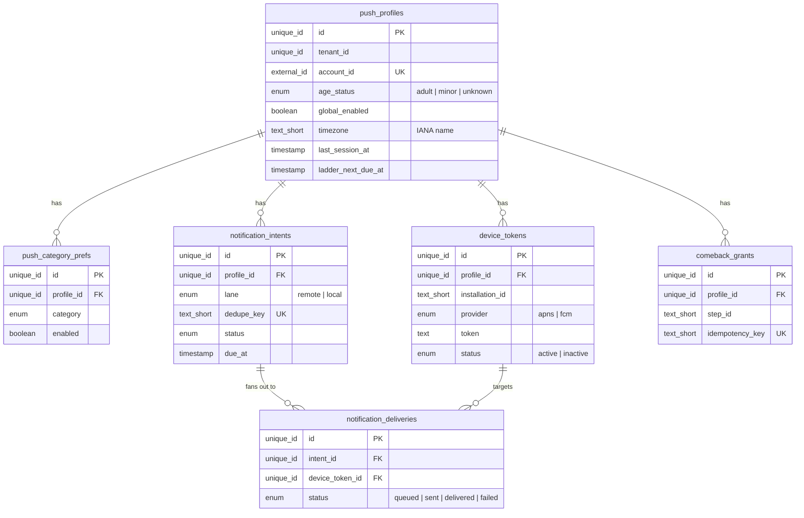
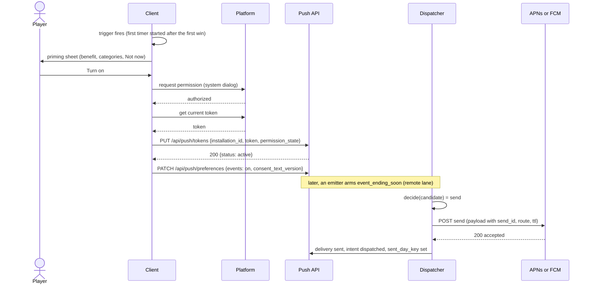
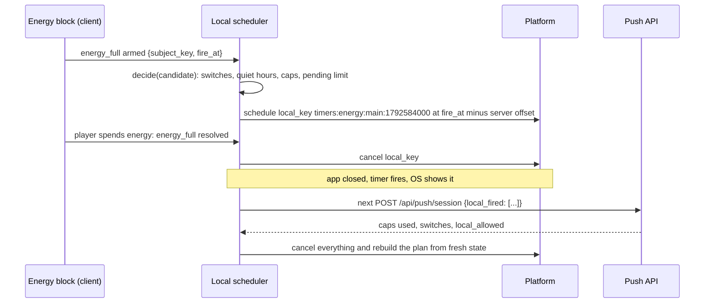
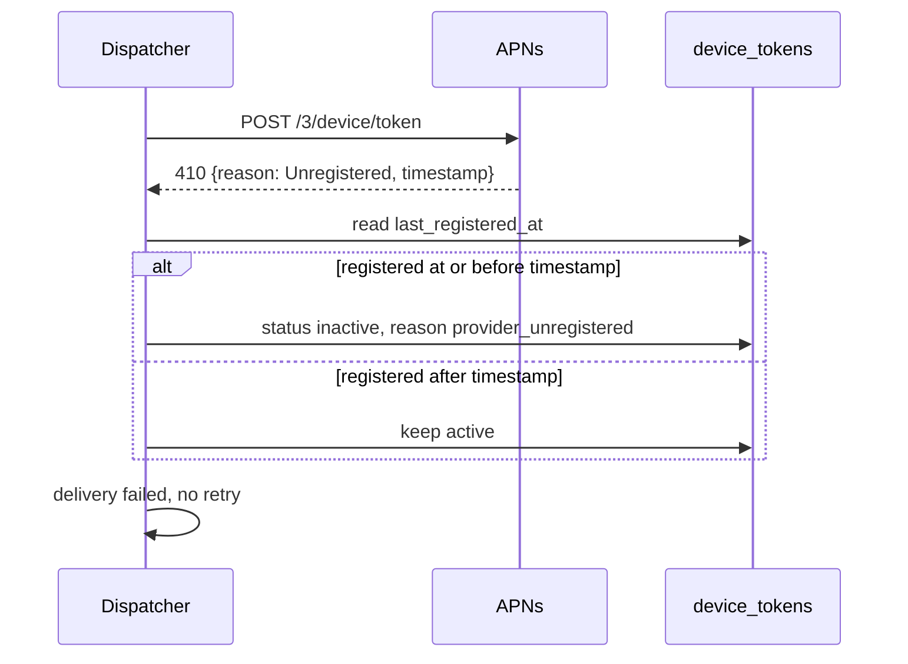
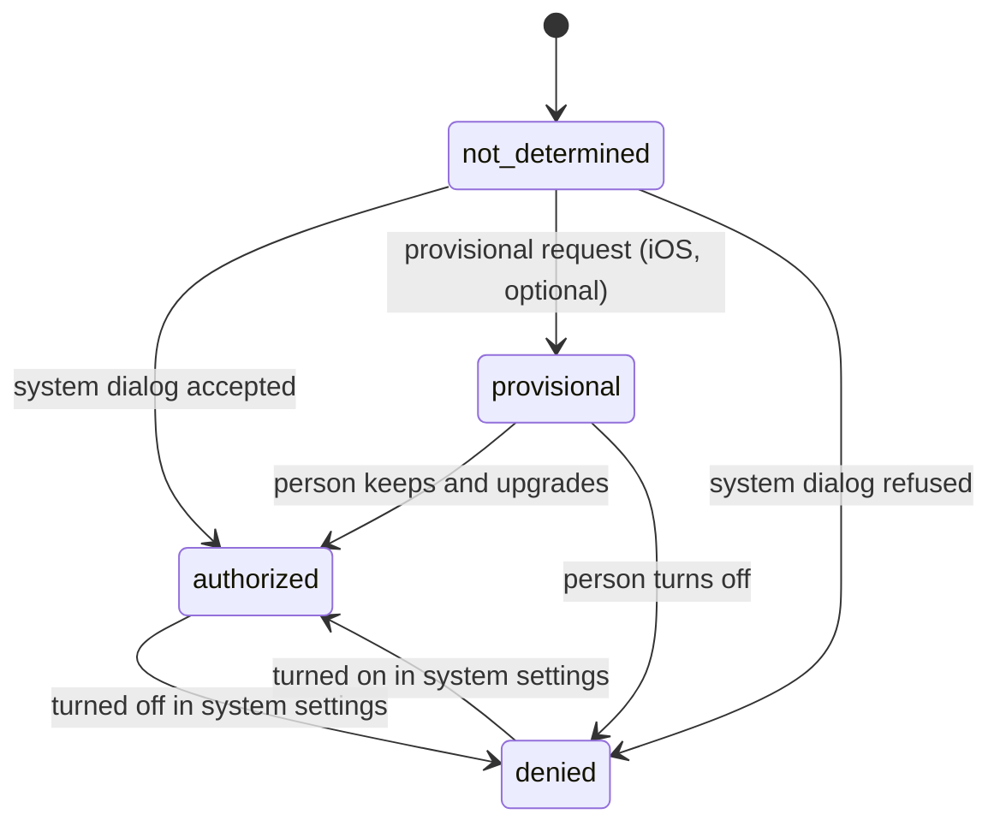
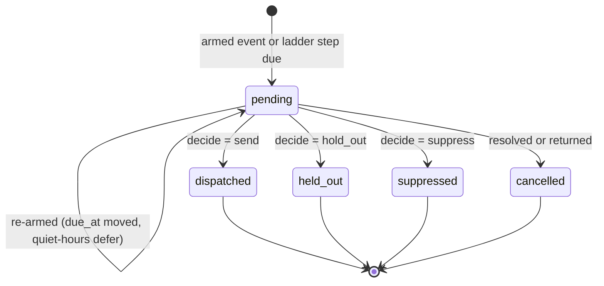

# Push Notifications and Re-engagement (mobile game)

## 1. Overview

### Problem Statement

A mobile game earns its second and third session partly through reminders: an energy bar that is full, a streak that ends tonight, an event that closes in three hours, a lapsed player who has not opened the game for a week. Both platforms put every one of these behind a permission the player can refuse, and a refusal is hard to undo: iOS shows its system dialog on the first request only (P1), and Android lets a player deny twice before the dialog stops appearing (P9). The block specifies the whole path from the first ask to the last stop:

- **Permission**: an explanation screen first, the system dialog only from a trigger tied to a visible benefit, a settings path after a refusal.
- **Registration**: one provider token per account and device, rotated, invalidated on the provider's own error answers, removed on logout and account deletion.
- **Two delivery lanes**: local scheduled notifications for timers the device already knows, remote sends for facts only the server knows.
- **A lapsed-player ladder** that is configuration: steps keyed to days since the last session, an optional comeback reward granted through the ledger on return, and stop rules.
- **Restraint**: suppression after the player opens the app, frequency caps across all categories, quiet hours in the player's local time, per-category switches and a global off, no notifications for players under the age threshold, a holdout group that measures whether the notifications cause returns.

The kit guides ask for this program in two places: delay the permission ask until after the first win (`kits/game-engagement/guides/01-first-session.md:11`), and treat re-engagement as a separate program (`kits/game-engagement/guides/05-marketing-and-launch.md:16`). The evidence for win-back effect sizes is thin and comes from tool vendors (guide 05, `:35`); the holdout group in this block exists so the adopter measures the effect on its own players and needs no vendor number.

### User Stories

- **Player**: the game explains what the reminders are for before my phone asks, and asking is my choice at a moment when I can see the benefit.
- **Player**: I switch off event reminders and keep timer reminders; I set quiet hours; I turn everything off with one switch.
- **Player (refused earlier)**: the settings screen tells me notifications are off in the phone's settings and takes me there when I tap, without a pop-up asking again.
- **Player (away for a week)**: I get a small number of messages, each one true, and a welcome-back gift on return whether or not I ever allowed notifications.
- **Player (two devices)**: a reminder reaches the device I use and stops when I come back.
- **Parent or regulator**: no notification and no device token exists for a player under the age threshold.
- **Subscriber on a free trial**: I get one notice before the trial converts that names the price and the renewal date and points to where I manage it; it never tries to sell me anything.
- **Live-ops owner**: I change the ladder, the caps and the copy as configuration; I read the holdout comparison to learn whether the ladder works.
- **Developer**: other blocks emit hand-off events; this block decides whether, when and where to send, and never makes other blocks wait.

### When to use this block

- The game has timers, streaks, events or objectives whose state the player would want to hear about while the app is closed.
- The game has accounts (guest or signed in) so that preferences, tokens and caps attach to `account_id`.
- User says: "push notifications", "re-engagement", "win-back", "comeback reward", "notification permission", "quiet hours", "notification settings".

### When NOT to use

- Receipts, password resets and other transactional messages: `messaging.transactional-email`.
- In-app banners, inboxes and pop-ups: in-app messaging is outside this block.
- Retargeting ads and paid win-back: outside this block (guide 05 covers the program).
- Web push, SMS, live activities, widgets, background silent updates: not specified here.
- Messages that must reach every player (legal notices): a push can be refused, so it is never the only channel for them.

---

## 2. Data Model

> Types below are **logical types** (canonical mapping in `docs/SPEC_GUIDELINES.md` section 5). Reference SQL for Postgres follows in [Reference Migration](#reference-migration-postgres).

Everything is keyed by `tenant_id` and `account_id` as in `ugc.friends-leaderboard` (single-app deployments use one constant tenant). `account_id` comes from the verified session and is never accepted from a request body. Templates, the ladder, caps and the category catalog are **configuration** (section 7), not tables.



### Table: `push_profiles`

One row per account: the push-relevant facts about the player and the ladder pointer.

| Column | Logical Type | Constraints | Notes |
|--------|------|-------------|-------|
| `id` | `unique_id` | PK | distributed-safe ID, immutable |
| `tenant_id` | `unique_id` | NOT NULL | tenant isolation; one constant for a single-app deployment |
| `account_id` | `external_id` | NOT NULL, UNIQUE per tenant | from the verified session; guest or signed-in account |
| `age_status` | `enum` | NOT NULL, default `unknown` | values: `adult\|minor\|unknown`. Written only through the age-gate input (section 6), never from a client request. `adult` means at or above `PUSH_MIN_AGE`. |
| `global_enabled` | `boolean` | NOT NULL, default true | the player's master switch; false beats every category |
| `quiet_hours_enabled` | `boolean` | NOT NULL, default `QUIET_HOURS_DEFAULT_ENABLED` | |
| `quiet_start` | `text_short` | NOT NULL | local wall-clock time `HH:MM`, 24-hour; the window is `[quiet_start, quiet_end)` and may wrap midnight; `quiet_start` differs from `quiet_end` |
| `quiet_end` | `text_short` | NOT NULL | same format |
| `timezone` | `text_short` | NOT NULL | IANA name. Mirrors the account timezone of the time contract; this block reads it and never rate-limits or decides it (section 6) |
| `locale` | `text_short` | NOT NULL | BCP 47 tag of the app language at the last session; selects template copy |
| `holdout` | `boolean` | NOT NULL | assigned once at creation by a stable hash of tenant, account and `HOLDOUT_SALT`; never changes |
| `last_session_at` | `timestamp` | nullable | server time of the latest session start (`POST /api/push/session`); null until the first session |
| `previous_session_at` | `timestamp` | nullable | the `last_session_at` value before the latest session start; lets a replayed session call return the same answer |
| `last_session_id` | `text_short` | nullable | the client `session_id` of the latest session start; a replay with the same id changes nothing |
| `ladder_anchor_at` | `timestamp` | nullable | the `last_session_at` value the current ladder run is anchored to |
| `ladder_next_step` | `text_short` | nullable | id of the next ladder step to evaluate; null when the run is over |
| `ladder_next_due_at` | `timestamp` | nullable | when the dispatcher evaluates that step; the dispatcher scans this column |
| `ladder_unopened_sends` | `integer` | NOT NULL, default 0 | consecutive ladder sends without a tap; reset by any tap on any push (stop rule) |
| `last_comeback_granted_at` | `timestamp` | nullable | latest applied comeback grant; source of the cooldown |
| `created_at` / `updated_at` | `timestamp` | NOT NULL | UTC instants; `updated_at` is server-assigned |

**Indexes**: UNIQUE `(tenant_id, account_id)`; `(ladder_next_due_at)` for the dispatcher scan.

### Table: `push_category_prefs`

The player's per-category switches. An absent row means the category default (section 7): service categories default on, promotional categories default off, and `subscription` defaults on for an `adult` profile and off for any other.

| Column | Logical Type | Constraints | Notes |
|--------|------|-------------|-------|
| `id` | `unique_id` | PK | |
| `profile_id` | `unique_id` | NOT NULL, FK to `push_profiles.id`, ON DELETE CASCADE | |
| `category` | `enum` | NOT NULL | values: `streak\|events\|timers\|rewards\|comeback\|subscription` (the catalog of section 7) |
| `enabled` | `boolean` | NOT NULL | |
| `consent_text_version` | `text_short` | nullable | for a promotional category: the version of the consent copy on screen when the player turned it on (P5). Required when `enabled` is true and the category is promotional. |
| `updated_at` | `timestamp` | NOT NULL | server time |

**Indexes**: UNIQUE `(profile_id, category)`.

### Table: `device_tokens`

One row per account and app install. Rotation updates the row in place.

| Column | Logical Type | Constraints | Notes |
|--------|------|-------------|-------|
| `id` | `unique_id` | PK | |
| `profile_id` | `unique_id` | NOT NULL, FK, ON DELETE CASCADE | |
| `installation_id` | `text_short` | NOT NULL | random id the app creates at first launch and keeps on the device; identifies the install across token rotation. Not a hardware or advertising identifier. |
| `platform` | `enum` | NOT NULL | values: `ios\|android` |
| `provider` | `enum` | NOT NULL | values: `apns\|fcm`. An iOS install may use `fcm` when the adopter routes iOS through Firebase. |
| `target_kind` | `enum` | NOT NULL | values: `apns_token\|fcm_fid\|fcm_registration_token`. Decides which send field carries the value (P13, P19, P20). |
| `apns_environment` | `enum` | nullable | values: `production\|sandbox`; set when `target_kind` is `apns_token`; decides the APNs host (P13) |
| `token` | `text` | NOT NULL | the provider-issued value. Sensitive: never logged, never returned by any API. Do not assume a maximum size (P17). |
| `status` | `enum` | NOT NULL, default `active` | values: `active\|inactive` |
| `inactive_reason` | `enum` | nullable | set when inactive; values: see "Token lifecycle" in section 3 |
| `permission_state` | `enum` | NOT NULL | last client report; values: `not_determined\|authorized\|provisional\|denied` |
| `os_blocked_categories` | `json` | NOT NULL, default empty list | category codes whose system channel the player blocked (Android, P10) |
| `app_version` | `text_short` | NOT NULL | |
| `last_registered_at` | `timestamp` | NOT NULL | server time of the latest upload of this token; staleness is measured from it (P22) |
| `last_success_at` | `timestamp` | nullable | latest provider acceptance |
| `consecutive_failures` | `integer` | NOT NULL, default 0 | |
| `invalidated_at` | `timestamp` | nullable | |
| `created_at` / `updated_at` | `timestamp` | NOT NULL | |

**Indexes**: UNIQUE `(provider, token)`; UNIQUE `(profile_id, installation_id)`; `(profile_id, status)`.

### Table: `notification_intents`

One row per decision about one notification for one account. Remote intents are decided by the server; `local` rows are written only from the device's own report of a local notification that fired (section 3), so caps and attribution count both lanes.

| Column | Logical Type | Constraints | Notes |
|--------|------|-------------|-------|
| `id` | `unique_id` | PK | |
| `tenant_id` | `unique_id` | NOT NULL | |
| `profile_id` | `unique_id` | NOT NULL, FK, ON DELETE CASCADE | |
| `lane` | `enum` | NOT NULL | values: `remote\|local` |
| `source` | `enum` | NOT NULL | values: `handoff\|ladder\|local_report` |
| `category` | `enum` | NOT NULL | as in `push_category_prefs` |
| `kind` | `text_short` | NOT NULL | hand-off event name, or the ladder step id |
| `subject_key` | `text_short` | NOT NULL | the emitter's key for ONE occurrence, or the ladder step id |
| `dedupe_key` | `text_short` | NOT NULL, UNIQUE per tenant | `{source}:{account_id}:{category}:{subject_key}` for hand-offs; `ladder:{account_id}:{anchor_epoch_seconds}:{step_id}` for the ladder; `local:{account_id}:{local_key}:{fire_at_epoch_seconds}` for a reported local notification |
| `template_id` | `text_short` | NOT NULL | key into the template catalog |
| `params` | `json` | NOT NULL | flat template variables (strings and numbers) |
| `route` | `text_short` | NOT NULL | a route id from `ROUTE_ALLOWLIST` |
| `route_params` | `json` | NOT NULL | validated ids for the route |
| `due_at` | `timestamp` | NOT NULL | the evaluation instant; moved by a quiet-hours deferral |
| `expires_at` | `timestamp` | NOT NULL | not sent at or after this instant |
| `status` | `enum` | NOT NULL | values: `pending\|dispatched\|suppressed\|held_out\|cancelled` |
| `suppress_reason` | `enum` | nullable | set when `suppressed` or `cancelled`; values: see "Suppression and cancellation reasons" in section 3 |
| `dispatched_at` | `timestamp` | nullable | server time of the decision to send (local rows: the reported fire time) |
| `sent_day_key` | `text_short` | nullable | the player's local calendar date (`YYYY-MM-DD`) of `dispatched_at`; the cap counters read it |
| `opened_at` | `timestamp` | nullable | first tap on any device |
| `returned_at` | `timestamp` | nullable | first session start inside the return window after `dispatched_at` (held-out rows: after `due_at`) |
| `created_at` / `updated_at` | `timestamp` | NOT NULL | |

**Indexes**: UNIQUE `(tenant_id, dedupe_key)`; `(status, due_at)` for the dispatcher; `(profile_id, sent_day_key)` for caps.

### Table: `notification_deliveries`

One row per remote intent and device. `id` is the `send_id` carried in the payload and echoed in receipts.

| Column | Logical Type | Constraints | Notes |
|--------|------|-------------|-------|
| `id` | `unique_id` | PK | the `send_id` |
| `intent_id` | `unique_id` | NOT NULL, FK, ON DELETE CASCADE | |
| `device_token_id` | `unique_id` | NOT NULL, FK, ON DELETE CASCADE | |
| `status` | `enum` | NOT NULL | values: `queued\|sent\|delivered\|failed`; `sent` means the provider accepted the request, not that the phone received it (P16) |
| `attempts` | `integer` | NOT NULL, default 0 | |
| `next_attempt_at` | `timestamp` | nullable | retry schedule |
| `provider_message_id` | `text_short` | nullable | APNs `apns-id` (generated by this block per request) or the FCM message `name` |
| `provider_status` | `text_short` | nullable | HTTP status plus reason or error code of the last attempt |
| `sent_at` / `delivered_at` / `opened_at` | `timestamp` | nullable | `delivered_at` only from a client or provider signal (INV-19) |
| `created_at` / `updated_at` | `timestamp` | NOT NULL | |

**Indexes**: UNIQUE `(intent_id, device_token_id)`; `(status, next_attempt_at)`.

### Table: `comeback_grants`

The audit of comeback rewards and the source of the once-per-run rule.

| Column | Logical Type | Constraints | Notes |
|--------|------|-------------|-------|
| `id` | `unique_id` | PK | |
| `profile_id` | `unique_id` | NOT NULL, FK, ON DELETE CASCADE | |
| `step_id` | `text_short` | NOT NULL | the ladder step whose reward applied |
| `anchor_at` | `timestamp` | NOT NULL | the previous `last_session_at` the lapse was measured from |
| `lapse_days` | `integer` | NOT NULL | local calendar days between the previous session and the return |
| `currency` | `text_short` | NOT NULL | ledger currency or item code |
| `amount` | `integer` | NOT NULL | positive |
| `idempotency_key` | `text_short` | NOT NULL, UNIQUE | `push-reengagement:{account_id}:{anchor_epoch_seconds}:{step_id}` |
| `status` | `enum` | NOT NULL | values: `pending\|applied`; `pending` is retried until the ledger confirms |
| `ledger_entry_id` | `text_short` | nullable | `entry_id` from the ledger result |
| `created_at` / `updated_at` | `timestamp` | NOT NULL | |

**Indexes**: UNIQUE `(profile_id, anchor_at)`; UNIQUE `(idempotency_key)`.

### Reference Migration (Postgres)

#### `push_profiles` table

<!-- REFERENCE: dialect=postgres -->
<!-- ADAPT: MySQL - uuid becomes BINARY(16) with the id generated in the app, timestamptz becomes DATETIME(6), boolean becomes TINYINT(1), CHECK on enum text becomes ENUM(...); SQLite - uuid becomes TEXT generated in the app, timestamptz becomes TEXT ISO 8601 with Z, boolean becomes INTEGER 0/1; the quiet-hours HH:MM format check moves to the app if the dialect has no regex CHECK; the partial index becomes a plain index in MySQL -->
```sql
CREATE TABLE IF NOT EXISTS push_profiles (
  id                       uuid PRIMARY KEY DEFAULT gen_random_uuid(),
  tenant_id                uuid NOT NULL,
  account_id               text NOT NULL,
  age_status               text NOT NULL DEFAULT 'unknown' CHECK (age_status IN ('adult','minor','unknown')),
  global_enabled           boolean NOT NULL DEFAULT true,
  quiet_hours_enabled      boolean NOT NULL DEFAULT true,
  quiet_start              varchar(5) NOT NULL DEFAULT '22:00' CHECK (quiet_start ~ '^([01][0-9]|2[0-3]):[0-5][0-9]$'),
  quiet_end                varchar(5) NOT NULL DEFAULT '08:00' CHECK (quiet_end ~ '^([01][0-9]|2[0-3]):[0-5][0-9]$' AND quiet_end <> quiet_start),
  timezone                 varchar(64) NOT NULL,
  locale                   varchar(35) NOT NULL,
  holdout                  boolean NOT NULL,
  last_session_at          timestamptz,
  previous_session_at      timestamptz,
  last_session_id          varchar(64),
  ladder_anchor_at         timestamptz,
  ladder_next_step         varchar(64),
  ladder_next_due_at       timestamptz,
  ladder_unopened_sends    bigint NOT NULL DEFAULT 0,
  last_comeback_granted_at timestamptz,
  created_at               timestamptz NOT NULL DEFAULT now(),
  updated_at               timestamptz NOT NULL DEFAULT now(),
  UNIQUE (tenant_id, account_id)
);
CREATE INDEX IF NOT EXISTS idx_pp_ladder_due ON push_profiles (ladder_next_due_at) WHERE ladder_next_due_at IS NOT NULL;
```

#### `push_category_prefs` table

<!-- REFERENCE: dialect=postgres -->
<!-- ADAPT: MySQL and SQLite - uuid, timestamptz and the category CHECK as in the push_profiles migration; keep the UNIQUE pair (profile_id, category), it makes a switch change an upsert -->
```sql
CREATE TABLE IF NOT EXISTS push_category_prefs (
  id                   uuid PRIMARY KEY DEFAULT gen_random_uuid(),
  profile_id           uuid NOT NULL REFERENCES push_profiles(id) ON DELETE CASCADE,
  category             varchar(32) NOT NULL CHECK (category IN ('streak','events','timers','rewards','comeback','subscription')),
  enabled              boolean NOT NULL,
  consent_text_version varchar(32),
  updated_at           timestamptz NOT NULL DEFAULT now(),
  UNIQUE (profile_id, category)
);
```

#### `device_tokens`

<!-- REFERENCE: dialect=postgres -->
<!-- ADAPT: MySQL - a UNIQUE index on a long TEXT column needs a prefix length or a hash column (store a SHA-256 hex of token in a second column and make that UNIQUE with provider); SQLite - jsonb becomes TEXT holding a JSON array, uuid and timestamptz as in the profiles migration; the partial-index syntax is the same in SQLite and Postgres, MySQL has none (use a plain index) -->
```sql
CREATE TABLE IF NOT EXISTS device_tokens (
  id                    uuid PRIMARY KEY DEFAULT gen_random_uuid(),
  profile_id            uuid NOT NULL REFERENCES push_profiles(id) ON DELETE CASCADE,
  installation_id       varchar(64) NOT NULL,
  platform              text NOT NULL CHECK (platform IN ('ios','android')),
  provider              text NOT NULL CHECK (provider IN ('apns','fcm')),
  target_kind           text NOT NULL CHECK (target_kind IN ('apns_token','fcm_fid','fcm_registration_token')),
  apns_environment      text CHECK (apns_environment IN ('production','sandbox')),
  token                 text NOT NULL,
  status                text NOT NULL DEFAULT 'active' CHECK (status IN ('active','inactive')),
  inactive_reason       text,
  permission_state      text NOT NULL CHECK (permission_state IN ('not_determined','authorized','provisional','denied')),
  os_blocked_categories jsonb NOT NULL DEFAULT '[]',
  app_version           varchar(32) NOT NULL,
  last_registered_at    timestamptz NOT NULL,
  last_success_at       timestamptz,
  consecutive_failures  bigint NOT NULL DEFAULT 0,
  invalidated_at        timestamptz,
  created_at            timestamptz NOT NULL DEFAULT now(),
  updated_at            timestamptz NOT NULL DEFAULT now(),
  UNIQUE (provider, token),
  UNIQUE (profile_id, installation_id)
);
CREATE INDEX IF NOT EXISTS idx_dt_profile_status ON device_tokens (profile_id, status);
```

#### `notification_intents` table

<!-- REFERENCE: dialect=postgres -->
<!-- ADAPT: MySQL - uuid to BINARY(16), timestamptz to DATETIME(6), jsonb to JSON, partial indexes to plain indexes; SQLite - jsonb to TEXT, uuid and timestamptz as above; the status and reason value sets are enforced in the app when the dialect lacks CHECK on text -->
```sql
CREATE TABLE IF NOT EXISTS notification_intents (
  id              uuid PRIMARY KEY DEFAULT gen_random_uuid(),
  tenant_id       uuid NOT NULL,
  profile_id      uuid NOT NULL REFERENCES push_profiles(id) ON DELETE CASCADE,
  lane            text NOT NULL CHECK (lane IN ('remote','local')),
  source          text NOT NULL CHECK (source IN ('handoff','ladder','local_report')),
  category        varchar(32) NOT NULL,
  kind            varchar(64) NOT NULL,
  subject_key     varchar(128) NOT NULL,
  dedupe_key      varchar(255) NOT NULL,
  template_id     varchar(64) NOT NULL,
  params          jsonb NOT NULL DEFAULT '{}',
  route           varchar(32) NOT NULL,
  route_params    jsonb NOT NULL DEFAULT '{}',
  due_at          timestamptz NOT NULL,
  expires_at      timestamptz NOT NULL,
  status          text NOT NULL CHECK (status IN ('pending','dispatched','suppressed','held_out','cancelled')),
  suppress_reason varchar(32),
  dispatched_at   timestamptz,
  sent_day_key    varchar(10),
  opened_at       timestamptz,
  returned_at     timestamptz,
  created_at      timestamptz NOT NULL DEFAULT now(),
  updated_at      timestamptz NOT NULL DEFAULT now(),
  UNIQUE (tenant_id, dedupe_key)
);
CREATE INDEX IF NOT EXISTS idx_ni_due ON notification_intents (status, due_at) WHERE status = 'pending';
CREATE INDEX IF NOT EXISTS idx_ni_caps ON notification_intents (profile_id, sent_day_key);
```

#### `notification_deliveries` table

<!-- REFERENCE: dialect=postgres -->
<!-- ADAPT: MySQL and SQLite - uuid and timestamptz as in the notification_intents migration; keep UNIQUE (intent_id, device_token_id): it makes a replayed fan-out harmless -->
```sql
CREATE TABLE IF NOT EXISTS notification_deliveries (
  id                  uuid PRIMARY KEY DEFAULT gen_random_uuid(),
  intent_id           uuid NOT NULL REFERENCES notification_intents(id) ON DELETE CASCADE,
  device_token_id     uuid NOT NULL REFERENCES device_tokens(id) ON DELETE CASCADE,
  status              text NOT NULL CHECK (status IN ('queued','sent','delivered','failed')),
  attempts            bigint NOT NULL DEFAULT 0,
  next_attempt_at     timestamptz,
  provider_message_id varchar(255),
  provider_status     varchar(255),
  sent_at             timestamptz,
  delivered_at        timestamptz,
  opened_at           timestamptz,
  created_at          timestamptz NOT NULL DEFAULT now(),
  updated_at          timestamptz NOT NULL DEFAULT now(),
  UNIQUE (intent_id, device_token_id)
);
```

#### `comeback_grants`

<!-- REFERENCE: dialect=postgres -->
<!-- ADAPT: MySQL - uuid to BINARY(16), timestamptz to DATETIME(6); SQLite - uuid and timestamptz as above; keep both UNIQUE constraints, they are the duplicate-grant guard together with the ledger idempotency key -->
```sql
CREATE TABLE IF NOT EXISTS comeback_grants (
  id               uuid PRIMARY KEY DEFAULT gen_random_uuid(),
  profile_id       uuid NOT NULL REFERENCES push_profiles(id) ON DELETE CASCADE,
  step_id          varchar(64) NOT NULL,
  anchor_at        timestamptz NOT NULL,
  lapse_days       bigint NOT NULL,
  currency         varchar(64) NOT NULL,
  amount           bigint NOT NULL CHECK (amount > 0),
  idempotency_key  varchar(255) NOT NULL UNIQUE,
  status           text NOT NULL CHECK (status IN ('pending','applied')),
  ledger_entry_id  varchar(255),
  created_at       timestamptz NOT NULL DEFAULT now(),
  updated_at       timestamptz NOT NULL DEFAULT now(),
  UNIQUE (profile_id, anchor_at)
);
```

---

## 3. Data Flow

### Platform rules this block depends on

Every row was read on the official page on 2026-10-27. Confidence: HIGH = the page states it directly; MEDIUM = one non-primary source or an inference from two statements. Later sections cite the row id (P1 to P26).

| ID | Fact | Source | Conf. |
|----|------|--------|-------|
| P1 | iOS: the first `requestAuthorization` call prompts the person and records the answer; later calls do not prompt. Apple advises asking in a context that explains why, not at first launch. | [Asking permission to use notifications](https://developer.apple.com/documentation/usernotifications/asking-permission-to-use-notifications) | HIGH |
| P2 | iOS `UNAuthorizationStatus` cases: `notDetermined`, `denied`, `authorized`, `provisional`, `ephemeral` (App Clips: limited time). | [UNAuthorizationStatus](https://developer.apple.com/documentation/usernotifications/unauthorizationstatus) | HIGH |
| P3 | iOS provisional authorization is granted on first call without a prompt; notifications arrive quietly in Notification Center history only (no sound, banner or lock screen) with Keep and Turn Off buttons; status stays `provisional` until the person chooses; check the status before scheduling local notifications. | same page as P1 | HIGH |
| P4 | iOS deep link to the app's notification settings: `UIApplication.openNotificationSettingsURLString` (iOS 16.0+); the app's general settings page: `UIApplication.openSettingsURLString` (iOS 8.0+). | [openNotificationSettingsURLString](https://developer.apple.com/documentation/uikit/uiapplication/opennotificationsettingsurlstring), [openSettingsURLString](https://developer.apple.com/documentation/uikit/uiapplication/opensettingsurlstring) | HIGH |
| P5 | App Review 4.5.4: push must not be required for the app to function or carry sensitive personal information; push must not be used for promotions or direct marketing unless the customer opted in through consent language in the app's UI and the app offers a way to opt out. | [App Review Guidelines](https://developer.apple.com/app-store/review/guidelines/) (page dated "Last Updated: October 16, 2026") | HIGH |
| P6 | App Review 5.1.2(i): an app may not require enabling push notifications (or location, tracking) to access functionality, content, use the app, or receive monetary or other compensation. | same page as P5 | HIGH |
| P7 | Android 13 (API 33) adds the runtime permission `android.permission.POST_NOTIFICATIONS`; for an app targeting 13 or higher the app controls when the dialog appears; on a fresh install notifications are off until granted; eligible existing apps are pre-granted on upgrade; "Don't allow" blocks all channels. | [Notification runtime permission](https://developer.android.com/develop/ui/views/notifications/notification-permission) | HIGH |
| P8 | Android, app targeting 12L or lower: the system shows the dialog when the first channel is created; one "Don't allow" means no further prompt until reinstall or until the app targets 13+. The page suggests waiting for a user action, or until the third or fourth launch. | same page as P7 | HIGH |
| P9 | Android: a second "Deny" for the same permission during the install's life is a permanent denial and the system dialog stops appearing; "don't link to system settings in an effort to convince the user to change their decision". | [Request runtime permissions](https://developer.android.com/training/permissions/requesting) | HIGH |
| P10 | Android 8.0+ (API 26): every notification belongs to a channel; after creation the app cannot change a channel's importance or behavior, the user controls it; the settings screen shows the count of deleted channels; `Settings.ACTION_CHANNEL_NOTIFICATION_SETTINGS` opens one channel's settings. | [Notification channels](https://developer.android.com/develop/ui/views/notifications/channels) | HIGH |
| P11 | Android alarms: inexact alarms fire within an hour of the trigger on Android 12+ and are the recommended default; exact alarms need `SCHEDULE_EXACT_ALARM` (not pre-granted for fresh installs targeting 13+) or `USE_EXACT_ALARM` and suit alarm-clock or calendar apps; all alarms are cancelled when the device shuts down, so the app reschedules after `BOOT_COMPLETED`. | [Schedule alarms](https://developer.android.com/develop/background-work/services/alarms/schedule) | HIGH |
| P12 | iOS local notifications: a pending request is cancelled with `removePendingNotificationRequests(withIdentifiers:)` when conditions change; at most 64 requests can be pending per app (Apple engineer's answer, January 2026; no current documentation page states the number). | [Scheduling a notification locally](https://developer.apple.com/documentation/usernotifications/scheduling-a-notification-locally-from-your-app), [Apple Developer Forums thread 811171](https://developer.apple.com/forums/thread/811171) | cancel: HIGH; limit 64: MEDIUM |
| P13 | APNs request: HTTP/2 with TLS 1.2+; hosts `api.push.apple.com:443` (production) and `api.sandbox.push.apple.com:443`; `POST /3/device/<device_token>`; headers `authorization: bearer <provider_token>`, `apns-push-type` (recommended on iOS, must match the payload), `apns-id` (optional UUID), `apns-expiration` (UNIX seconds; 0 = one attempt, not stored), `apns-priority` (10 immediate, 5 power-considerate, 1 lowest; default 10), `apns-topic` (required; the bundle id), `apns-collapse-id` (at most 64 bytes); payload at most 4096 bytes. For `alert`, Apple says use priority 10 when the notification needs immediate action, otherwise 5. Reuse connections for hours to days. | [Sending notification requests to APNs](https://developer.apple.com/documentation/usernotifications/sending-notification-requests-to-apns) | HIGH |
| P14 | APNs token auth: a JWT signed ES256 with header `kid` (10-character key id) and claims `iss` (team id) and `iat`; refresh no more than once every 20 minutes and no less than once every 60 minutes; an `iat` older than one hour gives 403 `ExpiredProviderToken`; faster refresh gives 429 `TooManyProviderTokenUpdates`. | [Establishing a token-based connection to APNs](https://developer.apple.com/documentation/usernotifications/establishing-a-token-based-connection-to-apns) | HIGH |
| P15 | APNs responses: 200 success; 400 `BadDeviceToken`, `DeviceTokenNotForTopic`, `BadTopic`, `PayloadEmpty` and others; 403 `ExpiredProviderToken`, `InvalidProviderToken`, `BadCertificate` and others; 410 `Unregistered` and `ExpiredToken`, with a body `timestamp` in milliseconds since epoch at which APNs confirmed the token stopped being valid for the topic (410 only); 413 `PayloadTooLarge`; 429 `TooManyRequests`; 500 `InternalServerError`; 503 `ServiceUnavailable`, `Shutdown`. Do not retry `BadDeviceToken`, `DeviceTokenNotForTopic`, `Forbidden`, `ExpiredToken`, `Unregistered`, `PayloadTooLarge`; 5xx may be retried after 15 minutes with back-off; `TooManyRequests` may be retried with a delay; 4xx answers slow sending and APNs disconnects a connection with too many errors (410 is not counted as an error). | [Handling notification responses from APNs](https://developer.apple.com/documentation/usernotifications/handling-notification-responses-from-apns) | HIGH |
| P16 | APNs is best effort: it may reorder, store at most one notification per bundle id for an offline device, throttle, and in some cases not deliver; priority 5 and 1 notifications may be grouped and delivered in bursts. | P13 page | HIGH |
| P17 | APNs registration: the app calls `registerForRemoteNotifications()` at every launch and forwards the token; the token changes after a restore from backup, on a new device and after an OS reinstall; never cache the token on the device; a person can have several devices; do not assume token size. | [Registering your app with APNs](https://developer.apple.com/documentation/usernotifications/registering-your-app-with-apns) | HIGH |
| P18 | iOS notification service extension: runs for a remote alert whose payload has `mutable-content: 1` and an `alert`, with about 30 seconds to modify content before display. | [Modifying content in newly delivered notifications](https://developer.apple.com/documentation/usernotifications/modifying-content-in-newly-delivered-notifications) | HIGH |
| P19 | FCM HTTP v1 send: `POST https://fcm.googleapis.com/v1/projects/{project_id}/messages:send`, body `{ "validate_only": bool, "message": {...} }`; OAuth scope `https://www.googleapis.com/auth/firebase.messaging`; `message.data` is a string-to-string map (reserved: `from`, `message_type`, keys starting `google.` or `gcm.notification.`); `android.ttl` 0 to 2,419,200 seconds (4 weeks, the default), `android.priority` normal or high, `android.collapse_key` (at most 4 at a time), `android.notification.channel_id` and `android.notification.tag`; `apns.headers` and `apns.payload` pass through to APNs (FCM defaults `apns-expiration` to 30 days and `apns-priority` to 10 when unset); `android_v2` is an alternative to `android`. | [projects.messages.send](https://firebase.google.com/docs/reference/fcm/rest/v1/projects.messages/send), [projects.messages](https://firebase.google.com/docs/reference/fcm/rest/v1/projects.messages) | HIGH |
| P20 | FCM is moving from registration tokens to Firebase Installation IDs; both are supported; in the send request `fid` is the preferred target field; `token` remains accepted and, during the transition, also accepts an FID. | [Best practices for FCM registration management](https://firebase.google.com/docs/cloud-messaging/manage-tokens), P19 reference | HIGH |
| P21 | FCM errors: `INVALID_ARGUMENT` 400, `UNREGISTERED` 404, `SENDER_ID_MISMATCH` 403, `QUOTA_EXCEEDED` 429, `UNAVAILABLE` 503 (honor `Retry-After`, exponential back-off, jitter), `INTERNAL` 500, `THIRD_PARTY_AUTH_ERROR` 401 (iOS or web credentials invalid). A 400 carries `details`: an `FcmError` with `errorCode` means an FCM-specific condition such as an invalid registration token; a `google.rpc.BadRequest` with `fieldViolations` means a bad request value. | [FCM error codes](https://firebase.google.com/docs/cloud-messaging/error-codes), [ErrorCode](https://firebase.google.com/docs/reference/fcm/rest/v1/ErrorCode) | HIGH |
| P22 | FCM freshness: a registration whose app instance has not connected for a month is stale; on Android a registration inactive for 270 days expires and is rejected, iOS has no such rule; store a timestamp each time the identifier is uploaded; delete on `UNREGISTERED`, and on `INVALID_ARGUMENT` only when the payload is valid. | P20 page | HIGH |
| P23 | FCM throttling: default 600,000 messages per minute per project; 429 means wait the `retry-after` header, or 60 seconds without it; 500 means exponential back-off; wait at least 10 seconds before retrying; avoid sends within two minutes of :00, :15, :30, :45 and ramp up over at least 60 seconds; Admin SDK `sendEach` takes up to 500 messages per call. | [Scale FCM](https://firebase.google.com/docs/cloud-messaging/scale-fcm), [Throttling and quotas](https://firebase.google.com/docs/cloud-messaging/throttling-and-quotas), [Send with the Admin SDK](https://firebase.google.com/docs/cloud-messaging/send/admin-sdk) | HIGH |
| P24 | FCM on Android: a notification message received in the background goes to the system tray, in the foreground to `onMessageReceived` (the `android` config; with `android_v2` the notification is shown in both states unless silenced in `onNotificationReceived`); notification messages are always collapsible and ignore `collapse_key`; high priority is for time-sensitive user-visible content. | [Receive messages on Android](https://firebase.google.com/docs/cloud-messaging/android/receive), [Collapsible messages](https://firebase.google.com/docs/cloud-messaging/customize-messages/collapsible-message-types), [Message priority](https://firebase.google.com/docs/cloud-messaging/customize-messages/setting-message-priority) | HIGH for the table and priority; MEDIUM for `android_v2` (read only in the receive page, not the reference) |
| P25 | FCM delivery reporting: "Sends" means accepted for delivery or passed to a third-party service such as APNs; "Received" is available only on Android; "Impressions" only for notification messages on Android. | [Understand message delivery](https://firebase.google.com/docs/cloud-messaging/understand-delivery) | HIGH |
| P26 | FCM message lifespan: `ttl` 0 to 28 days on Android and web; on iOS the `apns-expiration` header; collapsible-message throttling is not applied to a `ttl` of 0. | [Set the lifespan of a message](https://firebase.google.com/docs/cloud-messaging/customize-messages/setting-message-lifespan) | HIGH |

### The decision pipeline (L1)

`decide(candidate, profile, now, config)` is a pure function: no I/O, no clock besides `now`. Both lanes use it (the device runs the client-side subset, section 5 of `frontend.md`). It returns `send`, `defer(due_at)`, `suppress(reason)` or `hold_out`. **The order is fixed** (INV-8):

1. **Age**: `age_status` is `adult`, or `unknown` with `UNKNOWN_AGE_POLICY = allow`; else `suppress(age_ineligible)`.
2. **Expiry**: `now >= expires_at` gives `suppress(expired)`.
3. **Global switch**: `global_enabled = false` gives `suppress(global_off)`.
4. **Category switch**: the category pref (or its default for the profile's `age_status`) is off, or the category is promotional and the stored consent version is missing: `suppress(category_off)`.
5. **Quiet hours**: `now` inside the profile's window in its timezone gives `defer(next window end)`, or `suppress(quiet_expired)` when that end is at or after `expires_at`.
6. **Device**: no active token with `authorized` or `provisional`, fresher than `TOKEN_STALE_DAYS`: `suppress(no_device)`; every such token blocks the category in `os_blocked_categories`: `suppress(os_blocked)`.
7. **Ladder only**: a step with a reward whose grant would fail on return (cooldown, claim window): `suppress(reward_unavailable)`; `ladder_unopened_sends >= stop.after_unopened_sends`: `suppress(ladder_stopped)`.
8. **Caps**: for a marketing category, sends already counted in the player's local day reach `CAP_PER_LOCAL_DAY`, or in the last seven local days reach `CAP_PER_7_LOCAL_DAYS`: `suppress(cap_day)` or `suppress(cap_week)`. A service notice (`subscription`) skips both and is checked against `CAP_SERVICE_PER_LOCAL_DAY` instead: `suppress(cap_service)`. A capped candidate is dropped, never queued (INV-10, INV-25).
9. **Holdout**: the profile is in the holdout, the category is in `HOLDOUT_CATEGORIES` (never a service category): `hold_out`.
10. Else `send`.

Holdout is last so that the held-out group and the treated group are made of notifications that would otherwise have been sent (INV-8). `fixtures/profiles.json` `decision_cases` is the executable table for this list.

### Suppression and cancellation reasons

| Reason | Set when |
|--------|----------|
| `age_ineligible`, `expired`, `global_off`, `category_off`, `quiet_expired`, `no_device`, `os_blocked`, `reward_unavailable`, `ladder_stopped`, `cap_day`, `cap_week`, `cap_service` | the decision pipeline above (`status = suppressed`) |
| `template_error` | the template did not render (a variable it names is missing from `params`, or the text is over length); `status = suppressed` |
| `resolved` | the emitter sent `state = resolved` for the subject (`status = cancelled`) |
| `returned` | a session start cancelled a pending intent whose event has `cancel_on_session` (`status = cancelled`) |
| `superseded` | an `armed` event with the same dedupe key replaced the pending intent's `due_at` or params; the same row is updated, no new row |
| `lane_mismatch` | a local-lane event reached the server ingest (`status = cancelled`, counted, never sent) |

### Token lifecycle

| Trigger | Effect on `device_tokens` |
|---------|--------------------------|
| App start with permission `authorized` or `provisional` | Client asks the platform for the current token (P17), uploads when it differs from the last uploaded value or the last upload is older than `TOKEN_REUPLOAD_DAYS`. Server upserts by `(profile_id, installation_id)`, sets `last_registered_at`, `status = active`. |
| Token value rotates | Same row, new `token`, `last_registered_at` updated. |
| Another profile registers the same `installation_id` or the same `(provider, token)` | The previous row becomes inactive, reason `superseded` (shared device, account switch). |
| Client reports `permission_state = denied` | Row inactive, reason `permission_denied`. A later `authorized` report reactivates it. |
| Logout | `DELETE /api/push/tokens/{installation_id}`: inactive, reason `logout`; pending deliveries to it become `failed`. |
| `age_status` becomes `minor` (or `unknown` under the block policy) | All the profile's rows inactive, reason `age_blocked`; pending intents cancelled; `GET /api/push/state` tells the device to cancel its local plan. |
| Last upload older than `TOKEN_STALE_DAYS` | Not sent to (decision rule 6); row stays so a later upload revives it. Reason `stale` is set by the nightly sweep. |
| Last upload older than `TOKEN_PRUNE_DAYS` | Row deleted. |
| Provider answers (table below) | Per row. |
| Account deletion | Profile row and every dependent row deleted (INV-22). |

`inactive_reason` takes one of `provider_unregistered`, `bad_token`, `sender_mismatch`, `superseded`, `logout`, `permission_denied`, `age_blocked`, `stale`.

Provider answers that change a token (full table with retries in `backend.md`):

| Provider answer | Token action | `inactive_reason` |
|-----------------|--------------|-------------------|
| APNs 410 `Unregistered` or `ExpiredToken` and the row's `last_registered_at` is at or before the body `timestamp` | deactivate | `provider_unregistered` |
| APNs 410 and the row was registered after the `timestamp` | keep (the app fetched the token again; P15 says do not send again "unless your application retrieves the same device token") | none |
| APNs 400 `BadDeviceToken` or `DeviceTokenNotForTopic` | deactivate, counts toward the breaker | `bad_token` |
| FCM 404 `UNREGISTERED` | deactivate | `provider_unregistered` |
| FCM 400 `INVALID_ARGUMENT` whose `details` holds an `FcmError` with `errorCode` `INVALID_ARGUMENT` | deactivate | `bad_token` |
| FCM 400 `INVALID_ARGUMENT` whose `details` holds a `BadRequest` with `fieldViolations` | keep; the payload is defective | none |
| FCM 403 `SENDER_ID_MISMATCH` | deactivate, counts toward the breaker | `sender_mismatch` |
| Any 2xx | `last_success_at` set, `consecutive_failures` 0 | none |

### Two delivery lanes

| | Local lane | Remote lane |
|---|-----------|-------------|
| For | timers the device computes from state it holds plus the server time offset (energy full, a chest or building timer) | facts the server alone knows or can change without the device (an event ending, an objective reward, the comeback ladder) |
| Who decides | the client scheduler, running the client subset of `decide` | the server dispatcher |
| Needs a token | no | yes |
| Cancelled by | `resolved`, state change, session reconcile, logout, switches, permission loss, age change | `resolved` or `returned` before dispatch; after the provider accepted, it cannot be recalled |
| Weakness | fires even if state changed on another device while the app was closed | only as fresh as the last server fact; subject to P16 |

Each hand-off event has **one** lane in `EVENT_ROUTES` (INV-6). The reference mapping: `energy_full`, `queue_item_ready` and `streak_at_risk` local, `event_ending_soon` and `objective_reward_ready` remote. The rule behind it: a timer the device can compute is local, anything the server can change while the device sleeps is remote.

### Cap counting across lanes

Marketing caps and the service cap are separate counters over the same table: rows of a service category (`subscription`) are counted only against `CAP_SERVICE_PER_LOCAL_DAY` and never against the marketing counts, so a service notice cannot crowd out a reminder. The server counts `notification_intents` rows with `status = dispatched` by `sent_day_key`. Local notifications enter the count when the device reports them in the next `POST /api/push/session` (`local_fired`, at most `LOCAL_REPORT_MAX` entries, each a notification of the device's own plan whose fire time has passed and that was not cancelled). The device counts its own plan plus the server counts returned by `GET /api/push/state`. Between two syncs each lane sees the other's sends late, so the combined number can briefly exceed a cap; the next sync restores the true count. This lag is documented behavior, not a defect (see Known limits).

### Known limits

- A local notification already scheduled cannot be recalled when another device changes the state. The next session reconcile fixes the plan; until then a stale reminder can show. Copy for local categories states a fact that stays true after the state changes ("Energy is full" can be stale, so the copy offers no urgency and no count).
- iOS holds at most 64 pending local requests (P12, MEDIUM); the block uses at most `LOCAL_MAX_PENDING` (20).
- A player who is away longer than `TOKEN_STALE_DAYS` receives no remote notification: FCM calls a registration stale after a month without a connection and says messages to it are unlikely to be delivered (P22). The default ladder therefore ends at day 28.
- Delivery of a given message is not guaranteed (P16); `sent` is acceptance by the provider.
- Provider quotas and policies move; the rows above carry the date they were read.

---

## 4. Sequence Diagrams

### Permission, registration and first remote send (happy path)



### Local timer lane (energy full)



### Lapsed player returns (ladder, suppression, comeback reward)

```mermaid
sequenceDiagram
    participant C as Client
    participant S as Push API
    participant D as Dispatcher
    participant L as Ledger (billing.virtual-currency)

    Note over D: day 3 local, 18:04: ladder_next_due_at reached
    D->>D: decide(lapse-d3) = send; advance pointer to lapse-d7
    Note over D: day 7: decide(lapse-d7): reward confirmed available, send
    C->>S: POST /api/push/session {timezone, locale, local_fired}
    S->>S: previous last_session_at, lapse_days = local day difference
    S->>S: stamp returned_at on intents inside the return window
    S->>S: reset ladder pointer from the new anchor, cancel cancel_on_session intents
    S->>S: select highest claimable reward step, cooldown clear
    S->>L: grant(account, currency, amount, push-reengagement.comeback-reward, comeback_grants.id, idempotency_key)
    L-->>S: {applied, balance, entry_id}
    S-->>C: {comeback: {status: granted, amount, currency}}
```

### Provider says the token is dead



---

## 5. State Management

### Permission state (client)



Invalid transitions: the app never moves `denied` to `authorized` by asking again on iOS (P1); `denied` to `authorized` happens only because the player changed the system setting, and the app learns of it on the next foreground. On Android the same holds after the second refusal (P9).

### Priming policy (client record `push_ui_state`)

| Field | Meaning |
|-------|---------|
| `priming_shown` | number of times the sheet was shown |
| `last_priming_session` | session counter value at the last showing |
| `system_prompt_count` | number of system dialogs requested |
| `denied_hint_shown` | number of inline denied hints shown |
| `last_permission_state` | for change detection |
| `session_count` | sessions since install |

`nextPrimingAction(state, trigger, platform, config)` is pure and returns `show_sheet`, `request_system`, `show_denied_hint` or `none` (rules in `frontend.md`).

### Intent status



Invalid transitions: a terminal status never returns to `pending`; a `dispatched` intent is never re-armed (a new occurrence has a new `subject_key`).

### Delivery status

`queued -> sent -> delivered` (delivered only when a signal exists); `queued -> failed`, `sent -> failed` is not allowed (a provider acceptance is final for this block). A retry keeps `queued` with a later `next_attempt_at`.

### Token status

`active <-> inactive`; reactivation only by a fresh upload with `authorized` or `provisional` permission, never by the dispatcher.

### Ladder pointer

`(ladder_anchor_at, ladder_next_step, ladder_next_due_at)` is replaced as one unit at every session start; the dispatcher advances `ladder_next_step` after each evaluated step (sent, suppressed, held out) and sets it to null after the final step or when a stop rule applies.

---

## 6. Integration Points

### Inbound

| Caller | How | Purpose |
|--------|-----|---------|
| Game client | `PUT /api/push/tokens`, `DELETE /api/push/tokens/{installation_id}`, `GET /api/push/state`, `PATCH /api/push/preferences`, `POST /api/push/session`, `POST /api/push/receipts` | Registration, state, switches, session start, opened and delivered receipts (`backend.md`) |
| Emitting blocks (`engagement.daily-streak`, `engagement.energy-lives`, `engagement.event-calendar`, `engagement.objectives`, `engagement.timed-queues`, `billing.subscriptions`) | hand-off events on the shared event bus; no direct call | `streak_at_risk`, `energy_full`, `event_ending_soon`, `objective_reward_ready`, `queue_item_ready`, `subscription_trial_ending` |
| Age gate (the adopter's decision for kit interview 4) | internal operation `set_age_status(account_id, status)` | `adult`, `minor` or `unknown`; server side only |
| Account merge (`data.progress-sync`, guest to signed-in) | internal operation `merge_accounts(from, to)` | re-key tokens, keep the surviving profile's switches |
| Account deletion (`compliance.account-deletion`) | internal operation `erase_account(account_id)` | delete the profile and every dependent row |

### Hand-off event contract (consumed)

Fields on top of the shared analytics envelope (`event_name`, `account_id`, `server_ts`, ...):

| Field | Type | Meaning |
|-------|------|---------|
| `subject_key` | text_short | stable for ONE occurrence; the shapes are in the table below |
| `state` | `armed` or `resolved` | default `armed`; `resolved` cancels the pending notification with the same `subject_key` |
| `fire_at` | timestamp | absolute server time to show it; default `ends_at` when the event carries one (`queue_item_ready` does), else `server_ts` |
| `expires_at` | timestamp | pointless after this; default `fire_at` plus the category `ttl_seconds` |
| `params` | json | flat template variables and route parameters; the exact set each emitter sends is in the table below. A template names the params it needs and ignores the rest (see "Template variables"). |
| `ends_at`, `revision` | timestamp, integer | extra fields only `queue_item_ready` carries. `revision` orders re-armed events: an `armed` event whose revision (or, for `energy_full`, `params.meter_revision`) is lower than the stored one is ignored, an equal one is a replay, a higher one replaces the pending notification. An event without a revision field is always applied. |

Emitters never call this block and never wait for it. An event whose lane in `EVENT_ROUTES` is `local` is handled by the client scheduler from the emitter's client-side state; the server ingest drops it with reason `lane_mismatch`. Delivery is at least once and the consumer upserts by (account, event, `subject_key`), so a replay changes nothing (INV-21).

### Hand-off events consumed

Each row restates what the emitting block documents (file and line of its README in the last column). `fixtures/config-defaults.json` `event_routes` holds the same shapes in machine-readable form, and `fixtures/template-catalog.json` `handoff_param_cases` has one checked example per event.

| Event | Emitted by | Lane | Category | `subject_key` | `fire_at` / `expires_at` | `params` (exactly) | Extra fields | Defined at |
|-------|------------|------|----------|---------------|--------------------------|--------------------|--------------|------------|
| `streak_at_risk` | `engagement.daily-streak` | local | `streak` | `streak:{day_key}` | armed when now reaches the streak deadline minus `AT_RISK_LEAD_HOURS`; `expires_at` is the day's `ends_at` | `streak_length`, `freezes_held`, `cycle_day`, `reward_code`, `reward_amount` (the last two are the first ledger-bound line of the next claim) | none | `blocks/engagement/daily-streak/README.md:592` |
| `energy_full` | `engagement.energy-lives` | local | `timers` | `energy:{meter_code}:{cycle_started_at as epoch seconds}` | `fire_at` is the meter's `full_at`; `expires_at` is `full_at + FULL_NOTICE_TTL_SECONDS` | `meter_code`, `cap`, `value`, `meter_revision` | none | `blocks/engagement/energy-lives/README.md:688-692` |
| `queue_item_ready` | `engagement.timed-queues` | local | `timers` | `queue-item:{item_id}` | `fire_at` equals `ends_at`; `expires_at` is `ends_at + READY_NOTICE_TTL_SECONDS` | `queue_code`, `queue_kind`, `job_id`, `slot_index` | `ends_at`, `revision` (the item's `notice_revision`) | `blocks/engagement/timed-queues/README.md:590` |
| `event_ending_soon` | `engagement.event-calendar` | remote | `events` | `event:{event_id}` | `fire_at` is the account's `ending_soon_at`; `expires_at` is its effective end | `event_id`, `event_title` | none | `blocks/engagement/event-calendar/README.md:734` |
| `objective_reward_ready` | `engagement.objectives` | remote | `rewards` | `objective:{objective_id}:{window_key}` | `fire_at` is `completed_at + REWARD_READY_DELAY_SECONDS`; `expires_at` is `fire_at + REWARD_READY_NOTIFY_WINDOW_SECONDS` | `objective_id`, `scope` | none | `blocks/engagement/objectives/README.md:632` |
| `subscription_trial_ending` | `billing.subscriptions` | remote | `subscription` | `trial:{term_id}:{reminder_seq}` (a re-armed reminder gets a new `reminder_seq`, so a new key) | `fire_at` is the trial `ends_at` minus `min(TRIAL_REMINDER_LEAD_SECONDS, half the trial length)`; `expires_at` is the trial `ends_at` | `plan_code`, `product_code`, `platform`, `period` (ISO 8601), `renews_at` (the first charge date), and when known `price_milliunits`, `currency_code` | none | `blocks/billing/subscriptions/README.md:817-829` |

The kit guide `12-live-ops-and-instrumentation.md` carries the same keys and lanes (its "Hand-off events" table); it lists five common fields and does not name the two extra fields of `queue_item_ready`.

### Template variables

A template names the variables it uses and nothing else; a param the template does not name is ignored, so an emitter can add or omit params without breaking the copy.

- `{name}` is a **required** variable. When it is absent the intent is suppressed with `template_error` and nothing is sent.
- `[[ ... ]]` is an **optional segment**: it is omitted whole, with its own spaces, when any variable inside it is absent. The text outside it must read correctly without it.
- Every variable is an emitter param from the table above or a **derived** variable the renderer computes: `ends_in` (from `expires_at`, with `time_binding`), `reward_name` (the display name of `reward_code`, absent for an unknown code), `renewal_date` (from `renews_at`, a long date in the profile's locale and timezone), `price_text` (from `price_milliunits` and `currency_code`, see below).
- The template lint rejects a template that names a variable that is neither a declared param nor a derived variable.

**`subscription_trial_ending` is a service notice.** `expires_at` is the instant the trial converts, and the emitter sends `state = resolved` when the player cancels, the trial converts, the term ends otherwise or its end moves; a changed fact arms a new occurrence under a new `reminder_seq`. The notice is information about a charge the player already agreed to (INV-25, lint `COPY_UPSELL_PATTERNS`). Its copy states:

- the renewal date, from `renews_at`;
- the price after the trial **when it is known**: `price_text` is `price_milliunits` divided by 1000 (milliunits as the store reports them, the convention `billing.subscriptions` cites), formatted as `currency_code` in the player's locale, followed by a period phrase when `period` is `P1W` (per week), `P1M` (per month), `P2M`, `P3M` or `P6M` (every N months) or `P1Y` (per year). When `price_milliunits` or `currency_code` is absent, the price sentence is omitted and the rest reads correctly;
- that the exact amount is on the store screen, because taxes can change it;
- where to manage or cancel; the route `subscription` opens the Settings subscription row.

It is never a ladder step: no ladder pointer, no `ladder_unopened_sends` increment and no holdout rule applies to it.

Rules and the reason for each:

- **Honours the master switch, its category switch and quiet hours.** A player who turned everything off, or the category off, is not messaged; the reason is that the player's control over what their phone shows outranks a convenience reminder.
- **Skips the marketing frequency caps and has its own cap of `CAP_SERVICE_PER_LOCAL_DAY` (1).** The caps exist to limit marketing frequency; a notice about an upcoming charge is tied to one date, and dropping it because the player already received reminders would hide a charge from them. The trade-off: on a day with the marketing cap used up, the player receives one more notification than the cap says, and the service counter bounds that at one. The notice does not use up the marketing budget, so it cannot crowd out a reminder either.
- **Quiet hours can still swallow it.** A deferral past `expires_at` gives `quiet_expired` and nothing is sent. The trade-off is accepted: this push is not the way the player learns the terms. The disclosure at purchase and the in-app status belong to `billing.subscriptions`, which owns them (its `paywall-disclosure.feature`), and the platform stores keep their own subscription management.
- **Defaults on only for an `adult` profile.** Guide 15 keeps real-money spending off by default for any profile not verified as an adult (`kits/game-engagement/guides/15-manipulation-and-the-line.md:50`, `:111`). A profile with `age_status = unknown` that the adopter chose to allow (`UNKNOWN_AGE_POLICY = allow`) therefore starts with `subscription` off and switches it on by a deliberate act; a `minor` profile receives no notification of any category (INV-13).

### Outbound

| Target | How | Purpose |
|--------|-----|---------|
| APNs | HTTP/2 (P13 to P15) | iOS installs with `provider = apns` |
| FCM | HTTP v1 (P19 to P21) | Android installs, and iOS installs with `provider = fcm` |
| Ledger (`billing.virtual-currency`) | `grant(account_id, currency, amount, reason, source_ref, idempotency_key)` | comeback rewards; `reason` is `push-reengagement.comeback-reward`; `source_ref` is the `comeback_grants.id`; result `{applied, balance, entry_id}`; a replay returns the first result |
| Database | SQL | the six tables of section 2 |
| Analytics | events below | funnel and holdout analysis |

### Cross-block contracts

- **Time contract**: every due time, expiry, quiet-hours boundary and cap day is computed on the server; the client receives `server_now` and absolute times and never decides that a timer elapsed. `day_key` here is the profile's local calendar date derived from its IANA `timezone`.
- **Timezone**: the profile mirrors the account timezone that `engagement.daily-streak` owns and rate-limits. Where no such block exists, the profile stores the device timezone sent at session start. This block never writes the account timezone.
- **Ledger contract**: rewards are granted through `grant` only; this block never writes balances. The stable key is `push-reengagement:{account_id}:{anchor_epoch_seconds}:{step_id}`.
- **Entitlements**: this block does not read entitlements; a subscriber receives the same notifications as anyone else.
- **`compliance.account-deletion`**: must call `erase_account`; the ledger entries of past grants remain with `billing.virtual-currency`.
- **`data.progress-sync`**: switches and tokens are server data keyed by account and are not part of the progress snapshot; the device's `push_ui_state` is per device and never synced.

### Events (analytics, snake_case, shared envelope of guide `12-live-ops-and-instrumentation.md`)

Client:

| Event | Properties | When |
|-------|------------|------|
| `push_priming_shown` | `trigger`, `showing_index` | sheet displayed |
| `push_priming_accepted` | `trigger` | Turn on tapped |
| `push_priming_declined` | `trigger`, `showing_index` | Not now tapped or sheet dismissed |
| `push_system_prompt_result` | `result` (`authorized\|provisional\|denied`), `can_prompt_again` | system dialog answered |
| `push_permission_changed` | `from`, `to`, `source` (`dialog\|system_settings\|app_start`) | state differs from the last known |
| `push_token_registered` | `provider`, `target_kind`, `reason` (`first\|rotation\|refresh`) | upload accepted |
| `push_token_register_failed` | `error` | upload rejected or failed |
| `push_denied_hint_shown`, `push_denied_hint_action` | `action` (`open_settings\|dismiss`) | inline hint |
| `push_settings_opened` | `from` | settings screen displayed |
| `push_system_settings_opened` | `kind` (`app\|notifications\|channel`) | deep link to the system settings tapped |
| `push_category_toggled` | `category`, `enabled` | switch changed |
| `push_global_toggled` | `enabled` | master switch changed |
| `push_quiet_hours_changed` | `enabled`, `start`, `end` | control changed |
| `push_local_scheduled`, `push_local_cancelled` | `category`, `local_key`, `fire_in_s` or `reason` | local plan change |
| `push_opened` | `lane`, `category`, `route`, `cold_start`, `send_id` or `local_key` | player tapped a notification |
| `push_route_failed` | `route`, `reason` | tap could not be routed |
| `comeback_reward_shown` | `step_id`, `amount`, `currency` | welcome-back sheet displayed |

Server:

| Event | Properties | When |
|-------|------------|------|
| `push_intent_created` | `category`, `source`, `lane` | intent row inserted |
| `push_suppressed` | `category`, `reason` | decision `suppress` |
| `push_held_out` | `category`, `step_id` | decision `hold_out` |
| `push_sent` | `category`, `provider`, `priority` | provider accepted |
| `push_delivered` | `category`, `provider`, `source` (`client\|provider`) | delivery signal |
| `push_failed` | `category`, `provider`, `status`, `reason` | terminal failure |
| `push_token_invalidated` | `provider`, `reason` | row deactivated |
| `push_returned` | `category`, `lane`, `since_s`, `holdout` | return inside the window |
| `comeback_granted` | `step_id`, `currency`, `amount`, `lapse_days` | ledger applied |
| `push_lane_paused` | `provider`, `reason` | breaker tripped |

---

## 7. Configuration Surface

Machine-readable defaults: `fixtures/config-defaults.json`. Every default below is a **design choice** unless the Source column cites a platform page. The kit's research notes hold vendor guidance on timing, all LOW or MEDIUM (see "Origin and verification status"); none of the numbers is a measured optimum.

### Permission and priming

| Key | Type | Default | Description |
|-----|------|---------|-------------|
| `PRIME_TRIGGERS` | `string[]` | `["first_timer_started","streak_day_2","session_3"]` | Moments that may open the priming sheet. `session_3` follows Android's suggestion to wait for the third or fourth launch (P8). |
| `PRIME_REQUIRES_FIRST_WIN` | `boolean` | `true` | No sheet before the first win (`01-first-session.md:11`). |
| `REASK_MAX` | `number` | `2` | Extra sheet showings after a "Not now". |
| `REASK_MIN_SESSIONS` | `number` | `3` | Sessions between two showings. |
| `PROVISIONAL_FIRST` | `boolean` | `false` | Request iOS provisional authorization at first launch (P3). Off: quiet delivery hides the notifications, and no source here verifies the later upgrade path. |
| `DENIED_HINT_MAX` | `number` | `2` | Inline denied hints over the install's life (P9: no nagging). |
| `DENIED_HINT_MIN_SESSIONS` | `number` | `5` | Sessions between hints. |
| `PUSH_MIN_AGE` | `number` | `16` | Age at or above which `adult` is set by the age gate. Pick the strictest threshold of your markets; the kit guide cites 16 for the Vietnamese parent-management rule and the FTC loot-box settlement terms (`06-design-ethics-and-compliance.md:45`, `:51`). |
| `UNKNOWN_AGE_POLICY` | `enum` | `block` | `block` or `allow`. `allow` only when the game is not directed at children and runs no age gate (kit interview 4). |

### Categories (catalog)

| Category | Promotional | Priority (1 first) | `ttl_seconds` | Delivery priority | Channel id | Return window |
|----------|-------------|--------------------|---------------|-------------------|------------|---------------|
| `streak` | no | 1 | 7200 | high | `streak.v1` | 24 h |
| `events` | yes | 2 | 21600 | high | `events.v1` | 24 h |
| `timers` | no | 3 | 3600 | normal | `timers.v1` | 24 h |
| `rewards` | no | 4 | 21600 | normal | `rewards.v1` | 24 h |
| `comeback` | yes | 5 | 86400 | normal | `comeback.v1` | 72 h |
| `subscription` | no, a service notice | none (exempt from the marketing caps) | 86400 | normal | `subscription.v1` | 24 h |

Promotional categories are off until the player turns them on with the consent copy on screen (P5); service categories default on, except `subscription`, which defaults on only for an `adult` profile (INV-25). Delivery priority maps to APNs priority 10 or 5 and FCM `high` or `normal` (P13: 10 for immediate action, otherwise 5). A new default for a channel ships under a new id (`events.v2`), because the app cannot change an existing channel (P10).

### Event routes

| Event | Category | Lane | `cancel_on_session` | Template | Route id |
|-------|----------|------|---------------------|----------|----------|
| `energy_full` | `timers` | local | true | `timers.energy_full` | `energy` |
| `queue_item_ready` | `timers` | local | true | `timers.queue_item_ready` | `queue` |
| `subscription_trial_ending` | `subscription` | remote | false | `subscription.trial_ending` | `subscription` |
| `streak_at_risk` | `streak` | local | false | `streak.at_risk` | `daily` |
| `event_ending_soon` | `events` | remote | false | `events.ending_soon` | `event` |
| `objective_reward_ready` | `rewards` | remote | true | `rewards.ready` | `objectives` |

`ROUTE_ALLOWLIST` default: `home`, `energy`, `daily`, `event`, `objectives`, `queue`, `subscription`, `settings_notifications`. Each route lists the parameter names it accepts (`energy`: `meter_code`; `event`: `event_id`; `objectives`: `objective_id`; `queue`: `queue_code`; `subscription`: none; the others none); a parameter value must match `^[A-Za-z0-9._:-]{1,64}$`. Route ids and parameter names are placeholders the adopter maps to screens.

### Restraint

| Key | Type | Default | Description |
|-----|------|---------|-------------|
| `CAP_PER_LOCAL_DAY` | `number` | `2` | Notifications per local calendar day across all categories and both lanes. |
| `CAP_PER_7_LOCAL_DAYS` | `number` | `8` | Same, over the last seven local days including today. |
| `CAP_SERVICE_PER_LOCAL_DAY` | `number` | `1` | Service notices per local day, counted apart from the marketing caps; bounds an emitter that loops. |
| `QUIET_HOURS_DEFAULT_ENABLED` | `boolean` | `true` | |
| `QUIET_START_DEFAULT` / `QUIET_END_DEFAULT` | `string` | `"22:00"` / `"08:00"` | Local time; the player edits both. |
| `HOLDOUT_PERCENT` | `number` | `5` | Share of profiles in the holdout. |
| `HOLDOUT_CATEGORIES` | `string[]` | `["comeback"]` | Categories withheld from the holdout; configuration validation rejects a service category here. |
| `HOLDOUT_SALT` | `string` | adopter-defined | Part of the stable assignment hash. |
| `CONSENT_TEXT_VERSIONS` | `string[]` | `["v1"]` | Versions of the consent copy the app has shipped; the server accepts only these in `consent_text_version`. |

### Tokens and lanes

| Key | Type | Default | Description |
|-----|------|---------|-------------|
| `TOKEN_REUPLOAD_DAYS` | `number` | `7` | Upload again when the last upload is older (P22: no benefit in refreshing more often than weekly). |
| `TOKEN_STALE_DAYS` | `number` | `30` | No sends to a token not uploaded for this long (P22: a month). Must be at least the ladder's `max_lapse_days`. |
| `TOKEN_PRUNE_DAYS` | `number` | `270` | Delete rows not uploaded for this long (P22: Android expiry). |
| `MAX_DEVICES_PER_SEND` | `number` | `3` | Most recently registered active devices per remote intent. |
| `LOCAL_MAX_PENDING` | `number` | `20` | Local notifications scheduled at once; below the iOS limit of 64 (P12). |
| `LOCAL_REPORT_MAX` | `number` | `50` | `local_fired` entries per session call. |
| `MAX_PENDING_PER_PROFILE` | `number` | `50` | Pending intents one profile may hold; a newer armed event beyond it is dropped and counted (a defense against an emitter that loops). |
| `INTENT_RETENTION_DAYS` | `number` | `90` | Intent and delivery rows older than this are purged after their counts are aggregated for the holdout analysis. |
| `MAX_TOKEN_CHARS` | `number` | `4096` | Upload limit for `token`; P17 says not to assume a token size, so this is a defensive ceiling, not a platform number. |

### Ladder

| Key | Type | Default | Description |
|-----|------|---------|-------------|
| `LADDER.steps` | `object[]` | see below | Steps `{ id, after_days, template, reward, final }`. |
| `LADDER.send_at_local` | `string` | `"18:00"` | Local time a step is due on its day. |
| `LADDER.spread_minutes` | `number` | `10` | Per-account offset of `3 + (stable hash mod spread_minutes)` minutes added to the due time, so ladder sends stay outside the two-minute windows around :00, :15, :30, :45 that FCM asks fan-outs to avoid and a timezone's players do not land on one instant (P23). |
| `LADDER.stop.max_lapse_days` | `number` | `30` | No step after this many days. |
| `LADDER.stop.after_unopened_sends` | `number` | `6` | Stop after this many consecutive ladder sends with no tap. |
| `LADDER.comeback_cooldown_days` | `number` | `30` | Minimum days between two applied comeback grants. |

Default steps: `lapse-d3` (reminder, no reward), `lapse-d7` (gift, 50 `coin`, claimable until day 27), `lapse-d14` (update, no reward), `lapse-d28` (final, 100 `coin`, claimable until day 90). Currency code and amounts are placeholders for the adopter's economy.

### Client behavior

| Key | Type | Default | Description |
|-----|------|---------|-------------|
| `COMEBACK_PENDING_RETRY_SECONDS` | `number` | `5` | Wait before repeating a session call whose comeback status is `pending`. |
| `COMEBACK_PENDING_RETRY_MAX` | `number` | `3` | Repeats before the client stops asking (the grant stays on the server). |
| `HANDLED_TAPS_MAX` | `number` | `50` | Keys of handled taps kept on the device to drop duplicate deliveries. |

### Provider and dispatch

| Key | Type | Default | Description |
|-----|------|---------|-------------|
| `APNS_TOPIC` | `string` | the app's bundle id | `apns-topic` (P13). |
| `APNS_JWT_REFRESH_MINUTES` | `number` | `45` | Between 20 and 60 (P14). |
| `APNS_5XX_RETRY_SECONDS` | `number` | `900` | P15: 15 minutes. |
| `FCM_PROJECT_ID` | `string` | adopter-defined | Path segment of the send URL (P19). |
| `FCM_RETRY_FLOOR_SECONDS` | `number` | `10` | P23. |
| `FCM_QUOTA_DEFAULT_WAIT_SECONDS` | `number` | `60` | P23: 429 without `retry-after`. |
| `PROVIDER_MAX_ATTEMPTS` | `number` | `5` | Then `failed`. |
| `DISPATCH_TICK_SECONDS` | `number` | `30` | Dispatcher period. |
| `DISPATCH_BATCH_SIZE` | `number` | `500` | Intents evaluated per tick; also the FCM Admin SDK `sendEach` ceiling (P23). |
| `BREAKER_MIN_SAMPLE` / `BREAKER_CONFIG_ERROR_RATIO` / `BREAKER_PAUSE_MINUTES` | `number` | `50` / `0.2` / `15` | Pause a provider lane when config-class errors dominate. |

### Attribution and copy

| Key | Type | Default | Description |
|-----|------|---------|-------------|
| `RETURN_WINDOW_HOURS` | `number` | `24` | A session start inside this window after a send is `returned` (per-category override: `comeback` 72). |
| `TITLE_MAX_CHARS` / `BODY_MAX_CHARS` | `number` | `50` / `140` | Template lint limits; platforms truncate text on their own terms. |
| `DEFAULT_LOCALE` | `string` | `"en"` | Last step of locale resolution. |
| `COPY_GUILT_PATTERNS`, `COPY_FAKE_URGENCY_PATTERNS`, `COPY_FALSE_SCARCITY_PATTERNS`, `COPY_UPSELL_PATTERNS` (service templates only) | `string[]` | see `fixtures/template-catalog.json` `copy_rules` | A floor for the template lint, not a classifier. |

---

## 8. Invariants (L1, referenced by features and acceptance)

| ID | Invariant |
|----|-----------|
| INV-1 | **The server clock decides.** Due times, expiries, quiet-hours boundaries, cap days and return windows come from the server clock and the profile's IANA timezone. A local notification is scheduled from `fire_at` minus the known server offset; the client clock never decides that something is due. |
| INV-2 | **Permission precedes registration.** An active `device_tokens` row exists only for a device that reported `authorized` or `provisional`; a `denied` report deactivates it. |
| INV-3 | **Explain first, ask on a trigger.** The system dialog follows the priming sheet, only from a configured trigger, never before the first win when `PRIME_REQUIRES_FIRST_WIN` holds, never twice in one session, and never again on iOS after `denied` (P1) or on Android after the platform stops showing it (P9). Re-asks stop at `REASK_MAX`. |
| INV-4 | **One token, one account.** A `(provider, token)` pair is active under at most one profile. Logout, account switch, age change and permission loss deactivate; rotation updates the same row. |
| INV-5 | **Provider answers change tokens by rule.** The tables in section 3 and `backend.md` decide; payload-class errors never deactivate a token; config-class errors trip the breaker and tokens are not deactivated in bulk, and deactivations made on config-class errors inside the breaker window are reverted. |
| INV-6 | **One lane per event.** Each hand-off event has exactly one lane; the same `(category, subject_key)` is never sent on both. |
| INV-7 | **Local notifications are cancellable.** Each has a `local_key`; scheduling the same key replaces it; `resolved`, a state change, a session reconcile, logout, a switch, permission loss and an age change cancel it; the pending count is at most `LOCAL_MAX_PENDING`. |
| INV-8 | **The decision order is fixed; the holdout decides last.** Section 3 lists the order; no rule after the holdout can suppress a held-out intent. |
| INV-9 | **Opening the app suppresses.** A session start resets the ladder pointer, cancels pending intents whose event has `cancel_on_session`, and stamps `returned_at` on intents inside the return window. A foreground notification shows no system banner. |
| INV-10 | **Caps count everything and never queue.** They count both lanes and all marketing categories (a service notice has its own counter, INV-25); a capped candidate is suppressed, not deferred; same-tick contention resolves by category priority, then `due_at`. |
| INV-11 | **Quiet hours use local time.** The window `[start, end)` is evaluated in the profile's timezone at the evaluation instant, across daylight-time changes; a deferral lands exactly at the window end and never at or after `expires_at`. |
| INV-12 | **Switches are server-authoritative.** Global off beats categories; a promotional category sends only while enabled with a recorded consent text version (P5); a switch change takes effect on the next evaluation and cancels pending intents and local notifications of that category. |
| INV-13 | **No notifications for minors.** Only `adult` (or `unknown` under `allow`) profiles have active tokens, a local plan, ladder runs or comeback grants. The age status is written only by the server-side age-gate input. |
| INV-14 | **The ladder is configuration.** Steps are keyed to local calendar days since the previous session; each step is evaluated at most once per anchor; the run ends at the final step, `max_lapse_days`, `after_unopened_sends` or ineligibility. |
| INV-15 | **The comeback reward is a function of lapse length, not of push.** On return the server selects the highest step with a reward whose `after_days <= lapse_days <= claim_until_day`, grants it once per anchor and once per cooldown through the ledger with the stable idempotency key, whether or not notifications are enabled, delivered or held out (P6). A tap grants nothing. |
| INV-16 | **No false promise.** Copy mentions a reward only when the dispatcher confirmed at send time that the return grant would apply; copy states a deadline only through a derived variable bound to a server-enforced instant (for `event_ending_soon` the emitter's `expires_at`, which is the real end). |
| INV-17 | **Copy follows the rules.** Templates pass the lint (no guilt, no fake urgency, no false scarcity, only declared variables, length limits) before they are saved; a template whose required variable is missing from the event's `params` suppresses the intent (`template_error`) and never renders a blank; an absent optional segment is omitted and the copy still reads correctly. |
| INV-18 | **Deep links are route ids, not URLs.** The payload carries a route id from `ROUTE_ALLOWLIST` and validated parameters; an unknown route opens `home`. |
| INV-19 | **Attribution is honest.** `sent` is provider acceptance; `delivered` exists only from a client or provider signal; `opened` is idempotent per `send_id` or `local_key`; `returned` is the first session start inside the return window; the holdout comparison uses `returned` on intents that passed every earlier rule. |
| INV-20 | **Provider limits are obeyed.** Connections are reused; non-retryable answers are not retried (P15); retry delays honor the documented minimums (P15, P23); the lifetime sent to the provider is the intent's remaining life, at most the provider maximum (P19, P26); a payload stays within 4096 bytes. |
| INV-21 | **Ingest is idempotent.** Replaying a hand-off event, a token upload, a receipt or a session call changes nothing beyond the first application. |
| INV-22 | **Erasure and merge.** Deleting an account deletes the profile and everything that cascades from it; merging accounts re-keys tokens to the surviving profile, cancels the merged-away profile's pending intents and keeps the survivor's switches. |
| INV-23 | **Tenant isolation.** Every query includes `tenant_id`; `account_id` comes from the verified session. |
| INV-24 | **Minimal payloads.** A notification carries copy, a send id, a category and a route; no personal data, no balances, no tokens (P5). |

| INV-25 | **A service notice informs and never sells.** `subscription` notices are information about a charge the player already agreed to: the copy names the renewal date, the price after the trial when it is known, that the exact amount is on the store screen, and where to manage or cancel, and carries no offer, discount, upgrade or urgency (`COPY_UPSELL_PATTERNS`, INV-17). The notice is never a ladder step, never counts toward `ladder_unopened_sends` and never held out. It honours the master switch, its own category switch and quiet hours, is exempt from the marketing caps and is bounded by `CAP_SERVICE_PER_LOCAL_DAY`, and it defaults on only for an `adult` profile. It is not the compliance mechanism for trial terms: those belong to `billing.subscriptions` at purchase. |
---

## Origin and verification status

This block is specified from public platform documentation and published industry practice. **No shipped app verified it, and it has not been run on stacks A, B or C.** The 3-stack check in `acceptance.md` is a mental test. The platform pages were read on 2026-10-27; the notification and store rules move often, so reread the rows of section 3 before shipping.

**Documented fact** (platform pages, section 3): the iOS one-time system dialog and the authorization states (P1 to P3), provisional delivery, the settings deep links (P4), App Review 4.5.4 and 5.1.2(i) (P5, P6), the Android 13 runtime permission, targeting-dependent dialog timing, the two-denial rule and channels (P7 to P10), exact-alarm and reboot behavior (P11), the APNs request, token-auth, response and retry contracts (P13 to P16), token registration (P17), the service extension (P18), the FCM v1 send contract, the move to installation ids, error codes, token freshness, throttling, message types and lifespan (P19 to P26).

**Documented, weaker**: the 64-pending-notification limit on iOS rests on an Apple engineer's forum answer (P12, MEDIUM); `android_v2` was read only on the receive page (P24, MEDIUM).

**Design choice** (nothing external dictates it): the `subscription` service notice, its exemption from the marketing caps with a separate cap of 1 per local day, its default-off rule for a profile not verified as an adult (guide 15 states the default for real-money spending, `kits/game-engagement/guides/15-manipulation-and-the-line.md:50` and `:111`; extending it to the notice about a charge is our reading, MEDIUM); the two-lane split and the lane per event; the decision order; the holdout-last rule; the pointer-based ladder and every ladder default; the caps (2 per day, 8 per seven days); quiet-hour defaults; the comeback reward as a function of lapse length with a cooldown; the rule that no reward depends on push settings (this follows P6 but the mechanism is ours); default-off promotional categories (a conservative reading of P5); the `TOKEN_STALE_DAYS` of 30 tied to the ladder length; the breaker and its thresholds; local-fire reporting for cross-lane caps; the `subject_key` and `armed`/`resolved` shape of the hand-off contract, the `revision` ordering rule, the optional-segment template syntax, the derived variables (`ends_in`, `reward_name`, `renewal_date`, `price_text`) and the period phrases. The subject keys, `fire_at` and `expires_at` rules and params of all six hand-off events are read from the emitting blocks' READMEs (file and line in the "Hand-off events consumed" table, HIGH for what they state); the one reading of ours is the milliunit convention, which `billing.subscriptions` cites for the store prices and which this block takes as thousandths of the currency unit (MEDIUM, the store page was not re-read here).

**Extrapolation** (reasoned, not read anywhere): comparing a 410 `timestamp` with `last_registered_at` (P15 gives the timestamp and says not to send again "unless your application retrieves the same device token"; the comparison is our reading of both); reverting deactivations when the breaker trips; opening a new connection after an APNs `Shutdown`; treating an `INVALID_ARGUMENT` with an `FcmError` detail as an invalid token and one with a `BadRequest` detail as a payload defect (the two example responses are in P21, the general rule is our reading together with P22); the day-28 end of the default ladder (P22 stale threshold, one month); the iOS-via-FCM header pass-through for expiration and priority (P19).

**Vendor and practitioner inputs** (kit research notes; no benchmark is used as a rule): win-back pushes start after three to seven days for casual games and seven to fourteen for deeper ones (Countly and Playio, LOW, `research_notes/Mobile game retention mechanics/marketing_and_ua.md:204`); a vendor flow with a three-day trigger and an expiring offer (Pushwoosh, MEDIUM, `retention_mechanics_catalog.md:162`); segmenting by dormancy (XtremePush and others, LOW, `retention_mechanics_catalog.md:166`); do not interrupt active players (Pushwoosh, MEDIUM, `retention_mechanics_catalog.md:162`); opt-in rate did not track day-1 retention in sampled games (Pushwoosh, LOW to MEDIUM, `marketing_and_ua.md:203`); deep-link a push to its destination (Think with Google, MEDIUM, `marketing_and_ua.md:207`). No controlled win-back uplift number exists in those notes (`marketing_and_ua.md:220`), which is why the holdout is part of the block.

**Not covered, not verified**: Google Play policy text for notifications (not read); consent law for marketing notifications such as the EU ePrivacy rules and COPPA treatment of a push token as a persistent identifier (not researched; guide 06 lists GDPR for children as not researched, `06-design-ethics-and-compliance.md:55`); what the iOS system does when an app holding `provisional` status requests explicit authorization (no page read); notification cooldown and bundling behavior on recent Android versions; whether FCM delivers to a registration after a month offline (P22 says unlikely); real provider behavior under load.
