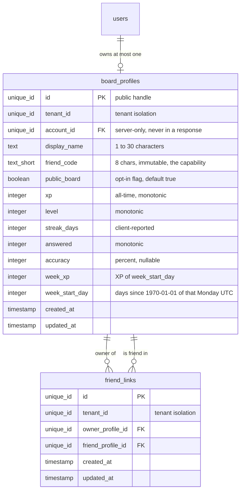
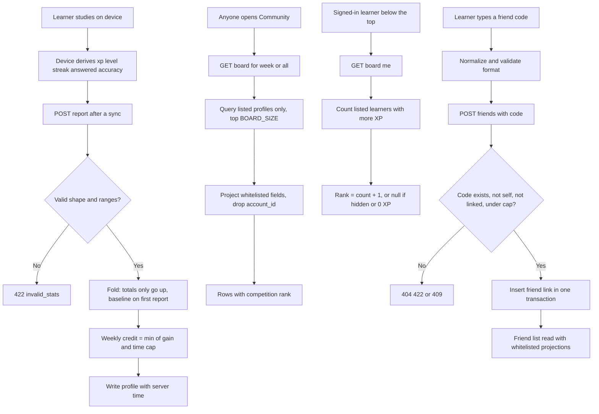
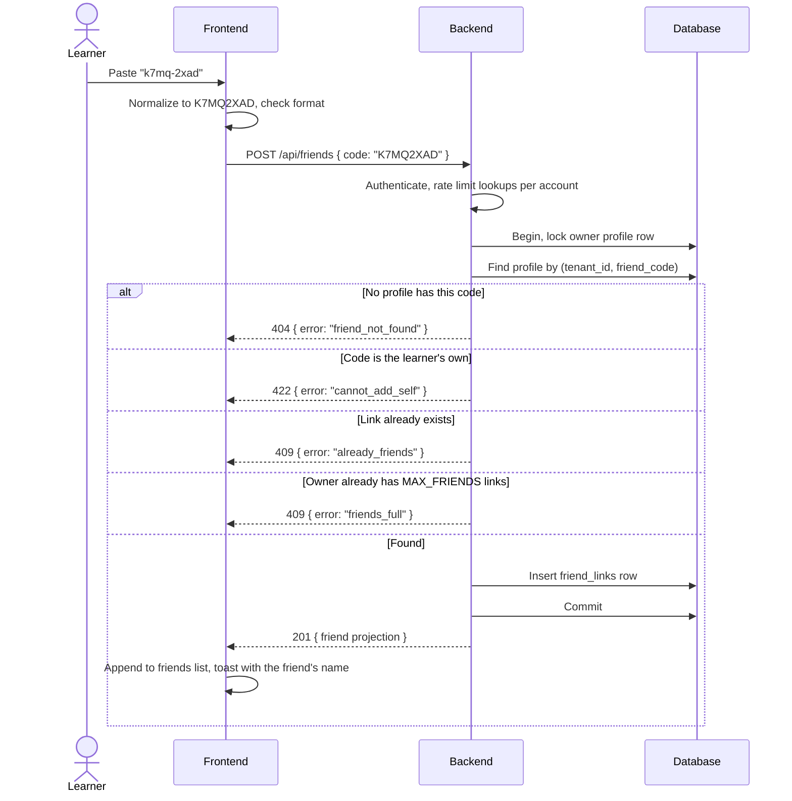
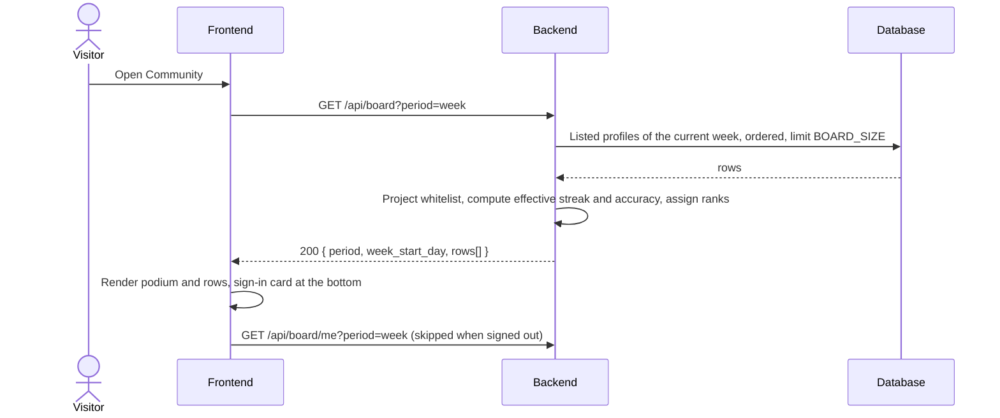

# Friends & Leaderboard

## 1. Overview

### Problem Statement

A learning or game app gets stickier when learners can see each other's progress. Two social surfaces cover most of the value: a **weekly and all-time leaderboard** that anyone can read, and a **small private circle of friends** added by a short shareable code. Both need the same careful treatment of personal data: a learner's name and numbers become visible to strangers, so visibility must be **opt-in-able, minimal, and enforced by the read path itself** rather than by the UI.

A second problem is trust. The progress numbers (XP, streak, answers) are computed on the learner's device, so the server cannot recompute them. The block therefore bounds what a report can change (monotonic totals, a weekly credit rate) and is explicit about what those bounds do **not** stop.

### User Stories

- **Learner**: I want to see the top learners this week and of all time so I can measure myself against others
- **Learner**: I want to see my own place even when I am far below the top
- **Learner**: I want to decide whether I appear on the public board, and know exactly what a stranger can see before I agree
- **Learner**: I want to add a friend by typing a short code, without the friend having to approve, and then compare this week's XP with my friends
- **Learner**: I want my code to be easy to read aloud (no `0/O`, `1/I/L`) and to paste with spaces or dashes
- **Operator**: I want the weekly board to reset itself every Monday (UTC) with no cron job
- **Operator**: I want a hand-made API call unable to lower anyone's totals or add more than a bounded amount to the weekly board (bounded, not prevented: see `security.md` T-1)

### When to use this block

- User mentions: "leaderboard", "ranking", "friends", "friend code", "weekly XP", "compete", "community tab", "opt-in public profile"
- The app already has accounts (`auth.google-login`, or `auth.sign-in-with-apple`) and numeric progress to rank (see `data.progress-sync` for where the numbers come from)
- Reading the board should work **without signing in**; adding friends and appearing on the board need an account

### When NOT to use

- Rankings that decide prizes, money or access: progress here is **client-reported** (see section 8 and `security.md` "What the bounds do not stop"). Use server-authoritative scoring instead; this block is the wrong tool
- Mutual friendship with requests and approvals, chat, or feeds: friends here are **one-way links** and carry no messages
- Per-item social content (reviews, comments) → block: `ugc.product-reviews`
- Storing or showing learners' individual answers: this block never touches them (invariant I-5 in `security.md`)

### Identity precondition

This block keys its rows on an authenticated user (`user_id`). `auth.google-login` is the reference implementation (a `users` row plus `sessions`), which is why it is listed as a prerequisite. The precondition is satisfied by **any existing authenticated-user model** in the project: managed auth (Firebase Authentication, Supabase, Auth0 and similar), another login block, or an existing users and sessions table. The origin app for this block used a managed provider and had no `users` or `sessions` tables of its own.

If the project already has login, do **not** implement `auth.google-login`. Map `user_id` here to the project's existing user id (same physical type) and keep every other column of this block unchanged. Never create a second login or a second user table for the same people.

For this block specifically: `board_profiles` and `friend_links` reference the project's user id; only the whitelisted profile fields in this block are ever read by other users, whatever the identity system stores about the person.

---

## 2. Data Model

> Types below are **logical types** (canonical mapping in `docs/SPEC_GUIDELINES.md` section 5). Dialect-specific SQL is in [Reference Migration](#reference-migration-postgres) at the end of this section.
>
> **Translation note.** The implementation this block was extracted from stores documents in Firestore and enforces access with Firestore security rules. NoSQL is a non-goal of this repo, so the rules are **translated into explicit authorization invariants** (`security.md`, I-1..I-10) and into the queries and server-side checks in `backend.md`. Where the translation changes behavior it is listed in section 8, "Differences from the shipped implementation".



### Table: `board_profiles`

One row per account: the public profile, the leaderboard row and the friend-code owner in one place (one row per learner keeps the read path a single indexed scan).

| Column | Logical Type | Constraints | Notes |
|--------|------|-------------|-------|
| `id` | `unique_id` | PK | Public handle used in every response and in `friend_links`. Not the account id |
| `tenant_id` | `unique_id` | NOT NULL, indexed | Tenant isolation. Single-app deployments use one constant value |
| `account_id` | `unique_id` | NOT NULL, UNIQUE per tenant, FK → `users.id`, ON DELETE CASCADE | **Server-only**; never serialized into any response |
| `display_name` | `text` | NOT NULL, 1 to `MAX_DISPLAY_NAME` characters | Set from the sign-in identity, whitespace collapsed, truncated; fallback `Learner` |
| `friend_code` | `text_short` | NOT NULL, UNIQUE per tenant, exactly `FRIEND_CODE_LENGTH` characters from `FRIEND_CODE_ALPHABET` | **Immutable after insert.** The capability to find this profile |
| `public_board` | `boolean` | NOT NULL, default `true` | `true` = may appear in board queries. Does **not** govern friend-code lookups (I-3) |
| `xp` | `integer` | NOT NULL, default `0`, `0 ≤ xp ≤ MAX_XP` | All-time total; never decreases except through the reset action |
| `level` | `integer` | NOT NULL, default `1`, `1 ≤ level ≤ MAX_LEVEL` | Never decreases except through reset |
| `streak_days` | `integer` | NOT NULL, default `0`, `0 ≤ n ≤ MAX_STREAK_DAYS` | Follows the latest report (may go down) |
| `answered` | `integer` | NOT NULL, default `0`, `0 ≤ n ≤ MAX_ANSWERED` | Number of answered questions; never decreases except through reset |
| `accuracy` | `integer` | nullable, `0 ≤ n ≤ 100` | Whole percent of correct answers. Shown only when `answered ≥ MIN_ANSWERED_FOR_ACCURACY`; never used for ranking |
| `week_xp` | `integer` | NOT NULL, default `0`, `0 ≤ n ≤ MAX_XP` | XP credited in the week `week_start_day`; meaningless once that week is over |
| `week_start_day` | `integer` | NOT NULL | Days since 1970-01-01 (UTC) of the Monday that starts the week of the last write. See "Week rule" |
| `created_at` | `timestamp` | NOT NULL, default = now | UTC instant, immutable |
| `updated_at` | `timestamp` | NOT NULL, default = now | **Server time** of the last write. Every write carries the full stat set, so this is also "last reported at" |

**Indexes** (both partial on `public_board = true`, matching the two board queries):
- UNIQUE `(tenant_id, account_id)`; UNIQUE `(tenant_id, friend_code)`
- `(tenant_id, week_start_day, week_xp DESC)` for the weekly board
- `(tenant_id, xp DESC)` for the all-time board

### Table: `friend_links`

One-way: a row means "owner follows friend". The friend is not asked and learns nothing.

| Column | Logical Type | Constraints | Notes |
|--------|------|-------------|-------|
| `id` | `unique_id` | PK | |
| `tenant_id` | `unique_id` | NOT NULL | Tenant isolation; must equal both profiles' `tenant_id` |
| `owner_profile_id` | `unique_id` | NOT NULL, FK → `board_profiles.id`, ON DELETE CASCADE | The learner who added |
| `friend_profile_id` | `unique_id` | NOT NULL, FK → `board_profiles.id`, ON DELETE CASCADE | The learner who was added |
| `created_at` | `timestamp` | NOT NULL, default = now | UTC instant |
| `updated_at` | `timestamp` | NOT NULL, default = now | UTC instant |

**UNIQUE**: `(tenant_id, owner_profile_id, friend_profile_id)`. **CHECK**: `owner_profile_id <> friend_profile_id` (no self-link, enforced in the database, not only in the client).
**Limit**: at most `MAX_FRIENDS` rows per owner, enforced inside the insert transaction (see `backend.md` "Add friend").

### Friend code rule (the capability)

- Alphabet `FRIEND_CODE_ALPHABET` = `ABCDEFGHJKMNPQRSTVWXYZ23456789` (30 symbols: no `0 O 1 I L`, and also no `U`), length 8 → 30^8 = 656,100,000,000 codes
- Input normalization before lookup: remove all whitespace and `-`, upper-case; the result must match `^[ABCDEFGHJKMNPQRSTVWXYZ23456789]{8}$` or the lookup is rejected as `invalid_friend_code` without touching the database
- Generation: uniformly random symbols from a CSPRNG; on UNIQUE violation draw again, at most `FRIEND_CODE_ATTEMPTS` times, then fail with `no_free_friend_code`
- Uniqueness is the database UNIQUE index (the Firestore original used a separate registry document per code; here that registry is the index on `board_profiles.friend_code`)
- The code is never changed and never re-drawn for an existing profile

### Derived values (computed on read, never stored)

These four rules are the shared definition used by the board, the friends list and the tests. Compute them on the **server**; clients receive the effective values.

**Week rule.** `d = floor(epoch_ms / 86400000)` (UTC day number). `week_start(d) = d - ((d + 3) mod 7)`. 1970-01-01 was a Thursday, so the Monday offset is 3. Vector: 2026-10-21 (a Wednesday) → `d = 20747` → `week_start = 20745` (Monday 2026-10-19). A row belongs to the current week iff `week_start_day = week_start(today)`.

**Effective period XP.** `week`: `week_xp` if the row is in the current week, else `0`. `all`: `xp`.

**Effective streak.** `streak_days` if `updated_at ≥` start of yesterday (UTC), else `0`. A streak can only be alive if the account reported since yesterday began; the stored number is from its last report.

**Effective accuracy.** `accuracy` if `answered ≥ MIN_ANSWERED_FOR_ACCURACY` (10), else `null`. One correct answer out of one is 100% and says nothing.

### Ranking rule

- **Listed** = `public_board = true` AND effective period XP `> 0`
- **Order** = effective period XP descending, then effective streak descending, then `display_name` ascending (case-insensitive, Unicode-aware collation), then `id` ascending (stable pages)
- **Rank** = `1 +` (number of listed learners with **strictly more** effective period XP). Equal XP shares a rank (1, 1, 3, 4)
- **Accuracy never ranks.** It is displayed, not sorted on
- **Friends ranking** = the viewer plus their friends, ranked on `week` with the same order and rank rule, regardless of `public_board`
- **Gap to next** = for the viewer's row in a friends ranking, `(XP of the nearest row above with strictly more XP) - (viewer XP) + 1`, or none when nobody is above

### Reference Migration (Postgres)

#### `board_profiles` table

<!-- REFERENCE: dialect=postgres -->
<!-- ADAPT: MySQL/SQLite per docs/SPEC_GUIDELINES.md section 5:
       - `text PRIMARY KEY DEFAULT gen_random_uuid()::text` → MySQL `CHAR(36)` + UUID() default; SQLite `TEXT PRIMARY KEY` with uuid4 generated in the app
       - `timestamptz` → MySQL `DATETIME(6)`; SQLite `TEXT` ISO 8601 with `Z`
       - `boolean` → MySQL `TINYINT(1)`; SQLite `INTEGER 0/1`
       - `bigint` → MySQL `BIGINT`; SQLite `INTEGER`
       - `friend_code ~ '^[...]{8}$'` regex CHECK → MySQL 8.0.16+ `REGEXP_LIKE` in CHECK; SQLite has no regex by default, validate in the app (the normalization step already does)
       - Partial indexes `WHERE public_board AND ...` → SQLite supports; MySQL has none, use full indexes and keep the predicate in the query -->

```sql
CREATE TABLE IF NOT EXISTS board_profiles (
  id             text PRIMARY KEY DEFAULT gen_random_uuid()::text,
  tenant_id      text NOT NULL,
  account_id     text NOT NULL REFERENCES users(id) ON DELETE CASCADE,
  display_name   text NOT NULL CHECK (char_length(display_name) BETWEEN 1 AND 30),
  friend_code    varchar(8) NOT NULL
                 CHECK (friend_code ~ '^[ABCDEFGHJKMNPQRSTVWXYZ23456789]{8}$'),
  public_board   boolean NOT NULL DEFAULT true,
  xp             bigint NOT NULL DEFAULT 0 CHECK (xp BETWEEN 0 AND 1000000),
  level          bigint NOT NULL DEFAULT 1 CHECK (level BETWEEN 1 AND 100),
  streak_days    bigint NOT NULL DEFAULT 0 CHECK (streak_days BETWEEN 0 AND 3650),
  answered       bigint NOT NULL DEFAULT 0 CHECK (answered BETWEEN 0 AND 1000000),
  accuracy       bigint CHECK (accuracy BETWEEN 0 AND 100),
  week_xp        bigint NOT NULL DEFAULT 0 CHECK (week_xp BETWEEN 0 AND 1000000),
  week_start_day bigint NOT NULL,
  created_at     timestamptz NOT NULL DEFAULT now(),
  updated_at     timestamptz NOT NULL DEFAULT now()
);
CREATE UNIQUE INDEX idx_bp_account ON board_profiles(tenant_id, account_id);
CREATE UNIQUE INDEX idx_bp_code ON board_profiles(tenant_id, friend_code);
CREATE INDEX idx_bp_week ON board_profiles(tenant_id, week_start_day, week_xp DESC)
  WHERE public_board AND week_xp > 0;
CREATE INDEX idx_bp_all ON board_profiles(tenant_id, xp DESC)
  WHERE public_board AND xp > 0;
```

#### `friend_links` table

<!-- REFERENCE: dialect=postgres -->
<!-- ADAPT: same type mapping as `board_profiles`; the `CHECK (owner_profile_id <> friend_profile_id)` is portable SQL and must stay in every dialect -->

```sql
CREATE TABLE IF NOT EXISTS friend_links (
  id                text PRIMARY KEY DEFAULT gen_random_uuid()::text,
  tenant_id         text NOT NULL,
  owner_profile_id  text NOT NULL REFERENCES board_profiles(id) ON DELETE CASCADE,
  friend_profile_id text NOT NULL REFERENCES board_profiles(id) ON DELETE CASCADE,
  created_at        timestamptz NOT NULL DEFAULT now(),
  updated_at        timestamptz NOT NULL DEFAULT now(),
  CHECK (owner_profile_id <> friend_profile_id)
);
CREATE UNIQUE INDEX idx_fl_pair
  ON friend_links(tenant_id, owner_profile_id, friend_profile_id);
CREATE INDEX idx_fl_friend ON friend_links(friend_profile_id);
```

---

## 3. Data Flow



---

## 4. Sequence Diagrams

### Report progress (happy path and capped credit)

```mermaid
sequenceDiagram
    actor L as Learner device
    participant B as Backend
    participant DB as Database

    L->>B: POST /api/board/me/report { xp, level, streak_days, answered, accuracy }
    B->>B: Authenticate, resolve profile from session (never from body)
    B->>B: Validate integer ranges
    alt Out of range or not an integer
        B-->>L: 422 { error: "invalid_stats" }
    else Valid
        B->>DB: Begin, lock own profile row
        DB-->>B: stored profile
        B->>B: xp = max(stored, reported); same for level and answered
        B->>B: week = week_start(now); base = week_xp if same week else 0
        alt Stored xp = 0 and answered = 0 (first report)
            B->>B: credit = 0 (history before signing in is not a week's work)
        else Normal report
            B->>B: credit = min(xp gain, BURST_XP + floor(hours since updated_at * XP_PER_HOUR))
        end
        B->>DB: Update stats, week_xp = base + credit, week_start_day = week, updated_at = now
        B->>DB: Commit
        B-->>L: 200 { own profile with effective values }
    end
```

A jump larger than the cap still raises the all-time `xp` but credits only the capped amount to `week_xp`. No error is returned.

### Add a friend by code (happy path and error cases)



### Read the board without signing in



---

## 5. State Management

| State | Storage | Survives Reload | Notes |
|-------|---------|-----------------|-------|
| `period` | In-memory | No | `week` (default) or `all` |
| `leaders` | In-memory, per period | No | Top `BOARD_SIZE` rows from the server |
| `ahead` / `myRank` | In-memory, per period | No | Rank below the top from `GET /api/board/me`; `null` while unknown |
| `friends` | In-memory | No | Friend projections; ranked together with the viewer on `week` |
| `loadedAt`, `failed` | In-memory | No | Reuse a load younger than `BOARD_REFRESH_SECONDS`; on failure keep what was shown and set `failed` |
| `publicBoard` | Server (`board_profiles.public_board`) | Yes | Toggle in the leaderboard card |
| `epoch` | In-memory | No | Bumps on account change so a late answer for the previous account is dropped |

### State transitions

```
Open Community → refresh (skip if loaded < BOARD_REFRESH_SECONDS ago and not forced)
  ├── all parts ok → loadedAt = now, failed = false
  └── any part fails → keep previous rows, failed = true, show "could not refresh" + retry

Toggle public_board → report current stats together with the new flag → refresh(force)
  ├── ok → card state text flips, own row appears or disappears
  └── error → previous state stays, error toast

Add friend → idle → submitting → ok (list grows) | error (bad code, self, not found, already, full, network, server)

Account changes (sign-in, sign-out, switch) → epoch++ → clear friends, leaders, ahead, loadedAt
```

---

## 6. Integration Points

### Inbound

| Caller | How | Purpose |
|--------|-----|---------|
| Community screen (anyone) | GET /api/board | Read the leaderboard, no session needed |
| Signed-in app | GET/POST/PATCH /api/board/me..., /api/friends | Own standing, report progress, opt-in flag, friends |
| `data.progress-sync` | Sync completion triggers one report call | The numbers that get reported; the study snapshot itself stays owner-only and is never part of this block |

### Outbound

| Target | How | Purpose |
|--------|-----|---------|
| Database | SQL | Profiles, friend links, board queries |
| `users` (from `auth.google-login`) | FK `account_id` | Cascade delete when the account is deleted |

### Events

| Event | Payload | When |
|-------|---------|------|
| `board.profile_created` | `{ profileId, tenantId }` | First sign-in creates the profile |
| `board.visibility_changed` | `{ profileId, publicBoard }` | Opt-in flag toggled |
| `friend.added` | `{ ownerProfileId, friendProfileId }` | Friend link created |
| `friend.removed` | `{ ownerProfileId, friendProfileId }` | Friend link deleted |

### Shared with other blocks

- **Account deletion** (`compliance.account-deletion`): deleting the account must delete its `board_profiles` row; `ON DELETE CASCADE` removes the learner from boards, removes all links in both directions, and frees the friend code. Verify with the checklist item in `acceptance.md`
- **Sign-in providers** (`auth.google-login`, `auth.sign-in-with-apple`): supply the display name used at profile creation. Apple may return no name; the fallback `Learner` applies
- **Share cards**: if the app renders a rank or progress card, it reads the same effective values from this block's API and must hide the name when the learner chose not to show it (a UI choice, not a data rule)

---

## 7. Configuration Surface

| Key | Type | Default | Description |
|-----|------|---------|-------------|
| `BOARD_SIZE` | `number` | `50` | Rows per board query |
| `MAX_FRIENDS` | `number` | `50` | Links one learner can hold |
| `PUBLIC_BOARD_DEFAULT` | `boolean` | `true` | Value of `public_board` on a new profile. The learner is told at sign-in, see privacy copy in `frontend.md` |
| `MIN_ANSWERED_FOR_ACCURACY` | `number` | `10` | Answers needed before accuracy is exposed |
| `MAX_DISPLAY_NAME` | `number` | `30` | Display name length cap |
| `FRIEND_CODE_LENGTH` | `number` | `8` | Characters per code |
| `FRIEND_CODE_ALPHABET` | `string` | `ABCDEFGHJKMNPQRSTVWXYZ23456789` | Allowed symbols |
| `FRIEND_CODE_ATTEMPTS` | `number` | `5` | Draws before `no_free_friend_code` |
| `BURST_XP` | `number` | `500` | Weekly credit allowed per report regardless of elapsed time |
| `XP_PER_HOUR` | `number` | `2000` | Extra weekly credit per hour since the previous write |
| `MAX_XP` / `MAX_ANSWERED` | `number` | `1000000` | Upper bound of all-time XP, answered count, weekly XP |
| `MAX_LEVEL` | `number` | `100` | Upper bound of level |
| `MAX_STREAK_DAYS` | `number` | `3650` | Upper bound of streak |
| `BOARD_REFRESH_SECONDS` | `number` | `30` | Client reuses a load younger than this |
| `REPORT_MIN_INTERVAL_SECONDS` | `number` | `0` (disabled) | **Extrapolated, not in the shipped system.** Minimum gap between two accepted reports; a nonzero value closes the "many small reports" gap described in `security.md` |
| `FRIEND_LOOKUP_RATE_LIMIT` | `number` | `60` | **Extrapolated, not in the shipped system.** Friend-code lookups per account per hour (slows code guessing) |

---

## 8. Origin and verification status

**Origin.** Extracted from the Community tab of the origin app (Vue + Capacitor, Firebase Auth + Firestore). Source of truth for the numbers and rules used here:
- Pure logic: `app/src/lib/community.ts` (friend-code parsing, ranking, gap, accuracy and streak display rules) and `app/src/lib/progress.ts:1-52` (constants, week rule, `nextStats`)
- Design contract: `app/src/CONTRACT.md` sections "Leaderboard numbers" and "Community"
- Access rules: `firebase/firestore.rules` (profile shape and bounds `:34-67`, growth and weekly credit `:69-90`, reads `:96-106`, friend registry `:160-173`, friend list `:143-157`) and 102 rule tests in `firebase/test/rules.test.ts`

**Verification status.**
- Rules and queries: **verified on the Firebase emulator only** (102 rules tests, plus a Playwright run of Friends and Community with 55 seeded learners). Two live checks exist: anonymous read/write of `users` is refused, and the public leaderboard queries work without sign-in while an unfiltered list is refused.
- A **full live Google sign-in and sync on web was not confirmed** by an agent in the recorded history; only that real accounts exist on the board.
- **This SQL block has never been implemented or run.** It is a translation of a Firestore implementation. Every statement in sections 2 to 7 that goes beyond the shipped behavior is listed below as a difference; treat those as design proposals until a SQL implementation passes `acceptance.md`.

**Differences from the shipped implementation (all extrapolated, not verified):**

| # | Shipped (Firestore) | This block (SQL) | Why |
|---|---|---|---|
| D1 | Separate `friendCodes/{code}` registry document | UNIQUE index on `board_profiles.friend_code` | A UNIQUE index gives the same first-come-first-served guarantee with one fewer table |
| D2 | `get` of any `users/{uid}` needs only a sign-in; the uid is the key | Non-listed profiles are readable only through a code lookup or an existing friend link (I-3, I-4); `account_id` is never exposed, a separate `id` is | The server can enforce what rules could only approximate; removes the uid as a second capability |
| D3 | Client computes effective week XP, streak and accuracy from stored fields | Server returns effective values; accuracy is `null` below the threshold in the API | A threshold that exists for privacy must hold at the read path, not only in the UI |
| D4 | Client computes `nextStats`; rules reject out-of-range writes | Server computes the fold (`max`, credit cap) and rejects only malformed input | One trusted implementation; no client-clock skew allowance needed |
| D5 | Firestore orders by XP, client re-sorts the 50 fetched rows by streak and name | One ordered query with all tie-breakers before `LIMIT` | Which tied learner is cut off at rank 50 becomes deterministic |
| D6 | Friend list is one document of ids; dead ids remain after a friend deletes their account (inferred from `firebasePort.ts:325-329`, which skips missing profiles) | Rows with cascade delete | Dead links must not occupy slots |
| D7 | No limit on report frequency or friend-code lookups in the rules | Optional `REPORT_MIN_INTERVAL_SECONDS`, `FRIEND_LOOKUP_RATE_LIMIT` | Closes gaps named in `security.md` |
| D8 | No report or block for user-chosen names on a world-readable board | Listed as an open threat with a recommended mitigation (`security.md` T-6) | App-store user-generated-content rules may apply; the shipped app had no such mechanism |
| D9 | Reads return the whole stored document (12 keys, including `answered`, `publicBoard`, timestamps) | Explicit projection of 8 fields; `answered`, `public_board` and timestamps of other learners are not returned | Least exposure; the shipped whitelist (`firestore.rules:35-38`) only restricts what can be written |
